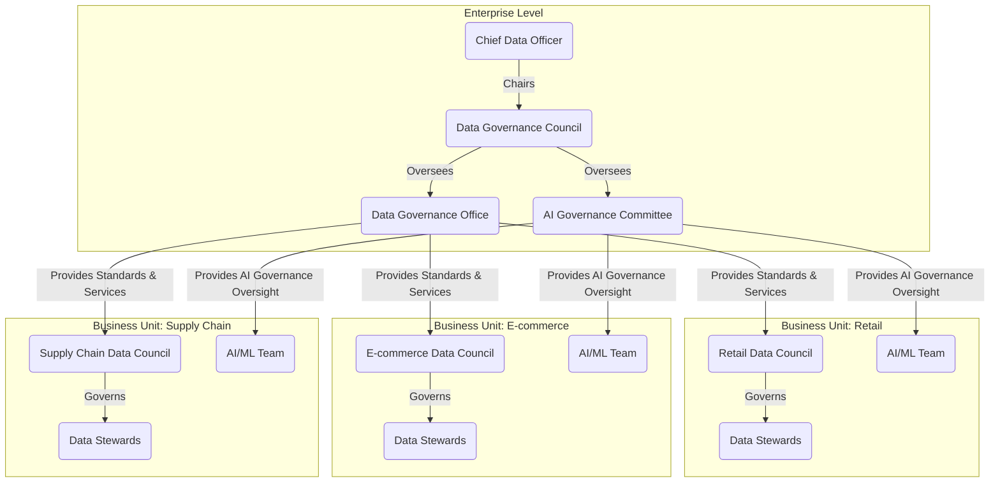

<!-- NAV-TOC -->
## Sections in This File

This file contains **13 sections**. Use `view_range` with the line numbers below to jump to a specific section.

| Line | Section |
|:---|:---|
| 24 | Data Governance Charter |
| 457 | Data Governance Framework |
| 842 | Data Policies |
| 1219 | Data Standards |
| 1569 | Roles and Responsibilities RASCI |
| 1847 | Business Glossary |
| 2141 | Business Rules |
| 2480 | Data Stewardship Plan |
| 2825 | Governance Metrics Report |
| 3221 | Issue Resolution Log |
| 3613 | Change Request Log |
| 3895 | Data Governance Operating Model |
| 4294 | Communication and Training Plan |

## Sections in This File

This file contains **13 sections**. Use `view_range` with the line numbers below to jump to a specific section.

| Line | Section |
|:---|:---|
| 1 | Data Governance Charter |
| 434 | Data Governance Framework |
| 819 | Data Policies |
| 1196 | Data Standards |
| 1546 | Roles and Responsibilities RASCI |
| 1824 | Business Glossary |
| 2105 | Business Rules |
| 2444 | Data Stewardship Plan |
| 2789 | Governance Metrics Report |
| 3185 | Issue Resolution Log |
| 3577 | Change Request Log |
| 3859 | Data Governance Operating Model |
| 4258 | Communication and Training Plan |

---

# Data Governance Charter


## Table of Contents

- [1. Overview](#1-overview)
  - [1.1. Definition and Purpose](#11-definition-and-purpose)
  - [1.2. Scope](#12-scope)
  - [1.3. Related Knowledge Areas](#13-related-knowledge-areas)
- [2. RASCI Assignment](#2-rasci-assignment)
  - [2.1. Output-Level RASCI](#21-output-level-rasci)
  - [2.2. Section-Level RASCI](#22-section-level-rasci)
- [3. Template](#3-template)
  - [3.1. Document Header](#31-document-header)
  - [3.2. Executive Sponsorship Statement](#32-executive-sponsorship-statement)
  - [3.3. Vision and Mission](#33-vision-and-mission)
  - [3.4. Scope](#34-scope)
  - [3.5. Authority and Decision Rights](#35-authority-and-decision-rights)
  - [3.6. Governance Structure](#36-governance-structure)
  - [3.7. Goals and Objectives](#37-goals-and-objectives)
  - [3.8. Success Metrics and KPIs](#38-success-metrics-and-kpis)
  - [3.9. Funding and Resources](#39-funding-and-resources)
  - [3.10. Amendment and Review Process](#310-amendment-and-review-process)
  - [3.11. Signatures](#311-signatures)
- [4. Example](#4-example)
  - [4.1. Document Header](#41-document-header)
  - [4.2. Executive Sponsorship Statement](#42-executive-sponsorship-statement)
  - [4.3. Vision and Mission](#43-vision-and-mission)
  - [4.4. Scope](#44-scope)
  - [4.5. Goals and Objectives](#45-goals-and-objectives)
- [5. Quality Criteria](#5-quality-criteria)
  - [5.1. Acceptance Criteria](#51-acceptance-criteria)
  - [5.2. Review Checklist](#52-review-checklist)
- [6. Related Outputs](#6-related-outputs)
  - [6.1. Inputs for This Output (Prerequisites)](#61-inputs-for-this-output-prerequisites)
  - [6.2. Outputs That Use This as Input](#62-outputs-that-use-this-as-input)
- [7. Tools and Automation](#7-tools-and-automation)
  - [7.1. Recommended Tools](#71-recommended-tools)
  - [7.2. Automation Opportunities](#72-automation-opportunities)
- [8. References](#8-references)

---

## 1. Overview

### 1.1. Definition and Purpose

The **Data Governance Charter** is the foundational document that formally establishes the data governance program within an organization. It serves as the authoritative mandate from executive leadership, defining the program's vision, mission, scope, authority, and organizational structure. Unlike a policy (which prescribes rules) or a framework (which describes components), the charter is a declaration of intent and empowerment. Its primary purpose is to secure executive sponsorship, define the governance body's authority, and communicate the strategic importance of data governance to all stakeholders.

In the evolving landscape of data management, the charter must also explicitly recognize emerging domains such as AI governance, data product management, and cloud-native architectures. It should reflect the organization's commitment to ethical data use, compliance with regulations like the EU AI Act alongside GDPR/HIPAA/CCPA, and the adoption of modern data paradigms such as Data Mesh and Data Fabric. This forward-looking approach ensures the charter remains relevant as the organization matures and adapts to technological and regulatory changes.

> The Data Governance Charter answers the fundamental question: *"Why does this program exist, who authorized it, and what power does it have?"* It also sets the tone for responsible data stewardship, including agentic stewardship models and integration with MLOps, DataOps, and FinOps practices.

### 1.2. Scope

**Global** — The Data Governance Charter applies organization-wide. It establishes the governance program that oversees all data assets, all business units, and all data-related activities across the enterprise. There is only one charter per organization.

The scope must explicitly include modern data domains and technologies such as AI models, data products, data contracts, and cloud-native platforms. It should clarify coverage of multi-cloud environments, lakehouse architectures, and hybrid data ecosystems. Additionally, the charter should delineate boundaries concerning third-party data, external AI services, and emerging agentic stewardship roles to prevent ambiguity.

### 1.3. Related Knowledge Areas

| Knowledge Area | Relationship |
| :--- | :--- |
| KA-02: Data Architecture | The charter authorizes the Data Architecture Review Board (DARB) and mandates alignment between business strategy and data architecture, including modern architectures like Data Mesh and Data Fabric. |
| KA-05: Data Security | The charter establishes the mandate for data protection, which is operationalized through security policies and standards, including AI governance and compliance with evolving regulations such as the EU AI Act. |
| KA-09: Metadata Management | Metadata strategy supports the charter's vision for data transparency, lineage, and governance, especially critical for AI model governance and data product management. |
| KA-11: Data Quality | The charter defines the organization's commitment to data quality, which is then measured and managed through the DQ framework, extending to data products and AI datasets. |
| KA-14: Data Management Maturity | Maturity assessment findings provide feedback that may trigger updates to the charter's goals and objectives, including readiness for AI governance and cloud-native data operations. |

---

## 2. RASCI Assignment

### 2.1. Output-Level RASCI

| Role Category | Assigned Role | Responsibility Description |
| :--- | :--- | :--- |
| **A (Accountable)** | Chief Data Officer (CDO) or Chief AI Officer (CAIO) | Ultimately answerable for the charter's creation, approval, and periodic review. The CDO/CAIO ensures the charter reflects the organization's strategic direction for data and AI governance. |
| **R (Responsible)** | Data Governance Manager (DG Mgr) | Drafts, updates, and manages the charter document. Coordinates input from all stakeholders, including AI governance leads and data product managers, ensuring the charter is comprehensive and actionable. |
| **S (Supportive)** | Data Governance Council (DGC), AI Ethics Committee | Reviews and endorses the charter. Provides strategic input on vision, mission, governance structure, and AI governance integration. |
| **C (Consulted)** | CIO, CISO, Legal, Compliance, MLOps Engineer | Consulted to ensure alignment with IT strategy, information security, regulatory compliance, and operational integration. |
| **I (Informed)** | All Data Management Office (DMO) Members, Data Product Managers, AI Governance Leads | Informed about the charter's contents and any updates, as it defines the authority under which they operate. |

### 2.2. Section-Level RASCI

| Charter Section | Primary Author (R) | Reviewer (C) | Approver (A) |
| :--- | :--- | :--- | :--- |
| Vision and Mission | DG Mgr | CDO, CAIO, DGC | CDO, CAIO |
| Scope and Authority | DG Mgr | CIO, CISO, Legal, AI Ethics Officer | CDO, CAIO |
| Governance Structure | DG Mgr | DGC, HR, AI Ethics Committee | CDO, CAIO |
| Goals and Objectives | DG Mgr | All KA Managers, AI Governance Leads | CDO, CAIO |
| Success Metrics | DG Analyst | DQ Mgr, Meta Mgr, AI Governance Analyst | DG Mgr |

---

## 3. Template

> *The following is the standardized template for creating a Data Governance Charter. Replace all placeholders `[...]` with organization-specific information. Each section includes inline guidance in blockquotes.*

### 3.1. Document Header

| Field | Value |
| :--- | :--- |
| Document Title | [Organization Name] Data Governance Charter |
| Document ID | CHR-GOV-001 |
| Version | [e.g., 1.0] |
| Effective Date | [YYYY-MM-DD] |
| Review Date | [YYYY-MM-DD, typically annual] |
| Sponsor | [Executive Sponsor Name and Title] |
| Owner | [CDO or CAIO Name] |
| Approver | [Board / Executive Committee / DGC] |

### 3.2. Executive Sponsorship Statement

> *This section contains a brief statement from the executive sponsor (CEO, COO, or equivalent) that formally authorizes the data governance program. It should be 2-3 paragraphs and convey the strategic importance of data governance. This statement gives the charter its authority.*

**Input needed**: Organization's strategic plan, CEO/COO vision statement, AI strategy documents.  
**Who fills this**: CDO drafts, Executive Sponsor reviews and signs.

[Insert Executive Sponsorship Statement]

### 3.3. Vision and Mission

> *The vision describes the desired future state of data management in the organization (aspirational, 3-5 year horizon). The mission describes the purpose and core function of the data governance program (operational, present tense).*

**Input needed**: Organization's strategic plan, industry benchmarks, AI governance frameworks.  
**Who fills this**: DG Mgr drafts, CDO, CAIO, and DGC review.

**Vision**: [e.g., "To be a data-driven organization where trusted, high-quality data and responsible AI empower every decision and innovation."]

**Mission**: [e.g., "To establish and sustain a data and AI governance program that ensures the quality, security, privacy, ethical use, and compliance of data and AI assets across the enterprise, enabling [Organization Name] to achieve its strategic objectives."]

### 3.4. Scope

> *Define the boundaries of the data governance program. Be explicit about what is included and what is excluded. This prevents scope creep and sets clear expectations.*

**Input needed**: Enterprise architecture documentation, list of business units, data inventory, AI asset inventory.  
**Who fills this**: DG Mgr drafts, CIO, CAIO, and business unit leaders review.

**In Scope**:
- **Organizational Units**: [e.g., All business units, subsidiaries, joint ventures, and AI centers of excellence]
- **Data Domains**: [e.g., Customer, Product, Financial, Employee, Supplier, AI Models, Data Products]
- **Data Types**: [e.g., Structured, semi-structured, unstructured data, AI training and inference datasets]
- **Systems**: [e.g., All production databases, data warehouses, data lakes, SaaS applications, AI platforms, MLOps pipelines]

**Out of Scope**:
- [e.g., Personal devices and data not stored on organizational systems]
- [e.g., Third-party data and AI services not under organizational control]

### 3.5. Authority and Decision Rights

> *This is one of the most critical sections. It defines the formal authority granted to the data governance program and its governing bodies. Without clear authority, governance becomes advisory and ineffective.*

**Input needed**: Organizational governance structure, existing decision-making frameworks, AI governance policies.  
**Who fills this**: DG Mgr and Legal draft, CDO, CAIO, and Executive Committee approve.

| Decision Area | Decision-Making Body | Authority Level |
| :--- | :--- | :--- |
| Data Policy Approval | Data Governance Council (DGC) | Final approval authority |
| Data Standard Approval | DGC or delegated KA Manager | Approval with escalation path |
| Data Issue Resolution | Data Steward (first level), DGC (escalation) | Resolution authority within defined SLAs |
| Data Architecture Decisions | Data Architecture Review Board (DARB) | Recommendation to DGC for approval |
| Data Access Decisions | Data Owner | Approval/denial within policy guidelines |
| AI Model Governance | AI Ethics Committee and CAIO Office | Final approval and oversight authority |
| Exception Requests | DGC | Final approval authority |

### 3.6. Governance Structure

> *Define the organizational structure of the data governance program, including all governing bodies, their composition, and their meeting cadence. Use a diagram if possible.*

**Input needed**: `reference/role-definitions.md`, organizational chart, AI governance charter.  
**Who fills this**: DG Mgr drafts, CDO, CAIO, and HR review.

#### 3.6.1. Governance Bodies

| Body | Composition | Meeting Cadence | Primary Function |
| :--- | :--- | :--- | :--- |
| Executive Steering Committee | C-Suite (CDO, CAIO, CIO, CISO, CFO) | Quarterly | Strategic direction, funding, and oversight including AI governance |
| Data Governance Council (DGC) | CDO (Chair), Data Owners, DG Mgr, AI Governance Leads | Monthly | Policy approval, issue escalation, AI governance integration |
| Data Stewardship Committee | DG Mgr (Chair), Data Stewards, Data Product Managers | Bi-weekly | Operational governance, data quality monitoring, stewardship of data products |
| Data Architecture Review Board | D-Arch (Chair), DW Arch, DFab Arch, Cloud Architects | Monthly | Architecture standards, reviews, including Data Mesh and Data Fabric oversight |
| AI Ethics Committee | CAIO (Chair), AI Ethics Officer, Legal, Compliance | Monthly | AI ethics, compliance, and governance oversight |

#### 3.6.2. Key Roles

> *List the key roles in the governance program with a brief description. Reference `reference/role-definitions.md` for full descriptions.*

| Role | Primary Responsibility |
| :--- | :--- |
| Chief Data Officer (CDO) | Overall accountability for data governance program, ensuring alignment with business strategy and regulatory compliance. |
| Chief AI Officer (CAIO) | Accountability for AI governance, ethical AI use, and integration of AI governance with data governance. |
| Data Governance Manager (DG Mgr) | Day-to-day management of the governance program, including coordination across data and AI domains. |
| Data Owner (D-Owner) | Accountability for data quality, security, and compliance within a domain or data product. |
| Data Steward (D-Steward) | Operational management of data assets, including data quality and lifecycle management. |
| Data Custodian (D-Custod) | Technical management and protection of data assets, including infrastructure and platform responsibilities. |
| AI Ethics Officer | Oversight of AI ethics policies, compliance with AI regulations, and risk management related to AI systems. |
| Data Product Manager | Ownership and lifecycle management of data products, ensuring they meet governance and quality standards. |
| MLOps Engineer | Responsible for operationalizing AI/ML models, ensuring governance controls are embedded in deployment pipelines. |

### 3.7. Goals and Objectives

> *Define SMART (Specific, Measurable, Achievable, Relevant, Time-bound) goals for the data governance program. Align these with the organization's strategic objectives.*

**Input needed**: Organization's strategic plan, current maturity assessment results (`KA-14`), AI governance maturity assessments.  
**Who fills this**: DG Mgr drafts, CDO, CAIO, and DGC review.

| # | Goal | Objective | Target | Timeline |
| :--- | :--- | :--- | :--- | :--- |
| 1 | Improve Data Quality | Increase DQ score for critical data elements | From 75% to 95% | 18 months |
| 2 | Enhance Data Security and Privacy | Reduce data security incidents and ensure compliance with GDPR, HIPAA, CCPA, and EU AI Act | 50% reduction in incidents | 12 months |
| 3 | Increase Data and AI Literacy | Train all employees on data governance and AI ethics basics | 100% completion | 24 months |
| 4 | Implement AI Governance Framework | Establish AI governance policies and oversight mechanisms | Framework approved and operational | 12 months |
| 5 | Reduce Data Silos | Integrate 80% of critical data sources and AI models into governed platforms | 80% integration | 18 months |

### 3.8. Success Metrics and KPIs

> *Define how the success of the data governance program will be measured. These metrics should directly support the goals defined in Section 3.7.*

**Input needed**: `reference/metrics-kpis.md`, `KA-11-data-quality-metrics.md`, AI governance metrics.  
**Who fills this**: DG Analyst drafts, DQ Mgr, Meta Mgr, and AI Governance Analyst review.

| Metric | Description | Target | Measurement Frequency | Data Source |
| :--- | :--- | :--- | :--- | :--- |
| Data Quality Index | Composite score across all critical data elements | > 90% | Monthly | DQ Tool |
| Policy Compliance Rate | % of data assets compliant with governance policies | > 95% | Quarterly | Audit Reports |
| Issue Resolution Time | Average time to resolve data governance issues | < 5 business days | Monthly | Issue Tracking System |
| AI Model Compliance | % of AI models reviewed and approved by AI Ethics Committee | 100% | Quarterly | AI Governance Platform |
| Data Literacy Completion | % of employees completing data and AI governance training | 100% | Annually | LMS Reports |

### 3.9. Funding and Resources

> *Outline the budget and resource allocation for the data governance program. This section is critical for securing ongoing executive support.*

**Input needed**: Finance department budget templates, HR headcount plans, AI governance resource plans.  
**Who fills this**: DG Mgr and Finance Business Partner draft, CDO, CAIO, and CFO approve.

| Resource Category | Description | Estimated Annual Cost |
| :--- | :--- | :--- |
| Personnel | [e.g., 7 FTEs: 1 DG Mgr, 2 DG Analysts, 2 Data Stewards, 1 AI Ethics Officer, 1 Data Product Manager] | [e.g., $1,050,000] |
| Technology | [e.g., Data governance platform license, DQ tools, AI governance tools] | [e.g., $350,000] |
| Training | [e.g., Data literacy and AI ethics program, certifications] | [e.g., $75,000] |
| External Consulting | [e.g., Initial assessment, AI governance framework design] | [e.g., $200,000] |
| **Total** | | **[e.g., $1,675,000]** |

### 3.10. Amendment and Review Process

> *Define how the charter will be reviewed and updated over time.*

**Input needed**: Existing document management procedures, AI governance policy review cycles.  
**Who fills this**: DG Mgr drafts, DGC and AI Ethics Committee approve.

- **Review Frequency**: Annually, or upon significant organizational or regulatory change.
- **Review Trigger Events**: Merger/acquisition, regulatory updates (e.g., EU AI Act), maturity assessment results, major AI program launches.
- **Amendment Process**: Proposed changes reviewed by DGC and AI Ethics Committee, approved by CDO and CAIO.
- **Version Control**: All versions maintained in document management system with detailed change log and audit trail.

### 3.11. Signatures

| Role | Name | Signature | Date |
| :--- | :--- | :--- | :--- |
| Executive Sponsor | [Name] | _____________ | [YYYY-MM-DD] |
| Chief Data Officer | [Name] | _____________ | [YYYY-MM-DD] |
| Chief AI Officer | [Name] | _____________ | [YYYY-MM-DD] |
| CIO | [Name] | _____________ | [YYYY-MM-DD] |
| CISO | [Name] | _____________ | [YYYY-MM-DD] |

---

## 4. Example

> *The following is a filled-in example for a fictional company, "GlobalRetail Inc."*

### 4.1. Document Header

| Field | Value |
| :--- | :--- |
| Document Title | GlobalRetail Inc. Data Governance Charter |
| Document ID | CHR-GOV-001 |
| Version | 2.0 |
| Effective Date | 2026-01-15 |
| Review Date | 2027-01-15 |
| Sponsor | Maria Santos, CEO |
| Owner | David Kim, Chief Data Officer |
| Approver | Executive Committee |

### 4.2. Executive Sponsorship Statement

Data is the lifeblood of GlobalRetail Inc. As we expand into new markets and channels, our ability to make informed decisions, personalize customer experiences, and optimize operations depends entirely on the quality, availability, and trustworthiness of our data. I am pleased to authorize the establishment of a formal Data Governance program, led by our Chief Data Officer, David Kim. This program has my full support and the support of the Executive Committee. I expect all business units and employees to actively participate in and support this initiative.

In parallel, as we increasingly leverage AI and machine learning to drive innovation, we recognize the critical importance of responsible AI governance. Our Chief AI Officer will lead efforts to ensure that AI systems are ethical, compliant, and aligned with our organizational values.

— Maria Santos, CEO, GlobalRetail Inc.

### 4.3. Vision and Mission

**Vision**: To be the most data-driven and ethically AI-enabled retailer in the Asia-Pacific region, where every decision is informed by trusted, high-quality data and responsible AI.

**Mission**: To establish and sustain a data and AI governance program that ensures the quality, security, privacy, ethical use, and compliance of data and AI assets across GlobalRetail Inc., enabling the company to deliver exceptional customer experiences and achieve sustainable growth.

### 4.4. Scope

**In Scope**:
- **Organizational Units**: All 12 business units across 5 countries, including e-commerce, brick-and-mortar, supply chain, and AI centers of excellence.
- **Data Domains**: Customer, Product, Sales, Inventory, Supplier, Employee, Financial, AI Models, Data Products.
- **Data Types**: All structured data in production databases, semi-structured data in data lakes, unstructured data in document management systems, and AI training/inference datasets.
- **Systems**: SAP ERP, Salesforce CRM, Snowflake Data Warehouse, Shopify E-commerce Platform, AI platforms (e.g., Databricks, MLflow), and 50+ ancillary systems.

**Out of Scope**:
- Personal devices and data not stored on GlobalRetail systems.
- Third-party marketplace data not directly ingested into GlobalRetail systems.
- External AI services not under direct organizational control.

### 4.5. Goals and Objectives

| # | Goal | Objective | Target | Timeline |
| :--- | :--- | :--- | :--- | :--- |
| 1 | Improve Customer Data Quality | Increase accuracy of customer master data | From 72% to 95% | 18 months |
| 2 | Enhance Data Security | Achieve ISO 27001 certification and reduce data breaches | Certification obtained; 50% reduction in incidents | 12 months |
| 3 | Increase Data and AI Literacy | Complete data governance and AI ethics training for all managers | 100% completion | 24 months |
| 4 | Reduce Data Silos | Integrate 80% of critical data sources and AI models into governed platforms | 80% integration | 18 months |
| 5 | Establish AI Governance Framework | Implement AI ethics policies and oversight mechanisms | Framework operational and enforced | 12 months |

---

### 4.4. Related Concepts and Guides

> The following resources provide additional context and guidance for this deliverable:

| Resource | Type | Path |
| :--- | :--- | :--- |
| Role Definitions | Reference | [reference/role-definitions.md](references/reference-materials.md) |
| Rasci Matrix | Reference | [reference/rasci-matrix.md](references/reference-materials.md) |
| AI Governance Framework | Guide | **guides/ai-governance/ai-governance-framework.md** |
| Data Mesh and Data Fabric Overview | Concept | [concepts/data-mesh-fabric.md](references/concepts-modern-paradigms.md) |

## 5. Quality Criteria

### 5.1. Acceptance Criteria

- [ ] The charter has been formally signed by the Executive Sponsor (CEO/COO), CDO, and CAIO.
- [ ] The charter defines a clear vision, mission, and scope for the data and AI governance program.
- [ ] The charter explicitly defines the authority and decision rights of the governance bodies, including AI governance.
- [ ] All governance bodies (DGC, Stewardship Committee, DARB, AI Ethics Committee) are defined with composition and cadence.
- [ ] All key roles referenced in the charter are defined in `reference/role-definitions.md`.
- [ ] Goals and objectives are SMART (Specific, Measurable, Achievable, Relevant, Time-bound).
- [ ] Success metrics are defined with targets, measurement frequency, and data sources, including AI governance metrics.
- [ ] Funding and resource requirements are specified and approved.
- [ ] A review and amendment process is defined, including triggers related to AI governance and regulatory changes.
- [ ] The charter has a defined review date (no more than 12 months from the effective date).

### 5.2. Review Checklist

| # | Review Question | Pass/Fail |
| :--- | :--- | :--- |
| 1 | Does the charter have explicit executive sponsorship, including AI governance leadership? | |
| 2 | Is the scope clearly defined with in-scope and out-of-scope items, including AI and modern architectures? | |
| 3 | Are decision rights unambiguous and assigned to specific bodies, including AI Ethics Committee? | |
| 4 | Are goals aligned with the organization's strategic plan and emerging AI governance needs? | |
| 5 | Are success metrics quantifiable and trackable, covering both data and AI governance? | |
| 6 | Is the governance structure realistic given the organization's size and maturity, including AI governance? | |
| 7 | Is the funding section realistic and approved by finance, covering data and AI governance resources? | |
| 8 | Is the language accessible to non-technical stakeholders and inclusive of AI governance concepts? | |

---

## 6. Related Outputs

### 6.1. Inputs for This Output (Prerequisites)

| Source Output | KA | Relationship | File Path |
| :--- | :--- | :--- | :--- |
| Maturity Assessment Report | KA-14 | Assessment findings inform the charter's goals and current state baseline. | `templates/templates-KA-14-data-management-maturity.md` |
| Improvement Roadmap | KA-14 | The roadmap's priorities help shape the charter's strategic initiatives. | `templates/templates-KA-14-data-management-maturity.md` |
| AI Governance Maturity Assessment | KA-XX | Provides insights into AI governance readiness and gaps to address in the charter. | `#` |

### 6.2. Outputs That Use This as Input

| Target Output | KA | Relationship | File Path |
| :--- | :--- | :--- | :--- |
| Data Governance Framework | KA-01 | The framework operationalizes the charter's vision and structure. | `02-governance-framework.md` |
| Data Policies | KA-01 | Policies are created under the authority established by the charter. | `03-data-policies.md` |
| Data Standards | KA-01 | Standards are created under the authority established by the charter. | `04-data-standards.md` |
| Roles and Responsibilities | KA-01 | The charter's governance structure is detailed in this output. | `05-roles-responsibilities.md` |
| Governance Operating Model | KA-01 | The operating model implements the governance structure defined in the charter. | `12-governance-operating-model.md` |
| Communication and Training Plan | KA-01 | Training plan is derived from the charter's goals and scope. | `13-communication-training-plan.md` |
| Data Security Policy | KA-05 | Security policy is authorized by the charter's mandate. | `templates/templates-KA-05-data-security.md` |
| Data Quality Strategy | KA-11 | DQ strategy aligns with the charter's data quality goals. | `templates/templates-KA-11-data-quality.md` |
| Metadata Strategy | KA-09 | Metadata strategy supports the charter's data management vision. | `templates/templates-KA-09-metadata-management.md` |
| AI Governance Framework | KA-XX | AI governance policies and procedures are developed under the charter's authority. | `#` |

---

## 7. Tools and Automation

### 7.1. Recommended Tools

| Tool Category | Commercial Examples | Open Source Examples |
| :--- | :--- | :--- |
| Document Management | Confluence, SharePoint, Google Docs | Wiki.js, BookStack |
| Governance Platforms | Collibra, Alation, Informatica Axon | Apache Atlas (partial), OpenMetadata (partial) |
| AI Governance Platforms | IBM Watson OpenScale, Fiddler AI, ModelOp | MLflow, TensorBoard (partial) |
| Collaboration | Microsoft Teams, Slack | Mattermost |
| Workflow Management | ServiceNow, Jira | Redmine |

### 7.2. Automation Opportunities

The Data Governance Charter is primarily a strategic document and is not heavily automated. However, the following aspects can be supported by automation:

- **Review Reminders**: Automated calendar notifications for the annual charter review cycle.
- **Version Control**: Use a document management system (e.g., Confluence, SharePoint) with built-in version history and approval workflows.
- **Metric Tracking**: The success metrics defined in the charter can be automatically tracked through dashboards connected to data quality, governance, and AI governance tools.
- **Distribution and Acknowledgment**: Automated distribution of the charter to all employees with tracking of read-receipts or acknowledgment signatures.
- **AI Model Monitoring**: Automated compliance checks and ethical risk assessments integrated into MLOps pipelines.
- **Data Contract Enforcement**: Automated validation of data contracts and SLAs within data mesh environments.

---

## 8. References

1. DAMA International. (2017). *DAMA-DMBOK: Data Management Body of Knowledge, 2nd Edition*. Chapter 3: Data Governance.
2. DAMA International. (Forthcoming 2025). *DAMA-DMBOK 3.0: Data Management Body of Knowledge, 3rd Edition* (Community-driven rebuild).
3. Seiner, R. S. (2014). *Non-Invasive Data Governance: The Path of Least Resistance and Greatest Success*. Technics Publications.
4. Internal Reference: `reference/role-definitions.md` — Full definitions of all 60+ data management roles.
5. Internal Reference: `reference/rasci-matrix.md` — Activity-level RASCI assignments for Data Governance.
6. Internal Reference: `guides/implementation/cross-knowledge-area-analysis.md` — Cross-KA dependency analysis.
7. Internal Reference: `reference/metrics-kpis.md` — Comprehensive list of data governance metrics and KPIs.
8. European Commission. (2023). *Proposal for a Regulation laying down harmonised rules on artificial intelligence (Artificial Intelligence Act)*.
9. Internal Reference: `guides/ai-governance/ai-governance-framework.md` — Guidance on establishing AI governance programs.
10. Internal Reference: `concepts/data-mesh-fabric.md` — Overview of modern data architectures: Data Mesh and Data Fabric.


---

# Data Governance Framework


## Table of Contents

- [1. Overview](#1-overview)
  - [1.1. Definition and Purpose](#11-definition-and-purpose)
  - [1.2. Scope](#12-scope)
  - [1.3. Related Knowledge Areas](#13-related-knowledge-areas)
- [2. RASCI Assignment](#2-rasci-assignment)
  - [2.1. Output-Level RASCI](#21-output-level-rasci)
  - [2.2. Section-Level RASCI](#22-section-level-rasci)
- [3. Template](#3-template)
  - [3.1. Document Header](#31-document-header)
  - [3.2. Framework Introduction](#32-framework-introduction)
  - [3.3. Core Governance Components](#33-core-governance-components)
  - [3.4. Governance Operating Model](#34-governance-operating-model)
  - [3.5. Key Processes and Workflows](#35-key-processes-and-workflows)
  - [3.6. Tools and Technology](#36-tools-and-technology)
  - [3.7. Framework Metrics and KPIs](#37-framework-metrics-and-kpis)
- [4. Example](#4-example)
  - [**3.2. Framework Introduction (Example)**](#32-framework-introduction-example)
  - [**3.3. Core Governance Components (Example)**](#33-core-governance-components-example)
  - [**3.4. Governance Operating Model (Example)**](#34-governance-operating-model-example)
  - [**3.5. Key Processes and Workflows (Example)**](#35-key-processes-and-workflows-example)
  - [**3.6. Tools and Technology (Example)**](#36-tools-and-technology-example)
- [5. Quality Criteria](#5-quality-criteria)
  - [5.1. Acceptance Criteria](#51-acceptance-criteria)
  - [5.2. Review Checklist](#52-review-checklist)
- [6. Related Outputs](#6-related-outputs)
  - [6.1. Prerequisites (Inputs)](#61-prerequisites-inputs)
  - [6.2. Consumers (Outputs)](#62-consumers-outputs)
- [7. Tools and Automation](#7-tools-and-automation)
  - [7.1. Recommended Tools](#71-recommended-tools)
  - [7.2. Automation Opportunities](#72-automation-opportunities)
- [8. References](#8-references)

---

## 1. Overview

### 1.1. Definition and Purpose

The **Data Governance Framework** is the structured blueprint that operationalizes the principles and authority outlined in the Data Governance Charter. It defines the essential components, processes, roles, and technologies required to manage and govern data as a strategic enterprise asset. While the charter provides the "why," the framework provides the "how." It is a comprehensive, practical guide that enables the consistent and effective execution of data governance activities across the organization.

This framework is evolving to incorporate emerging paradigms such as AI governance, data mesh and fabric architectures, and cloud-native operational models. It also anticipates compliance with upcoming regulations like the EU AI Act alongside established mandates such as GDPR, HIPAA, and CCPA.

> The Data Governance Framework answers the critical question: *"What are the specific structures, processes, and tools we will use to implement and enforce our data governance policies and standards?"*

It also serves as a foundation for integrating related disciplines such as MLOps, DataOps, and FinOps, and supports new roles including AI Ethics Officers and Data Product Managers, reflecting the increasing complexity and strategic importance of data governance in modern enterprises.

### 1.2. Scope

**Global** — The Data Governance Framework is a global artifact that applies to the entire organization. It provides the standardized, enterprise-wide structure for governance. While specific implementation details may vary by data product, domain, or business unit, they must all operate within the components and guidelines established by this single, overarching framework.

The framework is designed to be adaptable to modern data architectures, including multi-cloud environments, lakehouse platforms, and hybrid data mesh/fabric models, ensuring governance is embedded across distributed data ownership and technology landscapes.

### 1.3. Related Knowledge Areas

| Knowledge Area | Relationship |
| :--- | :--- |
| KA-02: Data Architecture | The framework provides the governance structure that oversees architectural decisions, ensuring they align with business strategy and data policies. It also supports modern architectural paradigms such as data mesh and data fabric. |
| KA-03: Data Modeling & Design | The framework mandates the use of modeling standards and provides the stewardship context for reviewing and approving data models, including those for AI and machine learning data assets. |
| KA-05: Data Security | The framework integrates data security as a core component, ensuring that security policies are embedded within all governance processes, including AI model governance and data privacy compliance. |
| KA-07: Data Privacy & Protection | The framework ensures compliance with privacy regulations such as GDPR, CCPA, HIPAA, and emerging AI-specific regulations like the EU AI Act. |
| KA-08: Data Integration & Interoperability | The framework governs data contracts and data products as first-class citizens, facilitating interoperability across data mesh and fabric environments. |
| KA-09: Document & Content Management | Governance of metadata, business glossaries, and documentation is embedded in the framework to ensure transparency and traceability. |
| KA-10: Data Warehousing & BI | The framework supports governance of data warehouses, lakehouses, and BI platforms, ensuring data quality and lineage. |
| KA-11: Data Quality | The framework establishes the roles (e.g., Data Stewards) and processes (e.g., issue resolution) necessary to execute the Data Quality Framework, including automated data quality monitoring integrated with DataOps pipelines. |
| KA-12: Metadata Management | The framework mandates metadata management as a foundational element, supporting data discovery, lineage, and governance automation. |
| KA-13: Data Lifecycle Management | The framework defines policies and processes for data retention, archival, and disposal, including AI model lifecycle governance. |

---

## 2. RASCI Assignment

### 2.1. Output-Level RASCI

| Role Category | Assigned Role | Responsibility Description |
| :--- | :--- | :--- |
| **A (Accountable)** | Chief Data Officer (CDO) | Ultimately accountable for the definition, implementation, and effectiveness of the enterprise Data Governance Framework, including alignment with strategic objectives and regulatory compliance. |
| **R (Responsible)** | Data Governance Manager (DG Mgr) | Responsible for designing, documenting, maintaining, and promoting the framework across the organization, ensuring it evolves with emerging data management trends and technologies. |
| **S (Supportive)** | Data Governance Council (DGC), Data Product Manager (DPM), AI Ethics Officer | The DGC provides strategic input and endorses the framework. DPMs support its implementation within their respective data product domains. The AI Ethics Officer supports integration of AI governance principles. |
| **C (Consulted)** | Data Owner (D-Owner), CISO, Legal/Compliance | Data Owners are consulted to ensure the framework is practical and addresses their domain-specific needs. The CISO is consulted for security alignment. Legal and Compliance teams ensure regulatory adherence, including AI and privacy laws. |
| **I (Informed)** | All DMO Members, Data Stewards, MLOps Engineers | All members of the Data Management Organization are informed of the framework as it defines their operational context for managing data. Data Stewards and MLOps Engineers receive updates relevant to their roles. |

### 2.2. Section-Level RASCI

| Framework Component | Primary Author (R) | Reviewer (C) | Approver (A) |
| :--- | :--- | :--- | :--- |
| Governance Components | DG Mgr | DGC, All KA Managers, AI Ethics Officer | CDO |
| Operating Model | DG Mgr | CDO, HR Business Partner, Legal/Compliance | CDO |
| Processes & Workflows | DG Analyst | Data Stewards, DPMs, MLOps Engineer | DG Mgr |
| Tools & Technology | DG Mgr | D-Arch, DSec Architect, Cloud Architect | CDO |
| Metrics & KPIs | DQ Analyst | DGC, Business Stakeholders, CAIO | DG Mgr |

---

## 3. Template

> *The following is the standardized template for a Data Governance Framework. This document outlines the core components of the governance program. Replace placeholders `[...]` with organization-specific details.*

### 3.1. Document Header

| Field | Value |
| :--- | :--- |
| Document Title | [Organization Name] Data Governance Framework |
| Document ID | FRM-GOV-002 |
| Version | [e.g., 1.0] |
| Effective Date | [YYYY-MM-DD] |
| Owner | [CDO Name] |

### 3.2. Framework Introduction

> *Provide a brief introduction explaining the purpose of the framework, its alignment with the Data Governance Charter, and the key business drivers it supports (e.g., regulatory compliance, improved decision-making, operational efficiency). Highlight the inclusion of AI governance, modern architectures, and regulatory compliance such as the EU AI Act.*

**Input needed**: Data Governance Charter, Corporate Strategic Plan, AI Governance Policy.  
**Who fills this**: DG Mgr.

[Insert Introduction Here]

### 3.3. Core Governance Components

> *This section details the structural pillars of your data governance program. Each component should be described in detail, incorporating modern concepts such as data contracts, data products, and agentic stewardship.*

**Input needed**: DAMA-DMBOK (including upcoming 3.0 insights), industry best practices, AI governance frameworks.  
**Who fills this**: DG Mgr, with input from KA Managers and AI Ethics Officer.

#### 3.3.1. Policies, Standards, and Rules
> *Describe the hierarchy of governing documents. Policies are high-level statements of intent. Standards provide mandatory controls. Rules are specific, executable instructions. Include AI governance policies and ethical guidelines.*

- **Data Policies**: [Link to `03-data-policies.md`]
- **Data Standards**: [Link to `04-data-standards.md`]
- **Business Rules**: [Link to `07-business-rules.md`]
- **AI Governance Policies**: [Link to `templates/templates-KA-01-data-governance.md` (suggested new deliverable)]

#### 3.3.2. Data Governance Organization (Roles & Responsibilities)
> *Describe the people and bodies that execute governance. Reference the detailed Roles and Responsibilities document. Include emerging roles such as AI Ethics Officer, MLOps Engineer, Data Product Manager, and Chief AI Officer (CAIO).*

- **Governing Bodies**: [e.g., Data Governance Council, Data Stewardship Committee, AI Governance Board]
- **Key Roles**: [e.g., CDO, Data Owner, Data Steward, Data Custodian, AI Ethics Officer, MLOps Engineer, Data Product Manager, CAIO]
- **Detailed RASCI**: [Link to `05-roles-responsibilities.md`]

#### 3.3.3. Data Domains
> *List the primary data domains that are the focus of governance (e.g., Customer, Product, Finance). Describe how they are defined and managed. Include data product boundaries and data contracts as governance units.*

| Data Domain | Description | Data Owner |
| :--- | :--- | :--- |
| [e.g., Customer] | [All data related to individual and organizational customers, including PII and AI-generated insights] | [e.g., Chief Marketing Officer] |
| [e.g., Product] | [All data related to products and services offered, including product data contracts] | [e.g., Chief Product Officer] |
| [e.g., AI Models] | [All AI/ML models, training data, and associated metadata governed under AI governance policies] | [e.g., Chief AI Officer] |

#### 3.3.4. Governance Processes
> *Outline the key repeatable processes that the governance program will manage. Provide a high-level description here and link to detailed process flows. Include AI model governance, data contract lifecycle, and agentic stewardship processes.*

- **Policy & Standard Management Process**
- **Issue Resolution Process**
- **Data Quality Monitoring & Remediation Process**
- **Metadata Management Process**
- **Data Access Request Process**
- **AI Model Governance Process**
- **Data Contract Lifecycle Management Process**
- **Agentic Data Stewardship Process**

### 3.4. Governance Operating Model

> *Describe how the governance organization will function. Choose and define the model that best fits the corporate culture (e.g., Centralized, Decentralized, Federated, Hybrid). Consider how the model supports modern data architectures like data mesh and fabric, and integration with AI governance.*

**Input needed**: Organizational structure, corporate culture assessment, technology landscape.  
**Who fills this**: DG Mgr, CDO, AI Ethics Officer.

**Selected Model**: [e.g., Federated Model]

**Rationale**: [e.g., Balances central control of enterprise standards with delegated, domain-level execution by business units, providing both consistency and agility. Supports distributed data ownership in a data mesh environment and embeds AI governance at multiple levels.]

**Diagram**: [Insert diagram illustrating the operating model, showing relationships between central and local teams, including AI governance bodies.]

### 3.5. Key Processes and Workflows

> *For each key process identified in 3.3.4, provide a more detailed description or a simplified workflow diagram (e.g., using mermaid syntax). Include AI governance workflows and data contract enforcement.*

#### 3.5.1. Data Issue Resolution Workflow
> *Describe the steps from identifying a data issue to its final resolution and communication.*

1.  **Issue Identification**: [Who can report issues and through what channel? e.g., employees, automated monitoring tools, AI model monitoring systems]
2.  **Triage & Logging**: [Who assesses the issue's priority and impact? e.g., Data Governance Office, AI Ethics Officer for AI-related issues]
3.  **Root Cause Analysis**: [Who is responsible for investigating the cause? e.g., Data Steward, MLOps Engineer]
4.  **Remediation**: [Who implements the fix? e.g., Data Custodian, Data Engineer, MLOps Engineer]
5.  **Validation & Closure**: [Who confirms the fix and closes the issue? e.g., Data Steward, AI Ethics Officer for AI issues]

#### 3.5.2. AI Model Governance Workflow
> *Outline the lifecycle steps for AI model governance, including development, validation, deployment, monitoring, and retirement.*

1.  **Model Development**: Data Scientists develop models following ethical guidelines.
2.  **Validation & Testing**: AI Ethics Officer and MLOps Engineer validate model fairness, accuracy, and compliance.
3.  **Approval & Deployment**: CAIO approves deployment; MLOps Engineer manages deployment pipelines.
4.  **Monitoring & Feedback**: Continuous monitoring for drift, bias, and performance.
5.  **Retirement & Archival**: Models are retired and archived according to governance policies.

### 3.6. Tools and Technology

> *Describe the technology ecosystem that supports the data governance program. List the key categories of tools and the specific products used. Include tools supporting AI governance, data mesh/fabric, and cloud-native environments.*

**Input needed**: `reference/tools-landscape.md`, IT architecture documentation, AI governance tool assessments.  
**Who fills this**: DG Mgr, D-Arch, AI Ethics Officer.

| Tool Category | Recommended Tool(s) | Purpose |
| :--- | :--- | :--- |
| Data Catalog & Metadata Mgmt | [e.g., Collibra, Alation, open-source Amundsen, DataHub] | Centralizing metadata, data lineage, business glossary, and supporting data contracts. |
| Data Quality Platform | [e.g., Informatica DQ, Talend DQ, Great Expectations] | Profiling, monitoring, and measuring data quality, integrated with DataOps pipelines. |
| Workflow & Collaboration | [e.g., Jira, ServiceNow, SharePoint] | Managing issue resolution, change requests, approvals, and AI governance workflows. |
| AI Governance & MLOps | [e.g., MLflow, Seldon, ModelOp Center] | Managing AI model lifecycle, monitoring, and compliance. |
| Cloud & Multi-Cloud Management | [e.g., AWS Lake Formation, Azure Purview, Google Cloud Data Catalog] | Supporting governance in cloud-native and multi-cloud environments. |

### 3.7. Framework Metrics and KPIs

> *Define the metrics that will be used to measure the performance and effectiveness of the governance framework itself. Include AI governance maturity and adoption of data contracts.*

**Input needed**: `reference/metrics-kpis.md`, Data Governance Charter, AI governance frameworks.  
**Who fills this**: DG Analyst, DG Mgr, AI Ethics Officer.

| KPI | Description | Target | Frequency |
| :--- | :--- | :--- | :--- |
| Framework Adoption Rate | % of data products with an assigned Data Steward and a completed Stewardship Plan. | >90% | Quarterly |
| Policy Compliance Score | % of audited systems and processes that are compliant with data policies. | >95% | Annually |
| Mean Time to Resolution (MTTR) | Average time taken to resolve critical data governance issues. | < 3 days | Monthly |
| Data Governance Maturity Score | Score from the Data Management Maturity Assessment for the Data Governance KA. | Increase by 1 level | Annually |
| AI Governance Maturity Score | Assessment of AI governance practices maturity, including ethical compliance and model monitoring. | Increase by 1 level | Annually |
| Data Contract Coverage | % of critical data products governed by formal data contracts. | >80% | Quarterly |

---

## 4. Example

> *This section provides a realistic, filled-in example of the Data Governance Framework for a fictional company, GlobalRetail Inc.*

### **3.2. Framework Introduction (Example)**

At GlobalRetail Inc., data is the lifeblood of our customer-centric strategy. The Data Governance Framework operationalizes the mandate from our Data Governance Charter, providing the practical structure to manage data as a critical asset. This framework is driven by the need to comply with GDPR and CCPA regulations, improve the accuracy of our demand forecasting analytics, and build a trusted data foundation for our new customer loyalty platform.

Recognizing the growing importance of AI, this framework incorporates AI governance policies aligned with the EU AI Act and emerging ethical standards. It also supports our transition to a hybrid data mesh architecture, enabling decentralized data ownership while maintaining enterprise-wide standards.

### **3.3. Core Governance Components (Example)**

#### **3.3.3. Data Domains (Example)**

| Data Domain | Description | Data Owner |
| :--- | :--- | :--- |
| Customer | All data related to individual shoppers, loyalty members, and B2B clients, including PII, transaction history, and engagement data. | VP of Marketing |
| Product | All data for our 50,000+ SKUs, including hierarchy, attributes, pricing, and supplier information. | VP of Merchandising |
| Supply Chain | Data related to inventory, logistics, warehousing, and supplier performance. | VP of Operations |
| AI Models | All AI/ML models used in demand forecasting, customer segmentation, and pricing optimization, including training data and model metadata. | Chief AI Officer |

### **3.4. Governance Operating Model (Example)**

**Selected Model**: Federated Model

**Rationale**: GlobalRetail Inc. operates in multiple regions with distinct regulatory environments. A federated model allows the central CDO office to set global policies (e.g., for data privacy) and standards (e.g., for product data), while empowering regional Data Stewardship Councils to manage implementation and address local needs. This balances enterprise consistency with business agility. The model also embeds AI governance at both central and domain levels to ensure ethical AI use.

### **3.5. Key Processes and Workflows (Example)**

#### **3.5.1. Data Issue Resolution Workflow (Example)**

1.  **Issue Identification**: Any employee can report a data issue via the #data-quality Slack channel or by creating a ticket in Jira. Automated alerts from data quality and AI monitoring tools also generate tickets.
2.  **Triage & Logging**: The Data Governance Office (DGO) triages new Jira tickets within 4 business hours, assigning a priority (P1-P4) and the relevant Data Steward or AI Ethics Officer.
3.  **Root Cause Analysis**: The assigned Data Steward or MLOps Engineer investigates the root cause within 2 business days for P1/P2 issues.
4.  **Remediation**: The Data Custodian or Data Engineer implements the technical fix based on the Steward's or AI Ethics Officer's recommendation.
5.  **Validation & Closure**: The Data Steward or AI Ethics Officer validates the fix in production and formally closes the Jira ticket, triggering an automated notification to the reporter.

#### **3.5.2. AI Model Governance Workflow (Example)**

1.  **Model Development**: Data Scientists develop models following ethical guidelines and documented standards.
2.  **Validation & Testing**: The AI Ethics Officer and MLOps Engineer validate model fairness, accuracy, and compliance with the EU AI Act.
3.  **Approval & Deployment**: The CAIO approves deployment; the MLOps Engineer manages deployment pipelines and monitors model performance.
4.  **Monitoring & Feedback**: Continuous monitoring for model drift, bias, and performance issues using automated tools.
5.  **Retirement & Archival**: Models are retired and archived according to governance policies, with documentation stored in the metadata catalog.

### **3.6. Tools and Technology (Example)**

| Tool Category | Recommended Tool(s) | Purpose |
| :--- | :--- | :--- |
| Data Catalog & Metadata Mgmt | Collibra | Serves as our single source of truth for business terms, data lineage, data contracts, and policy linkage. |
| Data Quality Platform | Great Expectations | Integrated into our data pipelines to automatically profile and validate critical data assets upon ingestion. |
| Workflow & Collaboration | Jira Service Desk | Manages all data governance-related requests, from issue tickets to data access requests. |
| AI Governance & MLOps | MLflow, Seldon | Manage AI model lifecycle, including tracking, deployment, and monitoring. |
| Cloud & Multi-Cloud Management | AWS Lake Formation, Azure Purview | Support governance in our multi-cloud data lake and lakehouse environments. |

---

### 4.4. Related Concepts and Guides

> The following resources provide additional context and guidance for this deliverable:

| Resource | Type | Path |
| :--- | :--- | :--- |
| Role Definitions | Reference | [role-definitions.md](references/reference-materials.md) |
| Rasci Matrix | Reference | [rasci-matrix.md](references/reference-materials.md) |
| AI Governance Concepts | Concepts | [concepts/ai-governance.md] (suggested new concept) |
| Data Mesh Concepts | Concepts | [concepts/data-mesh.md] |
| Data Contracts Guide | Guides | [guides/data-contracts.md] (suggested new guide) |

## 5. Quality Criteria

### 5.1. Acceptance Criteria

- [x] The framework clearly defines all core components (Policies, Roles, Processes, Technology), including AI governance and modern architectures.
- [x] An operating model (e.g., Federated) is explicitly chosen and justified, reflecting current organizational and technological realities.
- [x] At least three key governance processes are outlined with clear steps, including AI model governance and data contract management.
- [x] The technology stack for supporting governance is clearly identified, including AI governance and cloud-native tools.
- [x] Metrics for measuring the framework's success are defined and are SMART, including AI governance maturity and data contract coverage.
- [x] The document is aligned with and references the Data Governance Charter and relevant knowledge areas.
- [x] The framework is written in clear, accessible language for a broad audience and includes practical examples.
- [x] The framework addresses emerging roles and responsibilities, including AI Ethics Officer and MLOps Engineer.

### 5.2. Review Checklist

| Reviewer Role | Checklist Item | Status |
| :--- | :--- | :--- |
| CDO | Does the framework align with the strategic vision for data and AI at the company? | [ ] Reviewed |
| DG Mgr | Is the framework comprehensive, practical, and maintainable? | [ ] Reviewed |
| Data Owner | Does the framework provide the clarity needed to govern my data domain effectively? | [ ] Reviewed |
| D-Arch | Is the recommended technology stack feasible and well-integrated with our existing architecture? | [ ] Reviewed |
| AI Ethics Officer | Does the framework adequately address AI governance and ethical considerations? | [ ] Reviewed |
| Legal/Compliance | Does the framework provide adequate structure to meet our regulatory obligations, including AI regulations? | [ ] Reviewed |

---

## 6. Related Outputs

### 6.1. Prerequisites (Inputs)

| Output Name | File Path | Description |
| :--- | :--- | :--- |
| Data Governance Charter | `templates/templates-KA-01-data-governance.md` | Provides the authority and mandate that this framework operationalizes. |
| AI Governance Policy | `templates/templates-KA-01-data-governance.md` (suggested new) | Defines AI-specific governance principles and controls. |

### 6.2. Consumers (Outputs)

| Output Name | File Path | Description |
| :--- | :--- | :--- |
| Data Policies | `templates/templates-KA-01-data-governance.md` | Policies are a core component defined and managed within this framework. |
| Data Standards | `templates/templates-KA-01-data-governance.md` | Standards are developed and enforced through the processes established in this framework. |
| Roles and Responsibilities | `templates/templates-KA-01-data-governance.md` | The roles defined here are operationalized within the framework's structure. |
| Data Quality Framework | `templates/templates-KA-11-data-quality.md` | The DQ Framework is a specific implementation that operates within the broader Data Governance Framework. |
| AI Model Governance Framework | `templates/templates-KA-01-data-governance.md` (suggested new) | Defines processes and controls for AI model governance. |

---

## 7. Tools and Automation

### 7.1. Recommended Tools

| Tool Type | Commercial Options | Open Source Options |
| :--- | :--- | :--- |
| Data Catalog | Collibra, Alation, Informatica EDC | Amundsen, DataHub, OpenMetadata |
| Data Quality | Ataccama, Talend, Informatica IDQ | Great Expectations, Deequ, Soda Core |
| Policy/Workflow Mgmt | ServiceNow, Jira, Archer GRC | Basic workflow engines, custom scripts |
| AI Governance & MLOps | ModelOp Center, MLflow, Seldon | Kubeflow, MLflow (open source), BentoML |
| Cloud Data Governance | AWS Lake Formation, Azure Purview, Google Cloud Data Catalog | Open source cloud governance tools (limited) |

### 7.2. Automation Opportunities

- **Automated Policy Enforcement**: Integrate data quality rules and policy checks directly into CI/CD pipelines for data (e.g., using Great Expectations) to prevent non-compliant data from entering production systems.
- **Workflow Automation**: Use tools like Jira or ServiceNow to automate the routing of data issue tickets, access requests, and policy exception approvals to the correct Data Steward or Data Owner based on data domain metadata from the catalog.
- **Automated Lineage Generation**: Leverage data catalog tools to automatically scan databases, ETL jobs, and BI reports to build and maintain end-to-end data lineage, reducing manual effort and improving impact analysis.
- **AI Model Monitoring Automation**: Use MLOps platforms to automate continuous monitoring of AI models for drift, bias, and compliance violations, triggering governance workflows automatically.
- **Data Contract Enforcement**: Implement automated validation of data contracts at data product boundaries using schema validation and contract testing tools integrated into data pipelines.
- **Agentic Stewardship Automation**: Deploy intelligent agents or bots to assist Data Stewards by proactively identifying data issues, suggesting remediation, and facilitating communication.

---

## 8. References

- **[1]** DAMA International. *DAMA-DMBOK: Data Management Body of Knowledge, Second Edition*. Technics Publications, 2017. (Chapter 3: Data Governance)  
- **[2]** DAMA International. *DAMA-DMBOK 3.0 (In Development)*. Expected release June 2025. Incorporates AI governance, data mesh/fabric, and modern data management paradigms.  
- **[3]** `references/reference-materials.md`  
- **[4]** `templates/templates-KA-01-data-governance.md`  
- **[5]** EU AI Act (Proposed Regulation). European Commission, 2021.  
- **[6]** `references/reference-materials.md`  
- **[7]** `references/concepts-modern-paradigms.md`  
- **[8]** `#` (suggested new)


---

# Data Policies


## Table of Contents

- [1. Overview](#1-overview)
  - [1.1. Definition and Purpose](#11-definition-and-purpose)
  - [1.2. Scope](#12-scope)
  - [1.3. Related Knowledge Areas](#13-related-knowledge-areas)
- [2. RASCI Assignment](#2-rasci-assignment)
  - [2.1. Output-Level RASCI](#21-output-level-rasci)
  - [2.2. Section-Level RASCI](#22-section-level-rasci)
- [3. Template](#3-template)
  - [3.1. Policy Header](#31-policy-header)
  - [3.2. Purpose and Objective](#32-purpose-and-objective)
  - [3.3. Scope](#33-scope)
  - [3.4. Policy Statements](#34-policy-statements)
  - [3.5. Roles and Responsibilities](#35-roles-and-responsibilities)
  - [3.6. Non-Compliance](#36-non-compliance)
  - [3.7. Related Documents](#37-related-documents)
  - [3.8. Definitions](#38-definitions)
- [4. Example](#4-example)
  - [**Policy Header**](#policy-header)
  - [**Purpose and Objective**](#purpose-and-objective)
  - [**Scope**](#scope)
  - [**Policy Statements**](#policy-statements)
  - [**Roles and Responsibilities**](#roles-and-responsibilities)
  - [**Non-Compliance**](#non-compliance)
  - [**Related Documents**](#related-documents)
  - [**Definitions**](#definitions)
- [5. Quality Criteria](#5-quality-criteria)
  - [5.1. Acceptance Criteria Checklist](#51-acceptance-criteria-checklist)
  - [5.2. Review Checklist](#52-review-checklist)
- [6. Related Outputs](#6-related-outputs)
  - [6.1. Prerequisites (Input for this Output)](#61-prerequisites-input-for-this-output)
  - [6.2. Consumers (Outputs that use this as Input)](#62-consumers-outputs-that-use-this-as-input)
- [7. Tools and Automation](#7-tools-and-automation)
  - [7.1. Recommended Tools](#71-recommended-tools)
  - [7.2. Automation Opportunities](#72-automation-opportunities)
- [8. References](#8-references)
  - [8.1. DAMA-DMBOK Reference](#81-dama-dmbok-reference)
  - [8.2. Internal References](#82-internal-references)

---

## 1. Overview

### 1.1. Definition and Purpose

**Data Policies** are high-level, formal documents that articulate the principles, rules, and guiding statements an organization adopts to manage its data assets. They translate the strategic vision of the Data Governance Charter into actionable mandates. Unlike standards, which specify *how* to do something, or procedures, which detail the *steps*, policies define *what* the rules are and *why* they are important. The primary purpose of data policies is to ensure that data is managed in a consistent, compliant, and secure manner across the enterprise, reducing risk, improving data quality, and enabling the organization to leverage data as a strategic asset.

In the evolving data landscape, data policies now also encompass governance of AI-generated data and models, integration with cloud-native architectures such as Data Mesh and Data Fabric, and adherence to emerging regulatory frameworks like the EU AI Act alongside established privacy laws (GDPR, HIPAA, CCPA). They provide the foundation for agentic data stewardship and formalize the treatment of data products and data contracts as first-class governance objects.

> Data Policies answer the question: *"What are our organization's official rules for managing and using data?"*

> **Forward-Looking Note:** DAMA-DMBOK 3.0 (launching June 2025) will expand the scope of data policies to explicitly include AI governance principles, data product lifecycle policies, and integration with operational governance frameworks such as MLOps and DataOps.

### 1.2. Scope

**Global** — Data Policies apply to the entire organization, encompassing all business units, departments, and data domains. They form the top layer of the governance hierarchy, from which more specific standards and procedures are derived. While some policies may have sections that are more relevant to certain functions, the principles they establish are universal.

The scope also extends to data assets across hybrid and multi-cloud environments, ensuring consistent governance regardless of data location or technology platform. Policies must address data lifecycle stages from creation, storage, usage, sharing, retention, and destruction, including data generated or processed by AI systems and automated agents.

### 1.3. Related Knowledge Areas

| Knowledge Area | Relationship |
| :--- | :--- |
| KA-02: Data Architecture | Policies on data modeling and technology standards directly influence architectural decisions and blueprints, including modern paradigms like Data Mesh and Lakehouse architectures. |
| KA-05: Data Security | The Data Security Policy is a critical type of data policy, and its principles are often referenced in other policies, especially regarding data protection in cloud and AI environments. |
| KA-11: Data Quality | Data quality policies establish the organizational commitment and rules for maintaining data accuracy, completeness, and timeliness, essential for trustworthy AI and analytics. |
| KA-12: Data Handling Ethics | Ethical principles for data use, including AI ethics and fairness, are formalized and enforced through specific data policies, reflecting emerging roles such as AI Ethics Officer. |
| KA-14: AI and Machine Learning Governance | (Upcoming in DAMA-DMBOK 3.0) Policies governing AI model development, deployment, monitoring, and data usage for AI systems will be integrated here. |

---

## 2. RASCI Assignment

### 2.1. Output-Level RASCI

| Role Category | Assigned Role | Responsibility Description |
| :--- | :--- | :--- |
| **A (Accountable)** | Data Governance Council (DGC) | Ultimately accountable for the approval and ratification of all enterprise data policies. Ensures policies are aligned with business strategy, regulatory requirements, and emerging governance domains such as AI and cloud-native data management. |
| **R (Responsible)** | Data Governance Manager (DG Mgr) | Responsible for facilitating the policy creation process, managing the policy lifecycle (drafting, reviewing, updating), and ensuring stakeholder input is incorporated, including new roles like AI Ethics Officer and MLOps Engineer. |
| **S (Supportive)** | Data Protection Officer (DPO), Chief Information Security Officer (CISO), AI Ethics Officer | Provide subject matter expertise and support to ensure policies comply with privacy regulations (like GDPR), information security best practices, and ethical AI guidelines. |
| **C (Consulted)** | Data Owner (D-Owner), Subject Matter Expert (SME), MLOps Engineer, Data Product Manager | Consulted to provide domain-specific context and ensure that policies are practical, relevant to business operations, and aligned with operational governance practices. |
| **I (Informed)** | Data Steward (D-Steward), DataOps Team | Informed of all new and updated policies to ensure they can implement and enforce them at an operational level, including in automated workflows and pipelines. |

### 2.2. Section-Level RASCI

| Policy Lifecycle Stage | Primary Actor (R) | Reviewers (C) | Approver (A) |
| :--- | :--- | :--- | :--- |
| Policy Drafting | DG Mgr, Policy Analyst | Relevant SMEs, D-Owners, DPO, CISO, AI Ethics Officer | DG Mgr |
| Policy Review & Socialization | DG Mgr | DGC Members, Legal, Compliance, DataOps Leads | DGC Chair |
| Policy Approval & Ratification | DGC Chair | - | Data Governance Council (DGC) |
| Policy Communication & Training | DG Mgr, Change Manager | Corporate Communications, Learning & Development | Chief Data Officer (CDO) |
| Policy Enforcement & Monitoring | D-Steward, D-Owner | Internal Audit, DG Analyst, MLOps Engineer | DGC |

---

## 3. Template

> *The following is the standardized template for creating a Data Policy. This template ensures consistency and comprehensiveness for all policies developed within the organization. Replace placeholders `[...]` with specific information.*

### 3.1. Policy Header

| Field | Value |
| :--- | :--- |
| Policy Title | [e.g., Data Classification Policy] |
| Policy ID | [e.g., POL-GOV-001] |
| Version | [e.g., 1.0] |
| Effective Date | [YYYY-MM-DD] |
| Next Review Date | [YYYY-MM-DD] |
| Policy Owner | [e.g., Data Governance Manager] |
| Policy Sponsor | [e.g., Chief Data Officer] |
| Approving Body | Data Governance Council (DGC) |

### 3.2. Purpose and Objective

> *State clearly and concisely why this policy exists. What is the business problem it addresses or the goal it aims to achieve? This section should be understandable to a non-technical audience.*

**Input needed**: Business requirements, risk assessments, strategic goals from the Governance Charter, and emerging considerations such as AI governance and cloud data management.  
**Who fills this**: DG Mgr drafts with input from SMEs, AI Ethics Officer, and Legal.

[Insert Purpose and Objective Statement]

### 3.3. Scope

> *Define the boundaries of this policy. Specify which data, systems, processes, and personnel are covered by this policy. Also, explicitly state anything that is out of scope to avoid ambiguity.*

**Input needed**: Enterprise data landscape map, organizational chart, cloud and AI asset inventory.  
**Who fills this**: DG Mgr drafts, D-Owners, IT leaders, and AI Governance leads review.

**In Scope**: [e.g., All customer data, regardless of where it is stored; All employees and contractors; AI-generated data and models; Data products managed under Data Mesh principles]

**Out of Scope**: [e.g., Publicly available data, non-production environments, physical access controls]

### 3.4. Policy Statements

> *This is the core of the policy. List the specific, high-level rules that must be followed. Each statement should be a clear, declarative sentence. Number each statement for easy reference.*

**Input needed**: Regulatory requirements, industry best practices, internal standards, AI governance frameworks, cloud security guidelines.  
**Who fills this**: DG Mgr, SMEs, DPO, CISO, AI Ethics Officer collaborate.

1.  **[Statement 1]**: [e.g., All enterprise data must be classified into one of four sensitivity levels: Public, Internal, Confidential, or Restricted.]
2.  **[Statement 2]**: [e.g., Access to data classified as Confidential or Restricted must be granted based on the principle of least privilege.]
3.  **[Statement 3]**: [e.g., Data Owners are accountable for the classification of data within their domain.]
4.  **[Statement 4]**: [e.g., AI-generated data and models must comply with ethical guidelines and be subject to periodic review by the AI Ethics Officer.]
5.  **[Statement 5]**: [e.g., Data products managed under Data Mesh architecture must adhere to documented data contracts and quality standards.]
6.  **[Statement 6]**: [e.g., Data retention and deletion policies must align with applicable regulations including GDPR, CCPA, and the EU AI Act.]

### 3.5. Roles and Responsibilities

> *Clearly define the responsibilities of different roles in relation to this specific policy. This goes beyond the general RASCI and details policy-specific duties.*

**Input needed**: `reference/role-definitions.md`.  
**Who fills this**: DG Mgr drafts, DGC reviews.

| Role | Responsibilities under this Policy |
| :--- | :--- |
| **Data Owner** | Approving access requests for data within their domain, ensuring data is correctly classified, and overseeing compliance with this policy. |
| **Data Steward** | Monitoring compliance with this policy at the operational level, investigating and resolving policy violations, and facilitating training. |
| **IT Data Custodian** | Implementing technical controls to enforce this policy, such as access control lists, encryption, and logging. |
| **AI Ethics Officer** | Reviewing AI-related data policies, ensuring ethical use of AI-generated data, and advising on compliance with AI governance frameworks. |
| **Data Product Manager** | Ensuring data products comply with data contracts, quality standards, and policy requirements within their domain. |
| **All Employees** | Completing mandatory training on this policy, reporting any suspected policy violations, and adhering to data handling rules. |

### 3.6. Non-Compliance

> *State the consequences of failing to adhere to the policy. This section gives the policy authority and ensures it is taken seriously. Consequences should be appropriate and aligned with HR policies.*

**Input needed**: HR disciplinary policies, legal and regulatory penalty frameworks, AI governance compliance requirements.  
**Who fills this**: DG Mgr drafts with input from HR, Legal, and AI Governance.

[e.g., Violation of this policy may result in disciplinary action, up to and including termination of employment, in accordance with the company's employee conduct policy. Systemic or willful violations may also lead to legal action, including penalties under applicable data protection and AI regulations.]

### 3.7. Related Documents

> *List any other policies, standards, or procedures that are related to this policy. This helps users understand the full context and find more detailed information if needed.*

**Input needed**: The full suite of governance documents, including AI governance and cloud security policies.  
**Who fills this**: DG Mgr.

| Document ID | Document Title |
| :--- | :--- |
| [e.g., STD-SEC-002] | [e.g., Data Encryption Standard] |
| [e.g., PRC-GOV-005] | [e.g., Data Classification Procedure] |
| [e.g., POL-AI-001] | [e.g., AI Ethics and Governance Policy] |
| [e.g., POL-CLD-003] | [e.g., Cloud Data Security Policy] |

### 3.8. Definitions

> *Define any key terms used in the policy to ensure a common understanding and prevent misinterpretation.*

**Input needed**: `KA-01-business-glossary.md`.  
**Who fills this**: DG Analyst.

| Term | Definition |
| :--- | :--- |
| [e.g., Principle of Least Privilege] | The security concept of providing users with the minimum levels of access – or permissions – needed to perform their job functions. |
| [e.g., Data Domain] | A logical grouping of data related to a specific business subject area, such as Customer, Product, or Finance. |
| [e.g., Data Product] | A curated, managed dataset or data service designed to be consumed by users or systems, often with defined SLAs and data contracts. |
| [e.g., Data Contract] | A formal agreement specifying the schema, quality, and usage expectations between data producers and consumers. |
| [e.g., AI Ethics] | Principles guiding the responsible design, deployment, and use of AI systems to ensure fairness, transparency, and accountability. |

---

## 4. Example

> *This is a realistic example of a filled-in Data Access Policy for a fictional company, TechCorp Ltd.*

### **Policy Header**

| Field | Value |
| :--- | :--- |
| Policy Title | TechCorp Data Access Policy |
| Policy ID | POL-GOV-003 |
| Version | 1.1 |
| Effective Date | 2025-10-01 |
| Next Review Date | 2026-10-01 |
| Policy Owner | Data Governance Manager |
| Policy Sponsor | Chief Data Officer |
| Approving Body | Data Governance Council (DGC) |

### **Purpose and Objective**

This policy establishes the principles and rules for requesting, approving, granting, and reviewing access to TechCorp's data assets. The objective is to ensure that access to data is granted on a "need-to-know" basis, consistent with an individual's role and responsibilities, while protecting the confidentiality, integrity, and availability of the data. It also addresses access controls for AI-generated data and models, ensuring ethical and compliant use.

### **Scope**

**In Scope**: This policy applies to all TechCorp employees, contractors, and third-party partners who require access to any corporate data, whether stored in on-premise systems, cloud platforms, or third-party applications. It covers all data classified as Internal, Confidential, or Restricted, including AI-generated data and data products managed under Data Mesh principles.

**Out of Scope**: This policy does not apply to data classified as Public. It also does not cover access to physical facilities.

### **Policy Statements**

1.  All access to data must be authorized by the designated Data Owner or their delegate.
2.  Access rights shall be granted based on the principle of least privilege.
3.  Default access to all data assets is "no access."
4.  User access rights must be reviewed on a semi-annual basis by the Data Owner.
5.  Generic or shared user accounts are strictly prohibited for accessing systems containing Confidential or Restricted data.
6.  All access requests, approvals, and modifications must be logged in the corporate Identity and Access Management (IAM) system.
7.  Access to AI-generated data and models must be governed by additional controls defined by the AI Ethics Officer.
8.  Data product access must comply with established data contracts and SLAs.

### **Roles and Responsibilities**

| Role | Responsibilities under this Policy |
| :--- | :--- |
| **Data Owner** | Approving or denying access requests for their data domain. Conducting semi-annual access reviews. |
| **User's Manager** | Validating the business justification for an employee's access request. |
| **IT Data Custodian** | Provisioning, modifying, and revoking access rights in the relevant systems as per approved requests. |
| **AI Ethics Officer** | Reviewing access policies for AI assets and ensuring compliance with ethical standards. |
| **All Users** | Safeguarding their access credentials and reporting any unauthorized access immediately. |

### **Non-Compliance**

Failure to comply with this Data Access Policy may lead to revocation of access privileges and disciplinary action, up to and including termination of employment. Unauthorized access or sharing of data may also result in legal penalties and reputational damage. Violations involving AI-generated data may trigger additional scrutiny and sanctions under AI governance frameworks.

### **Related Documents**

| Document ID | Document Title |
| :--- | :--- |
| POL-GOV-001 | Data Classification Policy |
| STD-SEC-003 | Password Management Standard |
| PRC-IAM-001 | Access Request and Approval Procedure |
| POL-AI-001 | AI Ethics and Governance Policy |

### **Definitions**

| Term | Definition |
| :--- | :--- |
| Principle of Least Privilege | The security concept of providing users with the minimum levels of access – or permissions – needed to perform their job functions. |
| Need-to-Know | A criterion used in security and privacy that restricts access to sensitive information to only those individuals who require it to perform their official duties. |
| Data Product | A curated, managed dataset or data service designed to be consumed by users or systems, often with defined SLAs and data contracts. |

---


### 4.4. Related Concepts and Guides

> The following resources provide additional context and guidance for this deliverable:

| Resource | Type | Path |
| :--- | :--- | :--- |
| Role Definitions | Reference | [role-definitions.md](references/reference-materials.md) |
| Rasci Matrix | Reference | [rasci-matrix.md](references/reference-materials.md) |
| Data Governance Charter | Deliverable | [01-governance-charter.md](templates/templates-KA-01-data-governance.md) |
| Data Standards | Deliverable | [04-data-standards.md](templates/templates-KA-01-data-governance.md) |
| AI Ethics and Governance | Knowledge Area (upcoming) | **KA-14-ai-governance.md** |

## 5. Quality Criteria

### 5.1. Acceptance Criteria Checklist

- [ ] The policy has a clearly defined owner, sponsor, and approving body.
- [ ] The purpose and scope are unambiguous and include modern data governance contexts such as AI and cloud.
- [ ] Policy statements are clear, concise, and high-level (not procedural), covering emerging governance areas.
- [ ] Roles and responsibilities for the policy are explicitly defined, including new roles like AI Ethics Officer.
- [ ] Consequences for non-compliance are stated and aligned with legal and ethical frameworks.
- [ ] All key terms used within the policy are defined, including data products and AI-related concepts.
- [ ] The policy has been reviewed by Legal, Security, AI Governance, and relevant business stakeholders.
- [ ] The policy has been formally approved by the Data Governance Council.

### 5.2. Review Checklist

| Question | Yes/No | Notes |
| :--- | :--- | :--- |
| Is the policy aligned with the organization's strategic objectives, including AI and cloud strategies? | | |
| Is the policy enforceable with existing or planned technology, including DataOps and MLOps tools? | | |
| Does the policy comply with relevant laws and regulations (e.g., GDPR, CCPA, EU AI Act)? | | |
| Is the policy practical for business users to follow, considering modern data architectures? | | |
| Are the roles and responsibilities clearly distinguished from one another, including new governance roles? | | |

---

## 6. Related Outputs

### 6.1. Prerequisites (Input for this Output)

| Output | Relationship | Relative Path |
| :--- | :--- | :--- |
| Data Governance Charter | Provides the authority and strategic mandate for creating data policies. | `templates/templates-KA-01-data-governance.md` |
| Data Governance Framework | Defines the overall structure and components within which the policies operate. | `templates/templates-KA-01-data-governance.md` |
| AI Governance Framework | Provides principles and guidelines for AI-related data policies. | `templates/templates-KA-14-data-management-maturity.md` |

### 6.2. Consumers (Outputs that use this as Input)

| Output | Relationship | Relative Path |
| :--- | :--- | :--- |
| Data Standards | Translates the high-level rules of policies into specific, mandatory controls. | `templates/templates-KA-01-data-governance.md` |
| Business Rules | Implements the logic of policies within specific business processes and systems. | `templates/templates-KA-01-data-governance.md` |
| Data Security Policy | A specific, critical instance of a data policy that inherits the overall policy framework. | `templates/templates-KA-05-data-security.md` |
| AI Model Governance Policies | Operationalize AI governance principles in model development and deployment. | `templates/templates-KA-14-data-management-maturity.md` |

---

## 7. Tools and Automation

### 7.1. Recommended Tools

| Tool Category | Commercial Examples | Open Source Examples |
| :--- | :--- | :--- |
| **Policy Management** | ServiceNow, OneTrust, Collibra, Alation | None (often built into wikis) |
| **Document Management** | SharePoint, Confluence, Google Drive | MediaWiki, DokuWiki |
| **Workflow & Approval** | Jira, ServiceNow, Power Automate | Camunda, Activiti |
| **Compliance Monitoring** | Varonis, Netwrix, BigID | Osquery, Wazuh |
| **AI Governance Platforms** | IBM Watson OpenScale, Fiddler AI | OpenAI Governance Toolkit (emerging) |

### 7.2. Automation Opportunities

- **Policy Lifecycle Management**: Automate the review, approval, and recertification workflows for all data policies. When a policy's review date approaches, a ticket can be automatically generated and assigned to the policy owner.
- **Compliance Checking**: Use automated tools to scan data stores and systems for configurations or access patterns that violate data policies (e.g., finding public S3 buckets containing restricted data).
- **Training and Attestation**: Automate the distribution of new policies to relevant employees and track their attestations (confirming they have read and understood the policy) in a learning management system (LMS).
- **AI Model Monitoring**: Integrate AI governance tools to monitor model compliance with data policies and ethical guidelines in real-time.
- **Data Contract Enforcement**: Use automation to validate data contracts between producers and consumers, ensuring policy adherence in Data Mesh environments.

---

## 8. References

### 8.1. DAMA-DMBOK Reference

- DAMA-DMBOK (2nd Edition), Chapter 3: Data Governance  
- DAMA-DMBOK 3.0 (forthcoming June 2025): Expanded coverage on AI governance, data products, and modern architectures.

### 8.2. Internal References

| Document | Description | Path |
| :--- | :--- | :--- |
| `role-definitions.md` | Master list of all defined data management roles and responsibilities. | `references/reference-materials.md` |
| `rasci-matrix.md` | The complete RASCI matrix for all data management activities. | `references/reference-materials.md` |
| `KA-01-business-glossary.md` | Business glossary with definitions for key data terms. | `#` |
| `KA-14-ai-governance.md` | Knowledge area on AI governance principles and practices (upcoming). | `#` |


---

# Data Standards


## Table of Contents

- [1. Overview](#1-overview)
  - [1.1. Definition and Purpose](#11-definition-and-purpose)
  - [1.2. Scope](#12-scope)
  - [1.3. Related Knowledge Areas](#13-related-knowledge-areas)
- [2. RASCI Assignment](#2-rasci-assignment)
  - [2.1. Output-Level RASCI](#21-output-level-rasci)
  - [2.2. Section-Level RASCI](#22-section-level-rasci)
- [3. Template](#3-template)
  - [3.1. Standard Header](#31-standard-header)
  - [3.2. Standard Statement](#32-standard-statement)
  - [3.3. Rationale](#33-rationale)
  - [3.4. Scope and Applicability](#34-scope-and-applicability)
  - [3.5. Detailed Specifications](#35-detailed-specifications)
  - [3.6. Governance and Enforcement](#36-governance-and-enforcement)
- [4. Example](#4-example)
  - [**Standard Header**](#standard-header)
  - [**Standard Statement**](#standard-statement)
  - [**Rationale**](#rationale)
  - [**Scope and Applicability**](#scope-and-applicability)
  - [**Detailed Specifications**](#detailed-specifications)
  - [**Governance and Enforcement**](#governance-and-enforcement)
  - [4.4. Related Concepts and Guides](#44-related-concepts-and-guides)
- [5. Quality Criteria](#5-quality-criteria)
  - [5.1. Acceptance Criteria Checklist](#51-acceptance-criteria-checklist)
  - [5.2. Review Checklist](#52-review-checklist)
- [6. Related Outputs](#6-related-outputs)
  - [6.1. Prerequisites (Inputs)](#61-prerequisites-inputs)
  - [6.2. Consumers (Outputs)](#62-consumers-outputs)
- [7. Tools and Automation](#7-tools-and-automation)
  - [7.1. Recommended Tools](#71-recommended-tools)
  - [7.2. Automation Opportunities](#72-automation-opportunities)
- [8. References](#8-references)

---

## 1. Overview

### 1.1. Definition and Purpose

**Data Standards** are a set of formal, documented rules and guidelines that dictate how data is to be defined, named, represented, formatted, and exchanged throughout the organization. They operationalize data policies by translating high-level principles into specific, enforceable conventions that ensure data consistency, quality, and interoperability.

Unlike data policies, which articulate *what* should be achieved (e.g., "data shall be accurate and timely"), data standards specify *how* these goals are realized in practice (e.g., "all date fields must conform to the ISO 8601 format 'YYYY-MM-DD'"). They serve as the tactical foundation for data governance, enabling reliable data integration, analytics, and operational processes.

In the evolving landscape of data management, data standards increasingly encompass not only traditional data formats but also metadata, data contracts, data products, and AI governance parameters. This expansion reflects the growing complexity of modern data architectures such as Data Mesh and Data Fabric, and the need to govern data in multi-cloud and hybrid environments.

> The primary purpose of Data Standards is to ensure consistency, clarity, and interoperability of data across different systems, applications, business units, and increasingly, AI systems. They are the bedrock of data quality and a prerequisite for effective data integration, data warehousing, analytics, and responsible AI deployment.

### 1.2. Scope

**Global** — Data Standards apply to all data assets and related artifacts across the entire organization, regardless of system of origin, deployment environment (on-premises, cloud, hybrid), or business unit. While specific standards may be tailored to particular data domains (e.g., financial, clinical, operational) or data product types, the overarching framework for creating, approving, and enforcing standards is universal.

The scope also extends to AI-related data artifacts, including training datasets, model metadata, and data contracts that govern data exchange between data producers and consumers in AI pipelines. This reflects the growing emphasis on AI governance as an integral part of data governance.

Standards must be adaptable to support emerging architectures such as Data Mesh, where domain teams own data products, and Data Fabric, which integrates diverse data sources seamlessly. They should also consider regulatory compliance requirements, including GDPR, HIPAA, CCPA, and the EU AI Act, ensuring data standards support legal and ethical obligations.

### 1.3. Related Knowledge Areas

| Knowledge Area | Relationship |
| :--- | :--- |
| KA-03: Data Modeling & Design | Data standards provide foundational rules for modeling standards and naming conventions, ensuring logical and physical models are consistent, interoperable, and aligned with enterprise architecture. |
| KA-05: Data Security | Data classification and protection standards are critical components of data standards, dictating how sensitive data is handled, encrypted, and masked based on security policies. |
| KA-06: Data Integration | Standards for data formats, codes, identifiers, and data contracts enable seamless data exchange and interoperability between heterogeneous systems and platforms, including cloud and on-premises. |
| KA-07: Data Architecture | Data standards guide the design of data platforms and pipelines, ensuring consistent data representation across modern architectures such as Data Mesh, Data Fabric, and Lakehouse. |
| KA-09: Data Governance | Data standards are a core deliverable of data governance programs, translating policies into actionable rules and ensuring compliance through defined roles and responsibilities. |
| KA-10: Data Operations (DataOps) | Data standards facilitate automation and operationalization of data pipelines, enabling continuous integration, testing, and deployment of data assets with quality assurance. |
| KA-11: Data Quality | Data standards are primary tools for preventing data quality issues by enforcing consistent data capture, validation, and formatting practices from the point of origin. |
| KA-13: Artificial Intelligence & Machine Learning | Data standards extend to AI governance, covering data labeling, metadata, and data contracts to ensure responsible AI development, compliance with regulations, and ethical use of data. |

---

## 2. RASCI Assignment

### 2.1. Output-Level RASCI

| Role Category | Assigned Role | Responsibility Description |
| :--- | :--- | :--- |
| **A (Accountable)** | Data Governance Council (DGC) | Ultimately accountable for the approval, ratification, and periodic review of all enterprise-wide data standards. Ensures standards align with data policies, business objectives, and regulatory requirements, including AI governance mandates. |
| **R (Responsible)** | Data Governance Manager (DG Mgr) | Manages the lifecycle of data standards, including drafting, coordinating reviews, publishing, and maintaining standards. Facilitates cross-functional working groups and ensures alignment with evolving architectures and compliance needs. |
| **S (Supportive)** | Data Architect (D-Arch), Data Quality Manager (DQ Mgr), AI Ethics Officer | Provide subject matter expertise to ensure standards are technically sound, architecturally aligned, support data quality objectives, and incorporate AI governance principles. |
| **C (Consulted)** | Data Owner (D-Owner), Subject Matter Expert (SME), Legal and Compliance | Consulted to ensure standards are practical, meet business and regulatory needs, and are clearly understood within their respective domains. Legal ensures compliance with data protection and AI regulations. |
| **I (Informed)** | Data Steward (D-Steward), Data Engineer (D-Eng), MLOps Engineer | Informed of all new and updated standards, as they are responsible for implementing, enforcing, and operationalizing standards at the data and AI pipeline levels. |

### 2.2. Section-Level RASCI

| Standard Development Phase | Primary Author (R) | Reviewer (C) | Approver (A) |
| :--- | :--- | :--- | :--- |
| Identification of Need | DG Analyst, SME | DG Mgr, AI Ethics Officer | DGC |
| Drafting of Standard | DG Analyst, D-Steward | D-Arch, DQ Mgr, SME, Legal | DG Mgr |
| Review and Socialization | DG Mgr | D-Owner, D-Steward community, Compliance | DGC |
| Formal Approval | DG Mgr | Legal, Compliance, AI Ethics Officer | DGC |
| Publication & Communication | DG Analyst | Communications Team, MLOps Engineer | DG Mgr |

---

## 3. Template

> *The following is the standardized template for creating a new Data Standard. Each standard should be documented in a separate instance of this template and managed within the organization's Data Governance Center.*

### 3.1. Standard Header

| Field | Value |
| :--- | :--- |
| Standard ID | [e.g., DS-FMT-001] |
| Standard Name | [e.g., Standard for Date and Time Representation] |
| Version | [e.g., 1.0] |
| Status | [e.g., Proposed, Active, Deprecated, Retired] |
| Effective Date | [YYYY-MM-DD] |
| Review Date | [YYYY-MM-DD] |
| Owner | [e.g., Data Governance Manager] |
| Approver | [e.g., Data Governance Council] |

### 3.2. Standard Statement

> *Provide a concise, unambiguous statement of the standard. This is the core rule that must be followed.*

**Input needed**: The specific rule being mandated.  
**Who fills this**: DG Analyst, SME.

[e.g., "All date and time data exchanged between systems or stored in enterprise data repositories must conform to the ISO 8601 standard format."]

### 3.3. Rationale

> *Explain why this standard is necessary. What business problem does it solve? What are the benefits of compliance and the risks of non-compliance?*

**Input needed**: Business case, pain points from non-standardization, regulatory drivers, AI governance considerations.  
**Who fills this**: DG Analyst, D-Owner.

[e.g., "This standard eliminates ambiguity in date interpretation across different regions and systems, prevents data integration errors, and simplifies date-based calculations and analytics. Non-compliance leads to incorrect reporting, failed data loads, and increased development effort for custom parsing logic. Additionally, consistent date formats support AI model training and evaluation by ensuring temporal data integrity."]

### 3.4. Scope and Applicability

> *Define precisely where and when this standard applies. Be specific about systems, data domains, processes, and AI-related data artifacts.*

**Input needed**: Enterprise data landscape map, process documentation, AI data pipeline documentation.  
**Who fills this**: D-Arch, DG Analyst.

**In Scope**:
- **Systems**: [e.g., All enterprise applications, data warehouses, data lakes, APIs, AI training data repositories, and model registries developed or procured after the effective date.]
- **Data Domains**: [e.g., All domains, with a primary focus on Financial, Clinical, Operational, and AI datasets.]
- **Processes**: [e.g., All data creation, ingestion, exchange, transformation, and AI model training processes.]

**Out of Scope**:
- [e.g., Legacy systems scheduled for decommissioning within 12 months. An exception must be filed.]
- [e.g., User-facing display formats, which can be localized, provided underlying stored data conforms to the standard.]
- [e.g., External third-party data where contractual agreements specify different standards; exceptions must be documented.]

### 3.5. Detailed Specifications

> *Provide the technical details required to implement the standard. This section should be comprehensive and leave no room for interpretation. Include examples of valid and invalid data.*

**Input needed**: Technical specifications, industry best practices, AI data governance requirements.  
**Who fills this**: SME, D-Arch, D-Steward.

**Allowed Formats**:
- **Date**: `YYYY-MM-DD` (e.g., `2026-02-08`)
- **Datetime (UTC)**: `YYYY-MM-DDTHH:MM:SSZ` (e.g., `2026-02-08T14:30:00Z`)
- **Datetime (with offset)**: `YYYY-MM-DDTHH:MM:SS±hh:mm` (e.g., `2026-02-08T09:30:00-05:00`)

**Examples**:

| Type | Valid Example | Invalid Example | Reason for Invalidity |
| :--- | :--- | :--- | :--- |
| Date | `2025-12-31` | `12/31/2025` | Ambiguous format (MDY vs DMY) |
| Date | `2026-01-20` | `20-Jan-2026` | Uses month abbreviation |
| Datetime | `2026-02-08T18:00:00Z` | `2026-02-08 18:00:00` | Missing 'T' separator and 'Z' for UTC |

**Additional Considerations**:
- Metadata fields related to data lineage, provenance, and AI model versioning must comply with organizational metadata standards.
- Data contracts specifying schema, format, and quality expectations between data producers and consumers should reference this standard.
- For AI datasets, labeling conventions and annotation formats must adhere to defined standards to ensure model training consistency.

### 3.6. Governance and Enforcement

> *Describe how compliance with the standard will be monitored and enforced. Define the process for handling exceptions and non-compliance.*

**Input needed**: Data quality framework, issue resolution process, AI governance compliance processes.  
**Who fills this**: DG Mgr, DQ Mgr.

- **Compliance Monitoring**: [e.g., Data quality rules will be implemented in the enterprise DQ tool to scan all critical data elements for compliance. Results will be published to the DQ dashboard and reviewed by Data Stewards and AI Governance teams.]
- **Enforcement**: [e.g., Non-compliant data will be quarantined and will not be loaded into the enterprise data warehouse or AI training datasets. Data Stewards and MLOps Engineers will be notified to remediate the source data.]
- **Exception Process**: [e.g., Requests for exceptions must be submitted to the Data Governance Office using the 'Standard Exception Form'. Exceptions are reviewed by the DGC and AI Ethics Officer and are granted for a limited time only with defined mitigation plans.]
- **Audit and Reporting**: Regular audits will be conducted to ensure ongoing compliance, with findings reported to the Data Governance Council and AI Ethics Committee.

---

## 4. Example

> *This is a realistic, filled-in example of a Data Standard for a fictional company, GlobalRetail Inc.*

### **Standard Header**

| Field | Value |
| :--- | :--- |
| Standard ID | DS-REF-004 |
| Standard Name | Standard for Country Code Representation |
| Version | 1.2 |
| Status | Active |
| Effective Date | 2024-06-15 |
| Review Date | 2025-06-15 |
| Owner | Data Governance Manager |
| Approver | Data Governance Council |

### **Standard Statement**

All data elements representing a country must use the official ISO 3166-1 alpha-2 two-letter country code.

### **Rationale**

GlobalRetail Inc. operates in over 50 countries. Using a standardized country code is essential for accurate sales reporting, supply chain logistics, and compliance with international trade regulations. Using free-text country names or non-standard codes has led to a 15% error rate in regional sales aggregation and significant delays in customs clearance. This standard will eliminate ambiguity and ensure data consistency across our global systems.

Furthermore, consistent country codes support AI-driven demand forecasting and customer segmentation by providing reliable geographic identifiers. This standard also aligns with GDPR and CCPA requirements by enabling precise data localization and access controls.

### **Scope and Applicability**

**In Scope**:
- **Systems**: SAP S/4HANA, Salesforce CRM, Global E-commerce Platform, Enterprise Data Warehouse (EDW), AI training data repositories.
- **Data Domains**: Customer, Supplier, Employee, Sales, Logistics, AI datasets.
- **Processes**: Customer account creation, supplier onboarding, international shipping, employee records management, AI model training data preparation.

**Out of Scope**:
- Marketing campaign materials where full country names are preferred for readability.
- Internal-only analytical files where country codes have been joined with country names for context.
- External third-party data where contractual agreements specify alternative coding schemes.

### **Detailed Specifications**

The standard requires the use of the ISO 3166-1 alpha-2 code. The official list is maintained by ISO and can be referenced internally at [GlobalRetail Intranet Link]. Codes must be stored in uppercase.

**Examples**:

| Country | Valid Code | Invalid Example | Reason for Invalidity |
| :--- | :--- | :--- | :--- |
| United States | `US` | `USA` | USA is the alpha-3 code, not alpha-2 |
| United Kingdom | `GB` | `UK` | UK is an exceptionally reserved code, but GB is the official standard |
| Germany | `DE` | `Ger` | Abbreviation is not a valid code |
| Japan | `JP` | `Japan` | Full name is not a valid code |

### **Governance and Enforcement**

- **Compliance Monitoring**: A data quality rule in Collibra DQ checks all `COUNTRY_CD` columns in the EDW nightly. Any values not on the official ISO list are flagged and reported.
- **Enforcement**: New customer or supplier records with invalid country codes will be rejected by the master data management (MDM) hub. An error message will be sent to the source system with a link to the standard.
- **Exception Process**: No exceptions are permitted for this standard due to its criticality for financial and regulatory reporting.
- **AI Governance**: AI training datasets must also comply with this standard to ensure geographic data consistency in models. Non-compliance triggers review by the AI Ethics Officer.

---

### 4.4. Related Concepts and Guides

> The following resources provide additional context and guidance for this deliverable:

| Resource | Type | Path |
| :--- | :--- | :--- |
| Role Definitions | Reference | [role-definitions.md](references/reference-materials.md) |
| Rasci Matrix | Reference | [rasci-matrix.md](references/reference-materials.md) |
| Data Policies | Deliverable | [templates/templates-KA-01-data-governance.md](templates/templates-KA-01-data-governance.md) |
| Data Contracts | Concept | [concepts/data-contracts.md](references/concepts-modern-paradigms.md) |
| AI Governance | Knowledge Area | [knowledge-areas/KA-13-artificial-intelligence.md](knowledge-areas/KA-13-big-data-and-data-science.md) |

---

## 5. Quality Criteria

### 5.1. Acceptance Criteria Checklist

- [x] The standard is clearly and unambiguously defined.
- [x] The business rationale is compelling and justifies the need for the standard.
- [x] The scope is well-defined, specifying exactly what is in and out of scope.
- [x] Technical specifications are precise and include clear examples of valid/invalid data.
- [x] The enforcement mechanism is practical and automated where possible.
- [x] The standard is aligned with a corresponding data policy.
- [x] The standard has been reviewed and approved by the appropriate stakeholders (SMEs, Data Owners, DGC, AI Ethics Officer).
- [x] The standard incorporates considerations for modern architectures (Data Mesh, Data Fabric) and AI governance.
- [x] Exception handling processes are clearly defined and include AI governance oversight where applicable.

### 5.2. Review Checklist

| Review Area | Question | Reviewer Role |
| :--- | :--- | :--- |
| **Clarity** | Is the standard easy to understand for both technical and non-technical audiences? | D-Owner, SME |
| **Feasibility** | Can the standard be realistically implemented across the specified systems and architectures? | D-Arch, D-Eng |
| **Testability** | Can compliance with the standard be measured and tested automatically? | DQ Mgr |
| **Necessity** | Is this standard truly necessary, or is it overly prescriptive? | DGC |
| **Consistency** | Does this standard conflict with any other existing standards or policies? | DG Mgr |
| **Regulatory Compliance** | Does the standard support compliance with relevant regulations including GDPR, HIPAA, CCPA, and the EU AI Act? | Legal, Compliance |
| **AI Governance** | Does the standard incorporate AI governance principles and support ethical AI practices? | AI Ethics Officer |

---

## 6. Related Outputs

### 6.1. Prerequisites (Inputs)

| Output | Relationship | Relative Path |
| :--- | :--- | :--- |
| Data Policies | Data standards are the tactical implementation of rules defined in data policies. | `templates/templates-KA-01-data-governance.md` |
| Data Contracts | Data standards inform the structure and content of data contracts governing data exchange. | `#` |
| Data Architecture Principles | Standards must align with architectural guidelines for data platforms and pipelines. | `templates/templates-KA-07-document-content-management.md` |

### 6.2. Consumers (Outputs)

| Output | Relationship | Relative Path |
| :--- | :--- | :--- |
| Modeling Standards | Data standards provide the foundational rules for data types and formats used in data models. | `templates/templates-KA-03-data-modeling-design.md` |
| Naming Conventions | Naming conventions often incorporate elements of data standards (e.g., using a standard abbreviation). | `templates/templates-KA-03-data-modeling-design.md` |
| Data Quality Rules | Data quality rules operationalize data standards to monitor compliance. | `templates/templates-KA-11-data-quality.md` |
| AI Data Governance Framework | Data standards support AI data governance by defining consistent data formats and metadata. | `templates/templates-KA-13-big-data-data-science.md` |

---

## 7. Tools and Automation

### 7.1. Recommended Tools

| Tool Category | Commercial Tools | Open Source Tools |
| :--- | :--- | :--- |
| **Data Governance Center** | Collibra, Alation, Informatica Axon | Amundsen, DataHub |
| **Data Quality** | Informatica DQ, Talend DQ, Ataccama | Great Expectations, Deequ |
| **Master Data Management** | Informatica MDM, Semarchy, TIBCO EBX | OpenMDM, Pimcore |
| **AI Governance & MLOps** | DataRobot MLOps, IBM Watson OpenScale | MLflow, Kubeflow, Seldon Core |

### 7.2. Automation Opportunities

- **Automated DQ Scanning**: Deploying data quality rules that automatically scan databases and data files to detect non-compliance with data standards.
- **API Gateway Validation**: Implementing validation rules in an API gateway to reject API calls that contain data not conforming to standards before it enters the system.
- **CI/CD Pipeline Checks**: Integrating data standard validation into the CI/CD pipeline to prevent code that generates non-compliant data from being deployed.
- **Self-Service Portal**: Providing a searchable portal where users can easily find, understand, and provide feedback on all data standards.
- **AI Pipeline Validation**: Embedding data standard checks into AI model training pipelines to ensure input datasets comply with standards, supporting reproducibility and regulatory compliance.
- **Data Contract Enforcement**: Automating enforcement of data contracts that reference data standards to ensure data producers meet consumer expectations.
- **Exception Tracking and Workflow Automation**: Using workflow tools to manage exception requests, approvals, and remediation tracking.

---

## 8. References

- [1] DAMA International. *DAMA-DMBOK: Data Management Body of Knowledge, Second Edition*. Technics Publications, 2017. (Chapter 3)
- [2] DAMA International. *DAMA-DMBOK 3.0 (In Development)*. Expected Release June 2025. [https://dama.org/dmbok3](https://dama.org/dmbok3)
- [3] Internal Document: `role-definitions.md`
- [4] Internal Document: `pre-execution-analysis.md`
- [5] European Commission. *EU AI Act*. [https://digital-strategy.ec.europa.eu/en/policies/european-approach-artificial-intelligence](https://digital-strategy.ec.europa.eu/en/policies/european-approach-artificial-intelligence)
- [6] Gartner Research. *Data Mesh and Data Fabric: Synergies and Best Practices*, 2023.
- [7] IBM. *AI Governance and Responsible AI Frameworks*, 2024.


---

# Roles and Responsibilities RASCI


## Table of Contents

- [1. Overview](#1-overview)
  - [1.1. Definition and Purpose](#11-definition-and-purpose)
  - [1.2. Scope](#12-scope)
  - [1.3. Related Knowledge Areas](#13-related-knowledge-areas)
- [2. RASCI Assignment](#2-rasci-assignment)
  - [2.1. Output-Level RASCI](#21-output-level-rasci)
  - [2.2. Section-Level RASCI](#22-section-level-rasci)
- [3. Template](#3-template)
  - [3.1. RASCI Matrix for [Data Product/Process Name]](#31-rasci-matrix-for-data-productprocess-name)
  - [3.2. Role Descriptions](#32-role-descriptions)
  - [3.3. RASCI Definitions](#33-rasci-definitions)
- [4. Example](#4-example)
  - [4.1. RASCI Matrix for GlobalRetail Inc. Customer Data Product](#41-rasci-matrix-for-globalretail-inc-customer-data-product)
  - [4.2. Role Descriptions](#42-role-descriptions)
  - [4.3. Emerging Roles and Considerations](#43-emerging-roles-and-considerations)
  - [4.4. Related Concepts and Guides](#44-related-concepts-and-guides)
- [5. Quality Criteria](#5-quality-criteria)
  - [5.1. Acceptance Criteria](#51-acceptance-criteria)
  - [5.2. Review Checklist](#52-review-checklist)
- [6. Related Outputs](#6-related-outputs)
  - [6.1. Prerequisites](#61-prerequisites)
  - [6.2. Consumers](#62-consumers)
- [7. Tools and Automation](#7-tools-and-automation)
  - [7.1. Recommended Tools](#71-recommended-tools)
  - [7.2. Automation Opportunities](#72-automation-opportunities)
- [8. References](#8-references)

---

## 1. Overview

### 1.1. Definition and Purpose

The **Roles and Responsibilities (RASCI) Matrix** is a foundational governance artifact that provides a detailed, comprehensive, and unambiguous mapping of who does what for key data management activities and outputs. It moves beyond high-level role descriptions to provide granular assignments of responsibility, accountability, and involvement. The primary purpose of this output is to ensure clarity, eliminate confusion, prevent task duplication or omission, and establish clear lines of accountability for the creation, management, and consumption of data products across the enterprise.

In the evolving landscape of data management, where AI governance, cloud-native architectures, and decentralized data ownership models such as Data Mesh are gaining prominence, the RASCI matrix serves as a critical tool to coordinate complex interactions and ensure compliance with regulatory frameworks like GDPR, HIPAA, CCPA, and the emerging EU AI Act.

> This document answers the critical operational questions: *“For this specific data output, who is Accountable for its success, who is Responsible for creating it, who must be Consulted, who provides Support, and who needs to be Informed?”*

It also supports emerging paradigms such as agentic data stewardship and the management of data products and data contracts as first-class entities, ensuring that roles are aligned with modern data management practices and integrated operational workflows including MLOps, DataOps, and FinOps.

### 1.2. Scope

**Global** — The Roles and Responsibilities framework and the high-level RASCI assignments defined herein are applicable enterprise-wide. While specific responsibilities for product-level outputs will be detailed within those outputs, this document establishes the global standard for defining and assigning data-related roles and responsibilities.

This framework is designed to be adaptable to evolving organizational structures, including federated and decentralized models, and to support the integration of new roles such as AI Ethics Officer, MLOps Engineer, Data Product Manager, and Chief AI Officer (CAIO). It also anticipates the transition to DAMA-DMBOK 3.0, which emphasizes community-driven, agile governance approaches and expanded coverage of AI and data product management.

### 1.3. Related Knowledge Areas

| Knowledge Area | Relationship |
| :--- | :--- |
| KA-01: Data Governance | This output is a cornerstone of governance, operationalizing the principles and structures defined in the Governance Charter and Framework. It ensures role clarity and accountability essential for effective governance. |
| KA-14: Data Management Maturity | A clearly defined and implemented RASCI is a key indicator of data management maturity, moving an organization from ad-hoc to managed and optimized processes. It supports continuous improvement and operational excellence. |
| KA-02: Data Architecture | The RASCI clarifies who is responsible for creating, approving, and maintaining architectural artifacts like data models, flow diagrams, and infrastructure components, especially in multi-cloud and hybrid environments. |
| KA-09: Data Quality Management | Defines roles accountable for data quality monitoring, issue resolution, and continuous improvement, integrating with data stewardship and operational roles. |
| KA-10: Data Security Management | Aligns security roles with data governance responsibilities, ensuring compliance with privacy laws and AI regulatory requirements. |
| All other KAs | The RASCI matrix provides the role clarity needed to execute activities within every other Knowledge Area effectively, including Data Integration, Metadata Management, and Master Data Management. |

---

## 2. RASCI Assignment

### 2.1. Output-Level RASCI

| Role Category | Assigned Role | Responsibility Description |
| :--- | :--- | :--- |
| **A (Accountable)** | **Chief Data Officer (CDO)** | Ultimately answerable for the establishment, approval, and maintenance of the enterprise-wide Roles and Responsibilities (RASCI) framework. Ensures alignment with strategic objectives, regulatory compliance, and integration with AI governance frameworks. |
| **R (Responsible)** | **Data Governance Manager (DG Mgr)** | Responsible for drafting, maintaining, and ensuring the consistent application of the RASCI matrix across all data products and governance activities. Coordinates with data product managers and AI governance leads for alignment. |
| **S (Supportive)** | **All KA Managers** | Support the DG Manager by providing the necessary details and context for assigning roles and responsibilities within their respective knowledge areas, including emerging domains like MLOps and FinOps. |
| **C (Consulted)** | **All Managers (All Mgrs)** | Consulted to ensure that the assigned responsibilities are practical, feasible, and align with the operational realities of their teams, especially in federated or decentralized data environments. |
| **I (Informed)** | **All DMO Members (All DMO)** | Kept informed of the master RASCI framework and their specific roles and responsibilities as defined within it, including updates related to AI governance and cloud-native data management practices. |

### 2.2. Section-Level RASCI

| Section | Primary Author (R) | Reviewer (C) | Approver (A) |
| :--- | :--- | :--- | :--- |
| 1. Overview | DG Analyst | DG Mgr | CDO |
| 2. RASCI Assignment | DG Analyst | DG Mgr | CDO |
| 3. Template | DG Analyst | DG Mgr, All KA Managers | CDO |
| 4. Example | DG Analyst | DG Mgr | CDO |
| 5. Quality Criteria | DG Analyst | DG Mgr | CDO |
| 6. Related Outputs | DG Analyst | DG Mgr | CDO |
| 7. Tools & Automation | DG Analyst | DG Mgr, D-Arch | CDO |
| 8. References | DG Analyst | DG Mgr | CDO |

---

## 3. Template

> *The following template is used to define and document the Roles and Responsibilities (RASCI) for a specific data product, process, or activity. It should be filled out to create a clear and actionable matrix.*

### 3.1. RASCI Matrix for [Data Product/Process Name]

> *Use this table to define the specific roles and responsibilities for the data product or process. List the key activities in the first column and the relevant roles across the top. Use the letters R, A, S, C, I to fill the matrix.*

| Activity | [Role 1] | [Role 2] | [Role 3] | [Role 4] | [Role 5] | [Role 6] |
| :--- | :---: | :---: | :---: | :---: | :---: | :---: |
| **[Activity 1: e.g., Define Business Requirements]** | [C] | [R] | [A] | [I] | [S] | [I] |
| **[Activity 2: e.g., Develop Data Model]** | [I] | [A] | [R] | [C] | [S] | [I] |
| **[Activity 3: e.g., Implement Data Pipeline]** | [I] | [S] | [C] | [A] | [R] | [I] |
| **[Activity 4: e.g., Test Data Quality]** | [C] | [R] | [I] | [S] | [A] | [I] |
| **[Activity 5: e.g., Deploy to Production]** | [I] | [C] | [S] | [R] | [I] | [A] |
| **[Activity 6: e.g., Monitor Performance]** | [I] | [I] | [I] | [A] | [R] | [S] |

*Note: When filling out this matrix, consider the inclusion of emerging roles such as AI Ethics Officer, MLOps Engineer, and Data Product Manager, especially for AI-driven data products or cloud-native architectures.*

### 3.2. Role Descriptions

> *Provide a brief description for each role listed in the matrix above. This ensures that everyone understands the responsibilities associated with each title.*

| Role | Description |
| :--- | :--- |
| **[Role 1: e.g., Business Analyst]** | Responsible for gathering and documenting business requirements from stakeholders, ensuring alignment with business goals and compliance requirements. |
| **[Role 2: e.g., Data Modeler]** | Responsible for designing the conceptual, logical, and physical data models, incorporating considerations for data mesh domains and data fabric integration. |
| **[Role 3: e.g., Data Engineer]** | Responsible for developing, testing, and maintaining data pipelines, including automation and orchestration within cloud-native and multi-cloud environments. |
| **[Role 4: e.g., Data Quality Analyst]** | Responsible for defining and executing data quality tests, monitoring data health, and reporting on results to stakeholders. |
| **[Role 5: e.g., DevOps Engineer]** | Responsible for deploying and managing the production environment, including CI/CD pipelines and infrastructure as code for data platforms. |
| **[Role 6: e.g., Data Steward]** | Accountable for the overall quality, governance, and compliance of the data product, acting as a liaison between business and technical teams. |

*Additional emerging roles to consider:*

| Role | Description |
| :--- | :--- |
| **AI Ethics Officer** | Oversees ethical considerations and compliance related to AI models and data usage, ensuring alignment with the EU AI Act and organizational policies. |
| **MLOps Engineer** | Manages the deployment, monitoring, and lifecycle of machine learning models, integrating with data pipelines and governance processes. |
| **Data Product Manager** | Owns the end-to-end lifecycle of data products, including defining data contracts, managing consumer relationships, and prioritizing enhancements. |
| **Chief AI Officer (CAIO)** | Executive responsible for AI strategy, governance, and operationalization across the enterprise, ensuring synergy between data and AI governance. |

### 3.3. RASCI Definitions

> *Include this standard legend in every RASCI document to ensure consistent interpretation of the terms.*

| Code | Role | Description |
| :--- | :--- | :--- |
| **R** | **Responsible** | The person(s) who do the work. They are responsible for action and implementation. |
| **A** | **Accountable** | The person who is ultimately answerable for the correct and thorough completion of the task. There is only one “A” for each task. |
| **S** | **Supportive** | The person(s) who provide resources or play a supporting role in implementation. |
| **C** | **Consulted** | The person(s) who provide input based on their expertise or knowledge. This is a two-way communication. |
| **I** | **Informed** | The person(s) who need to be kept up-to-date on progress. This is a one-way communication. |

---

## 4. Example

### 4.1. RASCI Matrix for GlobalRetail Inc. Customer Data Product

| Activity | Business Analyst | Data Architect | Data Engineer | DQ Analyst | Data Steward | Marketing Mgr |
| :--- | :---: | :---: | :---: | :---: | :---: | :---: |
| **Define Customer Attributes** | R | C | I | C | A | C |
| **Design Customer Data Model** | C | A | R | I | C | I |
| **Develop Ingestion Pipeline** | I | C | A | R | C | I |
| **Validate Address Data** | I | I | R | A | C | C |
| **Approve Data for Use** | I | I | I | C | A | R |
| **Monitor Data Freshness** | I | I | R | C | A | I |

### 4.2. Role Descriptions

| Role | Description |
| :--- | :--- |
| **Business Analyst** | Works with the Marketing team to define the required customer attributes for marketing campaigns, ensuring business needs and compliance requirements are met. |
| **Data Architect** | Designs the canonical customer model to ensure it aligns with the enterprise data model and supports multi-cloud and data mesh architectures. |
| **Data Engineer** | Builds and maintains the ETL jobs that ingest customer data from various source systems, ensuring scalability and reliability. |
| **DQ Analyst** | Develops and runs data quality rules to validate customer addresses and other critical attributes, reporting issues for remediation. |
| **Data Steward** | Accountable for the overall quality, definition, and business rules for the Customer Data Product, coordinating with data owners and consumers. |
| **Marketing Manager** | A key consumer of the customer data, responsible for approving its use in marketing initiatives and providing feedback on data quality. |

### 4.3. Emerging Roles and Considerations

In modern data governance contexts, especially with AI and cloud-native data products, additional roles may be involved:

| Role | Example Responsibility |
| :--- | :--- |
| **AI Ethics Officer** | Reviews customer data use in AI models to ensure ethical standards and regulatory compliance. |
| **MLOps Engineer** | Automates deployment and monitoring of AI models using customer data, integrating with data pipelines. |
| **Data Product Manager** | Manages the customer data product lifecycle, including defining SLAs, data contracts, and consumer engagement. |

These roles should be incorporated into the RASCI matrix as appropriate, reflecting the organization's maturity and operational model.

### 4.4. Related Concepts and Guides

> The following resources provide additional context and guidance for this deliverable:

| Resource | Type | Path |
| :--- | :--- | :--- |
| Role Definitions | Reference | [role-definitions.md](references/reference-materials.md) |
| Rasci Matrix | Reference | [rasci-matrix.md](references/reference-materials.md) |
| AI Governance | Knowledge Area | KA-XX-ai-governance.md |
| Data Governance Framework | Deliverable | [02-governance-framework.md](templates/templates-KA-01-data-governance.md) |

---

## 5. Quality Criteria

### 5.1. Acceptance Criteria

- [x] A single, accountable role ('A') is assigned for each activity.
- [x] At least one responsible role ('R') is assigned for each activity.
- [x] All roles listed in the matrix have a corresponding description.
- [x] The RASCI definitions are included and are consistent with the standard.
- [x] The scope of the RASCI matrix (i.e., the specific data product or process) is clearly defined.
- [x] The matrix has been reviewed and approved by the Accountable role.
- [x] Emerging roles relevant to AI governance, data product management, and modern architectures are considered and included as appropriate.
- [x] The matrix reflects integration with operational workflows such as MLOps, DataOps, and FinOps where applicable.

### 5.2. Review Checklist

| # | Check | Finding | Action Required |
|:--|:---|:---|:---|
| 1 | Is there only one 'A' per activity? | Yes | None |
| 2 | Is there at least one 'R' per activity? | Yes | None |
| 3 | Are there any activities with no 'R' or 'A'? | No | None |
| 4 | Are the roles clearly defined and understood? | Yes | None |
| 5 | Does the matrix reflect the actual workflow? | In Review | Circulate for feedback with stakeholders. |
| 6 | Are there any conflicts or overlaps in responsibility? | In Review | Analyze feedback for potential conflicts. |
| 7 | Are emerging roles and modern governance considerations included? | In Review | Update matrix as needed based on organizational maturity. |

---

## 6. Related Outputs

### 6.1. Prerequisites

| Output | Relative Path |
| :--- | :--- |
| Data Governance Charter | `templates/templates-KA-01-data-governance.md` |
| Data Governance Framework | `templates/templates-KA-01-data-governance.md` |
| Role Definitions | `references/reference-materials.md` |
| AI Governance Framework | `#` |

### 6.2. Consumers

| Output | Relative Path |
| :--- | :--- |
| Data Stewardship Plan | `templates/templates-KA-01-data-governance.md` |
| Data Governance Operating Model | `templates/templates-KA-01-data-governance.md` |

---

## 7. Tools and Automation

### 7.1. Recommended Tools

| Category | Commercial Tools | Open Source / Free Tools |
| :--- | :--- | :--- |
| **RASCI Charting** | Microsoft Visio, Lucidchart, Miro | diagrams.net (formerly draw.io), Google Drawings |
| **Collaboration** | Confluence, SharePoint | Wiki.js, BookStack |
| **Workflow Management** | Jira, Asana | Trello, OpenProject |
| **Data Governance Platforms** | Collibra, Alation, Informatica | Apache Atlas, Amundsen |
| **AI Governance Tools** | IBM Watson OpenScale, Fiddler AI | OpenAI Governance Toolkit (community-driven) |

### 7.2. Automation Opportunities

- **RASCI Generation**: While the initial assignment requires human input, templates can be pre-populated based on the type of data product, suggesting a baseline RASCI matrix that can then be customized.
- **Workflow Integration**: Integrate the RASCI matrix with workflow management tools (like Jira) to automatically assign tasks to the designated 'Responsible' roles when a new data product initiative is created.
- **Notification System**: Automatically notify 'Consulted' and 'Informed' stakeholders at key stages of a data product's lifecycle based on the roles defined in the matrix.
- **Role-Based Access Control (RBAC)**: Link the RASCI roles to access control systems to enforce permissions aligned with responsibilities.
- **AI Governance Integration**: Automate compliance checks and ethical review workflows by linking AI Ethics Officer and MLOps Engineer roles with AI model registries and monitoring tools.
- **Data Contract Enforcement**: Use automation to monitor adherence to data contracts managed by Data Product Managers, triggering alerts when SLAs are breached.

---

## 8. References

- **[1]** DAMA-DMBOK2, Chapter 3, Data Governance  
- **[2]** DAMA-DMBOK 3.0 (forthcoming, 2025), Community-driven update emphasizing AI governance, data products, and modern architectures  
- **[3]** Internal document: `role-definitions.md`  
- **[4]** EU AI Act Compliance Guidelines (2024)  
- **[5]** Industry Whitepaper: "Integrating Data Mesh and Data Fabric for Scalable Governance"  
- **[6]** Gartner Report: "MLOps and DataOps Integration Best Practices"


---

# Business Glossary


## Table of Contents

- [1. Overview](#1-overview)
- [2. RASCI Assignment](#2-rasci-assignment)
- [3. Template](#3-template)
- [4. Example](#4-example)
- [5. Quality Criteria](#5-quality-criteria)
- [6. Related Outputs](#6-related-outputs)
- [7. Tools and Automation](#7-tools-and-automation)
- [8. References](#8-references)


## 1. Overview

### 1.1. Definition and Purpose

The **Business Glossary** is a centralized, curated repository of business terms and their definitions, designed to create a common, unambiguous language across an organization. It is a cornerstone of effective data governance and communication, ensuring that when stakeholders from different departments discuss a concept like "Active Customer," they are all referring to the same, precisely defined idea. The glossary bridges the gap between business and technical teams by providing clear, context-rich definitions for key business concepts, metrics, and KPIs.

In the evolving landscape of data management, the Business Glossary plays an increasingly critical role in supporting emerging paradigms such as AI governance, data mesh, and cloud-native architectures. By establishing a shared vocabulary, it enables consistent interpretation of business concepts across decentralized domains and federated data products, which is essential for effective collaboration and compliance.

> The Business Glossary answers the fundamental question: *"What do we mean when we say...?"* It is the organization's official dictionary, eliminating ambiguity and fostering a shared understanding of data. In the forthcoming DAMA-DMBOK 3.0, the glossary is envisioned as a dynamic, community-driven knowledge asset that integrates AI-assisted curation and semantic enrichment to accelerate adoption and quality.

### 1.2. Scope

**Global** — The Business Glossary is an enterprise-wide asset. It contains terms that are relevant across multiple business units, departments, and data products. While some terms may originate from a specific domain, their inclusion in the glossary signifies their importance to the broader organization. The goal is to have a single, authoritative source for all key business terminology.

The scope extends beyond traditional business terms to include definitions related to data products, data contracts, AI models, and operational metrics, reflecting the convergence of data governance with AI governance and modern data architectures such as data mesh and data fabric. This ensures that terms remain relevant and actionable across diverse platforms, including multi-cloud and lakehouse environments.

### 1.3. Related Knowledge Areas

| Knowledge Area | Relationship |
| :--- | :--- |
| KA-09: Metadata Management | The Business Glossary is a critical type of business metadata. It is often managed within a metadata repository and linked to technical metadata (e.g., database columns, report fields) to provide business context. It supports metadata-driven automation and lineage tracking, which are essential for AI governance and regulatory compliance. |
| KA-03: Data Modeling and Design | The glossary provides the official definitions for entities and attributes used in conceptual and logical data models, ensuring models accurately reflect business reality. It supports domain-driven design principles foundational to data mesh architectures. |
| KA-11: Data Quality | Clear definitions from the glossary are prerequisites for defining data quality rules. For example, a rule to validate "Customer Country" requires an unambiguous definition of "Customer." This clarity supports automated data quality monitoring and MLOps workflows. |
| KA-08: Data Warehousing and BI | The glossary provides the definitions for dimensions, measures, and KPIs used in reports and dashboards, ensuring users interpret analytics correctly. It also supports data product definitions in lakehouse and multi-cloud environments. |
| KA-13: AI and Analytics Governance | The glossary is foundational for defining AI-related terms, model performance metrics, and ethical considerations, supporting compliance with regulations such as the EU AI Act and internal AI governance frameworks. |

---

## 2. RASCI Assignment

### 2.1. Output-Level RASCI

| Role Category | Assigned Role | Responsibility Description |
| :--- | :--- | :--- |
| **A (Accountable)** | Data Owner (D-Owner), Chief AI Ethics Officer (CAIO) | Ultimately accountable for the accuracy, completeness, and approval of business terms within their specific data domain, including AI-related terminology and ethical considerations. |
| **R (Responsible)** | Data Steward (D-Steward), AI Data Steward | Responsible for the day-to-day management of the glossary, including defining terms, gathering consensus, documenting definitions, and resolving conflicts. AI Data Stewards focus on AI-specific terms and governance. |
| **S (Supportive)** | Metadata Manager (Meta Mgr), Subject Matter Expert (SME), MLOps Engineer | The Metadata Manager provides the platform and technical support for the glossary. SMEs provide the deep business knowledge required to define terms accurately. MLOps Engineers support integration of glossary terms into AI/ML lifecycle tools. |
| **C (Consulted)** | Business Analyst (BA), Data Analyst (D-Analyst), AI Ethics Officer | Consulted to ensure that definitions meet the needs of business processes, analytical use cases, and AI ethical standards. They often identify missing or ambiguous terms. |
| **I (Informed)** | Business Users, Data Product Managers | The primary consumers of the glossary. They are informed of new and updated terms to ensure they use a common language in their daily work, especially in data product development and AI model deployment. |

### 2.2. Section-Level RASCI

| Glossary Process | Primary Actor (R) | Reviewer (C) | Approver (A) |
| :--- | :--- | :--- | :--- |
| Term Nomination | Any Business User, Data Product Manager | Data Steward, AI Ethics Officer | N/A |
| Term Definition | Data Steward, AI Data Steward | SME, BA, AI Ethics Officer | Data Owner, CAIO |
| Linking to Technical Metadata | Metadata Analyst | Data Steward | Metadata Manager |
| Glossary Maintenance | Data Steward | SME, AI Ethics Officer | Data Owner |
| Platform Management | Metadata Manager | IT Operations | CDO |

---

## 3. Template

> *The following is the standardized template for defining a term within the Business Glossary. Each new term entry should follow this structure. The template is typically implemented within a dedicated business glossary tool.* 

### 3.1. Core Term Attributes

> *This section captures the fundamental definition and identification of the business term.*

| Attribute | Description | Example |
| :--- | :--- | :--- |
| **Term Name** | The official name of the business concept. Should be unique and intuitive. | `[Active Customer]` |
| **Definition** | A clear, concise, and unambiguous description of the term. Written in plain business language. | `[A customer who has made at least one purchase within the last 12 months.]` |
| **Business Rationale** | Why this term is important to the business. What processes or decisions does it support? | `[Used for marketing segmentation, sales forecasting, and customer loyalty programs.]` |
| **Status** | The current lifecycle status of the term. | `[Candidate, In Review, Approved, Deprecated]` |
| **AI Governance Relevance** | Indicates if the term has implications for AI governance, ethical use, or regulatory compliance. | `[Yes/No]` |

### 3.2. Governance and Ownership

> *This section assigns clear ownership and stewardship for the term, which is critical for accountability.*

**Input needed**: `05-roles-responsibilities.md`, `08-stewardship-plan.md`  
**Who fills this**: Data Steward

| Attribute | Description | Example |
| :--- | :--- | :--- |
| **Data Owner** | The senior leader accountable for the quality of this data concept. | `[VP of Sales]` |
| **Data Steward** | The individual responsible for managing the definition and quality of this term. | `[Sales Operations Manager]` |
| **Data Domain** | The business subject area the term belongs to. | `[Customer]` |
| **Approval Date** | The date the current definition was formally approved. | `[YYYY-MM-DD]` |
| **AI Ethics Owner** | The individual responsible for ensuring ethical considerations related to this term are addressed. | `[Chief AI Ethics Officer]` |

### 3.3. Context and Classification

> *This section provides additional context, helping users understand how the term is used and how it relates to other concepts.*

**Input needed**: SME knowledge, `KA-05/02-classification-scheme.md`  
**Who fills this**: Data Steward, SME

| Attribute | Description | Example |
| :--- | :--- | :--- |
| **Synonyms / Aliases** | Other names used for the same concept. | `[Engaged Client, Current Buyer]` |
| **Related Terms** | Other glossary terms that are associated with this one. | `[Customer, Purchase, Churned Customer]` |
| **Term Type** | The category of the term. | `[Metric, KPI, Entity, Attribute, Data Product, Data Contract]` |
| **Data Classification** | The security and privacy sensitivity of the data associated with this term. | `[Confidential, PII]` |
| **Applicable Regulations** | Relevant laws or regulations impacting the term (e.g., GDPR, HIPAA, EU AI Act). | `[GDPR, EU AI Act]` |

### 3.4. Usage and Examples

> *This section provides practical examples and rules to clarify the term's application in real-world scenarios.*

**Input needed**: `07-business-rules.md`, SME knowledge  
**Who fills this**: SME, Business Analyst

| Attribute | Description | Example |
| :--- | :--- | :--- |
| **Business Rules** | Specific rules that govern the term. | `[Purchase must be a completed transaction, not a return. The 12-month window is a rolling period.]` |
| **Calculation Logic** | If the term is a metric or KPI, how is it calculated? | `[COUNT(DISTINCT Customer_ID) WHERE Last_Purchase_Date >= (TODAY() - 365 days)]` |
| **Example of Use** | A sentence or scenario showing how the term is used in a business context. | `['''Our Q4 marketing campaign will target all Active Customers.''']` |
| **AI/ML Usage Notes** | Guidance on how this term is used or interpreted in AI/ML models or analytics. | `[Used as a label for supervised learning models predicting customer churn.]` |

### 3.5. Technical Metadata Links

> *This section connects the business term to its physical implementation in data systems, bridging the business-IT gap.*

**Input needed**: `KA-06/09-data-lineage.md`, Metadata Repository  
**Who fills this**: Metadata Analyst, Data Engineer

| System / Report | Technical Asset Name | Asset Type | Link |
| :--- | :--- | :--- | :--- |
| `[Salesforce]` | `[Account.Is_Active__c]` | `[Field]` | `[Link to object definition]` |
| `[Snowflake DW]` | `[DIM_CUSTOMER.IS_ACTIVE_FLAG]` | `[Column]` | `[Link to table definition]` |
| `[Tableau]` | `[Sales Dashboard - Active Customers]` | `[Report]` | `[Link to dashboard]` |
| `[ML Model Registry]` | `[Customer_Churn_Model_v2]` | `[Model]` | `[Link to model metadata]` |

---

### 3.6. Spreadsheet Template

> For a ready-to-use, operational template optimized for data entry, filtering, and collaboration, use the spreadsheet version of this deliverable:
>
> *Note: The spreadsheet template KA-01_business-glossary.xlsx can be generated by Claude on request.*
>
> The spreadsheet format complements this Markdown template by providing a structured, tabular format for managing large volumes of entries. Refer to the sections above for detailed guidance on each field.

## 4. Example

> *This is a realistic, filled-in example of a Business Glossary entry for the fictional company, GlobalRetail Inc.*

### **Term Name**: `Net Promoter Score (NPS)`

#### **Core Attributes**

*   **Definition**: A customer loyalty and satisfaction metric calculated by asking customers a single question: "On a scale of 0-10, how likely are you to recommend our company/product/service to a friend or colleague?"
*   **Business Rationale**: NPS is a key indicator of customer loyalty and a predictor of future business growth. It is used by executive leadership, marketing, and customer service to gauge customer sentiment and identify areas for improvement.
*   **Status**: `Approved`
*   **AI Governance Relevance**: `Yes`

#### **Governance and Ownership**

*   **Data Owner**: Chief Marketing Officer
*   **Data Steward**: Customer Experience Manager
*   **Data Domain**: Customer Feedback
*   **Approval Date**: 2025-10-20
*   **AI Ethics Owner**: Chief AI Ethics Officer

#### **Context and Classification**

*   **Synonyms / Aliases**: NPS Score
*   **Related Terms**: `Promoter`, `Passive`, `Detractor`, `Customer Satisfaction (CSAT)`
*   **Term Type**: `KPI`
*   **Data Classification**: `Internal`
*   **Applicable Regulations**: `GDPR`

#### **Usage and Examples**

*   **Business Rules**:
    *   Responses are categorized as follows: Promoters (9-10), Passives (7-8), and Detractors (0-6).
    *   The survey is sent to customers 14 days after a purchase is completed.
    *   Customers are surveyed no more than once every 90 days.
*   **Calculation Logic**: `NPS = (% of Promoters) - (% of Detractors)`
*   **Example of Use**: "The executive team reviews the quarterly NPS report to track progress against our goal of improving customer loyalty."
*   **AI/ML Usage Notes**: Used as a target variable in sentiment analysis and customer retention predictive models.

#### **Technical Metadata Links**

| System / Report | Technical Asset Name | Asset Type | Link |
| :--- | :--- | :--- | :--- |
| Medallia | `nps_survey_responses` | Table | `medallia.com/tables/123` |
| Snowflake DW | `FCT_CUSTOMER_FEEDBACK.NPS_SCORE` | Column | `snowflake.globalretail.com/db/tables/FCT_CUSTOMER_FEEDBACK` |
| Power BI | `Executive KPI Dashboard` | Report | `powerbi.com/reports/xyz` |
| ML Model Registry | `NPS_Predictive_Model_v1` | Model | `mlregistry.globalretail.com/models/nps_predictive_v1` |

---

### 4.4. Related Concepts and Guides

> The following resources provide additional context and guidance for this deliverable:

| Resource | Type | Path |
| :--- | :--- | :--- |
| Role Definitions | Reference | [role-definitions.md](references/reference-materials.md) |
| Rasci Matrix | Reference | [rasci-matrix.md](references/reference-materials.md) |
| Data Contracts | Concepts | [concepts/data-contracts.md](references/concepts-modern-paradigms.md) |
| AI Governance | Knowledge Area | [knowledge-areas/KA-13-ai-governance.md](knowledge-areas/KA-13-big-data-and-data-science.md) |

## 5. Quality Criteria

### 5.1. Acceptance Criteria

- [x] The glossary provides a single, authoritative definition for each key business term.
- [x] Each term has a clearly assigned Data Owner, Data Steward, and where applicable, AI Ethics Owner.
- [x] Definitions are written in clear, unambiguous business language.
- [x] The process for nominating, defining, and approving new terms is documented and followed, including AI governance considerations.
- [x] The glossary is easily accessible to all employees who need it, integrated with collaboration and metadata tools.
- [x] Terms are linked to related technical metadata where applicable, including AI/ML assets.
- [x] The glossary is reviewed and updated on a regular basis, with impact analysis for changes.
- [x] The glossary supports compliance with relevant regulations such as GDPR, HIPAA, CCPA, and the EU AI Act.

### 5.2. Review Checklist

| Quality Dimension | Check | Reviewer |
| :--- | :--- | :--- |
| **Clarity** | Is the definition easy to understand for a non-expert? | Business Analyst |
| **Precision** | Is the definition unambiguous? Does it include specific criteria (e.g., timeframes)? | Data Steward |
| **Conciseness** | Is the definition as short as possible without losing meaning? | SME |
| **Consensus** | Has the definition been agreed upon by key stakeholders from different departments? | Data Owner |
| **Completeness** | Are all relevant attributes in the template filled out, including AI governance fields? | Data Steward |
| **Consistency** | Does the term contradict other approved terms in the glossary? | Metadata Manager |
| **Regulatory Compliance** | Does the term comply with applicable regulations and ethical standards? | AI Ethics Officer |

---

## 6. Related Outputs

### 6.1. Prerequisites (Inputs)

| Output | Relationship | Relative Path |
| :--- | :--- | :--- |
| Data Policies | Policies may dictate the need for specific terms to be formally defined, including AI governance policies. | `templates/templates-KA-01-data-governance.md` |
| Role Definitions | Clear role definitions support RASCI assignments for glossary management. | `references/reference-materials.md` |

### 6.2. Consumers (Outputs)

| Output | Relationship | Relative Path |
| :--- | :--- | :--- |
| Entity Definitions | The glossary provides the business definition for logical entities. | `templates/templates-KA-03-data-modeling-design.md` |
| Business Glossary | The Business Glossary is a consumer of itself, as terms are often related to one another. | `templates/templates-KA-09-metadata-management.md` |
| Data Contracts | Glossary terms underpin definitions in data contracts and SLAs. | `#` |
| AI Governance Framework | Glossary terms support AI governance policies and controls. | `#` |

---

## 7. Tools and Automation

### 7.1. Recommended Tools

| Tool Category | Commercial Options | Open Source Options |
| :--- | :--- | :--- |
| **Business Glossary Platforms** | Collibra, Alation, Informatica Axon, Atlan | OpenMetadata, DataHub, Amundsen |
| **Collaboration Tools** | Confluence, SharePoint, Microsoft Teams | Wiki.js, XWiki |
| **Metadata Integration** | Mulesoft, Informatica IICS, Talend | Custom Python scripts, Apache Airflow |
| **AI Model Registries** | MLflow, Seldon Core, Algorithmia | MLflow, Kubeflow Pipelines |

### 7.2. Automation Opportunities

*   **Automated Linking**: Automatically scan data catalogs, data models, BI reports, and AI model metadata to identify and suggest links between technical assets and business terms based on name similarity, data profiling, and semantic analysis.
*   **Workflow Automation**: Use tools like Jira or ServiceNow to automate the workflow for term nomination, review, and approval, ensuring SLAs are met and an audit trail is maintained.
*   **Impact Analysis**: When a term's definition is proposed for change, automatically generate an impact analysis report showing all the downstream reports, models, and systems that will be affected, including AI/ML pipelines.
*   **Glossary-in-Chat**: Integrate the business glossary with collaboration tools like Slack or Teams, allowing users to look up term definitions using a simple chatbot command (e.g., `/glossary Active Customer`).
*   **AI-Assisted Curation**: Leverage natural language processing and machine learning to suggest new terms, detect inconsistencies, and recommend updates based on usage patterns and emerging business needs.
*   **Data Mesh Integration**: Enable domain teams to autonomously manage their glossary terms within a federated platform, with automated synchronization and governance oversight.

---

## 8. References

*   **[1]** DAMA International. *DAMA-DMBOK: Data Management Body of Knowledge, Second Edition*. Technics Publications, 2017. (Chapter 3: Data Governance)
*   **[2]** DAMA International. *DAMA-DMBOK 3.0 (in development)*. Expected launch June 2025. Community-driven rebuild emphasizing AI governance, data mesh, and cloud-native architectures.
*   **[3]** Internal Reference. `role-definitions.md`. (Defines the roles used in the RASCI charts).
*   **[4]** Internal Reference. `pre-execution-analysis.md`. (Provides the source for RASCI assignments and dependencies).
*   **[5]** European Commission. *EU AI Act*. Regulatory framework for trustworthy AI, complementing GDPR and other data privacy laws.
*   **[6]** Industry Report. *State of Data and AI Governance 2024*. Highlights low maturity in combined data and AI governance practices.
*   **[7]** Internal Reference. `KA-13-ai-governance.md`. (Knowledge Area on AI and Analytics Governance).


---

# Business Rules


## Table of Contents

- [1. Overview](#1-overview)
  - [1.1. Definition and Purpose](#11-definition-and-purpose)
  - [1.2. Scope](#12-scope)
  - [1.3. Related Knowledge Areas](#13-related-knowledge-areas)
- [2. RASCI Assignment](#2-rasci-assignment)
  - [2.1. Output-Level RASCI](#21-output-level-rasci)
  - [2.2. Section-Level RASCI](#22-section-level-rasci)
- [3. Template](#3-template)
  - [3.1. Rule Identification](#31-rule-identification)
  - [3.2. Rule Logic](#32-rule-logic)
  - [3.3. Rule Scope](#33-rule-scope)
  - [3.4. Rule Classification](#34-rule-classification)
  - [3.5. Enforcement and Validation](#35-enforcement-and-validation)
- [4. Example](#4-example)
  - [4.1. Rule Identification](#41-rule-identification)
  - [4.2. Rule Logic](#42-rule-logic)
  - [4.3. Rule Scope](#43-rule-scope)
  - [4.4. Rule Classification](#44-rule-classification)
  - [4.5. Enforcement and Validation](#45-enforcement-and-validation)
  - [4.6. Related Concepts and Guides](#46-related-concepts-and-guides)
- [5. Quality Criteria](#5-quality-criteria)
  - [5.1. Acceptance Criteria](#51-acceptance-criteria)
  - [5.2. Review Checklist](#52-review-checklist)
- [6. Related Outputs](#6-related-outputs)
  - [6.1. Prerequisites (Inputs)](#61-prerequisites-inputs)
  - [6.2. Consumers (Outputs)](#62-consumers-outputs)
- [7. Tools and Automation](#7-tools-and-automation)
  - [7.1. Recommended Tools](#71-recommended-tools)
  - [7.2. Automation Opportunities](#72-automation-opportunities)
- [8. References](#8-references)

---

## 1. Overview

### 1.1. Definition and Purpose

**Business Rules** are formal, precise statements that define or constrain some aspect of the business to ensure consistent decision-making and operational behavior. They are derived from business policies, procedures, regulations, and strategic objectives, and serve to assert business structure or to control or influence the behavior of the business. In the context of data management, business rules are the specific, testable directives that govern data creation, modification, validation, and removal. They translate high-level policies into actionable logic that can be implemented in databases, applications, and automated workflows to ensure data quality, integrity, compliance, and consistency.

Business rules are foundational to effective data governance and management. They help bridge the gap between business intent and technical implementation, enabling organizations to enforce compliance with regulatory requirements (such as GDPR, HIPAA, CCPA, and the emerging EU AI Act), internal controls, and operational standards. With the increasing adoption of AI and machine learning, business rules also play a critical role in AI governance frameworks, ensuring that data used for training, inference, and decision-making adheres to ethical, legal, and quality standards.

> A business rule is a statement that defines or constrains some aspect of the business. It is intended to assert business structure or to control or influence the behavior of the business. The data management equivalent of business rules are data rules, which can be implemented in a database, application, or AI governance platform.

### 1.2. Scope

**Business rules exist at multiple levels and contexts, reflecting the complexity and diversity of modern data ecosystems:**

- **Global (Enterprise-wide)**: These are rules that apply universally across all data products, domains, and systems within the organization. They establish foundational constraints and standards, such as data format conventions, mandatory data elements, or universal validation checks. For example, a global rule might enforce that all customer email addresses conform to a standard format and are unique across the enterprise.

- **Per Product / Domain / Application**: These rules are specific to a particular data product, business domain, or application context. They reflect specialized business logic relevant to that area. For example, a rule for a "Loan Origination" data product might specify the maximum allowable debt-to-income ratio for an applicant, or a rule in a healthcare data domain might enforce patient consent status before data sharing.

- **Cross-Domain / Federated Contexts**: In modern architectures such as Data Mesh or Data Fabric, business rules may be federated or coordinated across domains, enabling decentralized stewardship while maintaining enterprise-wide consistency. This requires harmonization of rules and metadata across domains and integration with data contracts and data products.

- **AI and Machine Learning Contexts**: Business rules increasingly govern data used in AI pipelines, including data labeling standards, bias mitigation constraints, and compliance with AI ethics policies. These rules support AI governance and operationalize regulatory requirements like the EU AI Act.

### 1.3. Related Knowledge Areas

| Knowledge Area | Relationship |
| :--- | :--- |
| KA-11: Data Quality | Business rules are the foundation for data quality rules. A data quality rule is the technical implementation of a business rule used to measure and enforce data quality dimensions such as accuracy, completeness, and validity. |
| KA-03: Data Modeling & Design | Business rules inform the constraints, relationships, and cardinalities within conceptual, logical, and physical data models, ensuring that models reflect real-world business logic. |
| KA-01: Data Governance | The governance program oversees the definition, approval, lifecycle management, and enforcement of business rules, integrating them into policies and stewardship processes. |
| KA-06: Data Integration & Interoperability | Transformation and mapping rules used in ETL/ELT and data pipeline processes often implement business rules to ensure data consistency and compliance. |
| KA-12: AI and Machine Learning Governance | Business rules extend into AI governance by defining constraints and ethical guidelines for data used in AI models, supporting transparency, fairness, and compliance. |
| KA-09: Data Architecture | Business rules influence architectural decisions, including rule enforcement mechanisms embedded in data platforms such as Data Mesh, Data Fabric, and Lakehouse architectures. |

---

## 2. RASCI Assignment

### 2.1. Output-Level RASCI

| Role Category | Assigned Role | Responsibility Description |
| :--- | :--- | :--- |
| **A (Accountable)** | Data Owner (D-Owner) | Ultimately accountable for the set of business rules within their data domain, ensuring they align with business needs, regulatory requirements, and organizational policies. |
| **R (Responsible)** | Data Steward (D-Steward) | Responsible for the day-to-day management of business rules, including their discovery, definition, documentation, validation with SMEs, and lifecycle updates. |
| **S (Supportive)** | Data Quality Analyst (DQ Analyst), Subject Matter Expert (SME) | SME provides domain expertise and business context to define accurate rules. DQ Analyst translates business rules into testable data quality rules and supports implementation in tools. |
| **C (Consulted)** | Business Analyst (BA), AI Ethics Officer | Consulted to ensure that business rules accurately reflect business processes, regulatory compliance, and ethical considerations, especially in AI contexts. |
| **I (Informed)** | Data Engineer (D-Eng), Data Analyst (D-Analyst), MLOps Engineer | Informed of the business rules to correctly implement them in data pipelines, analytics, and AI/ML workflows. |

### 2.2. Section-Level RASCI

| Business Rule Lifecycle Stage | Primary Actor (R) | Reviewer (C) | Approver (A) |
| :--- | :--- | :--- | :--- |
| Rule Discovery & Definition | Data Steward, SME | Business Analyst, AI Ethics Officer | Data Owner, Chief AI Officer (CAIO) |
| Rule Analysis & Validation | DQ Analyst, Data Steward | SME, Business Analyst | Data Owner |
| Rule Implementation | Data Engineer, MLOps Engineer | DQ Analyst, Data Steward | Data Steward |
| Rule Monitoring & Retirement | Data Steward | DQ Analyst, AI Ethics Officer | Data Owner |

---

## 3. Template

> *The following is the standardized template for defining a single Business Rule. This template should be stored and managed in a dedicated Business Rule Catalog or repository, ideally integrated with the enterprise data catalog and governance platform.*

### 3.1. Rule Identification

> *Provide a unique identifier and a clear, descriptive name for the business rule. The description should explain the rule's purpose in plain language, including its business rationale and regulatory context if applicable.*

| Field | Value |
| :--- | :--- |
| **Rule ID** | [Unique system-generated or manual ID, e.g., BR-CUST-001] |
| **Rule Name** | [A concise, descriptive name, e.g., "Customer Age Verification"] |
| **Description** | [A detailed explanation of what the rule does, why it is important, and any relevant business or regulatory context.] |
| **Status** | [Draft, Active, In Review, Retired] |
| **Version** | [e.g., 1.0] |
| **Date Created** | [YYYY-MM-DD] |
| **Last Updated** | [YYYY-MM-DD] |

### 3.2. Rule Logic

> *Define the core logic of the rule. The natural language expression should be understandable by business users, while the pseudo-code provides a blueprint for technical implementation. Where applicable, include references to AI governance or data product contexts.*

**Natural Language Expression**:  
[State the rule in a clear, unambiguous sentence. Example: "A customer must be at least 18 years old to open an account."]

**Pseudo-code / Logical Expression**:  
```
IF [Entity] is 'Customer' THEN
  [Attribute] 'DateOfBirth' must satisfy:
    (CurrentDate - DateOfBirth) >= 18 years
```

**Additional Notes**:  
[Optional: Include any exceptions, dependencies, or related AI governance constraints.]

### 3.3. Rule Scope

> *Specify exactly which data the rule applies to. This ensures the rule is applied in the correct context, especially important in federated or multi-cloud environments.*

| Field | Value |
| :--- | :--- |
| **Data Domain** | [e.g., Customer, Product, Finance] |
| **Entity / Table(s)** | [e.g., `Dim_Customer`, `Fact_Sales`] |
| **Attribute / Column(s)** | [e.g., `DateOfBirth`, `EmailAddress`] |
| **System(s) of Record** | [e.g., CRM, ERP, Data Lake, AI Training Dataset] |
| **Data Product(s)** | [If applicable, specify data product names or IDs] |

### 3.4. Rule Classification

> *Categorize the rule to help with organization, reporting, and implementation strategy. This also supports integration with data contracts and AI governance frameworks.*

| Field | Value |
| :--- | :--- |
| **Rule Type** | [Validation, Derivation, Authorization, Integrity, Timeliness, AI Compliance] |
| **Source / Justification** | [The origin of the rule, e.g., "SOX Regulation Section 404", "Company Credit Policy v2.1", "EU AI Act Article 10"] |
| **Criticality** | [High, Medium, Low] |
| **Enforcement Priority** | [Mandatory, Advisory, Informational] |

### 3.5. Enforcement and Validation

> *Describe how the rule will be enforced, monitored, and what happens when the rule is violated. Include integration points with automation, AI governance, and data ops pipelines.*

**Enforcement Method**:  
[e.g., Database constraint (CHECK), Application logic, ETL/ELT transformation, Business Rule Engine, AI governance platform, Manual review]

**Validation Action (On Failure)**:  
[e.g., Reject transaction, Log error, Flag record for review, Send notification to steward or AI Ethics Officer]

**Data Quality Dimension(s)**:  
[e.g., Accuracy, Completeness, Validity, Uniqueness, Consistency, Fairness]

**Monitoring and Reporting**:  
[Describe how rule compliance is monitored, including dashboards, alerts, and audit trails.]

---

## 4. Example

> *This is a realistic example of a completed business rule definition using the template above for the fictional company GlobalRetail Inc.*

### 4.1. Rule Identification

| Field | Value |
| :--- | :--- |
| **Rule ID** | BR-PROD-012 |
| **Rule Name** | "Standard Product Price Validity" |
| **Description** | Ensures that the standard list price for any product is always a positive value and does not exceed a reasonable maximum to prevent data entry errors and pricing anomalies that could impact sales and reporting. |
| **Status** | Active |
| **Version** | 1.2 |
| **Date Created** | 2023-05-10 |
| **Last Updated** | 2024-04-15 |

### 4.2. Rule Logic

**Natural Language Expression**:  
The standard price of a product must be greater than zero and less than or equal to $100,000.

**Pseudo-code / Logical Expression**:  
```
IF [Entity] is 'Product' THEN
  [Attribute] 'StandardPrice' must satisfy:
    StandardPrice > 0.00 AND StandardPrice <= 100000.00
```

### 4.3. Rule Scope

| Field | Value |
| :--- | :--- |
| **Data Domain** | Product |
| **Entity / Table(s)** | `Dim_Product` |
| **Attribute / Column(s)** | `StandardListPrice` |
| **System(s) of Record** | ERP (SAP S/4HANA) |
| **Data Product(s)** | Product Catalog Data Product |

### 4.4. Rule Classification

| Field | Value |
| :--- | :--- |
| **Rule Type** | Validation |
| **Source / Justification** | "GlobalRetail Inc. Pricing Policy, Section 3.1. Prevents erroneous pricing from impacting sales and reporting." |
| **Criticality** | High |
| **Enforcement Priority** | Mandatory |

### 4.5. Enforcement and Validation

**Enforcement Method**:  
Database constraint (CHECK constraint on `Dim_Product.StandardListPrice`) and pre-validation in the ERP's product master data entry screen.

**Validation Action (On Failure)**:  
Reject the database transaction or API call. The ERP entry screen will display an error message to the user: "Price must be between $0.01 and $100,000."

**Data Quality Dimension(s)**:  
Validity, Accuracy

**Monitoring and Reporting**:  
Automated reports generated weekly to track violations and trends. Alerts sent to Data Steward and Product Manager for investigation.

### 4.6. Related Concepts and Guides

> The following resources provide additional context and guidance for this deliverable:

| Resource | Type | Path |
| :--- | :--- | :--- |
| Role Definitions | Reference | [role-definitions.md](references/reference-materials.md) |
| Rasci Matrix | Reference | [rasci-matrix.md](references/reference-materials.md) |
| Data Quality Rules | Deliverable | `templates/templates-KA-11-data-quality.md` |
| Business Glossary | Deliverable | `templates/templates-KA-01-data-governance.md` |
| Data Policies | Deliverable | `templates/templates-KA-01-data-governance.md` |

---

## 5. Quality Criteria

### 5.1. Acceptance Criteria

A well-defined business rule must meet the following criteria:

- [x] **Atomic**: The rule expresses a single, indivisible constraint or directive.
- [x] **Unambiguous**: The rule is stated in clear language with only one possible interpretation.
- [x] **Testable**: The rule can be proven true or false against a piece of data or process.
- [x] **Contextualized**: The scope (entities, attributes, systems) of the rule is clearly defined.
- [x] **Sourced**: The business justification or regulatory source for the rule is documented.
- [x] **Actionable**: The consequence of the rule being violated is clearly defined and enforceable.
- [x] **Aligned with Governance**: The rule supports organizational policies, AI governance, and compliance frameworks.
- [x] **Maintainable**: The rule definition includes versioning, status, and lifecycle information to support ongoing management.

### 5.2. Review Checklist

| Reviewer Role | Key Area to Check |
| :--- | :--- |
| **Subject Matter Expert (SME)** | Does the rule accurately reflect the real-world business process or policy? Is the business context clear? |
| **Data Steward** | Is the rule's definition, scope, and metadata complete, consistent with other rules, and aligned with governance policies? |
| **Data Quality Analyst** | Is the rule logic clear, unambiguous, and testable? Can it be translated into technical data quality rules? |
| **Business Analyst** | Does the rule conflict with any documented business requirements, process flows, or regulatory mandates? |
| **Data Owner** | Does this rule support the strategic goals, risk appetite, and compliance posture for this data domain? |
| **AI Ethics Officer / CAIO** | For AI-related rules, does the rule address ethical, fairness, and compliance considerations? |

---

## 6. Related Outputs

### 6.1. Prerequisites (Inputs)

| Output Name | Relationship | Relative Path |
| :--- | :--- | :--- |
| Data Policies | Business rules are the detailed, operational expression of high-level data policies. | `templates/templates-KA-01-data-governance.md` |
| Business Glossary | Business rules must use terminology that is consistently defined in the Business Glossary to avoid ambiguity. | `templates/templates-KA-01-data-governance.md` |
| Regulatory Requirements | Legal and regulatory mandates that inform the creation of business rules, including GDPR, HIPAA, CCPA, and EU AI Act. | `#` (suggested) |

### 6.2. Consumers (Outputs)

| Output Name | Relationship | Relative Path |
| :--- | :--- | :--- |
| Data Quality Rules | Business rules are the direct input and specification for creating executable data quality rules and tests. | `templates/templates-KA-11-data-quality.md` |
| Data Contracts | Business rules inform data contracts that specify expectations and obligations between data producers and consumers. | `templates/templates-KA-01-data-governance.md` (suggested) |
| Data Product Specifications | Business rules define constraints and logic embedded in data products managed under Data Mesh or Fabric architectures. | `templates/templates-KA-01-data-governance.md` (suggested) |
| AI Governance Artifacts | Business rules related to AI data usage are inputs to AI governance frameworks and compliance monitoring. | `templates/templates-KA-12-data-handling-ethics.md` (suggested) |

---

## 7. Tools and Automation

### 7.1. Recommended Tools

| Tool Category | Commercial Options | Open Source Options |
| :--- | :--- | :--- |
| **Business Rule Engine** | IBM Operational Decision Manager, FICO Blaze Advisor, Red Hat Decision Manager | Drools, OpenL Tablets |
| **Data Catalog / Governance Platform** | Collibra, Alation, Informatica Axon | Amundsen, DataHub, OpenMetadata |
| **Data Quality Tools** | Informatica Data Quality, Talend Data Quality, Ataccama | Great Expectations, dbt, Soda Core |
| **AI Governance Platforms** | IBM Watson OpenScale, Fiddler AI, Google AI Explanations | OpenAI's AI governance toolkits (emerging) |
| **Workflow Orchestration** | Apache Airflow, Prefect, Azure Data Factory | Apache NiFi |

### 7.2. Automation Opportunities

- **Automated Discovery**: Rule mining tools can analyze data patterns, lineage, and usage to suggest potential business rules, accelerating discovery and validation.
- **Automated Testing**: Business rules stored in a catalog can be automatically converted into data quality tests (e.g., using Great Expectations) that run as part of CI/CD pipelines for data and AI models.
- **Automated Enforcement**: Business Rule Engines (BREs) can externalize rule logic from application code, allowing rules to be updated and deployed independently, supporting agility and compliance.
- **Catalog Integration**: Integrating the business rule catalog with the data catalog and data contracts can automatically link rules to the data assets and products they govern, enabling impact analysis and traceability.
- **AI Governance Integration**: Embedding business rules into AI governance platforms helps monitor data compliance, fairness, and ethical constraints in AI pipelines.
- **Continuous Monitoring**: Automated dashboards and alerts can track rule violations in real-time, enabling proactive data stewardship and risk management.

---

## 8. References

- [1] DAMA International. *DAMA-DMBOK: Data Management Body of Knowledge, Second Edition*. Technics Publications, 2017. (Chapter 3)  
- [2] DAMA International. *DAMA-DMBOK 3.0 (In Development)*. Community-driven rebuild launched June 2025. [https://dama.org/dmbok3](https://dama.org/dmbok3)  
- [3] `references/reference-materials.md`  
- [4] `references/reference-materials.md`  
- [5] `templates/templates-KA-11-data-quality.md`  
- [6] `templates/templates-KA-01-data-governance.md`  
- [7] `templates/templates-KA-01-data-governance.md`  
- [8] `templates/templates-KA-01-data-governance.md` (suggested)  
- [9] `templates/templates-KA-12-data-handling-ethics.md` (suggested)  

---

**Note on DAMA-DMBOK 3.0:**  
The upcoming DAMA-DMBOK 3.0 emphasizes the integration of business rules within modern data architectures such as Data Mesh and Data Fabric, highlights the critical role of AI governance, and introduces new roles like AI Ethics Officer and Data Product Manager. Organizations are encouraged to evolve their business rule management practices to incorporate these emerging trends and technologies, ensuring agility, compliance, and ethical stewardship in increasingly complex data ecosystems.


---

# Data Stewardship Plan


## Table of Contents

- [1. Overview](#1-overview)
  - [1.1. Definition and Purpose](#11-definition-and-purpose)
  - [1.2. Scope](#12-scope)
  - [1.3. Related Knowledge Areas](#13-related-knowledge-areas)
- [2. RASCI Assignment](#2-rasci-assignment)
  - [2.1. Output-Level RASCI](#21-output-level-rasci)
  - [2.2. Section-Level RASCI (for a specific plan)](#22-section-level-rasci-for-a-specific-plan)
- [3. Template](#3-template)
  - [3.1. Document Header](#31-document-header)
  - [3.2. Data Product / Domain Overview](#32-data-product-domain-overview)
  - [3.3. Critical Data Elements (CDEs)](#33-critical-data-elements-cdes)
  - [3.4. Data Quality Rules and Thresholds](#34-data-quality-rules-and-thresholds)
  - [3.5. Stewardship Processes & Procedures](#35-stewardship-processes-procedures)
  - [3.6. Access and Security](#36-access-and-security)
  - [3.7. Metrics and Reporting](#37-metrics-and-reporting)
- [4. Example](#4-example)
  - [4.1. Document Header](#41-document-header)
  - [4.2. Data Product / Domain Overview](#42-data-product-domain-overview)
  - [4.3. Critical Data Elements (CDEs)](#43-critical-data-elements-cdes)
  - [4.4. Data Quality Rules and Thresholds](#44-data-quality-rules-and-thresholds)
  - [4.5. Related Concepts and Guides](#45-related-concepts-and-guides)
- [5. Quality Criteria](#5-quality-criteria)
  - [5.1. Acceptance Criteria Checklist](#51-acceptance-criteria-checklist)
  - [5.2. Review Checklist](#52-review-checklist)
- [6. Related Outputs](#6-related-outputs)
  - [6.1. Prerequisites (Inputs)](#61-prerequisites-inputs)
  - [6.2. Consumers (Outputs)](#62-consumers-outputs)
- [7. Tools and Automation](#7-tools-and-automation)
  - [7.1. Recommended Tools](#71-recommended-tools)
  - [7.2. Automation Opportunities](#72-automation-opportunities)
- [8. References](#8-references)

---

## 1. Overview

### 1.1. Definition and Purpose

The **Data Stewardship Plan** is a comprehensive and tactical document that operationalizes data governance by defining the detailed processes, activities, roles, and responsibilities for managing a specific data asset or group of data assets throughout their lifecycle. It translates the high-level policies, standards, and principles from the enterprise Data Governance Framework into actionable and measurable procedures for data stewards and other stakeholders.

This plan ensures that data is treated as a valuable enterprise asset with clear accountability for its quality, security, usability, and compliance. It also addresses emerging challenges such as AI governance, cloud-native data architectures, and regulatory compliance (e.g., GDPR, HIPAA, CCPA, EU AI Act).

> The Data Stewardship Plan answers the critical question: *"How will we actively manage and care for this specific data set to ensure it remains fit for purpose, trustworthy, and compliant in a modern data ecosystem?"*

**Forward-Looking Note:**  
With the upcoming DAMA-DMBOK 3.0 (launching June 2025), stewardship plans will increasingly integrate AI governance considerations, agentic stewardship models, and data contracts to support data mesh and fabric architectures. This plan anticipates these trends by embedding flexibility for evolving roles, automation, and integration with MLOps, DataOps, and FinOps practices.

### 1.2. Scope

**Both** — The Data Stewardship Plan has a dual nature:

- **Enterprise Level:** A global template, standards, and governance principles are established at the enterprise level to ensure consistency, compliance, and alignment with organizational strategy. This includes defining stewardship frameworks that support emerging architectures such as data mesh domains and data fabrics, and compliance with regulations including the EU AI Act alongside GDPR, HIPAA, and CCPA.
- **Per Data Product/Domain Level:** Specific stewardship plans are created and maintained for each critical data product or data domain (e.g., Customer Data Stewardship Plan, Product Data Stewardship Plan). These plans operationalize the enterprise standards in the context of the unique business, technical, and regulatory requirements of each data asset, including AI data inputs and outputs.

This dual approach supports scalability and agility, enabling stewardship to adapt to modern architectures such as data mesh domains and lakehouse environments, and to integrate with cloud-native platforms and multi-cloud strategies.

### 1.3. Related Knowledge Areas

| Knowledge Area | Relationship |
| :--- | :--- |
| KA-03: Data Modeling & Design | The stewardship plan relies on data models to understand the structure, semantics, and relationships of the data being stewarded, enabling precise quality and access controls. It also supports defining data contracts and data products as first-class entities. |
| KA-05: Data Security | The plan incorporates and enforces security classifications, access controls, and privacy requirements defined in the Data Security Policy, including considerations for cloud and multi-cloud environments and AI governance access controls. |
| KA-09: Metadata Management | Effective stewardship depends on a robust metadata repository that captures lineage, definitions, business context, and AI model dependencies to support transparency, traceability, and bias detection. |
| KA-11: Data Quality | A core component of the stewardship plan is the definition, monitoring, and remediation of data quality rules, aligned with enterprise data quality standards and automated quality frameworks. Integration with DataOps pipelines is increasingly important. |
| KA-14: AI and Machine Learning Governance | Stewardship plans increasingly include governance for AI data inputs, model training data, and outputs to ensure ethical, compliant, and high-quality AI operations, including compliance with the EU AI Act and emerging AI ethics standards. |

---

## 2. RASCI Assignment

### 2.1. Output-Level RASCI

| Role Category | Assigned Role | Responsibility Description |
| :--- | :--- | :--- |
| **A (Accountable)** | Data Governance Manager (DG Mgr) | Ultimately accountable for the creation, maintenance, and standardization of the Data Stewardship Plan template and for overseeing the stewardship program enterprise-wide. Ensures alignment with evolving governance frameworks including AI governance, cloud strategies, and data mesh/fabric architectures. |
| **R (Responsible)** | Data Governance Analyst (DG Analyst) | Develops and updates the master Data Stewardship Plan template and associated guidelines. Provides support and coaching to Data Stewards in creating and maintaining specific plans. Facilitates integration with MLOps, DataOps, and FinOps teams. |
| **S (Supportive)** | Data Owner (D-Owner) | Provides business context, requirements, and quality expectations for the data asset. Supports the creation and approval of specific stewardship plans. Champions compliance with regulatory and AI governance requirements. |
| **C (Consulted)** | Data Steward (D-Steward), Subject Matter Expert (SME), AI Ethics Officer, MLOps Engineer, Data Product Manager | Consulted extensively during plan creation to provide operational expertise, domain knowledge, AI governance insights, and technical input on data product management and AI lifecycle. |
| **I (Informed)** | Chief Data Officer (CDO), Chief AI Officer (CAIO) | Kept informed of the status of the stewardship program, key plan completions, and compliance with data and AI governance policies. |

### 2.2. Section-Level RASCI (for a specific plan)

| Stewardship Plan Section | Primary Author (R) | Reviewer (C) | Approver (A) |
| :--- | :--- | :--- | :--- |
| Data Asset Definition | Data Steward | SME, DG Analyst | Data Owner |
| Critical Data Elements (CDEs) | Data Steward, Data Quality Analyst | SME, DG Analyst | Data Owner |
| Data Quality Rules | Data Quality Analyst | Data Steward, SME | Data Owner |
| Stewardship Processes & Procedures | Data Steward | DG Analyst, AI Ethics Officer (if AI data involved), MLOps Engineer | DG Mgr |
| Access & Security Rules | Data Security Analyst | Data Steward, AI Ethics Officer | Data Owner |
| Issue Management | Data Steward | DG Analyst | Data Owner |
| AI Data Governance (if applicable) | AI Ethics Officer, MLOps Engineer | Data Steward, DG Analyst | Data Owner |

---

## 3. Template

> *The following is the standardized template for creating a Data Stewardship Plan for a specific data product or domain. Replace all placeholders `[...]` with specific information.*

### 3.1. Document Header

| Field | Value |
| :--- | :--- |
| Document Title | Data Stewardship Plan for [Data Product/Domain Name] |
| Document ID | DSP-[Domain Code]-001 |
| Version | [e.g., 1.0] |
| Effective Date | [YYYY-MM-DD] |
| Data Owner | [Data Owner Name] |
| Lead Data Steward | [Lead Data Steward Name] |
| AI Ethics Officer (if applicable) | [Name] |
| MLOps Engineer (if applicable) | [Name] |
| Data Product Manager (if applicable) | [Name] |

### 3.2. Data Product / Domain Overview

> *Provide a high-level description of the data product or domain covered by this plan. Explain its business purpose, key stakeholders, strategic importance, and any relevant AI or cloud context.*

**Input needed**: Business Glossary, Enterprise Data Model, interviews with Data Owner, AI Governance Framework (if applicable), cloud architecture diagrams.  
**Who fills this**: Data Steward, with input from the Data Owner, AI Ethics Officer, and Data Product Manager (if applicable).

[Insert Data Product/Domain Overview]

### 3.3. Critical Data Elements (CDEs)

> *Identify the most critical data elements within this domain that require the highest level of stewardship. These are elements that, if incorrect, would have a significant business, regulatory, or AI model impact.*

**Input needed**: Data profiling results, business impact analysis, `KA-11-critical-data-elements.md`.  
**Who fills this**: Data Steward, in consultation with SMEs, Data Owner, AI Ethics Officer, and Data Product Manager (if applicable).

| CDE Name | Business Definition | Data Type | Source System | Rationale for Criticality |
| :--- | :--- | :--- | :--- | :--- |
| [e.g., CustomerEmail] | [The primary email address for customer communication] | [String] | [CRM] | [Essential for marketing, service notifications, and AI personalization models] |
| [e.g., ProductStatus] | [Indicates if a product is active, discontinued, etc.] | [String] | [PIM] | [Drives website availability, supply chain orders, and AI forecasting] |

### 3.4. Data Quality Rules and Thresholds

> *Define the specific data quality rules that will be applied to the data elements in this domain. For each rule, specify the acceptable quality threshold.*

**Input needed**: `KA-11-data-quality-rules.md`, `KA-11-data-quality-metrics.md`.  
**Who fills this**: Data Quality Analyst, with the Data Steward.

| DQ Dimension | Rule Description | CDE(s) | DQ Tool Logic | Quality Threshold |
| :--- | :--- | :--- | :--- | :--- |
| Completeness | [e.g., CustomerEmail must not be null] | [CustomerEmail] | `IS NOT NULL` | [> 99.5%] |
| Validity | [e.g., ProductStatus must be in ('Active', 'Inactive', 'EOL')] | [ProductStatus] | `IN ('Active', 'Inactive', 'EOL')` | [100%] |
| Timeliness | [e.g., Customer record updated within 24 hours of change] | [All] | `NOW() - LastUpdateDate < 24h` | [> 98%] |
| Consistency | [e.g., CustomerEmail format consistent across systems] | [CustomerEmail] | `matches_regex(EmailAddress, '[...]')` | [> 99.8%] |
| Uniqueness | [e.g., CustomerID must be unique] | [CustomerID] | `COUNT(CustomerID) = COUNT(DISTINCT CustomerID)` | [100%] |

### 3.5. Stewardship Processes & Procedures

> *Describe the step-by-step procedures that data stewards will follow for key data management activities. This section makes governance actionable and operational.*

**Input needed**: `KA-01-governance-framework.md`, interviews with current process owners, AI governance policies (if applicable).  
**Who fills this**: Data Steward, with the DG Analyst, AI Ethics Officer, and MLOps Engineer (if AI data involved).

#### 3.5.1. New Data Creation  
Describe the process for adding new records to the dataset, including required fields, validation steps, approval workflows, and AI data injection controls if applicable. Include data contract validation if used.

#### 3.5.2. Data Modification  
Describe the process for updating existing records, including authorized personnel, audit trails, validation, and impact assessment on downstream AI models and data products.

#### 3.5.3. Data Issue Triage and Remediation  
Describe the workflow for when a data quality or AI governance issue is detected. Include logging, assignment, investigation, resolution, and communication protocols. Reference the Issue Resolution Log and integration with DataOps pipelines.

#### 3.5.4. AI Data Stewardship (if applicable)  
Outline procedures for managing training data sets, model input data, and monitoring for bias, fairness, and compliance with the EU AI Act and other regulations. Include collaboration with AI Ethics Officer and MLOps Engineer.

### 3.6. Access and Security

> *Define the access control rules for this data domain, based on data classification, user roles, and regulatory requirements. This should align with the master Data Security Policy and AI governance policies.*

**Input needed**: `KA-05-classification-scheme.md`, `KA-05-access-control-standards.md`, AI governance access controls.  
**Who fills this**: Data Steward, in consultation with Data Security Analyst and AI Ethics Officer (if applicable).

| User Role | Access Type (CRUD) | Justification |
| :--- | :--- | :--- |
| [e.g., Marketing Analyst] | Read-Only | [Needs to read customer data for segmentation and AI model inputs] |
| [e.g., Customer Service Rep] | Create, Read, Update | [Needs to create new customers and update contact info] |
| [e.g., Data Engineer] | All (in non-prod) | [Needs full access for maintenance, development, and AI model training] |
| [e.g., MLOps Engineer] | Read, Update | [Requires access to training data and model outputs for monitoring and retraining] |

### 3.7. Metrics and Reporting

> *Define the key metrics that will be used to measure the effectiveness of stewardship for this data domain. Specify the reports that will be generated and their frequency.*

**Input needed**: `KA-01-governance-metrics-report.md`, `KA-11-data-quality-metrics.md`, AI governance metrics.  
**Who fills this**: Data Steward, with the DG Analyst and AI Ethics Officer (if applicable).

| Metric | Description | Target | Report | Frequency |
| :--- | :--- | :--- | :--- | :--- |
| [e.g., CDE Accuracy %] | [Percentage of CDEs passing all DQ rules] | [> 99%] | [Data Quality Dashboard] | [Daily] |
| [e.g., Avg. Issue Resolution Time] | [Average time from issue detection to closure] | [< 48 hours] | [Stewardship KPI Report] | [Monthly] |
| [e.g., AI Training Data Bias Incidents] | [Number of bias or fairness issues detected in training data] | [0] | [AI Governance Report] | [Quarterly] |

---

## 4. Example

> *This is a realistic, filled-in example of a Data Stewardship Plan for the "Customer" domain at the fictional company GlobalRetail Inc.*

### 4.1. Document Header

| Field | Value |
| :--- | :--- |
| Document Title | Data Stewardship Plan for Customer Data |
| Document ID | DSP-CUST-001 |
| Version | 1.0 |
| Effective Date | 2026-02-08 |
| Data Owner | John Smith, VP of Marketing |
| Lead Data Steward | Emily Jones |
| AI Ethics Officer | Sarah Lee |
| MLOps Engineer | David Kim |
| Data Product Manager | Michael Brown |

### 4.2. Data Product / Domain Overview

GlobalRetail's Customer Data domain is the authoritative source for all information related to our individual and business customers. It is the lifeblood of our marketing, sales, and customer service operations. This data is used for targeted campaigns, personalization, loyalty programs, customer support interactions, and AI-driven recommendations.

Key stakeholders include the Marketing, Sales, Service, Analytics, and AI teams. The strategic importance of this data is paramount, as a single, trusted view of the customer is a core pillar of our 2026 corporate strategy. The domain operates within a multi-cloud environment supporting a data mesh architecture, enabling decentralized stewardship aligned with domain ownership. The domain also supports AI governance requirements, including bias monitoring and compliance with the EU AI Act.

### 4.3. Critical Data Elements (CDEs)

| CDE Name | Business Definition | Data Type | Source System | Rationale for Criticality |
| :--- | :--- | :--- | :--- | :--- |
| CustomerID | The unique system-generated identifier for each customer. | Integer | Salesforce CRM | Primary key for all customer-related tables and AI model joins. |
| EmailAddress | The primary email address used for all digital communication. | String | Salesforce CRM | Essential for order confirmations, marketing, password resets, and AI personalization. |
| LoyaltyStatus | The customer's current tier in the loyalty program. | String | LoyaltyEngine | Drives personalized offers and benefits; direct revenue impact. |
| GDPR_Consent | Flag indicating if the customer has consented to marketing. | Boolean | Consent Mgmt Platform | Critical for legal and regulatory compliance (GDPR, EU AI Act). |

### 4.4. Data Quality Rules and Thresholds

| DQ Dimension | Rule Description | CDE(s) | DQ Tool Logic | Quality Threshold |
| :--- | :--- | :--- | :--- | :--- |
| Uniqueness | CustomerID must be unique across all records. | CustomerID | `COUNT(CustomerID) = COUNT(DISTINCT CustomerID)` | 100% |
| Validity | EmailAddress must follow a valid email format (e.g., regex check). | EmailAddress | `matches_regex(EmailAddress, '^[\w\.-]+@[\w\.-]+\.\w{2,}$')` | > 99.8% |
| Accuracy | LoyaltyStatus in CRM must match the source LoyaltyEngine. | LoyaltyStatus | `CRM.LoyaltyStatus = LoyaltyEngine.LoyaltyStatus` | > 99.9% |
| Completeness | GDPR_Consent must not be null for any EU-based customer. | GDPR_Consent | `(Customer.Country = 'EU') IMPLIES (GDPR_Consent IS NOT NULL)` | 100% |

### 4.5. Related Concepts and Guides

> The following resources provide additional context and guidance for this deliverable:

| Resource | Type | Path |
| :--- | :--- | :--- |
| Role Definitions | Reference | [references/reference-materials.md](references/reference-materials.md) |
| Rasci Matrix | Reference | [references/reference-materials.md](references/reference-materials.md) |
| Data Quality Rules | Deliverable | **templates/templates-KA-11-data-quality.md** |
| AI Governance Framework | Knowledge Area | **templates/templates-KA-14-data-management-maturity.md** |
| Data Contracts | Concept | [#](references/concepts-modern-paradigms.md) |
| Data Mesh Principles | Guide | **#** |

---

## 5. Quality Criteria

### 5.1. Acceptance Criteria Checklist

- [x] Plan has a clearly defined Data Owner, Lead Data Steward, AI Ethics Officer, and other relevant roles (e.g., MLOps Engineer, Data Product Manager).  
- [x] All Critical Data Elements (CDEs) are identified, defined, and linked to business impact and AI model dependencies.  
- [x] Data Quality rules are specific, measurable, and have defined thresholds aligned with enterprise standards.  
- [x] Stewardship processes for creation, modification, issue resolution, and AI data governance are documented and integrated with DataOps/MLOps workflows.  
- [x] Access and security controls are defined by role and aligned with regulatory and AI governance policies.  
- [x] Metrics for measuring stewardship effectiveness, including AI governance metrics, are defined and linked to reporting mechanisms.  
- [x] The plan has been formally approved and signed off by the Data Owner and relevant governance officers.  
- [x] Plan includes provisions for data contracts enforcement and agentic stewardship where applicable.  

### 5.2. Review Checklist

| Review Area | Question | Reviewer Role |
| :--- | :--- | :--- |
| Business Alignment | Does this plan adequately protect and enhance the value of the data asset for its intended business purpose? | Data Owner |
| Technical Feasibility | Are the defined DQ rules and processes technically implementable with our current tools and architecture? | Data Engineer |
| Governance Compliance | Does the plan align with the enterprise Data Governance Framework, AI governance policies, and regulatory requirements including the EU AI Act? | DG Analyst, AI Ethics Officer |
| Clarity and Usability | Is the plan clear, concise, and actionable for the assigned Data Stewards and AI governance roles? | Lead Data Steward |
| Modern Architecture Fit | Does the plan support data mesh/fabric principles, cloud-native deployment, and integration with MLOps/DataOps workflows? | Data Architect |

---

## 6. Related Outputs

### 6.1. Prerequisites (Inputs)

| Output Name | Relative Path | Purpose |
| :--- | :--- | :--- |
| Data Governance Framework | `templates/templates-KA-01-data-governance.md` | Provides the high-level structure and principles that this plan implements. |
| Roles and Responsibilities | `templates/templates-KA-01-data-governance.md` | Defines the roles (Owner, Steward, AI Ethics Officer) assigned in this plan. |
| Data Quality Rules | `templates/templates-KA-11-data-quality.md` | Provides the library of potential DQ rules to be applied. |
| AI Governance Framework | `templates/templates-KA-14-data-management-maturity.md` | Provides policies and standards for AI data stewardship and ethics. |
| Data Contracts | `#` | Defines contractual obligations between data producers and consumers. |

### 6.2. Consumers (Outputs)

| Output Name | Relative Path | Purpose |
| :--- | :--- | :--- |
| Governance Metrics Report | `templates/templates-KA-01-data-governance.md` | The metrics defined in this plan are a primary input for the metrics report. |
| Issue Resolution Log | `templates/templates-KA-01-data-governance.md` | Issues identified through the stewardship process are logged and tracked here. |
| AI Governance Compliance Report | `templates/templates-KA-14-data-management-maturity.md` | Reports on AI data stewardship compliance and risk mitigation. |
| Data Contracts Enforcement Logs | `templates/templates-KA-01-data-governance.md` | Tracks compliance with data contracts and SLAs. |

---

## 7. Tools and Automation

### 7.1. Recommended Tools

| Tool Category | Commercial Tools | Open Source Tools |
| :--- | :--- | :--- |
| Data Catalog & Glossary | Collibra, Alation, Atlan | Amundsen, DataHub |
| Data Quality | Informatica DQ, Talend DQ, Ataccama | Great Expectations, Deequ |
| Issue Tracking | Jira, ServiceNow | Redmine, Bugzilla |
| Workflow Automation | Camunda, Bonita | Activiti, jBPM |
| AI Governance & MLOps | DataRobot, MLflow, Seldon | Kubeflow, MLflow |
| Data Contracts Management | Monte Carlo, Unravel | OpenLineage, OpenDataHub |

### 7.2. Automation Opportunities

- **Automated DQ Monitoring:** Data quality rules defined in this plan should be configured in a DQ tool to run automatically on a schedule, with alerts triggered for any breaches of thresholds.  
- **Workflow-Driven Issue Management:** When a DQ alert is triggered, a ticket should be automatically created in the issue tracking system (e.g., Jira) and assigned to the appropriate Data Steward based on rules configured in the workflow engine.  
- **Automated Access Reviews:** The access control lists can be used to automate periodic user access reviews, generating reports of users with access to the data domain for the Data Owner to certify.  
- **AI Data Lineage and Bias Detection:** Integrate AI governance tools to monitor training data lineage, detect bias or fairness issues, and automate reporting to AI Ethics Officers.  
- **Data Contracts Enforcement:** Use data contracts to automate validation and SLA enforcement between data producers and consumers within the data mesh architecture.  
- **Agentic Stewardship Automation:** Emerging AI-driven agents can assist stewards by proactively identifying data issues, suggesting remediations, and automating routine stewardship tasks.  

---

## 8. References

- [1] DAMA International. *DAMA-DMBOK: Data Management Body of Knowledge, Second Edition*. Technics Publications, 2017. (Chapter 3)  
- [2] `templates/templates-KA-01-data-governance.md`  
- [3] `templates/templates-KA-01-data-governance.md`  
- [4] `templates/templates-KA-11-data-quality.md`  
- [5] `templates/templates-KA-14-data-management-maturity.md`  
- [6] European Commission. *EU AI Act Proposal*, 2021.  
- [7] DAMA International. *DAMA-DMBOK 3.0 (forthcoming)*, 2025.  
- [8] `#`  
- [9] `#`


---

# Governance Metrics Report


## Table of Contents

- [1. Overview](#1-overview)
  - [1.1. Definition and Purpose](#11-definition-and-purpose)
  - [1.2. Scope](#12-scope)
  - [1.3. Related Knowledge Areas](#13-related-knowledge-areas)
- [2. RASCI Assignment](#2-rasci-assignment)
  - [2.1. Output-Level RASCI](#21-output-level-rasci)
  - [2.2. Section-Level RASCI](#22-section-level-rasci)
- [3. Template](#3-template)
  - [3.1. Report Header](#31-report-header)
  - [3.2. Executive Summary](#32-executive-summary)
  - [3.3. Data Governance Program Health](#33-data-governance-program-health)
  - [3.4. Deep Dive: Data Quality Metrics](#34-deep-dive-data-quality-metrics)
  - [3.5. Deep Dive: Stewardship and Engagement](#35-deep-dive-stewardship-and-engagement)
  - [3.6. Deep Dive: Metadata and Business Glossary](#36-deep-dive-metadata-and-business-glossary)
  - [3.7. Action Items and Recommendations](#37-action-items-and-recommendations)
- [4. Example](#4-example)
  - [4.1. Report Header](#41-report-header)
  - [4.2. Executive Summary](#42-executive-summary)
  - [4.3. Data Governance Program Health](#43-data-governance-program-health)
  - [4.4. Deep Dive: Data Quality Metrics](#44-deep-dive-data-quality-metrics)
  - [4.5. Deep Dive: Stewardship and Engagement](#45-deep-dive-stewardship-and-engagement)
  - [4.6. Deep Dive: Metadata and Business Glossary](#46-deep-dive-metadata-and-business-glossary)
  - [4.7. Action Items and Recommendations](#47-action-items-and-recommendations)
- [5. Quality Criteria](#5-quality-criteria)
  - [5.1. Acceptance Criteria](#51-acceptance-criteria)
  - [5.2. Review Checklist](#52-review-checklist)
- [6. Related Outputs](#6-related-outputs)
  - [6.1. Prerequisites (Inputs)](#61-prerequisites-inputs)
  - [6.2. Consumers (Outputs)](#62-consumers-outputs)
- [7. Tools and Automation](#7-tools-and-automation)
  - [7.1. Recommended Tools](#71-recommended-tools)
  - [7.2. Automation Opportunities](#72-automation-opportunities)
- [8. References](#8-references)

---

## 1. Overview

### 1.1. Definition and Purpose

The **Governance Metrics Report** is a recurring, formal document that presents key performance indicators (KPIs) and metrics to measure the effectiveness, efficiency, and impact of the data governance program. It translates governance activities into quantitative and qualitative insights, enabling leadership to assess the program's health, make data-driven decisions about its direction, and demonstrate its value to the organization.

This report serves as a critical feedback mechanism in the governance lifecycle, providing transparency and accountability to stakeholders ranging from executive leadership to operational data stewards.

> The Governance Metrics Report answers the critical question: *"Is our data governance program working, and how do we know?"*

In the evolving landscape of data management, this report increasingly incorporates metrics related to AI governance, cloud-native data architectures (such as Data Mesh and Data Fabric), and regulatory compliance with emerging frameworks like the EU AI Act alongside GDPR, HIPAA, and CCPA. It also supports the integration of modern operational practices such as MLOps, DataOps, and FinOps, reflecting the growing convergence of data governance with AI and analytics governance.

### 1.2. Scope

**Both** — This output has two components:

*   **Global**: A standardized template and a set of enterprise-level metrics that apply to the entire organization, providing a consistent way to measure overall governance maturity and performance. This includes cross-domain metrics that reflect the organization's posture on data privacy, AI ethics, and compliance readiness.

*   **Per Product**: Specific instances of the report are generated for key data products, business domains, or AI models, allowing for a more granular view of governance effectiveness at a local level. This supports the emerging practice of treating data products and data contracts as first-class governance objects, aligned with Data Mesh principles.

The report is designed to be adaptable to different organizational maturity levels and can be tailored to reflect the unique governance challenges of multi-cloud environments, lakehouse architectures, and agentic stewardship models.

### 1.3. Related Knowledge Areas

| Knowledge Area | Relationship |
| :--- | :--- |
| KA-11: Data Quality | Provides the core data quality metrics that are a primary input and focus for this report. The DQ Index is often a headline metric. |
| KA-09: Metadata Management | The metadata repository is the source for many governance metrics, such as the percentage of critical data elements with documented lineage or business glossary coverage. Metadata also supports AI model governance through lineage and feature provenance tracking. |
| KA-14: Data Management Maturity | This report provides the quantitative evidence needed to support the qualitative findings of a maturity assessment. It tracks progress against maturity goals and helps identify gaps in emerging capabilities like AI governance and data product management. |
| KA-05: Data Security | Metrics related to data access policy violations, security incidents, and data classification coverage are often included. This area is critical for compliance with privacy regulations and the EU AI Act. |
| KA-01: Data Governance | This deliverable is a core output of the Data Governance knowledge area, supporting oversight, accountability, and continuous improvement. It aligns with the evolving DAMA-DMBOK 3.0 framework's emphasis on integrated governance across data and AI domains. |

---

## 2. RASCI Assignment

### 2.1. Output-Level RASCI

| Role Category | Assigned Role | Responsibility Description |
| :--- | :--- | :--- |
| **A (Accountable)** | Data Governance Manager (DG Mgr) | Ultimately answerable for the timely and accurate production of the Governance Metrics Report. Ensures the report is distributed to and reviewed by the Data Governance Council (DGC) and other key stakeholders. Drives continuous improvement based on report findings. |
| **R (Responsible)** | Data Governance Analyst (DG Analyst) | Responsible for gathering data from various sources, calculating the metrics, compiling the report, and performing initial analysis on trends and anomalies. Coordinates with data domain teams and AI governance leads as needed. |
| **S (Supportive)** | Data Quality Manager (DQ Mgr), Metadata Manager (Meta Mgr), AI Governance Lead, Security Analyst | Provide the raw data, tool extracts, and context required for the metrics. Support the DG Analyst in interpreting the data from their respective domains, including AI model monitoring and compliance data. |
| **C (Consulted)** | Chief Data Officer (CDO), Data Governance Council (DGC), Chief AI Ethics Officer (CAIO) | Consulted on which metrics are most meaningful for strategic oversight. They are the primary audience and provide feedback on the report's format and content, ensuring alignment with enterprise data and AI governance strategies. |
| **I (Informed)** | Data Stewards, Data Owners, MLOps Engineers, Data Product Managers | Informed of the report's findings, particularly for the data domains or AI products they are responsible for, so they can take corrective action and improve governance practices. |

### 2.2. Section-Level RASCI

| Report Section | Primary Author (R) | Data Provider (S) | Reviewer (C) | Approver (A) |
| :--- | :--- | :--- | :--- | :--- |
| Executive Summary | DG Analyst | DG Mgr | CDO, CAIO | DG Mgr |
| Data Quality Metrics | DG Analyst | DQ Mgr, DQ Analyst | DQ Mgr | DG Mgr |
| Stewardship & Engagement | DG Analyst | DG Mgr, Data Stewards | DGC | DG Mgr |
| Metadata & Lineage | DG Analyst | Meta Mgr, Meta Analyst | Meta Mgr | DG Mgr |
| Policy Compliance & AI Governance | DG Analyst | Security Analyst, AI Governance Lead, Audit | CISO, CAIO | DG Mgr |

---

## 3. Template

> *The following is the standardized template for creating a Governance Metrics Report. This template should be populated on a recurring basis (e.g., monthly or quarterly). Each section includes inline guidance in blockquotes.*

### 3.1. Report Header

| Field | Value |
| :--- | :--- |
| Report Title | Governance Metrics Report |
| Report Period | [e.g., Q3 2026] |
| Publication Date | [YYYY-MM-DD] |
| Version | [e.g., 1.0] |
| Status | [Draft, Final] |
| Distribution List | [e.g., Data Governance Council, CDO, CAIO, KA Managers] |

### 3.2. Executive Summary

> *Provide a high-level overview of the key findings for the reporting period. Start with a summary of the overall program health (e.g., using a Red/Amber/Green status). Highlight 2-3 major achievements and 2-3 key challenges or areas needing attention. This section should be concise and suitable for an executive audience.*

**Input needed**: Completed metrics from all other sections of the report.  
**Who fills this**: DG Analyst drafts, DG Mgr reviews.

[Insert Executive Summary Here]

### 3.3. Data Governance Program Health

> *Use a balanced scorecard approach to show performance across different dimensions of the governance program. The scorecard provides an at-a-glance view of overall performance against targets. Consider including emerging dimensions such as AI governance maturity and cloud-native data architecture adoption.*

**Input needed**: Calculated KPI values and predefined thresholds for RAG status.  
**Who fills this**: DG Analyst.

| Metric Category | KPI | Previous Period | Current Period | Target | Trend | Status (R/A/G) |
| :--- | :--- | :--- | :--- | :--- | :--- | :--- |
| **Data Quality** | Overall Data Quality Index | [e.g., 82%] | [e.g., 84%] | >90% | ▲ | Amber |
| **Stewardship** | Issue Resolution SLA Met | [e.g., 91%] | [e.g., 88%] | >95% | ▼ | Red |
| **Metadata** | CDEs with Documented Lineage | [e.g., 45%] | [e.g., 52%] | >70% | ▲ | Amber |
| **Compliance** | Policy Compliance Rate | [e.g., 98%] | [e.g., 99%] | >98% | ▲ | Green |
| **Engagement** | Steward Engagement Score | [e.g., 7.5/10] | [e.g., 8.1/10] | >8.0 | ▲ | Green |
| **AI Governance** | AI Model Compliance Rate | [e.g., 60%] | [e.g., 65%] | >85% | ▲ | Amber |
| **Cloud-Native Adoption** | % Data Products on Data Mesh/Fabric | [e.g., 30%] | [e.g., 40%] | >60% | ▲ | Amber |

### 3.4. Deep Dive: Data Quality Metrics

> *Present detailed metrics on data quality. Go beyond the overall index and show scores for key data domains and the six core DQ dimensions. This helps pinpoint specific problem areas. Include any AI data quality metrics where applicable.*

**Input needed**: Raw data from Data Quality monitoring tools (`templates/templates-KA-11-data-quality.md`).  
**Who fills this**: DG Analyst, with data from DQ Analyst.

#### 3.4.1. Data Quality Index by Critical Data Domain

| Data Domain | DQ Index | Completeness | Accuracy | Timeliness | Uniqueness | Validity | Consistency |
| :--- | :--- | :--- | :--- | :--- | :--- | :--- | :--- |
| Customer | [e.g., 85%] | [e.g., 90%] | [e.g., 82%] | [e.g., 95%] | [e.g., 99%] | [e.g., 75%] | [e.g., 80%] |
| Product | [e.g., 92%] | [e.g., 95%] | [e.g., 94%] | [e.g., 98%] | [e.g., 100%] | [e.g., 88%] | [e.g., 90%] |
| Financial | [e.g., 98%] | [e.g., 100%] | [e.g., 99%] | [e.g., 97%] | [e.g., 100%] | [e.g., 98%] | [e.g., 97%] |
| AI Training Data | [e.g., 75%] | [e.g., 80%] | [e.g., 70%] | [e.g., 85%] | [e.g., 90%] | [e.g., 65%] | [e.g., 70%] |

#### 3.4.2. Trend Analysis

> *Show the trend of the overall Data Quality Index over the last 4-6 reporting periods. This visualizes progress and the impact of improvement initiatives.*

[Insert Trend Chart for Overall DQ Index]

### 3.5. Deep Dive: Stewardship and Engagement

> *Measure the performance and engagement of the data stewardship community. This indicates the operational effectiveness of the governance program. Include emerging roles such as AI Ethics Officers and MLOps Engineers where relevant.*

**Input needed**: Data from issue tracking systems (e.g., Jira, ServiceNow) and stewardship activity logs (`templates/templates-KA-01-data-governance.md`).  
**Who fills this**: DG Analyst.

| Metric | Previous Period | Current Period | Target | Analysis |
| :--- | :--- | :--- | :--- | :--- |
| Data Issues Opened | [e.g., 120] | [e.g., 145] | <100 | *Increase in issues may indicate higher engagement or new data problems.* |
| Data Issues Closed | [e.g., 115] | [e.g., 130] | >95% of opened | *Closure rate is healthy, but backlog is growing slightly.* |
| Average Resolution Time (Days) | [e.g., 4.2] | [e.g., 5.1] | <4.0 | *Resolution time has increased, investigate root cause (e.g., complexity, resource constraints).* |
| Steward Meeting Attendance | [e.g., 85%] | [e.g., 92%] | >90% | *Attendance is strong, indicating good engagement.* |
| AI Governance Reviews Completed | [e.g., 3] | [e.g., 5] | >5 per period | *Increasing number of AI model governance reviews reflects growing maturity.* |

### 3.6. Deep Dive: Metadata and Business Glossary

> *Track the progress of documenting the organization's data assets. High metadata coverage is a leading indicator of a mature governance program. Include metrics related to AI model metadata and data product definitions.*

**Input needed**: Statistics from the metadata management tool (`../KA-09-metadata-management/`).  
**Who fills this**: DG Analyst, with data from Meta Analyst.

| Metric | Previous Period | Current Period | Target | Analysis |
| :--- | :--- | :--- | :--- | :--- |
| Business Glossary Terms Defined | [e.g., 1,500] | [e.g., 1,750] | >3,000 | *Good progress, on track to meet year-end goal.* |
| % of CDEs with Business Definitions | [e.g., 65%] | [e.g., 72%] | >90% | *Steady growth, focus on Customer and Product domains is paying off.* |
| % of CDEs with Documented Lineage | [e.g., 45%] | [e.g., 52%] | >70% | *Lineage documentation is lagging, requires additional focus and automation.* |
| Metadata Queries per Month | [e.g., 5,400] | [e.g., 6,100] | >5,000 | *Increased usage indicates growing reliance on the metadata platform.* |
| AI Model Metadata Coverage | [e.g., 30%] | [e.g., 40%] | >75% | *AI metadata capture is an emerging area; progress is steady but requires acceleration.* |

### 3.7. Action Items and Recommendations

> *Based on the analysis in the previous sections, define specific, actionable recommendations. Assign an owner and a due date for each action item to ensure accountability. Include actions addressing AI governance, cloud-native adoption, and emerging stewardship models.*

**Input needed**: Analysis from all previous sections.  
**Who fills this**: DG Analyst and DG Mgr.

| # | Recommendation | Rationale | Owner | Due Date |
| :--- | :--- | :--- | :--- | :--- |
| 1 | [e.g., Launch DQ Task Force for Customer Domain] | [e.g., Customer DQ Index is the lowest and Validity is a key issue.] | [e.g., Customer Data Owner] | [YYYY-MM-DD] |
| 2 | [e.g., Review and Optimize Issue Resolution Workflow] | [e.g., Average resolution time is increasing and breaching SLA.] | [e.g., DG Mgr] | [YYYY-MM-DD] |
| 3 | [e.g., Prioritize automated lineage capture for Product domain] | [e.g., Lineage coverage is a key gap and Product is a high-value domain.] | [e.g., Meta Mgr] | [YYYY-MM-DD] |
| 4 | Implement AI model governance checklist and integrate with MLOps pipeline. | To improve AI governance compliance and model transparency. | AI Governance Lead | [YYYY-MM-DD] |
| 5 | Expand stewardship roles to include AI Ethics Officer and Data Product Manager participation. | To enhance accountability and oversight in AI and data product domains. | DG Mgr | [YYYY-MM-DD] |

---

## 4. Example

> *This is a realistic, filled-in example of a Governance Metrics Report for the fictional company GlobalRetail Inc. for Q3 2026.*

### 4.1. Report Header

| Field | Value |
| :--- | :--- |
| Report Title | Governance Metrics Report |
| Report Period | Q3 2026 |
| Publication Date | 2026-10-15 |
| Version | 1.0 |
| Status | Final |
| Distribution List | Data Governance Council, CDO, CAIO, KA Managers |

### 4.2. Executive Summary

Overall program health is **Amber**. We saw significant positive momentum in steward engagement and metadata coverage this quarter, with the launch of the new "Glossary Guardians" initiative driving a 17% increase in defined business terms. The overall Data Quality Index also improved by 2 points to 84%. However, the program faces a key challenge in the stewardship process, where issue resolution times have slipped by 21%, breaching our SLA. This is primarily due to a spike in complex issues from the new Omni-Channel Analytics platform. A task force has been initiated to address this bottleneck.

AI governance compliance improved modestly to 65%, reflecting increased model documentation and review activities, but remains below target. Cloud-native data product adoption increased to 40%, driven by ongoing Data Mesh initiatives.

### 4.3. Data Governance Program Health

| Metric Category | KPI | Previous Period | Current Period | Target | Trend | Status (R/A/G) |
| :--- | :--- | :--- | :--- | :--- | :--- | :--- |
| **Data Quality** | Overall Data Quality Index | 82% | 84% | >90% | ▲ | Amber |
| **Stewardship** | Issue Resolution SLA Met | 91% | 88% | >95% | ▼ | Red |
| **Metadata** | CDEs with Documented Lineage | 45% | 52% | >70% | ▲ | Amber |
| **Compliance** | Policy Compliance Rate | 98% | 99% | >98% | ▲ | Green |
| **Engagement** | Steward Engagement Score | 7.5/10 | 8.1/10 | >8.0 | ▲ | Green |
| **AI Governance** | AI Model Compliance Rate | 60% | 65% | >85% | ▲ | Amber |
| **Cloud-Native Adoption** | % Data Products on Data Mesh/Fabric | 30% | 40% | >60% | ▲ | Amber |

### 4.4. Deep Dive: Data Quality Metrics

#### 4.4.1. Data Quality Index by Critical Data Domain

| Data Domain | DQ Index | Completeness | Accuracy | Timeliness | Uniqueness | Validity | Consistency |
| :--- | :--- | :--- | :--- | :--- | :--- | :--- | :--- |
| Customer | 85% | 91% | 83% | 96% | 99% | 76% | 81% |
| Product | 92% | 96% | 93% | 98% | 100% | 89% | 91% |
| Financial | 98% | 100% | 99% | 97% | 100% | 98% | 97% |
| AI Training Data | 75% | 80% | 70% | 85% | 90% | 65% | 70% |

#### 4.4.2. Trend Analysis

*(An image of a line chart showing the DQ Index trending up from 78% in Q4 2025 to 84% in Q3 2026 would be embedded here.)*

### 4.5. Deep Dive: Stewardship and Engagement

| Metric | Previous Period | Current Period | Target | Analysis |
| :--- | :--- | :--- | :--- | :--- |
| Data Issues Opened | 120 | 145 | <100 | Increase driven by Omni-Channel platform rollout. While high, it reflects active issue identification. |
| Data Issues Closed | 115 | 130 | >95% of opened | Closure rate is lagging openings, leading to a 15-issue increase in the backlog. |
| Average Resolution Time (Days) | 4.2 | 5.1 | <4.0 | The 21% increase is concerning. Investigation points to a lack of trained stewards for the new platform. |
| Steward Meeting Attendance | 85% | 92% | >90% | Excellent attendance at the bi-weekly Stewardship Committee meetings. |
| AI Governance Reviews Completed | 3 | 5 | >5 per period | Increased focus on AI governance, with more model reviews scheduled. |

### 4.6. Deep Dive: Metadata and Business Glossary

| Metric | Previous Period | Current Period | Target | Analysis |
| :--- | :--- | :--- | :--- | :--- |
| Business Glossary Terms Defined | 1,500 | 1,750 | >3,000 | The "Glossary Guardians" program has been a success, adding 250 new terms this quarter. |
| % of CDEs with Business Definitions | 65% | 72% | >90% | Strong progress, with the Marketing team completing definitions for all their CDEs. |
| % of CDEs with Documented Lineage | 45% | 52% | >70% | Progress is slow. Manual lineage tracing is proving to be a bottleneck. |
| Metadata Queries per Month | 5,400 | 6,100 | >5,000 | The Data Science team is now the heaviest user of the metadata catalog. |
| AI Model Metadata Coverage | 30% | 40% | >75% | AI metadata capture is improving but requires further automation. |

### 4.7. Action Items and Recommendations

| # | Recommendation | Rationale | Owner | Due Date |
| :--- | :--- | :--- | :--- | :--- |
| 1 | Establish a dedicated stewardship pod for the Omni-Channel Analytics platform. | The current stewardship model is not equipped to handle the volume and complexity of issues from this new platform. | DG Mgr | 2026-11-15 |
| 2 | Conduct a PoC for an automated data lineage tool. | Manual lineage documentation is not scalable and is hindering progress towards our 70% target. | Meta Mgr | 2027-01-31 |
| 3 | Host a "Data Quality Deep Dive" workshop for the Customer Data domain. | The Customer DQ Index, specifically the Validity score, has been stagnant for two quarters. | Customer Data Owner | 2026-12-10 |
| 4 | Implement AI model governance checklist and integrate with MLOps pipeline. | To improve AI governance compliance and model transparency. | AI Governance Lead | 2026-12-31 |
| 5 | Expand stewardship roles to include AI Ethics Officer and Data Product Manager participation. | To enhance accountability and oversight in AI and data product domains. | DG Mgr | 2026-12-15 |

---


### 4.4. Related Concepts and Guides

> The following resources provide additional context and guidance for this deliverable:

| Resource | Type | Path |
| :--- | :--- | :--- |
| Role Definitions | Reference | [references/reference-materials.md](references/reference-materials.md) |
| Rasci Matrix | Reference | [references/reference-materials.md](references/reference-materials.md) |
| Data Quality Metrics | Deliverable | [templates/templates-KA-11-data-quality.md](templates/templates-KA-11-data-quality.md) |
| Stewardship Plan | Deliverable | [templates/templates-KA-01-data-governance.md](templates/templates-KA-01-data-governance.md) |
| Metadata Management | Knowledge Area | **knowledge-areas/KA-09-metadata-management.md** |

## 5. Quality Criteria

### 5.1. Acceptance Criteria

- [x] Report is generated for the correct reporting period.
- [x] All metrics are calculated according to their documented definitions.
- [x] Data sources for all metrics are validated and cited.
- [x] The Executive Summary accurately reflects the key findings in the report.
- [x] Trend analysis is included for key metrics.
- [x] Each finding in the deep dive sections is supported by data.
- [x] Action items are specific, assigned, and time-bound.
- [x] The report has been reviewed and approved by the Data Governance Manager.
- [x] AI governance metrics and compliance status are included where applicable.
- [x] Cloud-native data architecture adoption metrics are reported.
- [x] Cross-functional roles and responsibilities are clearly documented in RASCI.

### 5.2. Review Checklist

| Review Area | Question | Reviewer |
| :--- | :--- | :--- |
| **Clarity** | Is the report easy to understand for a non-technical audience? | CDO, DGC, CAIO |
| **Accuracy** | Are the numbers and calculations correct? Has the source data been verified? | DG Analyst, Peer Reviewer |
| **Completeness** | Are all sections of the template filled out? Are there any missing data points? | DG Mgr |
| **Insightfulness** | Does the report go beyond just presenting numbers? Does it provide meaningful analysis and context? | CDO, DG Mgr |
| **Actionability** | Does the report lead to clear, actionable recommendations? | DGC |

---

## 6. Related Outputs

### 6.1. Prerequisites (Inputs)

| Output | File Path | Provided By |
| :--- | :--- | :--- |
| Data Stewardship Plan | `templates/templates-KA-01-data-governance.md` | Provides the framework for stewardship activities being measured. |
| Data Quality Metrics | `templates/templates-KA-11-data-quality.md` | Defines the specific DQ metrics and calculation logic used in this report. |
| Business Glossary | `templates/templates-KA-01-data-governance.md` | Source for metrics on glossary term completion. |
| Metadata Statistics | (From Metadata Tool) | Source for metrics on lineage, CDE documentation, AI model metadata, etc. |
| Issue Logs | (From Issue Tracking System) | Source for metrics on issue volume and resolution times. |
| AI Governance Reports | (From AI Governance Tools) | Source for AI model compliance and review status. |

### 6.2. Consumers (Outputs)

| Output | File Path | Consumed By |
| :--- | :--- | :--- |
| Maturity Assessment Report | `templates/templates-KA-14-data-management-maturity.md` | The metrics in this report are a key input for assessing the current state of data management maturity. |
| DGC Meeting Minutes | (Meeting Artifact) | This report is a standing agenda item for the Data Governance Council, and its findings are documented in the minutes. |
| Communication and Training Plan | `templates/templates-KA-01-data-governance.md` | The report's findings may trigger new communication campaigns or targeted training initiatives. |
| AI Governance Dashboard | (BI Tool) | Used by CAIO and AI Governance Lead for ongoing monitoring. |

---

## 7. Tools and Automation

### 7.1. Recommended Tools

| Tool Category | Commercial Examples | Open Source Examples |
| :--- | :--- | :--- |
| **Data Governance Platforms** | Collibra, Alation, Informatica Axon | OpenMetadata, Amundsen, DataHub |
| **Data Quality Tools** | Informatica DQ, Talend DQ, Ataccama | Great Expectations, Deequ, Soda Core |
| **BI & Visualization Tools** | Tableau, Power BI, Qlik Sense | Apache Superset, Metabase, Grafana |
| **Issue Tracking Systems** | Jira, ServiceNow | Redmine, Bugzilla |
| **AI Governance Tools** | IBM Watson OpenScale, Fiddler AI | Open Source AI Model Monitoring Tools (Emerging) |

### 7.2. Automation Opportunities

- **Automated Data Extraction**: The process of gathering raw data from DQ tools, metadata catalogs, AI governance platforms, and issue tracking systems should be fully automated via API calls or scheduled data dumps. This eliminates manual, error-prone work for the DG Analyst.
- **Automated Metric Calculation**: Once the data is extracted, a script or a BI dashboard should automatically perform the calculations for all KPIs and metrics, including AI governance and cloud-native adoption metrics.
- **Dashboard Generation**: The entire report, or at least the charts and tables, can be rendered automatically in a BI tool like Tableau or Power BI. This allows for an interactive, real-time version of the report, with the static document serving as a periodic, formal snapshot.
- **Threshold Alerting**: Configure automated alerts to be sent to the DG Mgr, AI Governance Lead, and relevant Data Stewards when a key metric breaches its predefined threshold (e.g., when the Issue Resolution SLA is not met or AI compliance falls below target).
- **Integration with MLOps Pipelines**: Embed governance checkpoints and metric reporting into MLOps workflows to enable continuous monitoring of AI model compliance and data quality.
- **Use of Data Contracts**: Automate validation of data contracts as part of the governance metrics to ensure data product SLAs and quality expectations are met.

---

## 8. References

- **DAMA-DMBOK Reference**: Chapter 3, "Data Governance," specifically the section on "Measuring Data Governance." Note that DAMA-DMBOK 3.0 (launched June 2025) expands on integrated governance including AI and cloud-native architectures.
- **Internal References**:
  - `[1]: /home/ubuntu/skills/dama-research/templates/deliverables/reference/role-definitions.md`
  - `[2]: /home/ubuntu/skills/dama-research/templates/deliverables/reference/metrics-kpis.md`
  - `[3]: /home/ubuntu/skills/dama-research/templates/deliverables/templates/templates-KA-11-data-quality.md`
  - `[4]: /home/ubuntu/skills/dama-research/templates/deliverables/templates/templates-KA-01-data-governance.md`
  - `[5]: /home/ubuntu/skills/dama-research/templates/deliverables/KA-09-metadata-management/KA-09-metadata-management.md`
  - `[6]: /home/ubuntu/skills/dama-research/templates/deliverables/templates/templates-KA-14-data-management-maturity.md`
  - `[7]: /home/ubuntu/skills/dama-research/templates/deliverables/templates/templates-KA-01-data-governance.md`

---

# End of Governance Metrics Report Template


---

# Issue Resolution Log


## Table of Contents

- [1. Overview](#1-overview)
  - [1.1. Definition and Purpose](#11-definition-and-purpose)
  - [1.2. Scope](#12-scope)
  - [1.3. Related Knowledge Areas](#13-related-knowledge-areas)
- [2. RASCI Assignment](#2-rasci-assignment)
  - [2.1. Output-Level RASCI](#21-output-level-rasci)
  - [2.2. Section-Level RASCI](#22-section-level-rasci)
- [3. Template](#3-template)
  - [3.1. Log Entry Header](#31-log-entry-header)
  - [3.2. Issue Identification](#32-issue-identification)
  - [3.3. Impact Analysis](#33-impact-analysis)
  - [3.4. Root Cause Analysis (RCA)](#34-root-cause-analysis-rca)
  - [3.5. Resolution Plan](#35-resolution-plan)
  - [3.6. Resolution Verification](#36-resolution-verification)
  - [3.7. Closure](#37-closure)
- [4. Example](#4-example)
  - [4.1. Log Entry Header](#41-log-entry-header)
  - [4.2. Issue Identification](#42-issue-identification)
  - [4.3. Impact Analysis](#43-impact-analysis)
  - [4.4. Root Cause Analysis (RCA)](#44-root-cause-analysis-rca)
  - [4.5. Resolution Plan](#45-resolution-plan)
  - [4.6. Resolution Verification](#46-resolution-verification)
  - [4.7. Closure](#47-closure)
  - [4.8. Related Concepts and Guides](#48-related-concepts-and-guides)
- [5. Quality Criteria](#5-quality-criteria)
  - [5.1. Acceptance Criteria](#51-acceptance-criteria)
  - [5.2. Review Checklist](#52-review-checklist)
- [6. Related Outputs](#6-related-outputs)
  - [6.1. Prerequisites (Inputs)](#61-prerequisites-inputs)
  - [6.2. Consumers (Outputs)](#62-consumers-outputs)
- [7. Tools and Automation](#7-tools-and-automation)
  - [7.1. Recommended Tools](#71-recommended-tools)
  - [7.2. Automation Opportunities](#72-automation-opportunities)
- [8. References](#8-references)

---

## 1. Overview

### 1.1. Definition and Purpose

The **Issue Resolution Log** is a formal, dynamic document used to systematically track, manage, and document all data-related issues from their identification through to their resolution and closure. It serves as a centralized register for problems such as data quality defects, broken data lineage, access control violations, AI governance concerns, or any deviation from established data policies and standards. Its primary purpose is to ensure that no issue is lost, to provide transparency into the resolution process, and to create an auditable record of how the organization addresses its data challenges.

> The Issue Resolution Log is the operational backbone of data stewardship, transforming reactive problem-solving into a structured, measurable, and repeatable process. It answers the questions: *"What data problems do we have, who is fixing them, how are they being fixed, and how do we prevent them from happening again?"* This deliverable is increasingly critical in modern data environments that leverage cloud-native architectures, data mesh and data fabric paradigms, and AI/ML pipelines, where rapid detection and remediation of issues are essential to maintain trust, data integrity, and regulatory compliance.

With the forthcoming DAMA-DMBOK 3.0 (anticipated mid-2025), the Issue Resolution Log will evolve to explicitly incorporate AI governance issues, data product lifecycle concerns, and agentic stewardship roles, reflecting the growing complexity and integration of data and AI governance frameworks. This evolution will emphasize the importance of continuous monitoring of AI model behavior, ethical considerations, and automated issue detection within data products managed under federated governance models.

### 1.2. Scope

**Per Product** — This output is created and maintained for an individual data product or data domain. While a global, aggregated view of issues may exist for enterprise-level reporting and governance oversight, the detailed investigation, root cause analysis, and resolution activities are managed at the data product level, closest to the context and the responsible stakeholders. This localized approach aligns with data mesh principles, empowering domain teams to own and resolve issues within their data products, while enabling federated governance.

The log covers all issue types, including but not limited to:

- Data quality defects (e.g., completeness, accuracy, timeliness)
- Metadata inconsistencies impacting lineage and traceability
- Security and privacy violations, including AI-related risks such as model bias or unauthorized data access
- Compliance gaps related to GDPR, HIPAA, CCPA, and the emerging EU AI Act
- Data contract breaches affecting SLAs and data product agreements
- Operational failures in MLOps/DataOps pipelines, including model drift and pipeline outages
- Issues arising from multi-cloud and hybrid cloud data architectures, data fabric, and lakehouse implementations

This comprehensive scope ensures the Issue Resolution Log supports the full spectrum of modern data governance challenges, including those introduced by AI and advanced analytics.

### 1.3. Related Knowledge Areas

| Knowledge Area | Relationship |
| :--- | :--- |
| KA-11: Data Quality | The Issue Resolution Log is the primary tool for documenting and managing the remediation of data quality issues identified through DQ assessments and monitoring. It supports continuous improvement cycles and root cause analysis. |
| KA-09: Metadata Management | Metadata provides the context needed to understand an issue, including data lineage (to trace the root cause), data contracts, and business glossary definitions (to understand the impact). Metadata also supports automated issue detection and impact analysis. |
| KA-05: Data Security | Security incidents or vulnerabilities related to data are often tracked and managed as high-priority issues within this log. This includes AI governance risks such as model bias or unauthorized data access, as well as compliance with privacy regulations. |
| KA-01: Data Governance | The log provides key metrics for the Governance Metrics Report (**09-governance-metrics-report.md**) and serves as an enforcement mechanism for data policies (**03-data-policies.md**). It also supports agentic stewardship and data product management roles emerging in modern governance models. |
| KA-12: Data Architecture | Issues related to modern architectures such as data mesh, data fabric, lakehouse implementations, and multi-cloud environments are tracked here to ensure architectural integrity and operational continuity. |
| KA-14: AI and Analytics Governance | Emerging in DAMA-DMBOK 3.0, this area focuses on governance of AI models, data used for training, and MLOps pipelines. The Issue Resolution Log is critical for tracking AI-specific issues such as model drift, fairness concerns, and compliance with AI regulations. |

---

## 2. RASCI Assignment

### 2.1. Output-Level RASCI

| Role Category | Assigned Role | Responsibility Description |
| :--- | :--- | :--- |
| **A (Accountable)** | Data Owner (D-Owner) | Ultimately accountable for the resolution of data issues within their domain or data product. They ensure that resources are allocated and that the resolution meets business needs and compliance requirements, including AI governance mandates. They approve closure and ensure lessons learned are incorporated into governance processes. |
| **R (Responsible)** | Data Steward (D-Steward) | Responsible for the day-to-day management of the log, including recording new issues, facilitating root cause analysis, tracking progress, and verifying resolutions. Acts as the primary liaison between technical and business stakeholders, and coordinates cross-functional collaboration. |
| **S (Supportive)** | Data Quality Analyst (DQ Analyst), MLOps Engineer, Data Product Manager | Supports the process by performing detailed data profiling, AI model validation, and analysis to identify the scope and root cause of data and AI governance issues. The Data Product Manager ensures alignment with product lifecycle and data contracts. MLOps Engineers provide technical expertise on AI pipeline issues. |
| **C (Consulted)** | Subject Matter Expert (SME), Data Custodian (D-Custod), AI Ethics Officer | Consulted for their deep knowledge of business processes (SME), technical systems (D-Custod), or AI ethics and regulatory compliance (AI Ethics Officer) to aid in impact and root cause analysis. Their input is critical for understanding complex or specialized issues. |
| **I (Informed)** | Data Governance Manager (DG Mgr), Chief AI Officer (CAIO) | Kept informed of high-priority issues and the overall status of issue resolution to report on program effectiveness, identify systemic trends, and ensure alignment with enterprise data and AI governance strategies. They may also trigger escalations or strategic interventions. |

### 2.2. Section-Level RASCI

| Log Activity | Primary Actor (R) | Reviewer (C) | Approver (A) |
| :--- | :--- | :--- | :--- |
| Issue Identification & Logging | Any Stakeholder, D-Steward | D-Steward, AI Ethics Officer (if AI-related) | N/A |
| Prioritization & Impact Analysis | D-Steward | SME, D-Owner, AI Ethics Officer (if applicable) | D-Owner |
| Root Cause Analysis (RCA) | D-Steward, DQ Analyst, MLOps Engineer | D-Custod, SME, AI Ethics Officer | D-Owner |
| Resolution Plan Development | D-Steward | D-Custod, SME, AI Ethics Officer | D-Owner |
| Resolution Implementation | D-Custod, Development Team, MLOps Engineer | D-Steward | D-Steward |
| Verification and Closure | D-Steward | Original Reporter, AI Ethics Officer (if AI-related) | D-Owner |

---

## 3. Template

> *The following is the standardized template for an Issue Resolution Log. This log should be maintained in a shared system like Jira, ServiceNow, or a collaborative spreadsheet. Each new issue becomes a new entry in the log.*

### 3.1. Log Entry Header

> *This section provides unique identification and high-level status for the issue. It is critical for tracking and reporting.*

| Field | Value |
| :--- | :--- |
| Issue ID | [Unique Identifier, e.g., DQ-PROD-2026-001] |
| Status | [Open, In Progress, Resolved, Closed, On Hold] |
| Priority | [Critical, High, Medium, Low] |
| Date Identified | [YYYY-MM-DD] |
| Date Closed | [YYYY-MM-DD] |
| Data Product | [Name of the affected Data Product] |
| Data Owner | [Name of the accountable Data Owner] |
| Data Steward | [Name of the responsible Data Steward] |
| AI Governance Impact | [Yes/No] (Indicate if the issue affects AI models, training data, or AI compliance) |

### 3.2. Issue Identification

> *Clearly and concisely describe the issue. A good description allows anyone to understand the problem without needing additional context.*

**Input needed**: Clear, factual description of the problem.  
**Who fills this**: The person who identified the issue, refined by the Data Steward.

**Issue Title**: [A brief, descriptive title, e.g., "Incorrect Customer State Codes in Sales Transaction Data"]

**Detailed Description**: [Provide a full description of the issue, including what was observed versus what was expected. Include specific examples, record IDs, or queries if possible.]

**Source of Identification**: [How was the issue found? E.g., DQ Monitoring Alert, User Report, Audit Finding, Business Reconciliation, AI Model Monitoring Alert]

### 3.3. Impact Analysis

> *Assess the business and technical impact of the issue. This analysis is crucial for determining the priority and urgency of the resolution.*

**Input needed**: Input from business users (SMEs), AI Ethics Officer (if AI-related), and technical teams (Custodians).  
**Who fills this**: Data Steward, in consultation with SME, D-Custod, and AI Ethics Officer.

**Business Impact**: [Describe the consequences for the business. E.g., "Inaccurate sales tax calculations leading to compliance risk and financial restatements. Affects the Q4 Regional Sales Report."]

**AI Governance Impact**: [If applicable, describe impact on AI model performance, fairness, or regulatory compliance.]

**Affected Systems/Processes**: [List all downstream systems, reports, dashboards, business processes, or AI pipelines affected by this issue.]

**Data Scope**: [Quantify the extent of the issue. E.g., "Affects approx. 15% of all customer records created since 2025-10-01. Estimated 50,000 records impacted."]

### 3.4. Root Cause Analysis (RCA)

> *Investigate and identify the fundamental cause of the issue. Avoid focusing on symptoms. A thorough RCA is the key to preventing recurrence.*

**Input needed**: Data lineage, process maps, system documentation, AI model logs, interviews with SMEs, Custodians, and AI Ethics Officer.  
**Who fills this**: Data Steward, DQ Analyst, D-Custod, MLOps Engineer.

**RCA Summary**: [Provide a detailed explanation of the root cause. E.g., "A recent API update to the CRM system (v3.5) deprecated the state code validation endpoint. The data entry interface now allows free-text entry, leading to non-standard state abbreviations being saved in the customer master."]

**Root Cause Category**: [Classify the root cause. E.g., Process Failure, System Error, Human Error, Policy Gap, External Data Issue, AI Model Drift, Data Contract Violation]

### 3.5. Resolution Plan

> *Define the specific steps, responsibilities, and timelines for fixing the issue. This includes both immediate correction and long-term prevention.*

**Input needed**: Agreement from the implementation team on feasibility and timeline.  
**Who fills this**: Data Steward, in agreement with D-Owner, D-Custod, and AI Ethics Officer (if applicable).

| Action Item # | Description of Action | Owner | Due Date |
| :--- | :--- | :--- | :--- |
| 1 | **Containment**: [e.g., Manually correct the top 100 highest-value customer records] | [e.g., Sales Ops Analyst] | [YYYY-MM-DD] |
| 2 | **Correction**: [e.g., Develop and run a script to standardize state codes for all 50k affected records] | [e.g., Data Engineer] | [YYYY-MM-DD] |
| 3 | **Prevention**: [e.g., Modify the CRM data entry screen to use a dropdown list for state codes, populated from a reference table] | [e.g., CRM Developer] | [YYYY-MM-DD] |
| 4 | **Monitoring**: [e.g., Implement a new DQ rule to monitor for non-standard state codes] | [e.g., DQ Analyst] | [YYYY-MM-DD] |
| 5 | **AI Governance Controls**: [e.g., Retrain AI model with corrected data and implement fairness checks] | [e.g., MLOps Engineer] | [YYYY-MM-DD] |

### 3.6. Resolution Verification

> *Confirm that the fix has been successfully implemented and has resolved the issue without causing unintended side effects.*

**Input needed**: Test results, data profiling output, AI model validation reports.  
**Who fills this**: Data Steward.

**Verification Method**: [How was the fix validated? E.g., "Ran a data profile on the customer table to confirm all state codes now conform to the 2-letter ISO standard. Verified that the CRM UI now displays a dropdown. AI model retraining metrics meet fairness thresholds."]

**Verification Outcome**: [Pass / Fail]

**Verifier**: [Name of the person who verified the fix]

**Verification Date**: [YYYY-MM-DD]

### 3.7. Closure

> *Formally close the issue and document any lessons learned.*

**Input needed**: Confirmation from the Data Owner.  
**Who fills this**: Data Steward, approved by Data Owner.

**Closure Summary**: [Summarize the resolution and the final outcome. E.g., "The issue was resolved by correcting 51,243 records and implementing a preventative control in the CRM UI. The associated DQ rule is now active. The Q4 Regional Sales Report was rerun with corrected data. AI model retraining completed successfully."]

**Lessons Learned**: [What can be done to improve processes or systems to prevent similar issues in the future? E.g., "All future API updates must include a regression test for data validation endpoints. AI model retraining must include fairness and bias assessments."]

---

### 3.8. Spreadsheet Template

> For a ready-to-use, operational template optimized for data entry, filtering, and collaboration, use the spreadsheet version of this deliverable:
>
> *Note: The spreadsheet template KA-01_issue-resolution-log.xlsx can be generated by Claude on request.*
>
> The spreadsheet format complements this Markdown template by providing a structured, tabular format for managing large volumes of entries. Refer to the sections above for detailed guidance on each field.

---

## 4. Example

### 4.1. Log Entry Header

| Field | Value |
| :--- | :--- |
| Issue ID | DQ-PROD-2026-001 |
| Status | Closed |
| Priority | High |
| Date Identified | 2026-01-15 |
| Date Closed | 2026-02-05 |
| Data Product | Customer 360 |
| Data Owner | John Smith |
| Data Steward | Emily White |
| AI Governance Impact | No |

### 4.2. Issue Identification

**Issue Title**: Customer 'Date of Birth' in future for high-value segment

**Detailed Description**: During a routine data quality check, it was discovered that approximately 5% of customers in the "Platinum Tier" segment have a `Date of Birth` (DOB) set to a future date (e.g., 2035-06-10). This is logically impossible and skews age-based segmentation and marketing campaigns.

**Source of Identification**: DQ Monitoring Alert (Rule DQ-AGE-003: DOB cannot be in the future)

### 4.3. Impact Analysis

**Business Impact**: Invalid DOBs cause customers to be incorrectly excluded from age-targeted marketing campaigns (e.g., "50+ Discount Program"). This results in lost revenue opportunities and negatively impacts customer experience personalization. The Compliance department has also flagged this as a potential issue for age-verification processes.

**Affected Systems/Processes**: Marketing Automation Platform (Marketo), Customer Relationship Management (Salesforce), BI Analytics Dashboard (Tableau).

**Data Scope**: The issue affects 1,258 out of 25,160 Platinum Tier customers. The invalid dates appear to have been introduced starting from a system migration in Q3 2025.

### 4.4. Root Cause Analysis (RCA)

**RCA Summary**: The root cause was traced to a data migration script used during the "Project Phoenix" CRM consolidation project. The ETL job mapping data from the legacy AS/400 system to the new cloud CRM had a field mapping error. It incorrectly mapped the `Account_Expiry_Date` from the legacy system to the `Date_of_Birth` field in the new system for a specific subset of records that were manually extended.

**Root Cause Category**: System Error (Data Migration Script Defect)

### 4.5. Resolution Plan

| Action Item # | Description of Action | Owner | Due Date |
| :--- | :--- | :--- | :--- |
| 1 | **Correction**: Develop and execute a SQL script to NULLify the DOB for the 1,258 affected records. | David Chen (Data Engineer) | 2026-01-25 |
| 2 | **Prevention**: Add a validation constraint to the CRM database `Customer` table to reject any `Date_of_Birth` > `CURRENT_DATE`. | Maria Garcia (DBA) | 2026-01-30 |
| 3 | **Monitoring**: Update the existing DQ rule (DQ-AGE-003) to run daily instead of weekly and to send alerts directly to the Customer 360 Data Steward. | Sarah Jones (DQ Analyst) | 2026-01-28 |
| 4 | **Process**: Trigger a backfill process to obtain correct DOBs for affected customers via a targeted email campaign. | Emily White (Data Steward) | 2026-02-15 |

### 4.6. Resolution Verification

**Verification Method**: 1. Ran a SQL query to confirm that no records in the `Customer` table have a DOB in the future. 2. Attempted to manually insert a record with a future DOB via the API, which was correctly rejected by the new database constraint. 3. Confirmed the updated DQ rule ran successfully.

**Verification Outcome**: Pass

**Verifier**: Emily White

**Verification Date**: 2026-01-31

### 4.7. Closure

**Closure Summary**: The immediate data defect was corrected by nullifying the invalid dates, and a database-level constraint was added to prevent recurrence. The issue is now closed, with a separate initiative underway to backfill the missing information.

**Lessons Learned**: Data migration scripts must have a dedicated peer review and testing phase that includes data validation checks against a golden dataset. The project management checklist for migrations will be updated to include a mandatory "Data Validation Sign-off" step.

### 4.8. Related Concepts and Guides

> The following resources provide additional context and guidance for this deliverable:

| Resource | Type | Path |
| :--- | :--- | :--- |
| Role Definitions | Reference | [role-definitions.md](references/reference-materials.md) |
| Rasci Matrix | Reference | [rasci-matrix.md](references/reference-materials.md) |
| Data Quality Framework | Knowledge Area | **templates/templates-KA-11-data-quality.md** |
| Data Policies | Deliverable | **templates/templates-KA-01-data-governance.md** |
| Governance Metrics Report | Deliverable | **templates/templates-KA-01-data-governance.md** |

---

## 5. Quality Criteria

### 5.1. Acceptance Criteria

- [x] Issue ID is unique and follows a standard format.
- [x] Issue is clearly and unambiguously described.
- [x] Business impact is quantified and specific.
- [x] Root cause is identified, not just the symptom.
- [x] Resolution plan includes both corrective and preventive actions.
- [x] Action items have clear owners and due dates.
- [x] Verification of the fix is documented.
- [x] The issue is formally closed by the Data Owner or their delegate.
- [x] AI governance impact is assessed and addressed where applicable.
- [x] Cross-functional collaboration is evident in the resolution plan.
- [x] Alignment with data product lifecycle and data contracts is considered.
- [x] Lessons learned are documented and communicated to relevant stakeholders.

### 5.2. Review Checklist

| Criteria | Expected Outcome | Reviewer Sign-off |
| :--- | :--- | :--- |
| **Clarity** | Can a stakeholder outside the immediate team understand the issue and its resolution? | [Name/Date] |
| **Completeness** | Are all sections of the log template filled out accurately? | [Name/Date] |
| **Correctness** | Is the root cause analysis logical and evidence-based? | [Name/Date] |
| **Prevention** | Does the resolution plan adequately prevent the issue from recurring? | [Name/Date] |
| **Timeliness** | Was the issue resolved within the timeframe appropriate for its priority? | [Name/Date] |
| **AI Governance** | If AI-related, are ethical, fairness, and compliance considerations addressed? | [Name/Date] |
| **Collaboration** | Were all relevant roles consulted and informed appropriately? | [Name/Date] |
| **Documentation** | Are lessons learned and follow-up actions clearly documented? | [Name/Date] |

---

## 6. Related Outputs

### 6.1. Prerequisites (Inputs)

| Output Name | Relationship | Relative Path |
| :--- | :--- | :--- |
| Data Policies | The log is used to track violations of established data policies. | `templates/templates-KA-01-data-governance.md` |
| Data Quality Issue Log | Issues identified here often originate from or feed into the Data Quality Issue Log. | `templates/templates-KA-11-data-quality.md` |
| AI Governance Framework | Provides policies and standards for AI-related issues tracked in this log. | `templates/templates-KA-14-data-management-maturity.md` |
| Data Contracts | Breaches or violations of data contracts are logged and managed here. | `templates/templates-KA-01-data-governance.md` |

### 6.2. Consumers (Outputs)

| Output Name | Relationship | Relative Path |
| :--- | :--- | :--- |
| Change Request Log | A resolution may require a system change, which is then tracked in the Change Request Log. | `templates/templates-KA-01-data-governance.md` |
| Data Quality Issue Log | This log provides the detailed resolution information for issues summarized in the Data Quality Issue Log. | `templates/templates-KA-11-data-quality.md` |
| Governance Metrics Report | Aggregated data from this log (e.g., resolution time, issue volume) is a key input for the metrics report. | `templates/templates-KA-01-data-governance.md` |
| AI Model Monitoring Reports | AI-related issues feed into ongoing model monitoring and governance reports. | `templates/templates-KA-14-data-management-maturity.md` |
| Data Product Lifecycle Reports | Issue trends inform data product health and lifecycle management. | `templates/templates-KA-01-data-governance.md` |

---

## 7. Tools and Automation

### 7.1. Recommended Tools

| Tool Category | Commercial Options | Open Source Options |
| :--- | :--- | :--- |
| **Issue Tracking / ITSM** | Jira, ServiceNow, BMC Helix, Zendesk | Redmine, Bugzilla, MantisBT |
| **Collaborative Work Mgmt** | Asana, Trello, Monday.com | OpenProject, Wekan |
| **Data Quality Monitoring** | Informatica DQ, Talend DQ, Ataccama | Great Expectations, Deequ |
| **AI Model Monitoring** | IBM Watson OpenScale, Fiddler AI, Arize AI | MLflow, WhyLabs |

### 7.2. Automation Opportunities

- **Automated Issue Creation**: Integrate data quality monitoring tools (e.g., Great Expectations) and AI model monitoring platforms (e.g., Fiddler AI) with issue tracking systems (e.g., Jira) via APIs. When a data quality or AI governance validation fails, an issue can be automatically created in the log, pre-populated with details from the monitoring tool, and assigned to the correct Data Steward or MLOps Engineer.
- **SLA Monitoring and Escalation**: Configure workflows in the issue tracking system to automatically monitor Service Level Agreements (SLAs) for resolution times. If an issue is approaching its SLA breach, the system can automatically escalate it to the Data Owner, AI Ethics Officer, or Data Governance Manager.
- **Automated Reporting**: Use the reporting and dashboarding features of the issue tracking tool to automatically generate weekly or monthly reports on issue volume, status, and resolution metrics, which can be embedded in governance dashboards. Include AI governance KPIs such as model drift incidents and bias detection events.
- **Root Cause Pattern Recognition**: Employ AI-driven analytics on historical issue logs to identify common root cause patterns and recommend preventive measures proactively.
- **Integration with Data Contracts**: Automate detection of data contract violations and automatically generate issues in the log for rapid remediation.
- **Agentic Stewardship Alerts**: Enable automated notifications and task assignments to agentic stewards or data product managers when issues arise within their domains, supporting federated governance and rapid response.
- **Cross-System Linkage**: Link issues automatically to related change requests, data quality logs, and AI governance frameworks to maintain traceability and holistic oversight.

---

## 8. References

- **[1]** DAMA International. *DAMA-DMBOK: Data Management Body of Knowledge*. 2nd ed., Technics Publications, 2017. (Chapter 3)
- **[2]** DAMA International. *DAMA-DMBOK 3.0 (Draft)*, Community Edition, 2024-2025. (In development)
- **[3]** Internal Document: `references/reference-materials.md`
- **[4]** Internal Document: `templates/templates-KA-11-data-quality.md`
- **[5]** Internal Document: `templates/templates-KA-14-data-management-maturity.md`
- **[6]** EU AI Act, European Commission, 2021. [https://digital-strategy.ec.europa.eu/en/policies/european-approach-artificial-intelligence](https://digital-strategy.ec.europa.eu/en/policies/european-approach-artificial-intelligence)
- **[7]** GDPR, European Parliament, 2016. [https://gdpr-info.eu/](https://gdpr-info.eu/)
- **[8]** HIPAA, U.S. Department of Health & Human Services, 1996. [https://www.hhs.gov/hipaa/index.html](https://www.hhs.gov/hipaa/index.html)
- **[9]** CCPA, California Legislative Information, 2018. [https://leginfo.legislature.ca.gov/faces/codes_displayText.xhtml?division=3.&chapter=1.&part=4.&lawCode=CIV](https://leginfo.legislature.ca.gov/faces/codes_displayText.xhtml?division=3.&chapter=1.&part=4.&lawCode=CIV)

---

# End of Document


---

# Change Request Log


## Table of Contents

- [1. Overview](#1-overview)
  - [1.1. Definition and Purpose](#11-definition-and-purpose)
  - [1.2. Scope](#12-scope)
  - [1.3. Related Knowledge Areas](#13-related-knowledge-areas)
- [2. RASCI Assignment](#2-rasci-assignment)
  - [2.1. Output-Level RASCI](#21-output-level-rasci)
  - [2.2. Section-Level RASCI](#22-section-level-rasci)
- [3. Template](#3-template)
  - [3.1. Log Header](#31-log-header)
  - [3.2. Change Request Log Entries](#32-change-request-log-entries)
  - [3.3. Template Field Descriptions](#33-template-field-descriptions)
  - [3.4. Spreadsheet Template](#34-spreadsheet-template)
- [4. Example](#4-example)
  - [4.1. Log Header](#41-log-header)
  - [4.2. Change Request Log Entries (Example for GlobalRetail Inc.)](#42-change-request-log-entries-example-for-globalretail-inc)
  - [4.3. Related Concepts and Guides](#43-related-concepts-and-guides)
- [5. Quality Criteria](#5-quality-criteria)
  - [5.1. Acceptance Criteria](#51-acceptance-criteria)
  - [5.2. Review Checklist](#52-review-checklist)
- [6. Related Outputs](#6-related-outputs)
  - [6.1. Prerequisites (Inputs)](#61-prerequisites-inputs)
  - [6.2. Consumers (Outputs)](#62-consumers-outputs)
- [7. Tools and Automation](#7-tools-and-automation)
  - [7.1. Recommended Tools](#71-recommended-tools)
  - [7.2. Automation Opportunities](#72-automation-opportunities)
- [8. References](#8-references)

---

## 1. Overview

### 1.1. Definition and Purpose

The **Change Request Log** is a formal, auditable document used to systematically record, track, and manage all proposed changes to a data product or its related assets throughout its lifecycle. These changes may include minor modifications to data models, updates to data processing logic, adjustments in business rules, enhancements to data quality standards, or adaptations required for emerging technologies such as AI governance frameworks, cloud-native architectures, or data mesh and data fabric implementations.

The log serves as a centralized registry, ensuring that every change is evaluated, prioritized, approved, implemented, and verified in a controlled, transparent, and compliant manner. This is particularly critical in modern data environments where data products are increasingly interconnected, and changes can have cascading effects across data fabrics, multi-cloud platforms, and AI/ML pipelines.

> The primary purpose of the Change Request Log is to provide a structured and repeatable process for managing change, preventing unauthorized or chaotic modifications that could compromise data integrity, quality, security, or alignment with business and regulatory requirements. It answers the questions: *What change is being requested? Why is it needed? What is its impact? Who approved it? What is its current status?* This process supports enterprise data governance maturity and aligns with evolving DAMA-DMBOK 3.0 principles emphasizing agility, AI governance, and data product stewardship.

> **DAMA-DMBOK 3.0 Forward-Looking Note:** As organizations increasingly adopt agentic data stewardship and treat data products and data contracts as first-class citizens, the Change Request Log evolves from a static record to an integrated component of a dynamic data governance ecosystem. This ecosystem leverages automation, AI governance tools, and real-time monitoring to enable rapid yet controlled change management, supporting continuous delivery and compliance in complex, distributed data environments.

### 1.2. Scope

**Per Product** — A Change Request Log is created and maintained for each individual data product or data contract. This ensures that the context, impact, and stakeholders for each change are managed within the specific scope of the affected product, allowing for more granular control and relevant assessment. In modern architectures such as Data Mesh, where data products are treated as first-class citizens, maintaining dedicated change logs per product supports decentralized stewardship and accountability.

The scope includes changes that affect:

- Data models (conceptual, logical, physical)
- Data integration pipelines and API/data contracts
- Data quality rules and remediation actions
- Metadata artifacts (business glossaries, data lineage)
- AI/ML model inputs, training data, inference pipelines, and model deployment configurations
- Security and privacy controls, including compliance with GDPR, HIPAA, CCPA, and the EU AI Act
- Operational runbooks, deployment configurations, and FinOps cost management settings

This scope reflects the expanded responsibilities of data governance in the era of AI and cloud-native data platforms, requiring cross-functional coordination among data engineering, AI ethics, security, and business teams.

### 1.3. Related Knowledge Areas

| Knowledge Area | Relationship |
| :--- | :--- |
| KA-03: Data Modeling and Design | Changes to conceptual, logical, or physical data models are a primary driver for entries in this log. The log provides an audit trail for the evolution of the data model and supports impact analysis in model change management. |
| KA-06: Data Integration and Interoperability | Modifications to data integration jobs, source-to-target mappings, or API/data contracts must be logged to manage dependencies and prevent downstream failures, especially in multi-cloud or hybrid environments. |
| KA-09: Metadata Management | Changes logged often necessitate updates to business glossaries, data dictionaries, or data lineage documentation to reflect the new state, supporting transparency and traceability. |
| KA-11: Data Quality | Requests to add new data quality rules, modify existing ones, or remediate data quality issues are formally managed through the change request process to maintain data trustworthiness. |
| KA-12: Data Security and Privacy | Change requests involving security controls, masking, encryption, or compliance with privacy regulations must be tracked to ensure governance and audit readiness. |
| KA-14: Artificial Intelligence and Machine Learning | Changes impacting AI models, training data, inference pipelines, or deployment require governance oversight and must be logged to support AI ethics, fairness, and compliance initiatives. |
| KA-01: Data Governance | The Change Request Log is a core deliverable within data governance, enabling controlled change management and supporting governance policies, standards, and compliance frameworks. |

---

## 2. RASCI Assignment

### 2.1. Output-Level RASCI

| Role Category | Assigned Role | Responsibility Description |
| :--- | :--- | :--- |
| **A (Accountable)** | Data Owner (D-Owner) | Ultimately accountable for the data product, including the approval of all changes. The Data Owner ensures that changes align with business strategy, regulatory compliance, and enterprise data governance policies. |
| **R (Responsible)** | Data Steward (D-Steward) | Responsible for managing the change request process, including logging requests, facilitating impact analysis, coordinating with technical teams, and ensuring the log is kept up-to-date and accessible. |
| **S (Supportive)** | Data Governance Analyst (DG Analyst) | Supports the process by providing guidance on governance standards, ensuring compliance with policies (including AI governance frameworks), and assisting in the review and prioritization of change requests. |
| **C (Consulted)** | Data Architect (D-Arch), Data Engineer (D-Eng), MLOps Engineer, AI Ethics Officer | Consulted to assess the technical feasibility, impact on architecture (including data mesh/fabric considerations), AI/ML pipelines, ethical implications, and effort required to implement the proposed change. |
| **I (Informed)** | Data Governance Manager (DG Mgr), Chief AI Officer (CAIO), Security Officer | Kept informed of significant change requests and the overall health of the change management process for the data product, including AI governance and security implications. |

### 2.2. Section-Level RASCI

| Log Section/Activity | Primary Actor (R) | Reviewer (C) | Approver (A) |
| :--- | :--- | :--- | :--- |
| Submitting a New Request | Any Stakeholder | Data Steward | N/A |
| Initial Triage and Logging | Data Steward | DG Analyst | N/A |
| Impact and Feasibility Analysis | Data Architect, Data Engineer, MLOps Engineer, AI Ethics Officer | Data Steward | N/A |
| Prioritization and Scheduling | Data Steward | Data Owner | Data Owner |
| Approving/Rejecting Request | Data Owner | Data Governance Council (for major or high-risk changes, including AI-related and compliance-sensitive) | Data Owner |
| Updating Log Status | Data Steward | N/A | N/A |

> **Practical Guidance:**  
> - The inclusion of AI Ethics Officer in the consultative roles ensures that AI-related changes are reviewed for fairness, bias mitigation, and regulatory compliance (e.g., EU AI Act).  
> - For high-impact or high-risk changes, especially those involving AI or security, the Data Governance Council should be engaged to provide collective oversight.  
> - Data Stewards should maintain clear communication channels with all stakeholders to facilitate timely updates and transparency.

---

## 3. Template

> *The following is the standardized template for a Change Request Log. This log should be maintained in a shared system such as a wiki, project management tool, or a dedicated change management system. Each new request becomes a new entry in the log.*

### 3.1. Log Header

| Field | Value |
| :--- | :--- |
| Data Product Name | [Name of the Data Product] |
| Data Product ID | [Unique Identifier for the Data Product] |
| Log Owner | [Name of the assigned Data Steward] |
| Last Updated | [YYYY-MM-DD] |

### 3.2. Change Request Log Entries

> *Use the table below to log all change requests. Each row represents a single change request.*

| ID | Date | Requester | Change Title | Description | Business Justification | Priority | Impact Assessment | Status | Approval Date | Approver | Target Date | Resolution Date |
| :--- | :--- | :--- | :--- | :--- | :--- | :--- | :--- | :--- | :--- | :--- | :--- | :--- |
| [CR-001] | [YYYY-MM-DD] | [Name, Role] | [Short, descriptive title] | > *Detailed description of the proposed change. What needs to be modified, added, or removed?* | > *Why is this change necessary? What business value will it deliver or what problem will it solve?* | > *[e.g., Critical, High, Medium, Low]* | > *Summary of the technical, business, regulatory, ethical, and resource impact. Link to detailed analysis document if needed.* | > *[e.g., Submitted, Under Review, Approved, Rejected, In Progress, Completed, On Hold]* | [YYYY-MM-DD] | [Name, Role] | [YYYY-MM-DD] | [YYYY-MM-DD] |
| [...] | [...] | [...] | [...] | [...] | [...] | [...] | [...] | [...] | [...] | [...] | [...] | [...] |

### 3.3. Template Field Descriptions

> *This section provides guidance on how to fill each column in the log table.*

*   **ID**: A unique identifier for the change request (e.g., CR-001, CR-002).
*   **Date**: The date the change request was submitted.
*   **Requester**: The name and role of the person requesting the change.
*   **Change Title**: A concise, one-line summary of the change.
*   **Description**: A detailed explanation of the proposed change. It should be clear enough for stakeholders to understand what is being asked, including any AI governance, ethical, or compliance considerations.
*   **Business Justification**: The "why" behind the change. This is critical for prioritization and approval. It should articulate the benefits, such as cost savings, revenue generation, risk mitigation, regulatory compliance (e.g., GDPR, EU AI Act), or strategic alignment with data mesh/fabric initiatives.
*   **Priority**: The urgency and importance of the change, typically categorized as Critical, High, Medium, or Low.
*   **Impact Assessment**: A summary of the analysis performed by technical, business, governance, and ethics teams. This should cover impact on systems, processes, other data products, AI/ML pipelines, security/privacy, ethical considerations, and required resources (time, budget, personnel).
*   **Status**: The current state of the change request in its lifecycle.
*   **Approval Date**: The date the change was formally approved.
*   **Approver**: The name and role of the person who approved the change (usually the Data Owner).
*   **Target Date**: The planned date for the completion of the change implementation.
*   **Resolution Date**: The actual date the change was implemented and verified.

### 3.4. Spreadsheet Template

> For a ready-to-use, operational template optimized for data entry, filtering, and collaboration, use the spreadsheet version of this deliverable:
>
> *Note: The spreadsheet template KA-01_change-request-log.xlsx can be generated by Claude on request.*
>
> The spreadsheet format complements this Markdown template by providing a structured, tabular format for managing large volumes of entries. It supports filtering by priority, status, or impacted data products, and can be integrated with workflow automation tools. Refer to the sections above for detailed guidance on each field.

---

## 4. Example

### 4.1. Log Header

| Field | Value |
| :--- | :--- |
| Data Product Name | Customer 360 Analytics Platform |
| Data Product ID | DP-CUST360-01 |
| Log Owner | Alice Johnson, Data Steward |
| Last Updated | 2026-02-08 |

### 4.2. Change Request Log Entries (Example for GlobalRetail Inc.)

| ID | Date | Requester | Change Title | Description | Business Justification | Priority | Impact Assessment | Status | Approval Date | Approver | Target Date | Resolution Date |
| :--- | :--- | :--- | :--- | :--- | :--- | :--- | :--- | :--- | :--- | :--- | :--- | :--- |
| CR-021 | 2026-01-15 | Bob Williams, Marketing Analyst | Add 'Last_Campaign_Response' field to Customer Profile | Add a new field to the `Dim_Customer` table to store the date of the customer's last response to a marketing campaign. This data is available in the `Campaign_Logs` source system. | The marketing team needs this information to create more targeted segments for upcoming campaigns, which is projected to increase campaign ROI by 5%. | High | **Technical**: Requires schema change in DWH, ETL job modification. Effort: 10 person-days. **Business**: Positive impact on marketing effectiveness. No negative impact. | Completed | 2026-01-20 | Charles Davis, Data Owner | 2026-02-05 | 2026-02-04 |
| CR-022 | 2026-01-22 | Sarah Lee, Compliance Officer | Mask Customer Email Address in Lower Environments | All instances of the `Customer_Email` field in UAT and DEV environments must be masked using a format-preserving masking technique. | To comply with the new internal data privacy standard (DS-04) and reduce the risk of data exposure during testing and development, supporting GDPR and CCPA compliance. | Critical | **Technical**: Requires implementation of a data masking function and updates to data provisioning scripts for non-prod environments. Effort: 15 person-days. **Business**: Mitigates significant compliance risk. | In Progress | 2026-01-25 | Charles Davis, Data Owner | 2026-02-28 | |
| CR-023 | 2026-02-01 | David Chen, Sales Manager | Change 'Sales_Region' derivation logic | The logic for deriving `Sales_Region` from `Store_Location_ID` is outdated. It needs to be updated to reflect the new sales territory realignment that went into effect this quarter. | Current sales reports are showing incorrect regional rollups, leading to misinformed decisions and inaccurate sales performance tracking. | High | **Technical**: Requires update to a specific transformation rule in the `trf_Load_Sales_Fact` ETL job. Minimal testing required. Effort: 3 person-days. **Business**: Corrects critical reporting errors. | Approved | 2026-02-05 | Charles Davis, Data Owner | 2026-02-12 | |
| CR-024 | 2026-02-08 | Alice Johnson, Data Steward | Decommission 'Customer_Age_Bucket' field | The `Customer_Age_Bucket` field is no longer used by any downstream report or analytical model. It was replaced by a dynamic age calculation in the BI layer 6 months ago. | To simplify the data model and reduce ETL processing time. This is part of the data product simplification initiative aligned with data mesh principles. | Medium | **Technical**: Requires removing the field from the `Dim_Customer` table and the corresponding transformation logic. Low risk as it has no consumers. Effort: 2 person-days. | Submitted | | | | |

---

### 4.3. Related Concepts and Guides

> The following resources provide additional context and guidance for this deliverable:

| Resource | Type | Path |
| :--- | :--- | :--- |
| Role Definitions | Reference | [role-definitions.md](references/reference-materials.md) |
| Rasci Matrix | Reference | [rasci-matrix.md](references/reference-materials.md) |
| Data Product Catalog | Reference | [data-product-outputs.md](references/reference-materials.md) |
| Model Change Log | Deliverable | **templates/templates-KA-03-data-modeling-design.md** |
| Data Lineage | Deliverable | **templates/templates-KA-06-data-integration-interoperability.md** |
| Issue Resolution Log | Deliverable | [templates/templates-KA-01-data-governance.md](templates/templates-KA-01-data-governance.md) |
| Operational Runbooks | Deliverable | **templates/templates-KA-04-data-storage-operations.md** |

---

## 5. Quality Criteria

### 5.1. Acceptance Criteria

- [x] A formal Change Request Log exists for the data product and is actively maintained.
- [x] The log is stored in a location accessible to all relevant stakeholders, supporting transparency and collaboration.
- [x] The log contains all required fields as specified in the template, including business justification and impact assessment.
- [x] Every change, regardless of size or complexity, is logged before implementation begins.
- [x] No change is implemented without a corresponding 'Approved' status and an identified approver.
- [x] The Business Justification and Impact Assessment fields are never left blank for submitted requests.
- [x] The log is actively maintained, with statuses updated in a timely manner to reflect current progress.
- [x] Change requests involving AI/ML, data privacy, security, or ethical considerations are reviewed with appropriate governance oversight.
- [x] The log supports auditability and traceability from request through implementation and verification.
- [x] The Change Request Log is integrated or cross-referenced with related deliverables such as Model Change Logs, Data Lineage, and Operational Runbooks to ensure end-to-end traceability.

### 5.2. Review Checklist

| Review Area | Question | Check |
| :--- | :--- | :--- |
| **Completeness** | Are all columns filled out appropriately for each stage of the request? | &#9744; |
| **Clarity** | Is the description and justification for each change clear and unambiguous? | &#9744; |
| **Process Adherence** | Is there evidence of proper impact assessment, including AI governance, ethical, and compliance considerations, and approval for all implemented changes? | &#9744; |
| **Timeliness** | Are the log statuses current? Are there overdue requests that need follow-up? | &#9744; |
| **Auditability** | Could an auditor trace a change from request to implementation using this log? | &#9744; |
| **Integration** | Is the Change Request Log linked or referenced in related deliverables such as Model Change Logs and Data Lineage? | &#9744; |

---

## 6. Related Outputs

### 6.1. Prerequisites (Inputs)

| Output | Relationship | Path |
| :--- | :--- | :--- |
| Issue Resolution Log | Issues identified in the Issue Resolution Log often lead to the creation of a formal change request to implement a permanent fix or enhancement. | `templates/templates-KA-01-data-governance.md` |
| Data Product Catalog | The catalog of all available data products. A change request is always tied to a specific data product listed here, supporting traceability and impact analysis. | `references/reference-materials.md` |

### 6.2. Consumers (Outputs)

| Output | Relationship | Path |
| :--- | :--- | :--- |
| Model Change Log | For changes that specifically affect a data model, the approved request from this log triggers a detailed entry in the Model Change Log to track model evolution. | `templates/templates-KA-03-data-modeling-design.md` |
| Data Lineage | The log provides context for changes observed in the data lineage, explaining why a particular transformation or data flow was modified, supporting impact analysis and root cause investigations. | `templates/templates-KA-06-data-integration-interoperability.md` |
| Operational Runbooks | Implemented changes may require updates to operational runbooks to reflect new procedures, system configurations, or AI/ML model deployment steps. | `templates/templates-KA-04-data-storage-operations.md` |
| AI Governance Reports | Change logs feed into AI governance reporting tools to track model lifecycle changes, fairness metrics updates, and compliance status. | `#` |

---

## 7. Tools and Automation

### 7.1. Recommended Tools

| Tool Category | Commercial Options | Open Source Options |
| :--- | :--- | :--- |
| **IT Service Management (ITSM)** | Jira Service Management, ServiceNow, BMC Helix | Zammad, osTicket |
| **Project Management** | Asana, Trello, Monday.com | Redmine, OpenProject |
| **Collaborative Wikis** | Confluence, SharePoint | BookStack, DokuWiki |
| **Version Control Systems** | GitHub, GitLab, Bitbucket | Git |
| **DataOps/MLOps Platforms** | DataKitchen, Pachyderm, MLflow | Kubeflow, Airflow |
| **AI Governance Platforms** | Fiddler AI, IBM Watson OpenScale, Google AI Explanations | Fairlearn, AI Fairness 360 |

### 7.2. Automation Opportunities

- **Automated Request Creation**: Integrate with monitoring or issue tracking systems (such as the `Issue Resolution Log`) to automatically generate draft change requests when recurring issues or specific alert patterns are detected, improving responsiveness.
- **Workflow Automation**: Use workflow engines within ITSM or project management tools to automatically route change requests for impact assessment and approval based on request category, priority, or affected data product.
- **Notification System**: Automatically notify stakeholders (e.g., via email, Slack, or MS Teams) when a change request they submitted or are involved in changes status, ensuring timely communication.
- **Integration with CI/CD and MLOps Pipelines**: Link change requests to specific code commits, pull requests, or model version deployments in version control and MLOps platforms. This provides a direct audit trail from the approved change to the exact implementation, and can be used to automatically update the log status to "In Progress" or "Completed" upon code merge or model deployment.
- **AI Governance Tools Integration**: Connect change request logs with AI governance platforms to track changes impacting AI models, data sets, or fairness metrics, supporting compliance with emerging regulations like the EU AI Act.
- **Impact Analysis Automation**: Leverage metadata management and data lineage tools to automatically assess the potential impact of proposed changes across data products, pipelines, and downstream consumers.
- **FinOps Integration**: Automate cost impact assessments for changes affecting cloud resources or data processing workloads, integrating with FinOps platforms to optimize expenditure.

---

## 8. References

- **DAMA-DMBOK Reference**: Chapter 3, "Data Governance," covers the fundamental concepts of controlling changes to data assets and managing data product lifecycles.
- **DAMA-DMBOK 3.0 Forward-Looking Notes**: Emphasizes the integration of AI governance, data mesh/fabric architectures, and agentic data stewardship in change management processes.
- **Internal References**:
    - `references/reference-materials.md`
    - `templates/templates-KA-01-data-governance.md`
    - `templates/templates-KA-03-data-modeling-design.md`
    - `templates/templates-KA-06-data-integration-interoperability.md`
    - `templates/templates-KA-04-data-storage-operations.md`
    - `#`


---

# Data Governance Operating Model


## Table of Contents

- [1. Overview](#1-overview)
  - [1.1. Definition and Purpose](#11-definition-and-purpose)
  - [1.2. Scope](#12-scope)
  - [1.3. Related Knowledge Areas](#13-related-knowledge-areas)
- [2. RASCI Assignment](#2-rasci-assignment)
  - [2.1. Output-Level RASCI](#21-output-level-rasci)
  - [2.2. Section-Level RASCI](#22-section-level-rasci)
- [3. Template](#3-template)
  - [3.1. Document Header](#31-document-header)
  - [3.2. Introduction](#32-introduction)
  - [3.3. Selected Operating Model](#33-selected-operating-model)
  - [3.4. Governance Bodies and Structure](#34-governance-bodies-and-structure)
  - [3.5. Decision-Making Framework](#35-decision-making-framework)
  - [3.6. Escalation Paths and Conflict Resolution](#36-escalation-paths-and-conflict-resolution)
  - [3.7. Communication and Engagement Model](#37-communication-and-engagement-model)
- [4. Example](#4-example)
  - [4.1. Selected Operating Model: Federated](#41-selected-operating-model-federated)
  - [4.2. Governance Bodies and Structure](#42-governance-bodies-and-structure)
  - [4.3. Decision-Making Framework](#43-decision-making-framework)
  - [4.4. Escalation Paths and Conflict Resolution](#44-escalation-paths-and-conflict-resolution)
- [5. Quality Criteria](#5-quality-criteria)
  - [5.1. Acceptance Criteria](#51-acceptance-criteria)
  - [5.2. Review Checklist](#52-review-checklist)
- [6. Related Outputs](#6-related-outputs)
  - [6.1. Prerequisites (Inputs to this Output)](#61-prerequisites-inputs-to-this-output)
  - [6.2. Consumers (Outputs that use this Output as Input)](#62-consumers-outputs-that-use-this-output-as-input)
- [7. Tools and Automation](#7-tools-and-automation)
  - [7.1. Recommended Tools](#71-recommended-tools)
  - [7.2. Automation Opportunities](#72-automation-opportunities)
- [8. References](#8-references)

---

## 1. Overview

### 1.1. Definition and Purpose

The **Data Governance Operating Model** is the comprehensive blueprint that defines how an organization's data governance program is structured, managed, and executed in practice. It translates the strategic vision and principles articulated in the Data Governance Charter and Framework into a practical, operational reality that aligns with organizational culture, maturity, and strategic goals.

This model specifies the organizational structures, roles and responsibilities (including emerging roles such as AI Ethics Officer and Data Product Manager), decision-making processes, communication channels, and interaction models required to effectively govern data assets across the enterprise. It also integrates modern considerations such as AI governance, cloud-native architectures, and data mesh/fabric paradigms.

Its primary purpose is to ensure that data governance is not merely a theoretical concept but a consistently applied, agile practice embedded into the fabric of the organization, enabling compliance, trust, and value realization from data and AI initiatives.

> The Data Governance Operating Model answers the critical question: *"How do we organize ourselves and work together to execute data governance on a day-to-day basis, including emerging domains such as AI governance and data product management?"*

### 1.2. Scope

**Global** — The Data Governance Operating Model is a foundational, enterprise-wide artifact. It defines the structure for the entire data governance program, ensuring a consistent and scalable approach across all business units, data domains, data products, and technology platforms (including multi-cloud and hybrid environments). While specific implementations may vary to accommodate domain-specific needs or maturity levels, the core model and its principles are universal and adaptable.

The model also encompasses governance for AI and machine learning pipelines, integrating MLOps and DataOps practices, and aligns with regulatory requirements such as GDPR, HIPAA, CCPA, and the emerging EU AI Act.

### 1.3. Related Knowledge Areas

| Knowledge Area | Relationship |
| :--- | :--- |
| KA-01: Data Governance | This output is a core component of the Data Governance KA, operationalizing the principles laid out in the Charter and Framework. It also incorporates emerging governance domains such as AI governance and agentic stewardship. |
| KA-02: Data Architecture | The operating model defines the roles (e.g., Data Architecture Review Board) and processes that govern architectural decisions, including modern architectures like Data Mesh, Data Fabric, and Lakehouse. |
| KA-05: Data Security | The model integrates data security roles and responsibilities into the overall governance structure, ensuring security is a shared responsibility and aligned with compliance frameworks (GDPR, HIPAA, CCPA, EU AI Act). |
| KA-14: Data Management Maturity | The choice of operating model (e.g., centralized vs. federated) is often influenced by the organization's current data management maturity level and readiness for advanced governance such as AI governance and data product management. |
| KA-XX: AI Governance (forthcoming) | The operating model is evolving to incorporate AI governance frameworks, roles (e.g., AI Ethics Officer), and processes to manage AI risks and compliance. |

---

## 2. RASCI Assignment

### 2.1. Output-Level RASCI

| Role Category | Assigned Role | Responsibility Description |
| :--- | :--- | :--- |
| **A (Accountable)** | Chief Data Officer (CDO) | Ultimately answerable for the design, implementation, and effectiveness of the Data Governance Operating Model, including integration with AI governance and modern data management practices. |
| **R (Responsible)** | Data Governance Manager (DG Mgr) | Responsible for drafting, documenting, and maintaining the operating model. Facilitates the implementation and adoption of the model across the organization, ensuring alignment with evolving data and AI governance needs. |
| **S (Supportive)** | Change Manager (ChgMgr), Data Product Manager (DPM), MLOps Engineer | The Change Manager supports communication and adoption of the model. The Data Product Manager provides input on how the model impacts data product development and management. The MLOps Engineer supports integration of AI governance and operationalization. |
| **C (Consulted)** | Data Governance Council (DGC), Chief Information Officer (CIO), Legal, AI Ethics Officer | The DGC is consulted to ensure the model aligns with strategic governance objectives. The CIO ensures alignment with IT infrastructure and processes. Legal and AI Ethics Officer provide consultation on compliance and ethical considerations. |
| **I (Informed)** | All Data Management Organization (DMO) Members, Data Stewards, AI/ML Teams | All members of the Data Management Organization and AI/ML teams are informed of the operating model as it defines their working relationships, responsibilities, and compliance obligations. |

### 2.2. Section-Level RASCI

| Operating Model Section | Primary Author (R) | Reviewer (C) | Approver (A) |
| :--- | :--- | :--- | :--- |
| Model Selection (Centralized, Federated, Hybrid, Data Mesh, etc.) | DG Mgr | DGC, CIO, AI Ethics Officer | CDO |
| Governance Bodies and Committees | DG Mgr | DGC Members, Legal | CDO |
| Decision-Making Framework | DG Mgr | Legal, Data Owners, AI Ethics Officer | DGC |
| Escalation Paths and Conflict Resolution | DG Mgr | Data Stewards, Data Owners, AI Ethics Officer | DGC |
| Communication and Engagement Model | ChgMgr | DG Mgr, DGC | CDO |

---

## 3. Template

> *The following is the standardized template for defining a Data Governance Operating Model. This document should be reviewed and updated annually or in response to significant organizational changes, including regulatory updates and technological advancements.*

### 3.1. Document Header

| Field | Value |
| :--- | :--- |
| Document Title | [Organization Name] Data Governance Operating Model |
| Document ID | OPM-GOV-001 |
| Version | [e.g., 1.0] |
| Effective Date | [YYYY-MM-DD] |
| Owner | [CDO Name] |

### 3.2. Introduction

> *Provide a brief introduction explaining the purpose of the operating model and how it aligns with the Data Governance Charter and Framework. Highlight its role in embedding data governance into daily operations, including AI governance and data product management. State the intended audience for this document.*

[Insert Introduction]

### 3.3. Selected Operating Model

> *Clearly state the chosen operating model and provide a detailed rationale for its selection. Describe how it fits the organization's culture, maturity, strategic goals, and technology landscape. Include considerations for modern architectures such as Data Mesh, Data Fabric, and Lakehouse, as well as AI governance integration. Include a diagram illustrating the chosen model.*

**Input needed**: `KA-14-maturity-assessment-report.md`, Organizational Chart, Strategic Plan, AI Governance Framework (if applicable).  
**Who fills this**: DG Mgr drafts, DGC, CIO, and AI Ethics Officer review.

**Chosen Model**: [e.g., Federated Model, Data Mesh Hybrid Model]

**Rationale**: [e.g., "GlobalRetail Inc. has selected a Federated Operating Model to balance the need for centralized standards and policies with the autonomy required by our diverse business units (Retail, E-commerce, Supply Chain). This model supports local data stewardship and domain-specific expertise while ensuring enterprise-wide consistency through a central Data Governance Office. The model also integrates AI governance roles and processes to manage emerging risks and compliance requirements."]

**Diagram**:

[Insert diagram showing the structure of the chosen model, e.g., a central DGO with dotted-line relationships to business unit data councils and AI governance bodies.]

### 3.4. Governance Bodies and Structure

> *Detail the composition, mandate, and meeting cadence of all committees, councils, and working groups involved in data governance. Include emerging governance bodies such as AI Governance Committee or Ethics Board. This section operationalizes the structure outlined in the charter.*

**Input needed**: `01-governance-charter.md`, `05-roles-responsibilities.md`, AI Governance Charter (if applicable).  
**Who fills this**: DG Mgr drafts, DGC members, AI Ethics Officer review.

#### 3.4.1. Data Governance Council (DGC)

*   **Mandate**: [e.g., "The highest decision-making body for data governance. Responsible for approving data policies, resolving escalated issues, providing strategic direction, and overseeing AI governance integration."]
*   **Composition**: [e.g., "Chair: CDO. Members: Data Owners from major domains (Customer, Product, Finance), representatives from IT, Security, Legal, and AI Ethics Officer."]
*   **Cadence**: [e.g., "Monthly"]

#### 3.4.2. Data Stewardship Working Group (DSWG)

*   **Mandate**: [e.g., "An operational body focused on the implementation of data policies and standards. Responsible for data quality monitoring, issue triage, business glossary maintenance, and supporting AI governance operationalization."]
*   **Composition**: [e.g., "Chair: DG Mgr. Members: All appointed Data Stewards from across the business, including AI/ML Data Stewards."]
*   **Cadence**: [e.g., "Bi-weekly"]

#### 3.4.3. Domain-Specific Councils

*   **Mandate**: [e.g., "(For Federated/Hybrid models) Address data governance issues specific to a data domain, such as Customer or Product data."]
*   **Composition**: [e.g., "Chair: Data Owner of the domain. Members: Key Data Stewards and SMEs from that domain."]
*   **Cadence**: [e.g., "As needed"]

#### 3.4.4. AI Governance Committee (if applicable)

*   **Mandate**: Oversee AI ethics, compliance with AI regulations (e.g., EU AI Act), risk management, and alignment with data governance policies.
*   **Composition**: Chair: AI Ethics Officer. Members: CDO, Legal, Data Governance Manager, MLOps Engineer, Data Product Managers.
*   **Cadence**: Monthly or as needed.

### 3.5. Decision-Making Framework

> *Define the specific processes for making key data-related decisions. Use tables to clearly outline the decision rights and accountability at each level. Include decisions related to AI governance, data contracts, and data products.*

**Input needed**: `03-data-policies.md`, `04-data-standards.md`, AI Governance Policies.  
**Who fills this**: DG Mgr drafts, Legal, Data Owners, AI Ethics Officer review.

| Decision Type | Initiator | Reviewer(s) | Approver | Escalation Path |
| :--- | :--- | :--- | :--- | :--- |
| New Business Glossary Term | Data Steward | DSWG | Data Owner | DGC |
| Change to a Data Standard | KA Manager | DGC | CDO | Executive Sponsor |
| Data Access Request (Sensitive Data) | Data Consumer | Data Steward | Data Owner | DGC, CISO |
| Cross-Domain Data Issue | Any Stakeholder | DG Mgr, Involved D-Stewards | Involved D-Owners | DGC |
| AI Model Deployment Approval | MLOps Engineer | AI Governance Committee | CDO | Executive Sponsor |
| Data Product Definition and Lifecycle | Data Product Manager | DGC, Data Owners | CDO | DGC |

### 3.6. Escalation Paths and Conflict Resolution

> *Provide a clear, visual flowchart and accompanying text that describes the step-by-step process for escalating unresolved data issues or conflicts. Define SLAs for each step. Include AI governance-related escalation paths.*

**Input needed**: `10-issue-resolution-log.md` template.  
**Who fills this**: DG Mgr drafts, Data Stewards, Data Owners, AI Ethics Officer review.

1.  **Level 1: Peer-to-Peer Resolution** (SLA: 2 business days)
    *   Data Stewards or AI/ML team members attempt to resolve the issue directly via collaboration tools (e.g., Slack channel #data-governance, AI governance forums).
2.  **Level 2: Data Stewardship or AI Governance Working Group Intervention** (SLA: 5 business days)
    *   If unresolved, the issue is logged in the governance tool (e.g., Jira) and assigned to the DG Manager or AI Ethics Officer for mediation and recommendation.
3.  **Level 3: Data Owner or AI Governance Committee Decision** (SLA: 7 business days)
    *   The DG Manager or AI Ethics Officer presents the issue and recommendation to the relevant Data Owners or AI Governance Committee for a binding decision.
4.  **Level 4: Data Governance Council (DGC) Arbitration** (SLA: 15 business days)
    *   If disagreement persists or the issue is of enterprise-wide significance, it is placed on the DGC agenda for a final, binding vote.

[Insert Escalation Flowchart]

### 3.7. Communication and Engagement Model

> *Describe the formal channels and activities that will be used to communicate with stakeholders and embed data governance into the organization. This is a critical component for change management and adoption, especially for new governance domains such as AI governance.*

**Input needed**: `13-communication-training-plan.md`.  
**Who fills this**: ChgMgr and DG Mgr collaborate.

| Channel / Activity | Audience | Frequency | Purpose |
| :--- | :--- | :--- | :--- |
| DG Newsletter | All Employees | Monthly | Share successes, announce new policies, highlight data heroes, and communicate AI governance updates. |
| DG Community of Practice | Data Stewards, Analysts, AI/ML Teams | Bi-monthly | Share best practices, solve common problems, provide training, and discuss AI governance topics. |
| Stakeholder Briefings | Business Leaders, Executives | Quarterly | Report on program progress, metrics, business value, and AI governance compliance. |
| DG Intranet Portal | All Employees | Always On | Central repository for all policies, standards, templates, and AI governance resources. |
| AI Governance Workshops | AI/ML Teams, Data Stewards | Quarterly | Deep dives into AI ethics, compliance, and operational governance practices. |

---

## 4. Example

> *This section provides a realistic, filled-in example of a Data Governance Operating Model for a fictional company, GlobalRetail Inc., incorporating modern governance practices.*

### 4.1. Selected Operating Model: Federated

**Rationale**: GlobalRetail Inc. has selected a **Federated Operating Model** to balance the need for centralized standards and policies with the autonomy required by our diverse business units (Retail, E-commerce, Supply Chain). This model allows for local data stewardship and domain-specific expertise within each business unit, while ensuring enterprise-wide consistency and direction through a central Data Governance Office (DGO). The DGO sets the guardrails (policies, standards) and provides shared services (tools, training), while the business units are empowered to manage their own data within those guardrails.

The model also integrates AI governance roles and processes to manage AI risks and compliance with emerging regulations such as the EU AI Act. The AI Governance Committee works closely with the DGO and business units to oversee AI ethics and operational governance.

**Diagram**:



### 4.2. Governance Bodies and Structure

#### 4.2.1. Data Governance Council (DGC)

*   **Mandate**: The highest strategic decision-making body for data governance at GlobalRetail Inc. The DGC is responsible for approving all enterprise data policies, resolving escalated cross-domain issues, securing funding for governance initiatives, and ensuring alignment with AI governance.
*   **Composition**: Chair: Chief Data Officer. Members: VP of Retail Operations, VP of E-commerce, VP of Supply Chain, Chief Information Security Officer (CISO), General Counsel, Head of Data Architecture, AI Ethics Officer.
*   **Cadence**: Monthly.

#### 4.2.2. Data Stewardship Working Group (DSWG)

*   **Mandate**: An operational body focused on the tactical implementation of data policies and standards. The DSWG is responsible for monitoring data quality KPIs, maintaining the Business Glossary, performing root cause analysis on data issues, and supporting AI governance operationalization.
*   **Composition**: Chair: Data Governance Manager. Members: All appointed Lead Data Stewards from Retail, E-commerce, and Supply Chain.
*   **Cadence**: Bi-weekly.

#### 4.2.3. AI Governance Committee (AIGC)

*   **Mandate**: Oversees AI ethics, compliance with AI regulations (e.g., EU AI Act), risk management, and alignment with data governance policies. Reviews AI model deployments, monitors AI-related incidents, and advises on AI governance best practices.
*   **Composition**: Chair: AI Ethics Officer. Members: Chief Data Officer, Legal Counsel, Data Governance Manager, MLOps Engineer, Data Product Managers.
*   **Cadence**: Monthly or as needed.

### 4.3. Decision-Making Framework

| Decision Type | Initiator | Reviewer(s) | Approver | Escalation Path |
| :--- | :--- | :--- | :--- | :--- |
| New Customer Data Attribute | E-commerce Data Steward | E-commerce Data Council | VP of E-commerce (Data Owner) | DGC |
| Change to Product Hierarchy Standard | Retail Data Steward | Retail & E-commerce Councils | DGC | CDO |
| Data Access Request (PII) | Marketing Analyst | Customer Data Steward | VP of E-commerce (Data Owner) | DGC, CISO |
| AI Model Deployment Approval | MLOps Engineer | AI Governance Committee | CDO | Executive Sponsor |
| Data Product Lifecycle Approval | Data Product Manager | DGC, Data Owners | CDO | DGC |

### 4.4. Escalation Paths and Conflict Resolution

1.  **Level 1: Peer-to-Peer Resolution** (SLA: 2 business days)
    *   Data Stewards and AI/ML team members attempt to resolve issues directly via collaboration tools (e.g., Slack channel #data-governance, AI governance forums).
2.  **Level 2: Data Governance Office (DGO) or AI Governance Committee Mediation** (SLA: 5 business days)
    *   If unresolved, the issue is logged in Jira and assigned to the DG Manager or AI Ethics Officer for mediation and recommendation.
3.  **Level 3: Data Owner or AI Governance Committee Decision** (SLA: 7 business days)
    *   The DG Manager or AI Ethics Officer presents the issue and recommendation to the relevant Data Owners or AI Governance Committee for a binding decision.
4.  **Level 4: Data Governance Council (DGC) Arbitration** (SLA: 15 business days)
    *   If disagreement persists or the issue is of enterprise-wide significance, it is placed on the DGC agenda for a final, binding vote.

---

### 4.4. Related Concepts and Guides

> The following resources provide additional context and guidance for this deliverable:

| Resource | Type | Path |
| :--- | :--- | :--- |
| Role Definitions | Reference | [role-definitions.md](references/reference-materials.md) |
| Rasci Matrix | Reference | [rasci-matrix.md](references/reference-materials.md) |
| AI Governance Framework | Knowledge Area | KA-XX-ai-governance.md |
| Data Product Management | Concept | [concepts/data-product.md](references/concepts-modern-paradigms.md) |

## 5. Quality Criteria

### 5.1. Acceptance Criteria

- [ ] The chosen operating model (e.g., Centralized, Federated, Hybrid, Data Mesh) is explicitly named and justified with rationale reflecting organizational culture, maturity, and technology landscape.
- [ ] A diagram illustrating the chosen model is included, showing governance bodies and relationships, including AI governance where applicable.
- [ ] All governance bodies are defined with a clear mandate, composition, and meeting cadence, including emerging AI governance committees.
- [ ] A detailed decision-making matrix is included for common data-related and AI governance decisions.
- [ ] A multi-level escalation path with defined SLAs is documented, covering both data and AI governance issues.
- [ ] The communication and engagement model specifies channels, audiences, and frequency, including AI governance communications.
- [ ] The example section is fully populated with realistic details for a fictional company, demonstrating modern governance practices.
- [ ] All roles mentioned are consistent with the master `05-roles-responsibilities.md` document and emerging roles such as AI Ethics Officer and Data Product Manager.
- [ ] Cross-references to related deliverables, concepts, and knowledge areas are included and accurate.

### 5.2. Review Checklist

| Question | Reviewer Action |
| :--- | :--- |
| Is the model practical for the organization's size, culture, and maturity? | Review the rationale and compare it against the known organizational structure, maturity, and technology landscape. |
| Are decision rights clear and unambiguous? | Check the decision matrix for any overlaps or gaps in accountability. Ensure there is a single 'A' for each decision. |
| Is the escalation path logical, actionable, and inclusive of AI governance? | Trace a hypothetical issue through the escalation path to identify any bottlenecks or dead ends. |
| Does the model effectively balance central control and business unit autonomy? | Evaluate whether the model empowers business units while maintaining necessary enterprise standards and AI governance. |
| Is the communication plan robust enough to drive adoption and awareness? | Assess if the communication channels and frequency are sufficient to reach all relevant stakeholders effectively, including AI/ML teams. |
| Are emerging governance domains (AI governance, data product management) adequately integrated? | Confirm inclusion of relevant roles, committees, decision rights, and escalation paths. |

---

## 6. Related Outputs

### 6.1. Prerequisites (Inputs to this Output)

| # | Output Name | File Path | Relationship |
|:--|:---|:---|:---|
| 1 | Data Governance Charter | `templates/templates-KA-01-data-governance.md` | Provides the vision, mission, and authority that the operating model operationalizes. |
| 2 | Data Governance Framework | `templates/templates-KA-01-data-governance.md` | Defines the core components and principles that the operating model must structure and implement. |
| 3 | Roles and Responsibilities | `templates/templates-KA-01-data-governance.md` | Provides the detailed role definitions that are assigned within the operating model's structure. |
| 4 | AI Governance Framework (forthcoming) | `#` | Provides policies and principles that must be integrated into the operating model for AI governance. |

### 6.2. Consumers (Outputs that use this Output as Input)

| # | Output Name | File Path | Relationship |
|:--|:---|:---|:---|
| 1 | Communication and Training Plan | `templates/templates-KA-01-data-governance.md` | The operating model defines the audiences and structures that the communication plan must target. |
| 2 | Data Product Management Plan | `#` | Uses the operating model to define governance and decision-making for data products. |
| 3 | AI Model Lifecycle Management | `#` | Relies on the operating model for AI governance roles and escalation paths. |

---

## 7. Tools and Automation

### 7.1. Recommended Tools

| Tool Category | Commercial Options | Open Source Options |
| :--- | :--- | :--- |
| **Data Governance Platforms** | Collibra, Alation, Informatica Axon | OpenMetadata, Amundsen, DataHub |
| **Workflow & Ticketing** | Jira, ServiceNow | Redmine, OS Ticket |
| **Collaboration & Communication** | Slack, Microsoft Teams | Mattermost, Rocket.Chat |
| **Diagramming & Flowcharts** | Visio, Lucidchart | diagrams.net (formerly Draw.io) |
| **AI Governance and MLOps Platforms** | MLflow, DataRobot, Seldon | Kubeflow, MLRun |

### 7.2. Automation Opportunities

- **Workflow Automation**: The decision-making and escalation processes can be automated using workflow tools like Jira or ServiceNow. Tickets can be automatically routed to the correct reviewers and approvers based on predefined rules, and SLAs can be monitored automatically.
- **Meeting Management**: Scheduling of governance body meetings (DGC, DSWG, AI Governance Committee) and distribution of agendas and minutes can be automated using calendar and collaboration platforms.
- **Reporting and Dashboards**: Automated generation of reports on governance metrics (e.g., issue resolution times, policy compliance, AI model monitoring) by connecting data governance platforms to BI tools like Power BI or Tableau.
- **AI Model Monitoring**: Integration of MLOps tools to automate monitoring of AI model performance, fairness, and compliance metrics, feeding into governance dashboards.
- **Data Contracts and Data Product Catalogs**: Automated enforcement and tracking of data contracts and data product metadata through governance platforms.

---

## 8. References

- [1] DAMA International. *DAMA-DMBOK: Data Management Body of Knowledge, Second Edition*. Technics Publications, 2017.
- [2] DAMA International. *DAMA-DMBOK 3.0 (forthcoming)*. Community-driven update, expected June 2025.
- [3] `templates/templates-KA-01-data-governance.md`
- [4] `templates/templates-KA-01-data-governance.md`
- [5] `#` (forthcoming)
- [6] EU AI Act (2023). European Commission legislative proposal for AI regulation.
- [7] GDPR, HIPAA, CCPA regulatory frameworks relevant to data governance and privacy compliance.


---

# Communication and Training Plan


## Table of Contents

- [1. Overview](#1-overview)
  - [1.1. Definition and Purpose](#11-definition-and-purpose)
  - [1.2. Scope](#12-scope)
  - [1.3. Related Knowledge Areas](#13-related-knowledge-areas)
- [2. RASCI Assignment](#2-rasci-assignment)
  - [2.1. Output-Level RASCI](#21-output-level-rasci)
  - [2.2. Section-Level RASCI](#22-section-level-rasci)
- [3. Template](#3-template)
  - [3.1. Document Header](#31-document-header)
  - [3.2. Introduction & Objectives](#32-introduction-objectives)
  - [3.3. Target Audience Analysis](#33-target-audience-analysis)
  - [3.4. Key Messages](#34-key-messages)
  - [3.5. Communication Channels and Schedule](#35-communication-channels-and-schedule)
  - [3.6. Training Needs Analysis](#36-training-needs-analysis)
  - [3.7. Training Curriculum](#37-training-curriculum)
  - [3.8. Training Delivery and Schedule](#38-training-delivery-and-schedule)
  - [3.9. Feedback and Measurement](#39-feedback-and-measurement)
- [4. Example](#4-example)
  - [**GlobalRetail Inc. Data Governance Communication and Training Plan**](#globalretail-inc-data-governance-communication-and-training-plan)
- [5. Quality Criteria](#5-quality-criteria)
  - [5.1. Acceptance Criteria](#51-acceptance-criteria)
  - [5.2. Review Checklist](#52-review-checklist)
- [6. Related Outputs](#6-related-outputs)
  - [6.1. Prerequisites (Inputs)](#61-prerequisites-inputs)
  - [6.2. Consumers (Outputs)](#62-consumers-outputs)
- [7. Tools and Automation](#7-tools-and-automation)
  - [7.1. Recommended Tools](#71-recommended-tools)
  - [7.2. Automation Opportunities](#72-automation-opportunities)
- [8. References](#8-references)

---

## 1. Overview

### 1.1. Definition and Purpose

The **Communication and Training Plan** is a strategic document that outlines the approach for educating and informing all relevant stakeholders about the data governance program. It details the messages, channels, audiences, and schedules for all communication efforts, as well as the curriculum, methods, and logistics for training activities. The purpose of this plan is to ensure that data governance initiatives are understood, adopted, and sustained across the organization. It aims to build awareness, foster a data-driven culture, and equip employees with the necessary knowledge and skills to fulfill their data-related responsibilities effectively.

In today’s rapidly evolving data landscape, this plan also integrates emerging themes such as AI governance, cloud-native data architectures (including Data Mesh and Data Fabric), and compliance with evolving regulations like the EU AI Act alongside GDPR, HIPAA, and CCPA. It supports the development of agentic data stewardship and the adoption of data contracts and data products as first-class concepts, reflecting the forward-looking principles anticipated in DAMA-DMBOK 3.0.

> This plan answers the critical questions: *Who needs to know what? When and how will they be told? What skills do they need, and how will they acquire them?* It also ensures alignment with modern data management practices and governance maturity goals.

### 1.2. Scope

**Global** — This plan applies to the entire organization. It establishes a comprehensive communication and training strategy that supports the enterprise-wide data governance program, ensuring consistent messaging and skill development across all business units and departments. It encompasses all relevant roles, including emerging positions such as AI Ethics Officers, MLOps Engineers, Data Product Managers, and Chief AI Officers (CAIOs).

The plan is designed to support a phased implementation timeline, typically spanning 3-6 months for foundational activities and 18-36 months for enterprise-wide rollout, aligning with best practices for sustainable adoption.

### 1.3. Related Knowledge Areas

| Knowledge Area | Relationship |
| :--- | :--- |
| KA-05: Data Security | The training program developed from this plan is a key input for the `12-security-awareness-training.md` output, ensuring security principles are embedded in broader data literacy. |
| KA-12: Data Handling Ethics | Communication messaging will incorporate and promote the principles outlined in the Data Handling Ethics KA, reinforcing responsible data use and ethical AI considerations. |
| KA-14: Data Management Maturity | The effectiveness of communication and training, measured through feedback and assessments, is a key indicator of the organization's data management maturity and governance program health. |
| KA-02: Data Architecture | Training materials will need to explain key architectural concepts from the `02-architecture-blueprint.md` to relevant technical audiences, including modern paradigms like Data Mesh, Data Fabric, and Lakehouse architectures. |
| KA-09: AI and Data Science Governance | This plan supports the integration of AI governance communication and training, addressing the low maturity levels observed in combined data and AI governance capabilities. |

---

## 2. RASCI Assignment

### 2.1. Output-Level RASCI

| Role Category | Assigned Role | Responsibility Description |
| :--- | :--- | :--- |
| **A (Accountable)** | Data Governance Manager (DG Mgr) | Ultimately answerable for the creation, implementation, and success of the communication and training plan. Ensures it aligns with the overall data governance strategy and emerging governance domains such as AI and cloud-native data management. |
| **R (Responsible)** | Change Manager (ChgMgr) | Responsible for drafting the plan, developing content, coordinating logistics, and executing the communication and training activities. Ensures inclusion of modern data governance topics and compliance requirements. |
| **S (Supportive)** | Data Literacy Coordinator (DLC), Data Governance Analyst (DG Analyst) | The DLC helps design the training curriculum and materials, incorporating new roles and technologies. The DG Analyst provides subject matter expertise on governance topics, including AI governance and data product management. |
| **C (Consulted)** | Chief Data Officer (CDO), AI Ethics Officer | Consulted for strategic direction, key messaging, and to ensure the plan has the necessary executive support and resources, especially for AI governance and ethical data use. |
| **I (Informed)** | All Employees | All employees are the target audience and are kept informed about data governance policies, standards, and their roles through the execution of this plan. |

### 2.2. Section-Level RASCI

| Plan Section | Primary Author (R) | Reviewer (C) | Approver (A) |
| :--- | :--- | :--- | :--- |
| Communication Strategy | Change Manager | CDO, DG Mgr, AI Ethics Officer | DG Mgr |
| Target Audience Analysis | Change Manager | HR Business Partners, AI Ethics Officer | DG Mgr |
| Training Needs Analysis | Data Literacy Coordinator | DG Analyst, Department Heads, MLOps Engineer | DG Mgr |
| Curriculum Development | Data Literacy Coordinator | Subject Matter Experts (SMEs), Data Product Manager | DG Mgr |
| Logistics and Scheduling | Change Manager | IT, Facilities | DG Mgr |

---

## 3. Template

> *The following is the standardized template for creating a Data Governance Communication and Training Plan. Replace all placeholders `[...]` with organization-specific information. Each section includes inline guidance in blockquotes.*

### 3.1. Document Header

| Field | Value |
| :--- | :--- |
| Document Title | [Organization Name] Data Governance Communication and Training Plan |
| Document ID | PLAN-GOV-002 |
| Version | [e.g., 1.0] |
| Effective Date | [YYYY-MM-DD] |
| Owner | [Data Governance Manager] |

### 3.2. Introduction & Objectives

> *Provide a brief overview of the plan's purpose and list the specific, measurable objectives for both communication and training efforts. These should align with the goals in the `01-governance-charter.md` and reflect modern data governance priorities including AI governance and cloud-native architectures.*

**Input needed**: `01-governance-charter.md`, `02-governance-framework.md`.  
**Who fills this**: Change Manager.

**Communication Objectives**:
- [e.g., Achieve 90% awareness of the Data Governance Program among all managers within 6 months, including AI governance policies.]
- [e.g., Ensure all Data Stewards and AI Ethics Officers can articulate the top 3 data and AI governance policies by the end of Q2.]

**Training Objectives**:
- [e.g., Train 100% of Data Stewards on the Issue Resolution process and data product management within 3 months.]
- [e.g., Achieve an 85% pass rate on the Data Literacy and AI Governance assessment for all new hires.]

### 3.3. Target Audience Analysis

> *Identify and segment the different audiences for communication and training. For each group, describe their current level of awareness, their specific interests or concerns, and their preferred communication channels. Include emerging roles and technical audiences involved in AI and cloud-native data management.*

**Input needed**: Organizational chart, stakeholder analysis from `12-governance-operating-model.md`.  
**Who fills this**: Change Manager.

| Audience Segment | Description | Key Interests & Concerns | Preferred Channels |
| :--- | :--- | :--- | :--- |
| Executive Leadership | [e.g., C-Suite, VPs, CAIO] | [e.g., ROI of governance, AI risk mitigation, regulatory compliance including EU AI Act] | [e.g., Executive briefings, dashboards, strategic workshops] |
| Data Owners | [e.g., Business unit heads] | [e.g., Data quality in their domain, impact on operations, data contracts] | [e.g., DGC meetings, targeted emails, data product forums] |
| Data Stewards | [e.g., Operational managers, SMEs] | [e.g., Specific procedures, tools, issue resolution, stewardship of data products] | [e.g., Workshops, newsletters, community forum, collaboration platforms] |
| Technical Staff | [e.g., IT, Data Engineers, MLOps Engineers, Analysts] | [e.g., Impact on systems, technical standards, data lineage, MLOps integration] | [e.g., Tech talks, Wiki/Confluence, code examples, Slack/MS Teams] |
| AI Governance Team | [e.g., AI Ethics Officers, Data Scientists] | [e.g., Ethical AI use, compliance with AI regulations, model governance] | [e.g., Specialized training sessions, AI governance forums, newsletters] |
| All Employees | [e.g., General staff] | [e.g., "What's in it for me?", basic data handling rules, privacy] | [e.g., Intranet articles, town halls, posters, eLearning] |

### 3.4. Key Messages

> *Define the core messages to be communicated. Tailor messages for different audiences. Ensure consistency and alignment with the program's vision and emerging governance domains.*

**Input needed**: `01-governance-charter.md` (Vision/Mission).  
**Who fills this**: Change Manager, with input from CDO and AI Ethics Officer.

| Audience | Core Message | Supporting Points |
| :--- | :--- | :--- |
| Executive Leadership | [e.g., "Data and AI governance are strategic enablers for innovation, compliance, and competitive advantage."] | [e.g., - Reduces regulatory and reputational risk\n- Supports responsible AI adoption\n- Drives operational efficiency and data product value] |
| Data Stewards | [e.g., "Effective stewardship ensures data quality and trustworthiness across domains."] | [e.g., - Stewardship includes managing data products and contracts\n- Collaboration with AI governance teams is essential\n- Your role impacts business outcomes] |
| Technical Staff | [e.g., "Adhering to data governance standards enables scalable, secure, and compliant data architectures."] | [e.g., - Follow data lineage and metadata standards\n- Integrate MLOps and DataOps best practices\n- Support cloud-native and multi-cloud environments] |
| All Employees | [e.g., "Good data practices and ethical AI use are everyone's responsibility."] | [e.g., - Follow data entry and privacy policies\n- Report data and AI issues promptly\n- Participate in training to stay informed] |

### 3.5. Communication Channels and Schedule

> *Create a detailed plan of communication activities. Specify the channel, frequency, owner, and timing for each activity. Incorporate modern digital platforms and automation where possible.*

**Input needed**: Corporate communications calendar.  
**Who fills this**: Change Manager.

| Activity | Channel | Audience | Frequency | Owner | Timeline |
| :--- | :--- | :--- | :--- | :--- | :--- |
| [e.g., Program Launch Announcement] | [e.g., All-hands Town Hall, CEO Email] | [e.g., All Employees] | [e.g., One-time] | [e.g., CDO] | [e.g., Q1 Week 1] |
| [e.g., DG Newsletter] | [e.g., Email] | [e.g., Data Stewards, Owners] | [e.g., Monthly] | [e.g., DG Analyst] | [e.g., Ongoing] |
| [e.g., AI Governance Updates] | [e.g., AI Governance Forum, Email Digest] | [e.g., AI Governance Team, Executives] | [e.g., Quarterly] | [e.g., AI Ethics Officer] | [e.g., Ongoing] |
| [e.g., Intranet Feature Story] | [e.g., Corporate Intranet] | [e.g., All Employees] | [e.g., Quarterly] | [e.g., Corp Comms] | [e.g., Ongoing] |

### 3.6. Training Needs Analysis

> *Assess the gap between current skills and required skills for different roles. This analysis will inform the curriculum design. Include skills related to AI governance, data product management, and cloud-native data operations.*

**Input needed**: `05-roles-responsibilities.md`, survey results, interviews with managers.  
**Who fills this**: Data Literacy Coordinator.

| Role | Required Skills | Current Skill Level (Avg) | Gap | Training Priority |
| :--- | :--- | :--- | :--- | :--- |
| Data Steward | [e.g., Root cause analysis, metadata management, data product stewardship] | [e.g., Novice] | [e.g., High] | [e.g., High] |
| Data Analyst | [e.g., Data quality assessment, data lineage interpretation, AI model data requirements] | [e.g., Intermediate] | [e.g., Medium] | [e.g., Medium] |
| AI Ethics Officer | [e.g., AI risk assessment, regulatory compliance, ethical frameworks] | [e.g., Beginner] | [e.g., High] | [e.g., High] |
| MLOps Engineer | [e.g., Model deployment governance, data pipeline monitoring] | [e.g., Intermediate] | [e.g., Medium] | [e.g., Medium] |

### 3.7. Training Curriculum

> *Develop a curriculum with specific courses or modules. For each module, define the learning objectives, format, and duration. Include modules on AI governance, data contracts, and modern data architectures.*

**Input needed**: Training Needs Analysis (3.6), DAMA-DMBOK content, AI governance frameworks.  
**Who fills this**: Data Literacy Coordinator.

| Course/Module Title | Learning Objectives | Target Audience | Format | Duration |
| :--- | :--- | :--- | :--- | :--- |
| [e.g., DG 101: Introduction to Data Governance] | [e.g., - Define data governance\n- Explain why it matters\n- Identify key roles] | [e.g., All Employees] | [e.g., eLearning] | [e.g., 30 mins] |
| [e.g., Steward Essentials Workshop] | [e.g., - Apply the issue resolution process\n- Use the business glossary tool\n- Manage data contracts] | [e.g., Data Stewards] | [e.g., Instructor-Led (Virtual)] | [e.g., 4 hours] |
| AI Governance Fundamentals | - Understand AI governance principles and regulations\n- Identify ethical AI risks\n- Apply AI governance frameworks | AI Governance Team, Executives | eLearning + Workshop | 3 hours |
| Data Mesh and Fabric Concepts | - Explain modern data architectures\n- Understand data product lifecycle\n- Recognize implications for governance | Technical Staff, Data Stewards | Webinar + Reading | 2 hours |

### 3.8. Training Delivery and Schedule

> *Outline the logistics for delivering the training, including the schedule, platform/tools, and instructors. Consider blended learning approaches and ongoing refresher sessions.*

**Input needed**: Curriculum (3.7), instructor availability.  
**Who fills this**: Change Manager.

| Course | Q1 | Q2 | Q3 | Q4 | Delivery Platform | Instructor(s) |
| :--- | :--- | :--- | :--- | :--- | :--- | :--- |
| [e.g., DG 101] | [e.g., Always On] | [e.g., Always On] | [e.g., Always On] | [e.g., Always On] | [e.g., LMS] | [e.g., N/A] |
| [e.g., Steward Essentials] | [e.g., 2 sessions] | [e.g., 2 sessions] | [e.g., 2 sessions] | [e.g., 2 sessions] | [e.g., MS Teams] | [e.g., DLC, DG Analyst] |
| AI Governance Fundamentals | [e.g., 1 session] | [e.g., 1 session] | [e.g., 1 session] | [e.g., 1 session] | [e.g., Virtual Classroom] | [e.g., AI Ethics Officer] |

### 3.9. Feedback and Measurement

> *Define how the effectiveness of both communication and training will be measured. Include metrics for reach, engagement, and impact. Incorporate AI governance and modern data management maturity indicators.*

**Input needed**: Objectives (3.2), `reference/metrics-kpis.md`.  
**Who fills this**: Change Manager, DG Analyst.

**Communication Metrics**:
- [e.g., Email open/click-through rates]
- [e.g., Intranet page views and time on page]
- [e.g., Pre- and post-communication surveys (awareness & understanding)]
- [e.g., Engagement metrics on AI governance communications]

**Training Metrics**:
- [e.g., Course completion rates]
- [e.g., Assessment/quiz scores]
- [e.g., Level 1 (Kirkpatrick) satisfaction surveys]
- [e.g., 30-60-90 day follow-up surveys on skill application]
- [e.g., AI governance competency assessments]

---

## 4. Example

> *This section provides a realistic, filled-in example of a Communication and Training Plan for a fictional company, GlobalRetail Inc.*

### **GlobalRetail Inc. Data Governance Communication and Training Plan**

**Introduction & Objectives**

GlobalRetail Inc. is launching its formal Data Governance program to improve data quality, reduce compliance risk, and enable better analytics. This plan supports the program by ensuring all employees understand the changes and have the skills to contribute. It also incorporates AI governance and cloud-native data architecture awareness to prepare the organization for future challenges.

**Communication Objectives**:
- Achieve 95% awareness of the new Data Governance Charter among all employees by end of Q2.
- Reduce data-related support tickets by 20% in the next 12 months through proactive communication.
- Establish AI governance awareness with 80% of AI-related roles trained by Q4.

**Training Objectives**:
- Train all 75 Data Stewards on the Collibra Business Glossary and Reference Data tools by end of Q3.
- Ensure all new hires complete the "Data-Driven Culture" eLearning module within their first 30 days.
- Deliver AI Governance Fundamentals training to all AI Ethics Officers and Data Scientists by Q4.

**Target Audience Analysis**

| Audience Segment | Description | Key Interests & Concerns | Preferred Channels |
| :--- | :--- | :--- | :--- |
| Executive Leadership | CEO, CFO, COO, CMO, CAIO | ROI, GDPR/CCPA compliance risk, EU AI Act compliance, competitive advantage from data and AI. | Quarterly DGC steering committee, Power BI dashboard, AI governance forums. |
| Merchandising Dept | Data Owners & Stewards | Product data accuracy, SKU setup process, vendor data quality, data contracts. | Monthly newsletter, dedicated Teams channel, workshops. |
| Technical Staff | IT, Data Engineers, MLOps Engineers | Data lineage, cloud-native architectures, MLOps integration, data mesh concepts. | Tech talks, Wiki/Confluence, Slack channels. |
| AI Governance Team | AI Ethics Officers, Data Scientists | Ethical AI use, AI risk management, regulatory compliance. | Specialized training sessions, AI governance forums, newsletters. |
| All Employees | ~5,000 global staff | How data entry changes affect their daily work, data privacy rules, AI ethics basics. | Intranet (The Hub), monthly all-hands, digital signage. |

**Key Messages**

| Audience | Core Message | Supporting Points |
| :--- | :--- | :--- |
| Merchandising Dept | "Clean product data at the source means fewer downstream problems and faster time-to-market." | - New validation rules in the PIM will prevent errors.\n- The Business Glossary will clarify attribute definitions.\n- Your role as a steward is critical to success. |
| AI Governance Team | "Responsible AI governance ensures trust, compliance, and innovation." | - AI governance aligns with regulatory requirements.\n- Ethical AI practices protect our brand and customers.\n- Collaboration with data governance is essential. |

**Communication Channels and Schedule**

| Activity | Channel | Audience | Frequency | Owner | Timeline |
| :--- | :--- | :--- | :--- | :--- | :--- |
| "Data Week" Launch | Intranet, Teams, Posters | All Employees | One-time | Change Manager | March 4-8 |
| DG Monthly Digest | Email Newsletter | Data Stewards, Owners | Monthly | DG Analyst | Starts Feb |
| AI Governance Quarterly Update | Email, Virtual Forum | AI Governance Team, Executives | Quarterly | AI Ethics Officer | Starts Q2 |

**Training Curriculum**

| Course/Module Title | Learning Objectives | Target Audience | Format | Duration |
| :--- | :--- | :--- | :--- | :--- |
| DG 101: Our Data-Driven Future | - Explain the "why" behind data governance\n- Show how it impacts GlobalRetail's success | All Employees | eLearning (interactive) | 25 mins |
| Collibra for Stewards | - Create/edit business terms\n- Manage reference data code lists\n- Log and manage data issues | Data Stewards | Virtual Instructor-Led | 2 x 2-hour sessions |
| AI Governance Fundamentals | - Understand AI governance principles and regulations\n- Identify ethical AI risks\n- Apply AI governance frameworks | AI Governance Team, Executives | eLearning + Workshop | 3 hours |

---


### 4.4. Related Concepts and Guides

> The following resources provide additional context and guidance for this deliverable:

| Resource | Type | Path |
| :--- | :--- | :--- |
| Role Definitions | Reference | [role-definitions.md](references/reference-materials.md) |
| Rasci Matrix | Reference | [rasci-matrix.md](references/reference-materials.md) |
| Data Governance Operating Model | Deliverable | [12-governance-operating-model.md](templates/templates-KA-01-data-governance.md) |
| Governance Framework | Deliverable | [02-governance-framework.md](templates/templates-KA-01-data-governance.md) |
| Roles and Responsibilities | Deliverable | [05-roles-responsibilities.md](templates/templates-KA-01-data-governance.md) |

## 5. Quality Criteria

### 5.1. Acceptance Criteria

- [x] The plan clearly defines specific, measurable, achievable, relevant, and time-bound (SMART) objectives, including AI governance and modern data management goals.
- [x] All key stakeholder groups, including emerging roles, are identified in the audience analysis.
- [x] Key messages are tailored to different audiences and are consistent with the DG Charter and AI governance principles.
- [x] The training curriculum directly addresses the gaps identified in the needs analysis and includes modern data governance topics.
- [x] The plan includes metrics to measure the effectiveness of both communication and training, incorporating AI governance metrics.
- [x] All activities have a clear owner, timeline, and channel assigned.
- [ ] The plan has been reviewed and approved by the Data Governance Manager and consulted with the CDO and AI Ethics Officer.

### 5.2. Review Checklist

| Review Area | Question | Reviewer(s) |
| :--- | :--- | :--- |
| Strategic Alignment | Does the plan directly support the goals of the overall data governance program, including AI governance and cloud-native strategies? | DG Mgr, CDO, AI Ethics Officer |
| Completeness | Are there any missing audiences, messages, or training topics, especially regarding emerging roles and technologies? | Change Manager, DLC |
| Feasibility | Are the timelines, resources, and budget realistic for the phased rollout and ongoing training needs? | DG Mgr, Finance |
| Clarity | Is the language clear, concise, and free of jargon while addressing complex topics like AI governance? | Corp Comms |

---

## 6. Related Outputs

### 6.1. Prerequisites (Inputs)

| Output | Relative Path | Purpose |
| :--- | :--- | :--- |
| Data Governance Operating Model | `templates/templates-KA-01-data-governance.md` | Provides the stakeholder analysis and governance structure, which are key inputs for the audience analysis. |
| Data Governance Framework | `templates/templates-KA-01-data-governance.md` | Defines the core principles and components of the DG program that must be communicated. |
| Roles and Responsibilities | `templates/templates-KA-01-data-governance.md` | Defines the roles for which training needs must be assessed. |
| Metrics and KPIs | `references/reference-materials.md` | Provides measurement frameworks for communication and training effectiveness. |

### 6.2. Consumers (Outputs)

| Output | Relative Path | Purpose |
| :--- | :--- | :--- |
| Security Awareness Training Program | `templates/templates-KA-05-data-security.md` | The curriculum and schedule from this plan serve as a foundational component for the security-specific training program. |
| AI Governance Training Program | `templates/templates-KA-09-metadata-management.md` | Builds on this plan to deliver specialized AI governance training. |

---

## 7. Tools and Automation

### 7.1. Recommended Tools

| Tool Category | Commercial | Open Source |
| :--- | :--- | :--- |
| Learning Management System (LMS) | Workday Learning, Cornerstone | Moodle, Open edX |
| Communication & Collaboration | Slack, MS Teams, Mailchimp | Mattermost, Zulip |
| Content Creation | Articulate 360, Camtasia | H5P, OBS Studio |
| Survey & Feedback | SurveyMonkey, Qualtrics | LimeSurvey |
| AI Governance Platforms | IBM Watson OpenScale, Fiddler AI | OpenAI API, TensorBoard |

### 7.2. Automation Opportunities

- **Automated Onboarding**: New hires are automatically enrolled in the "DG 101" eLearning module via LMS integration with the HRIS (e.g., Workday).
- **Targeted Communication**: Use of Active Directory groups to send targeted email communications to specific roles (e.g., all Data Stewards, AI Ethics Officers).
- **Certification Reminders**: Automated reminders sent from the LMS for employees whose data governance certifications are due for renewal.
- **Feedback Collection**: Automated surveys post-training to capture real-time feedback and skill application.
- **AI-Powered Content Personalization**: Use AI tools to tailor training content and communication based on role, skill level, and engagement metrics.

---

## 8. References

- **DAMA-DMBOK (2nd Edition)**: Chapter 3, "Data Governance," specifically the sections on communication and organizational change management.
- **DAMA-DMBOK 3.0 (forthcoming)**: Anticipated enhancements on AI governance, data product stewardship, and modern architectures.
- **Internal References**:
  - `references/reference-materials.md`
  - `templates/templates-KA-01-data-governance.md`
  - `references/reference-materials.md`
  - `templates/templates-KA-09-metadata-management.md`
