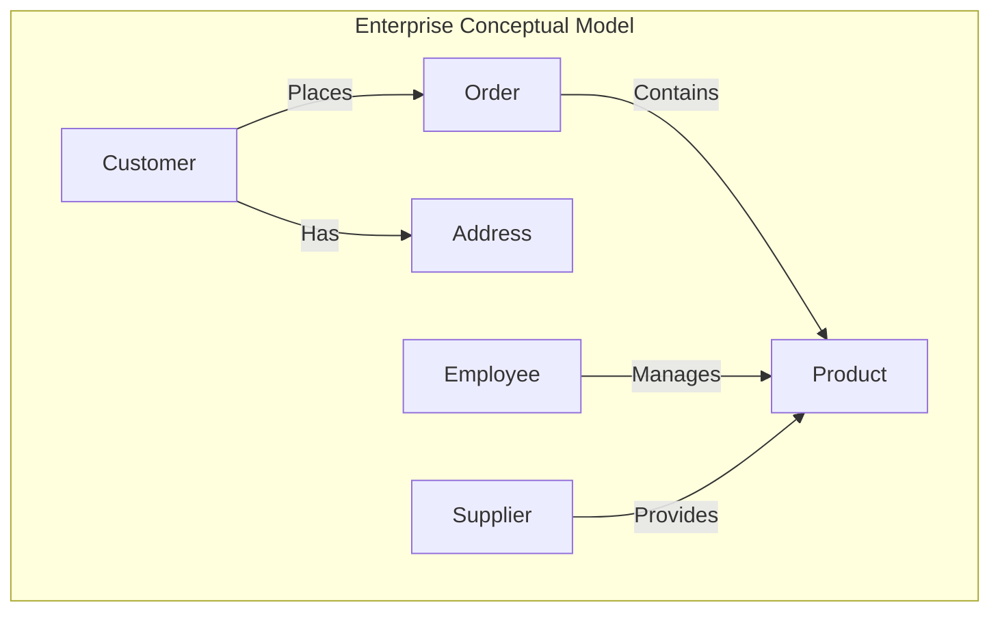
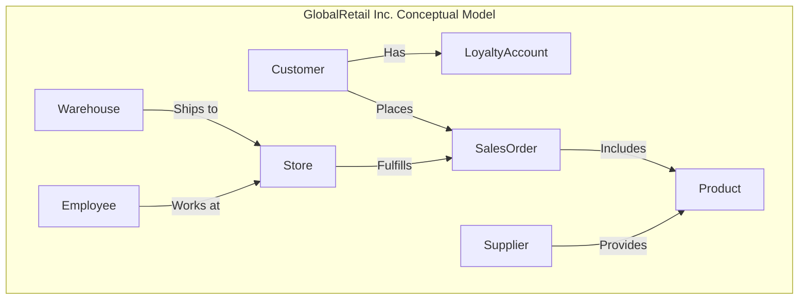
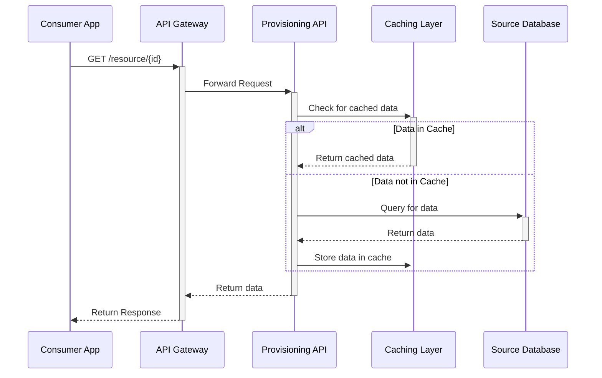

<!-- NAV-TOC -->
## Sections in This File

This file contains **10 sections**. Use `view_range` with the line numbers below to jump to a specific section.

| Line | Section |
|:---|:---|
| 21 | Enterprise Data Model |
| 408 | Data Architecture Blueprint |
| 787 | Data Flow Diagrams |
| 1138 | Technology Standards |
| 1459 | Integration Patterns |
| 1816 | Data Architecture Roadmap |
| 2250 | Subject Area Models |
| 2540 | Data Landscape Map |
| 2920 | Data Architecture Principles |
| 3227 | Data Architecture Review Checklist |

## Sections in This File

This file contains **10 sections**. Use `view_range` with the line numbers below to jump to a specific section.

| Line | Section |
|:---|:---|
| 1 | Enterprise Data Model |
| 388 | Data Architecture Blueprint |
| 767 | Data Flow Diagrams |
| 1118 | Technology Standards |
| 1439 | Integration Patterns |
| 1796 | Data Architecture Roadmap |
| 2230 | Subject Area Models |
| 2520 | Data Landscape Map |
| 2900 | Data Architecture Principles |
| 3207 | Data Architecture Review Checklist |

---

# Enterprise Data Model


## Table of Contents

- [1. Overview](#1-overview)
  - [1.1. Definition and Purpose](#11-definition-and-purpose)
  - [1.2. Scope](#12-scope)
  - [1.3. Related Knowledge Areas](#13-related-knowledge-areas)
- [2. RASCI Assignment](#2-rasci-assignment)
  - [2.1. Output-Level RASCI](#21-output-level-rasci)
  - [2.2. Section-Level RASCI](#22-section-level-rasci)
- [3. Template](#3-template)
  - [3.1. Document Control](#31-document-control)
  - [3.2. Introduction](#32-introduction)
  - [3.3. Core Business Subject Areas](#33-core-business-subject-areas)
  - [3.4. Enterprise Conceptual Data Model](#34-enterprise-conceptual-data-model)
  - [3.5. Enterprise Logical Data Model (ELDM)](#35-enterprise-logical-data-model-eldm)
  - [3.6. Data Model Governance and Maintenance](#36-data-model-governance-and-maintenance)
- [4. Example](#4-example)
  - [4.1. Introduction (GlobalRetail Inc.)](#41-introduction-globalretail-inc)
  - [4.2. Core Business Subject Areas (GlobalRetail Inc.)](#42-core-business-subject-areas-globalretail-inc)
  - [4.3. Enterprise Conceptual Data Model (GlobalRetail Inc.)](#43-enterprise-conceptual-data-model-globalretail-inc)
  - [4.4. Enterprise Logical Data Model (GlobalRetail Inc. - Excerpt)](#44-enterprise-logical-data-model-globalretail-inc-excerpt)
- [4.5. Related Concepts and Guides](#45-related-concepts-and-guides)
- [5. Quality Criteria](#5-quality-criteria)
  - [5.1. Acceptance Criteria](#51-acceptance-criteria)
  - [5.2. Review Checklist](#52-review-checklist)
- [6. Related Outputs](#6-related-outputs)
  - [6.1. Prerequisites (Inputs)](#61-prerequisites-inputs)
  - [6.2. Consumers (Outputs)](#62-consumers-outputs)
- [7. Tools and Automation](#7-tools-and-automation)
  - [7.1. Recommended Tools](#71-recommended-tools)
  - [7.2. Automation Opportunities](#72-automation-opportunities)
- [8. References](#8-references)
- [9. Related Deliverables](#9-related-deliverables)
- [10. Anti-Patterns](#10-anti-patterns)

---

## 1. Overview

### 1.1. Definition and Purpose

The **Enterprise Data Model (EDM)** is a holistic, high-level, and technology-agnostic representation of an organization's data assets. It provides a unified and consistent view of the key business concepts (entities), their characteristics (attributes), and the relationships between them across the entire enterprise. The primary purpose of the EDM is to create a shared business vocabulary, enforce data consistency, and provide a stable architectural foundation for all data-related development, including application design, database creation, data integration, and business intelligence initiatives.

In the evolving data management landscape, the EDM plays a critical role in enabling modern data architectures such as Data Mesh and Data Fabric by establishing a common semantic layer that supports decentralized data ownership while maintaining enterprise-wide consistency. It also underpins compliance efforts related to data privacy regulations (GDPR, HIPAA, CCPA) and emerging AI governance frameworks, ensuring that data used in AI/ML models is well-defined, trustworthy, and auditable.

> The Enterprise Data Model answers the fundamental question: *"What are the most important things our business needs to know about, and how do they relate to each other?"*

Looking forward to DAMA-DMBOK 3.0, the EDM is expected to evolve to explicitly incorporate data product concepts, data contracts, and agentic stewardship roles, reflecting the shift toward treating data as a managed product and embedding governance into operational workflows.

### 1.2. Scope

**Global** — The Enterprise Data Model is a strategic asset that applies to the entire organization. It provides a single, integrated model that transcends individual applications, projects, or business units to support enterprise-wide data consistency and integration.

The EDM is technology-agnostic and designed to be adaptable to multi-cloud environments, hybrid architectures, and cloud-native platforms. It supports the interoperability of data products and pipelines across diverse systems and enables integration with MLOps, DataOps, and FinOps practices.

### 1.3. Related Knowledge Areas

| Knowledge Area | Relationship |
| :--- | :--- |
| KA-01: Data Governance | The EDM is a key artifact governed by the Data Governance program. The Business Glossary provides the foundational business terms for the EDM. The EDM supports AI governance by defining data elements critical to AI model inputs and outputs. |
| KA-03: Data Modeling and Design | The EDM serves as the top-level context and starting point for all other data models, including conceptual, logical, and physical models for specific projects. It integrates modern modeling approaches including data product modeling. |
| KA-06: Data Integration & Interoperability | The EDM provides the common language and structure needed to design consistent source-to-target mappings and enable seamless data exchange between systems, including data mesh federated domains. |
| KA-09: Metadata Management | The EDM is a critical source of business and technical metadata, and its contents must be captured, managed, and made accessible through the metadata repository to support data lineage, impact analysis, and AI model explainability. |
| KA-10: Data Architecture | The EDM is foundational to defining enterprise data architecture patterns, supporting data fabric and lakehouse implementations, and aligning with cloud-native infrastructure strategies. |

---

## 2. RASCI Assignment

### 2.1. Output-Level RASCI

| Role Category | Assigned Role | Responsibility Description |
| :--- | :--- | :--- |
| **A (Accountable)** | Data Engineering Manager (DE Mgr) | Ultimately answerable for the creation, maintenance, and approval of the Enterprise Data Model, ensuring it aligns with business strategy, architectural principles, and compliance requirements including AI governance. |
| **R (Responsible)** | Data Architect (D-Arch) | Leads the design, development, and evolution of the Enterprise Data Model. Facilitates workshops and ensures the model is comprehensive, accurate, and aligned with modern data management practices such as data mesh and data products. |
| **S (Supportive)** | Data Modeler (D-Modeler) | Provides detailed data modeling expertise, assists in developing different layers of the model (conceptual, logical), and ensures adherence to modeling standards and integration with metadata management tools. |
| **C (Consulted)** | Data Steward (D-Steward), Subject Matter Expert (SME), AI Ethics Officer | Provide deep business knowledge about specific data domains, validate business rules, ensure the model accurately reflects business reality, and contribute to AI governance considerations. |
| **I (Informed)** | Data Analytics Manager (DA Mgr), MLOps Engineer | Informed of the model's structure to ensure analytics, reporting, and AI/ML initiatives are built upon a consistent and understood data foundation. |

### 2.2. Section-Level RASCI

| EDM Section | Primary Author (R) | Reviewer (C) | Approver (A) |
| :--- | :--- | :--- | :--- |
| Core Subject Areas | D-Arch | D-Steward, SME | DE Mgr |
| Entity & Relationship Definitions | D-Modeler | D-Steward, SME | D-Arch |
| High-Level Conceptual Model | D-Arch | D-Owner, Business Leaders | DE Mgr |
| Enterprise Logical Model | D-Modeler | D-Arch, Application Developers | D-Arch |
| Governance & Maintenance | D-Arch | DG Mgr, AI Ethics Officer | DE Mgr |

---

## 3. Template

> *The following is the standardized template for an Enterprise Data Model. This template guides the creation of a comprehensive model that serves as a blueprint for the organization's data landscape. Replace placeholders `[...]` with specific information.*

### 3.1. Document Control

| Field | Value |
| :--- | :--- |
| Document Title | Enterprise Data Model |
| Document ID | EDM-CORP-001 |
| Version | [e.g., 1.0] |
| Effective Date | [YYYY-MM-DD] |
| Owner | [Data Architect Name] |
| Approver | [Data Engineering Manager Name] |

### 3.2. Introduction

> *Provide an overview of the EDM's purpose, scope, and objectives within the context of the organization. Explain how it supports the business strategy and data management goals, including alignment with AI governance, data mesh/fabric initiatives, and compliance mandates.*

**Input needed**: `templates/templates-KA-01-data-governance.md`, Corporate Strategic Plan, AI Governance Framework.  
**Who fills this**: Data Architect (D-Arch).

[Insert Introduction]

### 3.3. Core Business Subject Areas

> *Identify and define the high-level subject areas that are fundamental to the business. These are broad categories of data that group related concepts. Examples include Customer, Product, Employee, Finance, and Sales.*

**Input needed**: Business capability model, interviews with business leaders, data product catalogs.  
**Who fills this**: Data Architect (D-Arch), with input from SMEs and Data Product Managers.

| Subject Area | Definition |
| :--- | :--- |
| [e.g., Customer] | [Data related to individuals or organizations that purchase or use our products and services.] |
| [e.g., Product] | [Data describing the goods and services offered by the organization.] |
| [e.g., Finance] | [Data related to financial transactions, accounting, and reporting.] |

### 3.4. Enterprise Conceptual Data Model

> *This is a visual, high-level diagram showing only the most critical business entities and their relationships. It is designed for a business audience and should be free of technical jargon. Focus on clarity and simplicity.*

**Input needed**: Definitions of core subject areas.  
**Who fills this**: Data Architect (D-Arch).

**Diagram:**



**Entity Definitions:**

> *For each entity in the conceptual diagram, provide a clear, business-friendly definition.*

| Entity | Definition |
| :--- | :--- |
| [e.g., Customer] | [An individual or organization that has a relationship with the company.] |
| [e.g., Order] | [A formal request by a customer to purchase one or more products.] |

### 3.5. Enterprise Logical Data Model (ELDM)

> *The ELDM expands on the conceptual model by adding more detail, including primary attributes for each entity and defining the cardinality and optionality of relationships. It remains technology-neutral.*

**Input needed**: Conceptual Data Model, `templates/templates-KA-01-data-governance.md`.  
**Who fills this**: Data Modeler (D-Modeler), reviewed by D-Arch.

#### 3.5.1. Entity: [e.g., Customer]

> *Define the entity and list its key attributes. Specify data types at a logical level (e.g., Text, Number, Date).*

**Definition**: [A party (individual or organization) that has purchased goods or services.]

| Attribute | Data Type | Definition | Business Rule |
| :--- | :--- | :--- | :--- |
| CustomerID | Unique Identifier | System-generated unique identifier for each customer. | Mandatory, unique. |
| CustomerName | Text | The full legal name of the customer. | Mandatory. |
| CustomerType | Text | Classification of the customer (e.g., Individual, Corporate). | Mandatory, from approved list. |
| RegistrationDate | Date | The date the customer first registered. | Mandatory. |

#### 3.5.2. Relationship: [e.g., Customer Places Order]

> *Define the relationship between two entities, including its cardinality.*

| Relationship | From Entity | To Entity | Cardinality | Definition |
| :--- | :--- | :--- | :--- | :--- |
| Places | Customer | Order | One-to-Many (1..*) | A Customer can place one or more Orders. Each Order must be placed by exactly one Customer. |

### 3.6. Data Model Governance and Maintenance

> *Describe the processes for reviewing, updating, and granting exceptions to the Enterprise Data Model. This ensures the model remains a living, relevant asset.*

**Input needed**: `templates/templates-KA-01-data-governance.md`.  
**Who fills this**: Data Architect (D-Arch).

- **Review Cycle**: [e.g., The EDM will be reviewed on an annual basis by the Data Architecture Review Board, with additional reviews aligned to AI governance audits and compliance cycles.]
- **Change Management Process**: [e.g., All proposed changes must be submitted via a change request, reviewed by the D-Arch, Data Governance Manager, and AI Ethics Officer, then approved by the DE Mgr.]
- **Exception Policy**: [e.g., Exceptions for non-compliance must be formally documented, justified, and approved by the Data Governance Council and AI Governance Committee.]
- **Integration with Metadata Management**: The EDM changes must be synchronized with the enterprise metadata repository to maintain traceability and lineage.
- **Stewardship Model**: Incorporate emerging agentic stewardship roles to empower domain data owners and product managers to maintain data quality and compliance.

---

## 4. Example

> *This section provides a realistic, filled-in example of an Enterprise Data Model for a fictional multinational company, **GlobalRetail Inc.** This demonstrates the practical application of the template.*

### 4.1. Introduction (GlobalRetail Inc.)

GlobalRetail Inc. is a multinational retailer operating in 30 countries with a complex landscape of legacy and modern applications. The Enterprise Data Model has been established to create a single source of truth for core business concepts, reduce data integration costs, and enable a 360-degree view of the customer. It is the cornerstone of our "Data as a Product" strategy and supports our transition to a data mesh architecture with federated domain ownership.

The EDM also supports compliance with GDPR and the EU AI Act by ensuring data elements used in AI/ML models are well-defined and governed. It facilitates integration with MLOps pipelines and supports FinOps by providing cost transparency on data assets.

### 4.2. Core Business Subject Areas (GlobalRetail Inc.)

| Subject Area | Definition |
| :--- | :--- |
| Customer | Data related to individuals enrolled in our loyalty program and corporate clients. |
| Product | Data describing the SKUs we sell, including hierarchy, pricing, and inventory. |
| Sales | Transactional data from our physical stores, e-commerce platform, and mobile app. |
| Supply Chain | Data related to our suppliers, warehouses, and logistics network. |
| Employee | Data about our internal staff, including roles, and store assignments. |

### 4.3. Enterprise Conceptual Data Model (GlobalRetail Inc.)



### 4.4. Enterprise Logical Data Model (GlobalRetail Inc. - Excerpt)

#### 4.4.1. Entity: Product

**Definition**: A unique, sellable item (Stock Keeping Unit - SKU) offered by GlobalRetail Inc.

| Attribute | Data Type | Definition | Business Rule |
| :--- | :--- | :--- | :--- |
| ProductSKU | Unique Identifier | The unique identifier for the product across all systems. | Mandatory, unique, alphanumeric. |
| ProductName | Text | The public-facing name of the product. | Mandatory. |
| BrandName | Text | The brand under which the product is sold. | Mandatory. |
| StandardCost | Currency | The standard cost of acquiring the product. | Mandatory, > 0. |
| ListPrice | Currency | The standard selling price before discounts. | Mandatory, > 0. |
| ProductCategoryID | Identifier | Foreign key to the Product Category entity. | Mandatory. |

#### 4.4.2. Relationship: Store Fulfills SalesOrder

| Relationship | From Entity | To Entity | Cardinality | Definition |
| :--- | :--- | :--- | :--- | :--- |
| Fulfills | Store | SalesOrder | One-to-Many (1..*) | A Store can fulfill many Sales Orders. A Sales Order is fulfilled by exactly one Store (for in-store purchases) or a Warehouse (for online orders). |

---

### 4.5. Related Concepts and Guides

> The following resources provide additional context and guidance for this deliverable:

| Resource | Type | Path |
| :--- | :--- | :--- |
| Tools Landscape | Reference | [references/reference-materials.md](references/reference-materials.md) |
| Data Product Outputs | Reference | [references/reference-materials.md](references/reference-materials.md) |
| Business Glossary | Deliverable | **templates/templates-KA-01-data-governance.md** |
| Conceptual Data Model | Deliverable | **templates/templates-KA-03-data-modeling-design.md** |
| Data Governance Charter | Deliverable | **templates/templates-KA-01-data-governance.md** |

---

## 5. Quality Criteria

### 5.1. Acceptance Criteria

- [x] The model identifies at least 5 core business subject areas.
- [x] All entities in the conceptual model have clear, business-friendly definitions.
- [x] All entities in the logical model include at least 3-5 key attributes.
- [x] All relationships define cardinality (e.g., one-to-many, many-to-many).
- [x] The model is technology-agnostic.
- [x] The model has been reviewed and approved by the Data Architect and at least two relevant Data Stewards.
- [x] The model aligns with current data governance policies, including AI governance requirements.
- [x] The model supports integration with metadata management and data product frameworks.

### 5.2. Review Checklist

| Criteria | Check | Reviewer Role |
| :--- | :--- | :--- |
| **Clarity** | Is the model easily understood by both business and technical stakeholders? | D-Arch, SME |
| **Completeness** | Does the model capture all critical entities and relationships for the defined scope? | SME, D-Steward |
| **Consistency** | Are entity and attribute names used consistently across the model? Do definitions align with the Business Glossary? | D-Modeler, DG Analyst |
| **Normalization** | Is the model reasonably normalized (e.g., 3rd Normal Form) to reduce data redundancy? | D-Modeler, D-Arch |
| **Extensibility** | Is the model designed to accommodate future business needs without major rework? | D-Arch |
| **Governance Alignment** | Does the model comply with data governance and AI governance policies? | DG Mgr, AI Ethics Officer |
| **Integration Readiness** | Is the model ready to integrate with metadata repositories and data product catalogs? | Metadata Manager, Data Product Manager |

---

## 6. Related Outputs

### 6.1. Prerequisites (Inputs)

| Output | File Path |
| :--- | :--- |
| Data Governance Charter | `templates/templates-KA-01-data-governance.md` |
| Business Glossary | `templates/templates-KA-01-data-governance.md` |
| Corporate Strategic Plan | `#` |

### 6.2. Consumers (Outputs)

| Output | File Path |
| :--- | :--- |
| Conceptual Data Model | `templates/templates-KA-03-data-modeling-design.md` |
| Subject Area Models | `templates/templates-KA-02-data-architecture.md` |
| Source-to-Target Mapping | `templates/templates-KA-06-data-integration-interoperability.md` |
| Data Product Specifications | `templates/templates-KA-02-data-architecture.md` |

---

## 7. Tools and Automation

### 7.1. Recommended Tools

| Tool Category | Commercial Tools | Open Source / Free Tools |
| :--- | :--- | :--- |
| Data Modeling | Erwin Data Modeler, SAP PowerDesigner, Sparx Enterprise Architect | `draw.io` (now diagrams.net), Lucidchart (Free Tier), Visual Paradigm CE |
| Model Repository | Erwin Mart, PowerDesigner Repository | Git (using a structured folder system), a corporate Wiki (e.g., Confluence) |
| Collaboration | Confluence, SharePoint | Miro, Mural |
| Metadata Management | Collibra, Informatica EDC | Apache Atlas, Amundsen |

### 7.2. Automation Opportunities

- **Model Generation**: Reverse-engineering existing databases to generate a baseline physical data model, which can then be abstracted into a logical and conceptual view.
- **Metadata Integration**: Automating the synchronization of the Enterprise Data Model with the enterprise metadata catalog. Changes in the model should automatically update the catalog.
- **Documentation Generation**: Using scripts to automatically generate HTML or PDF documentation from the modeling tool's repository.
- **Model Validation**: Implementing automated checks to ensure new or updated data models comply with the naming conventions and standards defined in the EDM.
- **Governance Enforcement**: Integration with AI governance tools to validate data elements used in AI/ML pipelines against the EDM definitions and policies.
- **Data Contract Automation**: Using data contracts to enforce schema and quality expectations between data producers and consumers as defined in the EDM.

---

## 8. References

- **[1]** DAMA International. *DAMA-DMBOK: Data Management Body of Knowledge, Second Edition*. Technics Publications, 2017. (Chapter 4: Data Architecture)
- **[2]** DAMA International. *DAMA-DMBOK 3.0 (Draft)*. Community-driven update, expected June 2025.
- **[3]** Internal Reference: `references/reference-materials.md`
- **[4]** Internal Reference: `templates/templates-KA-01-data-governance.md`
- **[5]** EU AI Act and GDPR Compliance Guidelines, 2023.
- **[6]** Data Mesh Principles and Practices, Zhamak Dehghani, ThoughtWorks, 2020.

---

## 9. Related Deliverables

| Deliverable | Relationship |
| :--- | :--- |
| [Data Quality Strategy](templates/templates-KA-11-data-quality.md) | The Enterprise Data Model provides the structural foundation that the Data Quality Strategy relies on to define and measure data quality rules. |
| [Business Glossary](templates/templates-KA-01-data-governance.md) | Provides the authoritative business terms and definitions that underpin the EDM entities and attributes. |
| **Conceptual Data Model** | The EDM serves as the top-level conceptual model from which detailed conceptual models are derived. |
| [Subject Area Models](templates/templates-KA-02-data-architecture.md) | Subject area models are derived from the EDM core subject areas and provide detailed domain-specific views. |
| **Data Product Specifications** | The EDM supports the definition of data products by providing consistent entity and attribute definitions. |

---

## 10. Anti-Patterns

> *Common pitfalls to avoid when developing and maintaining the Enterprise Data Model.*

- **Siloed Modeling**: Creating EDMs in isolation without cross-functional collaboration, leading to inconsistent definitions and duplication across domains.
- **Over-Complexity**: Including excessive detail or technical specifics in the EDM, making it difficult for business stakeholders to understand and use.
- **Stale Models**: Failing to maintain and update the EDM regularly, resulting in outdated models that do not reflect current business realities or technology environments.
- **Ignoring Governance**: Not integrating the EDM with data governance processes, leading to lack of accountability and poor data quality.
- **Neglecting AI and Cloud Context**: Omitting considerations for AI governance, data mesh, cloud-native architectures, and data productization, which reduces the EDM’s relevance in modern data ecosystems.
- **Lack of Automation**: Manual updates and documentation that increase errors and reduce agility.
- **Poor Communication**: Not effectively communicating the purpose and value of the EDM to stakeholders, resulting in low adoption and support.

---

# End of Document


---

# Data Architecture Blueprint


## Table of Contents

- [1. Overview](#1-overview)
  - [1.1. Definition and Purpose](#11-definition-and-purpose)
  - [1.2. Scope](#12-scope)
  - [1.3. Related Knowledge Areas](#13-related-knowledge-areas)
- [2. RASCI Assignment](#2-rasci-assignment)
  - [2.1. Output-Level RASCI](#21-output-level-rasci)
  - [2.2. Section-Level RASCI](#22-section-level-rasci)
- [3. Template](#3-template)
  - [3.1. Document Control](#31-document-control)
  - [3.2. Introduction](#32-introduction)
  - [3.3. Architecture Principles](#33-architecture-principles)
  - [3.4. Current State Architecture](#34-current-state-architecture)
  - [3.5. Target State Architecture](#35-target-state-architecture)
  - [3.6. Gap Analysis](#36-gap-analysis)
  - [3.7. Implementation Roadmap](#37-implementation-roadmap)
- [4. Example](#4-example)
  - [4.1. Document Control](#41-document-control)
  - [4.2. Introduction](#42-introduction)
  - [4.3. Architecture Principles](#43-architecture-principles)
  - [4.4. Current State Architecture](#44-current-state-architecture)
  - [4.5. Target State Architecture](#45-target-state-architecture)
  - [4.6. Gap Analysis](#46-gap-analysis)
  - [4.7. Implementation Roadmap](#47-implementation-roadmap)
  - [4.8. Related Concepts and Guides](#48-related-concepts-and-guides)
- [5. Quality Criteria](#5-quality-criteria)
  - [5.1. Acceptance Criteria](#51-acceptance-criteria)
  - [5.2. Review Checklist](#52-review-checklist)
- [6. Related Outputs](#6-related-outputs)
  - [6.1. Prerequisites (Inputs to this Output)](#61-prerequisites-inputs-to-this-output)
  - [6.2. Consumers (Outputs that use this Output)](#62-consumers-outputs-that-use-this-output)
- [7. Tools and Automation](#7-tools-and-automation)
  - [7.1. Recommended Tools](#71-recommended-tools)
  - [7.2. Automation Opportunities](#72-automation-opportunities)
- [8. References](#8-references)

---

## 1. Overview

### 1.1. Definition and Purpose

The **Data Architecture Blueprint** is the comprehensive, strategic plan that defines an organization's data infrastructure, standards, and principles. It serves as the master design document that aligns the enterprise's data systems and structures with its strategic business objectives. The blueprint provides a holistic view of the current state, defines the desired future state, and outlines the transition plan required to bridge the gap. It is a living document that guides the design, development, and management of all data assets.

This blueprint incorporates emerging trends such as cloud-native architectures, data mesh and data fabric paradigms, and AI governance considerations, ensuring that the architecture supports both current and future organizational needs. It also anticipates regulatory compliance requirements including GDPR, HIPAA, CCPA, and the evolving EU AI Act, embedding privacy and ethical considerations into the data architecture foundation.

> The Data Architecture Blueprint answers the fundamental question: *"How will we structure, manage, and utilize our data assets to achieve our business goals while ensuring compliance, scalability, and innovation?"*

### 1.2. Scope

**Global** — The Data Architecture Blueprint is an enterprise-wide artifact. It applies to all business units, data domains, and technology platforms, ensuring a unified and coherent approach to data management across the entire organization. There is one primary blueprint for the enterprise, which may be supplemented by more detailed, solution-level architectures.

The scope also extends to include emerging data product concepts and data contracts as first-class citizens within the architecture, supporting the shift toward product-oriented data management and enabling agile, federated data ownership models consistent with data mesh principles.

### 1.3. Related Knowledge Areas

| Knowledge Area | Relationship |
| :--- | :--- |
| KA-01: Data Governance | The blueprint operates under the authority of the Data Governance Charter and must adhere to all established data policies, standards, and AI governance frameworks. |
| KA-03: Data Modeling & Design | The blueprint provides the high-level framework and context within which specific data models (Conceptual, Logical, Physical) are designed and developed, including data product definitions and contracts. |
| KA-04: Data Storage & Operations | The blueprint directly influences the Storage Architecture, dictating the types of databases and storage technologies required to support the target state, including cloud-native and multi-cloud strategies. |
| KA-06: Data Integration & Interoperability | The blueprint defines the standards and patterns for data movement, ensuring that data flows efficiently and consistently between systems, supporting DataOps and MLOps integration. |
| KA-09: Architecture Principles | The blueprint is governed by architecture principles that ensure alignment with enterprise strategy, technology independence, security, and emerging best practices such as agentic data stewardship. |

---

## 2. RASCI Assignment

### 2.1. Output-Level RASCI

| Role Category | Assigned Role | Responsibility Description |
| :--- | :--- | :--- |
| **A (Accountable)** | Data Engineering Manager (DE Mgr) | Ultimately answerable for the creation, maintenance, and successful implementation of the Data Architecture Blueprint. Ensures resources are available and the blueprint aligns with technical capabilities and strategic objectives, including AI governance and compliance mandates. |
| **R (Responsible)** | Data Architect (D-Arch) | Leads the design, development, and documentation of the blueprint. Conducts current state analysis, defines the target state, and performs gap analysis. Integrates modern architectural paradigms such as Data Mesh, Data Fabric, and Lakehouse concepts. |
| **S (Supportive)** | Data Warehouse Architect (DW Arch), Data Fabric Architect (DFab Arch), MLOps Engineer | Provide specialized expertise on data warehousing, BI, modern data fabric principles, and operationalization of AI/ML pipelines to ensure the blueprint is comprehensive and technically sound. |
| **C (Consulted)** | Data Governance Manager (DG Mgr), CIO, AI Ethics Officer | The DG Mgr ensures alignment with governance policies. The CIO provides strategic input to ensure the blueprint supports enterprise-wide business and IT strategy. The AI Ethics Officer advises on ethical AI and compliance considerations. |
| **I (Informed)** | Chief Data Officer (CDO), Chief AI Officer (CAIO) | Kept informed of the blueprint's status and key decisions, ensuring it aligns with the overall data and AI strategy and vision. |

### 2.2. Section-Level RASCI

| Blueprint Section | Primary Author (R) | Reviewer (C) | Approver (A) |
| :--- | :--- | :--- | :--- |
| Architecture Principles | D-Arch | DG Mgr, CIO, AI Ethics Officer | DE Mgr |
| Current State Assessment | D-Arch | DW Arch, DFab Arch, MLOps Engineer | DE Mgr |
| Target State Architecture | D-Arch | CIO, Business Leaders, CAIO | DE Mgr |
| Gap Analysis & Roadmap | D-Arch | DE Mgr | DE Mgr |

---

## 3. Template

> *The following is the standardized template for creating a Data Architecture Blueprint. Replace all placeholders `[...]` with organization-specific information. Each section includes inline guidance in blockquotes.*

### 3.1. Document Control

| Field | Value |
| :--- | :--- |
| Document Title | [Organization Name] Data Architecture Blueprint |
| Document ID | ARC-GLB-002 |
| Version | [e.g., 1.0] |
| Effective Date | [YYYY-MM-DD] |
| Owner | [Data Engineering Manager] |
| Primary Author | [Data Architect] |

### 3.2. Introduction

> *State the purpose of the blueprint, the business drivers behind its creation (e.g., digital transformation, regulatory compliance, analytics maturity), and the intended audience. Include references to AI governance, cloud strategy, and emerging data management paradigms where relevant.*

**Input needed**: Business strategy documents, IT strategy, Data Governance Charter, AI Governance Framework.  
**Who fills this**: Data Architect.

[Insert Introduction]

### 3.3. Architecture Principles

> *List the fundamental principles that guide all data architecture decisions. These are high-level, stable rules that define the "why" behind the architecture. Reference `KA-02-09-architecture-principles.md` for the master list. Include principles addressing AI governance, data product orientation, cloud-native design, security, and compliance.*

**Input needed**: `KA-02-09-architecture-principles.md`, business goals, AI ethics guidelines.  
**Who fills this**: Data Architect.

| # | Principle | Statement |
|:--|:---|:---|
| 1 | Business Alignment | Data architecture decisions will be driven by and traceable to business needs and strategic objectives, including digital transformation and AI initiatives. |
| 2 | Data as a Shared Asset | Enterprise data is a shared asset managed consistently across the organization, enabling federated ownership and stewardship models. |
| 3 | Technology Independence | Architecture will be designed to be independent of specific technology solutions, promoting flexibility, portability, and vendor neutrality. |
| 4 | Security and Privacy by Design | Data security, privacy, and compliance controls will be embedded into the architecture from the outset, adhering to GDPR, CCPA, HIPAA, and EU AI Act requirements. |
| 5 | Cloud-Native and Multi-Cloud Ready | The architecture will leverage cloud-native services and support multi-cloud deployments to maximize scalability and resilience. |
| 6 | Data Product Orientation | Data will be managed as products with clear ownership, SLAs, and contracts to enable agility and accountability. |
| 7 | Support for AI Governance | The architecture will incorporate capabilities to support AI governance, including lineage, explainability, and ethical considerations. |
| 8 | Automation and Operational Excellence | Emphasize automation in data pipeline orchestration, quality monitoring, and compliance validation to support DataOps, MLOps, and FinOps practices. |

### 3.4. Current State Architecture

> *Describe the existing data landscape ("as-is"). This section should include diagrams and narrative to explain how data is currently stored, processed, and integrated. It should also identify key pain points and limitations, including gaps in AI governance, cloud adoption, and data product management.*

**Input needed**: `KA-02-08-data-landscape-map.md`, system inventories, interviews with technical teams, AI governance maturity assessments.  
**Who fills this**: Data Architect.

#### 3.4.1. Business Process Overview

[Diagram and description of key business processes and their data dependencies, highlighting areas where data supports AI/ML workflows and decision-making.]

#### 3.4.2. Data Landscape Diagram

[High-level diagram showing major data stores, applications, data flows, and integration points, including legacy systems and cloud platforms.]

#### 3.4.3. Key Systems and Platforms

| System ID | System Name | Description | Technology Stack | Data Domain(s) |
|:---|:---|:---|:---|:---|
| [e.g., ERP-01] | [e.g., SAP S/4HANA] | [e.g., Core ERP for Finance, HR, Supply Chain] | [e.g., HANA DB, ABAP] | [e.g., Finance, Employee] |
| [e.g., CRM-01] | [e.g., Salesforce] | [e.g., Customer Relationship Management] | [e.g., Force.com] | [e.g., Customer, Sales] |
| [e.g., AI-Platform] | [e.g., Databricks] | [e.g., AI/ML experimentation and model training] | [e.g., Spark, MLflow] | [e.g., Customer Insights, Predictive Analytics] |

#### 3.4.4. Pain Points and Limitations

- Data silos and inconsistent data definitions hinder enterprise-wide analytics and AI initiatives.
- Limited cloud adoption results in scalability and agility constraints.
- Lack of formal data product management and data contracts causes unclear ownership and accountability.
- Insufficient AI governance maturity, with minimal lineage, explainability, and ethical oversight.
- Manual, brittle integration pipelines increase operational risk and reduce responsiveness.
- Compliance gaps related to emerging regulations such as the EU AI Act.

### 3.5. Target State Architecture

> *Define the desired future state ("to-be") of the data architecture. This should be a conceptual and logical design that addresses the pain points of the current state and supports future business goals, including AI governance, data mesh/fabric integration, and cloud-native capabilities.*

**Input needed**: Business strategy, technology trends, architecture principles, AI governance frameworks.  
**Who fills this**: Data Architect.

#### 3.5.1. Conceptual Architecture

[High-level diagram (e.g., Data Fabric, Hub-and-Spoke, Data Mesh) illustrating the target architectural pattern and its core components like data sources, ingestion, storage, processing, and consumption layers. Highlight integration of AI governance components and data product lifecycle.]

#### 3.5.2. Logical Data Flow

[Diagram showing how data will logically flow between the components of the target architecture, including real-time and batch ingestion, data product interfaces, and AI model pipelines.]

#### 3.5.3. Key Technology Capabilities

| Capability | Description | Recommended Technology Category |
|:---|:---|:---|
| Data Ingestion | Real-time and batch ingestion from various sources supporting event-driven and streaming data | Streaming Platforms (Kafka, Pulsar), ETL/ELT Tools (Fivetran, Airbyte) |
| Data Lake Storage | Scalable, low-cost storage for raw and processed data supporting multi-cloud and hybrid environments | Cloud Object Storage (S3, ADLS, GCS), Lakehouse Platforms (Delta Lake, Apache Hudi) |
| Data Warehousing | High-performance analytics and reporting with support for data product interfaces | Cloud Data Warehouse (Snowflake, BigQuery, Redshift) |
| Data Governance Platform | Centralized catalog, lineage, quality management, and AI governance capabilities | Collibra, Alation, Informatica Axon, OpenMetadata |
| AI/ML Platform | Integrated environment for model development, deployment, monitoring, and governance | Databricks, MLflow, Kubeflow, Seldon |
| Security & Compliance | Tools and frameworks for data classification, access control, and regulatory compliance | Privacera, Immuta, Apache Ranger |

### 3.6. Gap Analysis

> *Compare the current state to the target state to identify the gaps in technology, skills, and processes. This analysis forms the basis for the implementation roadmap. Include gaps related to AI governance, cloud adoption, data product management, and operational excellence.*

**Input needed**: Current State and Target State sections.  
**Who fills this**: Data Architect.

| Gap Area | Description of Gap | Recommended Action |
|:---|:---|:---|
| Technology | No centralized data catalog or AI governance platform exists. Legacy ETL pipelines lack automation and monitoring. | Procure and implement a data governance and AI governance platform. Adopt modern ELT and streaming ingestion tools. |
| Skills | Limited expertise in cloud-native data platforms, data product management, and AI governance. | Develop targeted training programs. Hire Data Product Managers, MLOps Engineers, and AI Ethics Officers. |
| Process | Absence of formal data product lifecycle management and AI model governance processes. | Establish data product management framework and AI governance policies aligned with regulatory requirements. |
| Compliance | Partial compliance with GDPR and CCPA; no provisions for EU AI Act compliance. | Implement compliance monitoring tools and integrate compliance checks into data pipelines and AI workflows. |

### 3.7. Implementation Roadmap

> *Provide a high-level, phased plan for transitioning from the current state to the target state. This is a strategic summary, not a detailed project plan. Reference `KA-02-06-architecture-roadmap.md` for the detailed version. Incorporate AI governance and cloud migration milestones.*

**Input needed**: Gap Analysis.  
**Who fills this**: Data Architect.

| Phase | Timeframe | Key Initiatives | Expected Outcomes |
|:---|:---|:---|:---|
| Phase 1: Foundational | [e.g., Q1-Q2 2026] | Implement Data Governance and AI Governance Platforms. Establish Cloud Data Lake and foundational security controls. | Centralized metadata and AI governance capabilities. Raw data available for exploration with compliance controls. |
| Phase 2: Migration & Data Product Enablement | [e.g., Q3 2026 - Q2 2027] | Migrate key data sources to cloud platforms. Define and onboard initial data products with SLAs and contracts. | Trusted data products available for BI and AI use cases. Improved data quality and ownership clarity. |
| Phase 3: Optimization & AI Integration | [e.g., Q3 2027 onwards] | Implement advanced analytics and AI/ML use cases. Operationalize MLOps pipelines and FinOps practices. Optimize data pipelines and governance processes. | Predictive analytics capabilities deployed. Automated compliance and operational excellence achieved. |

---

## 4. Example

> *This is a realistic, filled-in example for a fictional company, **GlobalRetail Inc.**, to illustrate how the blueprint is used in practice.*

### 4.1. Document Control

| Field | Value |
| :--- | :--- |
| Document Title | GlobalRetail Inc. Data Architecture Blueprint |
| Document ID | ARC-GLB-002 |
| Version | 1.0 |
| Effective Date | 2026-02-08 |
| Owner | John Smith, Data Engineering Manager |
| Primary Author | Emily White, Data Architect |

### 4.2. Introduction

GlobalRetail Inc. is embarking on a digital transformation initiative to become a leader in data-driven retail. The primary business driver is the need to create a single, unified view of the customer to enable personalization and improve marketing ROI. This blueprint outlines the data architecture required to transition from our current siloed application landscape to a modern, cloud-based data platform that will serve as the foundation for all future analytics and AI/ML initiatives.

Additionally, GlobalRetail recognizes the critical importance of AI governance and regulatory compliance, including GDPR and the emerging EU AI Act. This blueprint incorporates these considerations to ensure ethical and compliant use of AI technologies.

### 4.3. Architecture Principles

| # | Principle | Statement |
|:--|:---|:---|
| 1 | Business Alignment | Data architecture decisions will be driven by and traceable to business needs, starting with the "Unified Customer View" program. |
| 2 | Data as a Shared Asset | Customer, Product, and Sales data are enterprise assets and will be managed via a central data hub, eliminating departmental silos. |
| 3 | Cloud-First | All new data platforms and analytics solutions will be deployed on our preferred cloud provider (AWS) unless a compelling exception is approved. |
| 4 | Security by Design | Customer data privacy is paramount. All data will be classified, and access will be controlled based on role and purpose, adhering to GDPR and CCPA regulations. |
| 5 | Data Product Orientation | Data will be managed as products with clear ownership, SLAs, and contracts to enable agility and accountability. |
| 6 | AI Governance | AI models and data used for AI will be governed for fairness, explainability, and compliance with ethical standards and regulations. |

### 4.4. Current State Architecture

GlobalRetail currently operates with a fragmented data landscape. Customer data is spread across our e-commerce platform (Magento), our POS system (Oracle Retail), and our marketing platform (Marketo), with no single source of truth. Data is moved via nightly batch files and custom scripts, leading to data quality issues and delays. Reporting is slow and largely manual, relying on Excel exports.

AI initiatives are nascent, with no formal governance or operationalization frameworks in place. Cloud adoption is limited, and data product management is informal.

*A diagram would be inserted here showing Magento, Oracle Retail, and Marketo as separate silos with brittle, point-to-point integrations.*

### 4.5. Target State Architecture

The target architecture is a cloud-native, hub-and-spoke model built on AWS. All source systems will feed data in near real-time into a central data lake on Amazon S3. Data will be processed using AWS Glue and served to analysts and data scientists via a Snowflake data warehouse. This central hub will provide a 360-degree view of the customer and product data.

Data products will be defined with clear ownership and SLAs, supported by a data governance platform (Alation) and AI governance tools integrated with the ML lifecycle.

*A conceptual diagram would be inserted here showing the AWS-based hub-and-spoke architecture with data products and AI governance overlays.*

### 4.6. Gap Analysis

| Gap Area | Description of Gap | Recommended Action |
|:---|:---|:---|
| Technology | No cloud data warehouse or data lake exists. ETL is based on fragile, custom Python scripts. No AI governance tools. | Procure Snowflake for data warehousing and Fivetran for ELT ingestion. Implement Alation for data catalog and Collibra AI governance module. |
| Skills | The current team is skilled in Oracle and SQL Server, but has no experience with AWS, Snowflake, or Python for data engineering. No AI governance expertise. | Train 4 data engineers on AWS and Snowflake. Hire 1 Senior Cloud Data Engineer and 1 AI Ethics Officer. |
| Process | Data quality is not formally measured. There is no data catalog or business glossary. AI models lack governance and monitoring. | Implement the Data Governance Framework. Procure Alation for the data catalog and populate the Business Glossary for the Customer domain. Establish AI governance policies and monitoring processes. |

### 4.7. Implementation Roadmap

| Phase | Timeframe | Key Initiatives | Expected Outcomes |
|:---|:---|:---|:---|
| Phase 1: Foundational | Q1-Q2 2026 | Set up AWS environment. Implement Snowflake and Fivetran. Ingest Customer data from Salesforce and POS. Deploy Alation data catalog and Collibra AI governance module. | Foundational cloud platform established. Raw customer data available in the data lake. AI governance capabilities initiated. |
| Phase 2: Customer 360 | Q3 2026 - Q1 2027 | Build the Customer 360 data model in Snowflake. Create initial marketing and sales dashboards in Tableau. Define data products and SLAs. | Unified customer view achieved. Self-service BI enabled for the marketing team. Data product management operational. |
| Phase 3: Expansion | Q2 2027 onwards | Ingest Product and Supply Chain data. Develop predictive models for customer churn and demand forecasting. Operationalize MLOps pipelines and FinOps practices. | Enterprise data hub expanded. Advanced analytics capabilities unlocked. AI governance fully operational. |

### 4.8. Related Concepts and Guides

> The following resources provide additional context and guidance for this deliverable:

| Resource | Type | Path |
| :--- | :--- | :--- |
| Tools Landscape | Reference | [tools-landscape.md](references/reference-materials.md) |
| Data Product Outputs | Reference | [data-product-outputs.md](references/reference-materials.md) |
| AI Governance Framework | Guide | **guides/governance/ai-governance.md** |
| Data Mesh Fundamentals | Concept | [concepts/data-mesh.md](references/concepts-modern-paradigms.md) |

---

## 5. Quality Criteria

### 5.1. Acceptance Criteria

- [ ] The blueprint has a named executive sponsor and a designated owner (DE Manager).
- [ ] All architecture principles are listed and have been approved by the Data Governance Council, including AI governance and data product principles.
- [ ] The current state assessment accurately identifies at least three major pain points, including gaps in AI governance and cloud adoption.
- [ ] The target state architecture clearly specifies the chosen architectural pattern (e.g., Hub-and-Spoke, Mesh) and includes AI governance and data product management components.
- [ ] The gap analysis identifies gaps across technology, skills, processes, and compliance.
- [ ] The implementation roadmap is phased and includes measurable outcomes for each phase, with milestones for AI governance and cloud migration.
- [ ] The blueprint has been formally reviewed and approved by the Data Architecture Review Board (DARB).

### 5.2. Review Checklist

| Category | Question | Pass/Fail |
| :--- | :--- | :--- |
| Strategic Alignment | Does the target architecture directly support the organization's key business objectives, including AI and data product strategies? | |
| Completeness | Does the blueprint include all 7 required sections (Intro to Roadmap) and address modern data management themes? | |
| Feasibility | Is the proposed target state and roadmap realistic given the organization's budget, skills, and timeline? | |
| Governance | Is the blueprint aligned with the Data Governance Charter, AI governance policies, and compliance standards? | |
| Clarity | Are all diagrams and descriptions clear, unambiguous, and understandable to both technical and business stakeholders? | |

---

## 6. Related Outputs

### 6.1. Prerequisites (Inputs to this Output)

| Output | Relationship | Relative Path |
| :--- | :--- | :--- |
| Data Governance Charter | Provides the authority and mandate to create and enforce the architecture, including AI governance policies. | `templates/templates-KA-01-data-governance.md` |
| Enterprise Data Model | Provides the high-level, business-aligned view of key data entities that the architecture must support. | `templates/templates-KA-02-data-architecture.md` |
| AI Governance Framework | Provides policies and guidelines for ethical AI use integrated into the architecture. | `templates/strategy-assessment-governance.md` |

### 6.2. Consumers (Outputs that use this Output)

| Output | Relationship | Relative Path |
| :--- | :--- | :--- |
| Data Flow Diagrams | Provides detailed, system-level views of data movement that must conform to the blueprint's architectural patterns. | `templates/templates-KA-02-data-architecture.md` |
| Storage Architecture | The blueprint's technology choices and patterns directly determine the selection of databases and storage systems. | `templates/templates-KA-04-data-storage-operations.md` |
| Data Architecture Roadmap | This is the detailed, project-level version of the high-level roadmap included in the blueprint. | `templates/templates-KA-02-data-architecture.md` |
| AI Model Governance Plan | Uses the blueprint to ensure AI models comply with architecture and governance standards. | `templates/templates-KA-07-document-content-management.md` |

---

## 7. Tools and Automation

### 7.1. Recommended Tools

| Tool Category | Commercial Examples | Open Source / Free Examples |
| :--- | :--- | :--- |
| Architecture Diagramming | Microsoft Visio, Lucidchart, Miro | diagrams.net (formerly Draw.io), PlantUML, Mermaid.js |
| Enterprise Architecture | Sparx Systems Enterprise Architect, Archi | Archi |
| Data Catalog & Governance | Collibra, Alation, Informatica Axon | OpenMetadata, Amundsen, DataHub |
| AI Governance & Model Monitoring | IBM Watson OpenScale, Fiddler AI | MLflow, Seldon Core, WhyLabs |
| Project & Roadmap Planning | Jira, Aha!, Monday.com | Trello, Asana (Free Tier) |

### 7.2. Automation Opportunities

- **Architecture Diagram as Code**: Tools like PlantUML or Mermaid.js can be used to generate architecture diagrams from text-based definitions. This allows diagrams to be version-controlled in Git alongside other documentation and code, ensuring they stay up-to-date.
- **Landscape Discovery**: Data catalog tools can automatically scan databases, data warehouses, and BI tools to discover assets and map the data landscape, automating a significant portion of the current state assessment.
- **Compliance Validation**: Automated checks can be built into CI/CD pipelines to validate that new applications or infrastructure changes (e.g., via Terraform) comply with the standards defined in the Data Architecture Blueprint.
- **AI Governance Automation**: Integration of AI governance tools to monitor model performance, bias, and compliance in production, with automated alerts and reporting.
- **Data Contract Enforcement**: Automation of data contracts validation to ensure data products meet agreed SLAs and quality metrics.

---

## 8. References

- [1] DAMA International. *DAMA-DMBOK: Data Management Body of Knowledge*. 2nd ed., 2017. (Chapter 4: Data Architecture)
- [2] DAMA International. *DAMA-DMBOK 3.0 (In Development)*. Community-driven update launching June 2025. [https://dama.org/dmbok3](https://dama.org/dmbok3)
- [3] Internal Document: `templates/templates-KA-01-data-governance.md`
- [4] Internal Document: `references/reference-materials.md`
- [5] Internal Document: `templates/templates-KA-02-data-architecture.md`
- [6] Internal Guide: `templates/strategy-assessment-governance.md`
- [7] Internal Reference: `references/reference-materials.md`


---

# Data Flow Diagrams


## Table of Contents

- [1. Overview](#1-overview)
  - [1.1. Definition and Purpose](#11-definition-and-purpose)
  - [1.2. Scope](#12-scope)
  - [1.3. Related Knowledge Areas](#13-related-knowledge-areas)
- [2. RASCI Assignment](#2-rasci-assignment)
  - [2.1. Output-Level RASCI](#21-output-level-rasci)
  - [2.2. Section-Level RASCI](#22-section-level-rasci)
- [3. Template](#3-template)
  - [3.1. Document Header](#31-document-header)
  - [3.2. Introduction](#32-introduction)
  - [3.3. Context Diagram (Level 0)](#33-context-diagram-level-0)
  - [3.4. Level 1 DFD](#34-level-1-dfd)
  - [3.5. Level 2 DFD (Optional)](#35-level-2-dfd-optional)
- [4. Example](#4-example)
  - [4.1. Introduction](#41-introduction)
  - [4.2. Context Diagram (Level 0)](#42-context-diagram-level-0)
  - [4.3. Level 1 DFD](#43-level-1-dfd)
- [5. Quality Criteria](#5-quality-criteria)
  - [5.1. Acceptance Criteria](#51-acceptance-criteria)
  - [5.2. Review Checklist](#52-review-checklist)
- [6. Related Outputs](#6-related-outputs)
  - [6.1. Prerequisites](#61-prerequisites)
  - [6.2. Consumers](#62-consumers)
- [7. Tools and Automation](#7-tools-and-automation)
  - [7.1. Recommended Tools](#71-recommended-tools)
  - [7.2. Automation Opportunities](#72-automation-opportunities)
- [8. References](#8-references)

---

## 1. Overview

### 1.1. Definition and Purpose

A **Data Flow Diagram (DFD)** is a graphical representation of the "flow" of data through an information system, modeling its process aspects. DFDs are used to visualize how data is processed by a system in terms of inputs and outputs. As a type of visual language, DFDs can be used to represent a system at any level of abstraction.

> A Data Flow Diagram (DFD) provides a visual representation of the movement of data between external entities, processes, and data stores within a system's boundaries. Its primary purpose is to clarify how data is sourced, transformed, stored, and consumed, making it an essential tool for system analysis and design.  
> In modern data environments, DFDs also support understanding data flows in complex architectures such as Data Mesh and Data Fabric, enabling clear visualization of decentralized data ownership and cross-domain data interactions.  
> Looking forward to DAMA-DMBOK 3.0, DFDs will increasingly incorporate AI governance considerations, highlighting data flows relevant to AI model training, inference, and compliance with emerging regulations like the EU AI Act.

### 1.2. Scope

**Both** — Data Flow Diagrams have both a global and a per-product scope. A high-level, conceptual DFD (Context Diagram or Level 0) may be created at the enterprise level to show data exchange between major systems, domains, or data products. More detailed DFDs (Level 1, 2, etc.) are typically created for specific data products or systems to illustrate internal data processes, transformations, and data product interactions.

DFDs are applicable across traditional monolithic systems, cloud-native architectures, and modern distributed data platforms. They help bridge the gap between technical and business stakeholders by providing a shared understanding of data movement and transformation, which is critical for effective data governance, including agentic data stewardship and data contract enforcement.

### 1.3. Related Knowledge Areas

| Knowledge Area | Relationship |
| :--- | :--- |
| KA-03: Data Modeling and Design | DFDs show how data moves between the structures defined in data models (conceptual, logical, physical), enabling alignment between data structure and flow. |
| KA-06: Data Integration and Interoperability | DFDs are essential for designing and documenting data integration jobs, showing source, transformation, and target systems, and supporting DataOps practices. |
| KA-09: Metadata Management | DFDs are a key source of process metadata, and metadata tools can be used to store and manage DFDs, facilitating lineage, impact analysis, and governance. |
| KA-11: Data Quality | DFDs help identify potential data quality issues by visualizing data transformations and handoffs, enabling targeted quality controls and monitoring. |
| KA-12: Data Security and Privacy | DFDs assist in identifying data exposure points and flows relevant to compliance with GDPR, HIPAA, CCPA, and the EU AI Act, supporting privacy-by-design. |
| KA-14: Artificial Intelligence and Machine Learning | DFDs can be extended to map data flows related to AI/ML pipelines, supporting MLOps integration and AI governance frameworks. |

---

## 2. RASCI Assignment

### 2.1. Output-Level RASCI

| Role Category | Assigned Role | Responsibility Description |
| :--- | :--- | :--- |
| **A (Accountable)** | Data Engineering Manager (DE Mgr) | Ultimately accountable for the creation, accuracy, and maintenance of Data Flow Diagrams, ensuring alignment with enterprise architecture and governance policies. |
| **R (Responsible)** | Data Architect (D-Arch) | Responsible for designing, creating, and updating the Data Flow Diagrams, incorporating input from stakeholders and ensuring technical correctness. |
| **S (Supportive)** | Data Engineer (D-Eng), Data Integration Specialist (DI Spec), MLOps Engineer | Provide technical details, implementation insights, and support for creating and validating the DFDs, including AI/ML data flows where applicable. |
| **C (Consulted)** | Data Steward (D-Steward), Business Analyst, AI Ethics Officer | Consulted to ensure the DFDs accurately reflect business processes, data usage, compliance requirements, and ethical considerations. |
| **I (Informed)** | Data Analyst Manager (DA Mgr), Chief AI Officer (CAIO), Data Product Manager | Kept informed of the data flows to understand data sources, transformations, and implications for data products and AI initiatives. |

### 2.2. Section-Level RASCI

| DFD Section | Primary Author (R) | Reviewer (C) | Approver (A) |
| :--- | :--- | :--- | :--- |
| Context Diagram (Level 0) | D-Arch | D-Steward, Business Analyst, AI Ethics Officer | DE Mgr |
| Level 1 DFD | D-Arch | D-Eng, DI Spec, MLOps Engineer | DE Mgr |
| Level 2 DFD (Optional) | D-Arch | D-Eng, DI Spec | DE Mgr |
| Process Descriptions | D-Arch | D-Steward, AI Ethics Officer | DE Mgr |
| Data Store Descriptions | D-Arch | D-Eng, Data Product Manager | DE Mgr |

---

## 3. Template

> *The following is the standardized template for creating a Data Flow Diagram document. Replace all placeholders `[...]` with project-specific information. Each section includes inline guidance in blockquotes.*

### 3.1. Document Header

| Field | Value |
| :--- | :--- |
| Document Title | Data Flow Diagram: [System/Product Name] |
| Document ID | DFD-[KA_Code]-[Seq_Num] |
| Version | [e.g., 1.0] |
| Effective Date | [YYYY-MM-DD] |
| Owner | [Data Architect Name] |
| Approver | [Data Engineering Manager Name] |

### 3.2. Introduction

> *Provide a brief introduction to the system or product for which the DFD is being created. Describe its purpose and the scope of the diagram, including any relevant architectural context such as cloud environment, data mesh domains, or AI/ML components.*  
> *Highlight any compliance or governance considerations relevant to the data flows.*

**Input needed**: System documentation, project charter, architectural blueprints, AI governance policies.  
**Who fills this**: Data Architect.

[Insert Introduction]

### 3.3. Context Diagram (Level 0)

> *This is the highest-level view of the system, showing it as a single process with its inputs and outputs from/to external entities. It should clearly identify boundaries, external systems, and data exchanges.*  
> *In modern architectures, consider including data mesh domains or data product boundaries as external entities or system components.*

**Input needed**: High-level system requirements, enterprise architecture context.  
**Who fills this**: Data Architect.

[Insert Context Diagram Image]

#### 3.3.1. External Entities

> *List and describe all external entities shown in the Context Diagram. Include third-party systems, external data sources, users, or data mesh domains.*

| Entity Name | Description |
| :--- | :--- |
| [Entity 1 Name] | [Description of Entity 1] |
| [Entity 2 Name] | [Description of Entity 2] |

#### 3.3.2. Data Flows

> *List and describe all data flows shown in the Context Diagram. Specify the nature of the data, frequency, and any relevant compliance or security considerations.*

| Flow Name | Description | Source | Target |
| :--- | :--- | :--- | :--- |
| [Flow 1 Name] | [Description of Flow 1] | [Source Entity] | [System] |
| [Flow 2 Name] | [Description of Flow 2] | [System] | [Target Entity] |

### 3.4. Level 1 DFD

> *This diagram decomposes the single process from the Context Diagram into its major sub-processes. It shows the data flows between these sub-processes and to/from data stores.*  
> *Include details relevant to data contracts, data product interactions, and AI/ML data pipelines where applicable.*

**Input needed**: Detailed system requirements, process analysis, data product definitions.  
**Who fills this**: Data Architect.

[Insert Level 1 DFD Image]

#### 3.4.1. Processes

> *List and describe all processes shown in the Level 1 DFD. Include process IDs consistent with the diagram.*

| Process ID | Process Name | Description |
| :--- | :--- | :--- |
| [e.g., 1.0] | [Process 1 Name] | [Description of Process 1] |
| [e.g., 2.0] | [Process 2 Name] | [Description of Process 2] |

#### 3.4.2. Data Stores

> *List and describe all data stores shown in the Level 1 DFD. Include details on storage technology, data ownership, and relevant data governance controls.*

| Store ID | Store Name | Description |
| :--- | :--- | :--- |
| [e.g., D1] | [Data Store 1 Name] | [Description of Data Store 1] |
| [e.g., D2] | [Data Store 2 Name] | [Description of Data Store 2] |

#### 3.4.3. Data Flows

> *List and describe all data flows shown in the Level 1 DFD. Include details on data format, frequency, and any data quality or security considerations.*

| Flow Name | Description | Source | Target |
| :--- | :--- | :--- | :--- |
| [Flow 3 Name] | [Description of Flow 3] | [Source Process/Entity] | [Target Process/Store] |
| [Flow 4 Name] | [Description of Flow 4] | [Source Process/Store] | [Target Process/Entity] |

### 3.5. Level 2 DFD (Optional)

> *If necessary, decompose complex processes from the Level 1 DFD into more detailed Level 2 diagrams. Repeat this section for each process being decomposed.*  
> *This level is useful for complex data transformations, AI model training pipelines, or detailed integration processes.*

**Input needed**: Detailed process logic, AI/ML pipeline details.  
**Who fills this**: Data Architect.

[Insert Level 2 DFD Image for Process X]

---

## 4. Example

### 4.1. Introduction

This document provides the Data Flow Diagram for the **GlobalRetail Inc. Customer Order System**. The system is responsible for processing customer orders from the company's e-commerce website and managing customer information.  
The system operates in a multi-cloud environment and integrates with external payment and shipping services. It supports AI-driven fraud detection and personalized recommendations, with data flows designed to comply with GDPR and the EU AI Act.

### 4.2. Context Diagram (Level 0)


#### 4.2.1. External Entities

| Entity Name | Description |
| :--- | :--- |
| Customer | An individual who places an order on the e-commerce website. |
| Payment Gateway | A third-party service that processes credit card payments securely. |
| Shipping Service | A third-party service that handles order fulfillment and shipping logistics. |
| Fraud Detection Service | AI-powered external service analyzing transactions for fraud risk. |

#### 4.2.2. Data Flows

| Flow Name | Description | Source | Target |
| :--- | :--- | :--- | :--- |
| Order Information | Details of the products ordered by the customer. | Customer | Customer Order System |
| Payment Details | Credit card information for payment processing. | Customer | Payment Gateway |
| Payment Confirmation | Confirmation of successful payment. | Payment Gateway | Customer Order System |
| Shipping Request | Details of the order to be shipped. | Customer Order System | Shipping Service |
| Shipping Confirmation | Confirmation of order shipment. | Shipping Service | Customer Order System |
| Fraud Analysis Request | Transaction data sent for fraud analysis. | Customer Order System | Fraud Detection Service |
| Fraud Analysis Result | Fraud risk score and alerts. | Fraud Detection Service | Customer Order System |

### 4.3. Level 1 DFD


#### 4.3.1. Processes

| Process ID | Process Name | Description |
| :--- | :--- | :--- |
| 1.0 | Process Order | Receives and validates customer orders, including fraud checks. |
| 2.0 | Manage Customer | Creates and updates customer records, including preferences and consent. |
| 3.0 | Fulfill Order | Sends order details to the shipping service and tracks shipment status. |
| 4.0 | Payment Processing | Coordinates payment authorization and confirmation. |

#### 4.3.2. Data Stores

| Store ID | Store Name | Description |
| :--- | :--- | :--- |
| D1 | Customers | Stores customer information, preferences, and consent records. |
| D2 | Orders | Stores order details, status, and history. |
| D3 | Payments | Stores payment transaction records and statuses. |

#### 4.3.3. Data Flows

| Flow Name | Description | Source | Target |
| :--- | :--- | :--- | :--- |
| New Order | A new order placed by a customer. | Customer | 1.0 Process Order |
| Validated Order | An order that has been validated and passed fraud checks. | 1.0 Process Order | D2 Orders |
| Customer Information | Details of a new or existing customer. | 1.0 Process Order | 2.0 Manage Customer |
| Updated Customer Info | Updated customer details and consent. | 2.0 Manage Customer | D1 Customers |
| Order to Fulfill | Details of an order to be shipped. | D2 Orders | 3.0 Fulfill Order |
| Shipping Request | Details of the order to be shipped. | 3.0 Fulfill Order | Shipping Service |
| Payment Authorization Request | Payment details sent for authorization. | 1.0 Process Order | 4.0 Payment Processing |
| Payment Confirmation | Confirmation of payment success or failure. | 4.0 Payment Processing | D3 Payments |
| Fraud Analysis Request | Transaction data sent for fraud analysis. | 1.0 Process Order | Fraud Detection Service |
| Fraud Analysis Result | Fraud risk score and alerts. | Fraud Detection Service | 1.0 Process Order |

---

### 4.4. Related Concepts and Guides

> The following resources provide additional context and guidance for this deliverable:

| Resource | Type | Path |
| :--- | :--- | :--- |
| Tools Landscape | Reference | [tools-landscape.md](references/reference-materials.md) |
| Data Product Outputs | Reference | [data-product-outputs.md](references/reference-materials.md) |
| Data Governance Framework | Knowledge Area | [KA-07-data-governance-framework.md](knowledge-areas/KA-07-document-content-management.md) |
| AI Governance | Knowledge Area | [KA-14-artificial-intelligence.md](knowledge-areas/KA-14-data-management-maturity-assessment.md) |
| Integration Architecture | Deliverable | **templates/templates-KA-06-data-integration-interoperability.md** |

## 5. Quality Criteria

### 5.1. Acceptance Criteria

- [ ] The DFD is consistent with the system's requirements, scope, and architectural context, including cloud and AI components.  
- [ ] All processes, data stores, and external entities are clearly labeled, described, and aligned with data product boundaries or domains.  
- [ ] The DFD is balanced (i.e., inputs and outputs are consistent across levels), with no orphaned or missing flows.  
- [ ] Data flows include relevant metadata such as data format, frequency, and governance considerations (e.g., data contracts, privacy).  
- [ ] The DFD has been reviewed and approved by relevant stakeholders, including data governance, AI ethics, and security teams.  
- [ ] Compliance considerations for GDPR, HIPAA, CCPA, and the EU AI Act are explicitly addressed where applicable.

### 5.2. Review Checklist

| Question | Yes/No |
| :--- | :--- |
| Does the DFD accurately represent the system's data flows, including AI/ML pipelines if applicable? | |
| Is the DFD easy to understand for both technical and non-technical audiences? | |
| Are there any missing, redundant, or ambiguous data flows? | |
| Is the level of detail appropriate for the intended audience and purpose? | |
| Are data ownership and stewardship responsibilities clearly indicated or implied? | |
| Are data quality and security considerations incorporated where relevant? | |
| Does the DFD support compliance with applicable regulations and governance policies? | |

---

## 6. Related Outputs

### 6.1. Prerequisites

| Output | Relationship |
| :--- | :--- |
| [templates/templates-KA-02-data-architecture.md](templates/templates-KA-02-data-architecture.md) | Provides the high-level architectural context for the DFD. |
| **templates/templates-KA-07-document-content-management.md** | Establishes governance policies that influence data flow design and documentation. |
| **templates/templates-KA-14-data-management-maturity.md** | Provides AI governance requirements relevant to data flows involving AI/ML. |

### 6.2. Consumers

| Output | Relationship |
| :--- | :--- |
| **templates/templates-KA-06-data-integration-interoperability.md** | Uses the DFD to design the integration architecture. |
| **templates/templates-KA-06-data-integration-interoperability.md** | Uses the DFD as a source for documenting data lineage. |
| [templates/templates-KA-03-data-modeling-design.md](templates/templates-KA-03-data-modeling-design.md) | The DFD informs the design of the logical data model by showing how data entities are created, read, updated, and deleted. |
| **templates/templates-KA-06-data-integration-interoperability.md** | The DFD is a direct input for creating detailed source-to-target mapping documents. |
| [templates/templates-KA-11-data-quality.md](templates/templates-KA-11-data-quality.md) | Helps identify critical points in the data flow where data quality rules and controls need to be implemented. |
| **templates/templates-KA-14-data-management-maturity.md** | Uses DFDs to understand data inputs and outputs for AI model training and inference pipelines. |

---

## 7. Tools and Automation

### 7.1. Recommended Tools

| Category | Commercial | Open Source |
| :--- | :--- | :--- |
| Diagramming Tools | Microsoft Visio, Lucidchart, Gliffy, Sparx Systems Enterprise Architect | diagrams.net (formerly draw.io), Pencil Project, yEd |
| Data Modeling Tools | Erwin, ER/Studio, IBM InfoSphere Data Architect | |
| Metadata Management Tools | Collibra, Informatica, Alation | Apache Atlas, Amundsen |

### 7.2. Automation Opportunities

- DFDs can be automatically generated or updated from some CASE (Computer-Aided Software Engineering) tools and metadata repositories, reducing manual effort and improving accuracy.  
- Metadata management tools can be used to store and manage DFDs, enabling automated impact analysis, lineage tracking, and governance enforcement.  
- Integration with DataOps and MLOps pipelines can enable dynamic visualization of data flows, including AI model data dependencies and operational metrics.  
- Leveraging data contracts and data product metadata can enhance DFDs with real-time status and SLA information, supporting FinOps and operational governance.

---

## 8. References

- DAMA-DMBOK2, Chapter 4: Data Architecture  
- DAMA-DMBOK 3.0 (forthcoming, 2025): Enhanced guidance on data architecture including AI governance and modern data platforms  
- [references/reference-materials.md](references/reference-materials.md)  
- [references/reference-materials.md](references/reference-materials.md)  
- [templates/templates-KA-07-document-content-management.md](knowledge-areas/KA-07-document-content-management.md)  
- [templates/templates-KA-14-data-management-maturity.md](knowledge-areas/KA-14-data-management-maturity-assessment.md)


---

# Technology Standards


## Table of Contents

- [1. Overview](#1-overview)
  - [1.1. Definition and Purpose](#11-definition-and-purpose)
  - [1.2. Scope](#12-scope)
  - [1.3. Related Knowledge Areas](#13-related-knowledge-areas)
- [2. RASCI Assignment](#2-rasci-assignment)
  - [2.1. Output-Level RASCI](#21-output-level-rasci)
  - [2.2. Section-Level RASCI](#22-section-level-rasci)
- [3. Template](#3-template)
  - [3.1. Document Control](#31-document-control)
  - [3.2. Introduction](#32-introduction)
  - [3.3. Technology Status Definitions](#33-technology-status-definitions)
  - [3.4. Data Storage Technology Standards](#34-data-storage-technology-standards)
  - [3.5. Data Integration Technology Standards](#35-data-integration-technology-standards)
  - [3.6. BI & Analytics Technology Standards](#36-bi-analytics-technology-standards)
  - [3.7. New Technology Evaluation & Exception Process](#37-new-technology-evaluation-exception-process)
- [4. Example](#4-example)
  - [4.1. Introduction (GlobalRetail Inc.)](#41-introduction-globalretail-inc)
  - [4.2. Data Storage Technology Standards (GlobalRetail Inc.)](#42-data-storage-technology-standards-globalretail-inc)
  - [4.3. Data Integration Technology Standards (GlobalRetail Inc.)](#43-data-integration-technology-standards-globalretail-inc)
  - [4.4. Related Concepts and Guides](#44-related-concepts-and-guides)
- [5. Quality Criteria](#5-quality-criteria)
  - [5.1. Acceptance Criteria](#51-acceptance-criteria)
  - [5.2. Review Checklist](#52-review-checklist)
- [6. Related Outputs](#6-related-outputs)
  - [6.1. Prerequisites (Inputs)](#61-prerequisites-inputs)
  - [6.2. Consumers (Outputs)](#62-consumers-outputs)
- [7. Tools and Automation](#7-tools-and-automation)
  - [7.1. Recommended Tools](#71-recommended-tools)
  - [7.2. Automation Opportunities](#72-automation-opportunities)
- [8. References](#8-references)

---

## 1. Overview

### 1.1. Definition and Purpose

The **Technology Standards** document is a foundational component of the enterprise data architecture framework. It provides a curated, approved, and evolving list of technologies, platforms, and tools authorized for use across the organization’s data ecosystem. These standards govern the selection and deployment of software and hardware technologies for data storage, integration, processing, analytics, and consumption.

The primary purpose of establishing and maintaining these standards is to:

- Ensure interoperability and seamless integration across diverse systems and platforms.
- Reduce architectural complexity and technical debt.
- Manage and optimize costs related to technology acquisition, licensing, and support.
- Mitigate risks related to security, compliance, and vendor lock-in.
- Streamline development, deployment, and operational support of data solutions.
- Enable agility and innovation through controlled adoption of emerging technologies.

> By defining a clear and authoritative set of approved technologies, the Technology Standards guide architects, engineers, and data practitioners toward building cohesive, scalable, supportable, and cost-effective data ecosystems. This prevents the proliferation of redundant, incompatible, or unsupported solutions that can fragment the data landscape and increase operational risk.

In alignment with emerging trends and the forthcoming DAMA-DMBOK 3.0 framework (anticipated June 2025), this document also incorporates considerations for modern data management paradigms such as data mesh and data fabric architectures, cloud-native platforms, AI governance requirements, and compliance with evolving regulatory frameworks including the EU AI Act.

### 1.2. Scope

**Global** — These Technology Standards apply universally to all data-related projects, initiatives, and systems across the entire organization, regardless of business unit or geography. They encompass technologies used for:

- Data storage (relational, NoSQL, data lakes, warehouses, caches)
- Data integration and movement (batch, streaming, API management)
- Data processing and analytics (BI tools, notebooks, AI/ML platforms)
- Supporting infrastructure and platform services (cloud services, container orchestration)

While individual product teams or lines of business may have unique requirements, any deviation from these standards must be formally requested and approved through the established exception process managed by the Data Architecture Review Board (DARB). This ensures consistency, governance, and alignment with enterprise strategy.

### 1.3. Related Knowledge Areas

| Knowledge Area | Relationship |
| :--- | :--- |
| KA-01: Data Governance | Provides the authority, policies, and framework for creating, enforcing, and evolving technology standards. The Data Standards output (see `templates/templates-KA-01-data-governance.md`) informs technology selection criteria. |
| KA-02: Data Architecture | Defines the target state architecture blueprint (`templates/templates-KA-02-data-architecture.md`) that these technology standards support and enable. |
| KA-04: Data Storage and Operations | Responsible for implementing, managing, and monitoring approved storage technologies. Provides operational feedback to inform standards updates. |
| KA-05: Data Security | Ensures technology selections comply with security policies, encryption standards, and access controls (`../KA-05-data-security/`). |
| KA-06: Data Integration & Interoperability | Defines integration patterns and tools that must align with the approved technology standards for data movement and transformation. |
| KA-07: Data Quality Management | Relies on technology standards to ensure tools support data profiling, cleansing, and monitoring capabilities. |
| KA-09: Data Analytics and BI | Uses approved BI and analytics platforms to deliver insights, ensuring consistency and supportability. |

---

## 2. RASCI Assignment

### 2.1. Output-Level RASCI

| Role Category | Assigned Role | Responsibility Description |
| :--- | :--- | :--- |
| **A (Accountable)** | Data Engineering Manager (DE Mgr) | Ultimately accountable for the creation, maintenance, enforcement, and periodic review of the Technology Standards. Ensures alignment with engineering capabilities, enterprise strategy, and compliance requirements. |
| **R (Responsible)** | Data Architect (D-Arch) | Responsible for researching, defining, documenting, and updating the technology standards in alignment with the enterprise data architecture blueprint and emerging industry trends. |
| **S (Supportive)** | Data Platform Team (DPlatform) | Provides technical expertise, operational feedback, and support for the standardized technologies. Assists in proofs-of-concept and pilot projects for emerging technologies. |
| **C (Consulted)** | Chief Information Officer (CIO), Data Governance Manager (DG Mgr), Security Architect | CIO ensures alignment with overall IT strategy and budget. DG Manager ensures compliance with data governance policies. Security Architect consults on security and compliance implications. |
| **I (Informed)** | Data Engineer (D-Eng), Data Scientist, Analytics Team | Informed of current technology standards to ensure compliance in solution design and implementation. |

### 2.2. Section-Level RASCI

| Standard Section | Primary Author (R) | Reviewer (C) | Approver (A) |
| :--- | :--- | :--- | :--- |
| Data Storage Standards | D-Arch | DPlatform, DSec Analyst | DE Mgr |
| Data Integration Standards | D-Arch | DPlatform, Integration Architect | DE Mgr |
| BI & Analytics Tool Standards | D-Arch | BI Analyst, Analytics Manager | DE Mgr |
| New Technology Evaluation Process | D-Arch | CIO, DG Mgr, Security Architect | DE Mgr |

---

## 3. Template

> *The following template is used to define and document the official technology standards for all data-related initiatives. It must be reviewed annually or when a new technology evaluation is completed.*

### 3.1. Document Control

| Field | Value |
| :--- | :--- |
| Document Title | Enterprise Data Technology Standards |
| Document ID | STD-ARCH-004 |
| Version | [e.g., 2.1] |
| Effective Date | [YYYY-MM-DD] |
| Review Date | [YYYY-MM-DD] |
| Owner | Data Architect (D-Arch) |
| Approver | Data Engineering Manager (DE Mgr) |

### 3.2. Introduction

This document establishes the official technology standards for all data-related projects and systems within the enterprise. It defines the approved technologies, platforms, and tools for data storage, integration, processing, and analytics, ensuring consistency, interoperability, security, and cost-effectiveness.

Adherence to these standards is mandatory unless a formal exception is granted through the New Technology Evaluation & Exception Process. This process ensures that any deviation is justified, evaluated for risk and benefit, and approved by the Data Architecture Review Board (DARB).

The standards support modern data management paradigms including cloud-native architectures, data mesh and data fabric approaches, and integration with AI governance frameworks. They also align with regulatory requirements such as GDPR, HIPAA, CCPA, and the emerging EU AI Act.

This document is intended for architects, engineers, data stewards, and governance teams responsible for designing, implementing, and managing data solutions.

### 3.3. Technology Status Definitions

> *Clearly define the lifecycle status categories used in the standards. This provides clarity on which technologies should be used, which are being phased out, and which are under evaluation.*

| Status | Definition |
| :--- | :--- |
| **Approved** | The standard, recommended technology for the specified use case. Fully supported by the Data Platform team and aligned with enterprise architecture. All new projects must use these technologies unless an exception is granted. |
| **Emerging** | A new or evolving technology under evaluation for specific use cases. May be used in pilot projects or proofs-of-concept with approval from the DARB. Not yet fully supported for production use. |
| **Contained** | A technology approved for very limited or legacy use cases where no Approved alternative exists. Its use is restricted and not to be expanded. |
| **Deprecated** | A technology being phased out. No new development is permitted. Migration plans to Approved alternatives must be in place and actively executed. |
| **Retired** | A technology no longer in use, unsupported, and removed from the environment. |

### 3.4. Data Storage Technology Standards

> *Detail the approved technologies for storing data. This includes relational databases, NoSQL databases, data warehouses, data lakes, object storage, and emerging storage paradigms such as lakehouses.*

| Category | Technology | Version(s) | Status | Primary Use Case(s) | Rationale & Limitations |
| :--- | :--- | :--- | :--- | :--- | :--- |
| Relational (OLTP) | [e.g., PostgreSQL] | [e.g., 14.x, 15.x] | [Approved] | Transactional systems, application backends requiring ACID compliance | Proven reliability, strong consistency, open source. Limited for unstructured or semi-structured data. |
| Document (NoSQL) | [e.g., MongoDB] | [e.g., 6.x] | [Approved] | Flexible schema applications, content management, customer profiles | Scalable, flexible schema design. Eventual consistency model; lacks complex joins. |
| Data Warehouse | [e.g., Snowflake] | [e.g., N/A (SaaS)] | [Approved] | Enterprise analytics, BI reporting, complex queries | Scalable, separates storage and compute, supports semi-structured data. Cost can be high for large workloads. |
| Data Lake | [e.g., AWS S3 + Delta Lake] | [e.g., Latest] | [Approved] | Raw data ingestion, large-scale batch and streaming processing | Cost-effective, scalable, decouples storage and compute. Requires robust governance and metadata management. |
| Lakehouse | [e.g., Databricks Lakehouse Platform] | [Latest] | [Emerging] | Unified analytics combining data lake flexibility with warehouse performance | Supports BI, ML, and streaming workloads. Emerging technology with evolving best practices. |
| Object Storage | [e.g., MinIO] | [Latest] | [Emerging] | Private cloud storage for unstructured data | S3-compatible API, self-hosted. Smaller support community; suitable for private cloud strategies. |
| In-Memory Cache | [e.g., Redis] | [Latest] | [Contained] | Real-time data access, session management, caching | Extremely low latency, supports ephemeral data. Not suitable for persistent storage or complex queries. |

### 3.5. Data Integration Technology Standards

> *Detail the approved tools and platforms for moving, transforming, and orchestrating data.*

| Category | Technology | Version(s) | Status | Primary Use Case(s) | Rationale & Limitations |
| :--- | :--- | :--- | :--- | :--- | :--- |
| Batch ETL/ELT | [e.g., dbt] | [e.g., 1.4.x] | [Approved] | In-warehouse data transformation (ELT), analytics engineering | SQL-based, version control, testing frameworks. Requires separate ingestion tools. |
| Batch Ingestion | [e.g., Airbyte] | [e.g., 0.40.x] | [Approved] | Data ingestion from diverse sources into data lakes and warehouses | Extensive connector library, open source. Resource-intensive at scale. |
| Streaming | [e.g., Apache Kafka] | [e.g., 3.x] | [Approved] | Real-time event streaming, change data capture, event-driven architectures | Highly scalable and durable. Operationally complex; managed services recommended. |
| API Gateway | [e.g., Kong] | [e.g., 3.x] | [Approved] | Managing, securing, and exposing data APIs | Plugin architecture, high performance. Open source version lacks some enterprise features. |
| DataOps Orchestration | [e.g., Apache Airflow] | [Latest] | [Emerging] | Workflow orchestration for data pipelines and ML workflows | Flexible DAG-based orchestration. Requires operational expertise and monitoring. |

### 3.6. BI & Analytics Technology Standards

> *Detail the approved tools for data analysis, visualization, reporting, and AI/ML experimentation.*

| Category | Technology | Version(s) | Status | Primary Use Case(s) | Rationale & Limitations |
| :--- | :--- | :--- | :--- | :--- | :--- |
| Enterprise BI | [e.g., Tableau] | [e.g., 2023.1] | [Approved] | Enterprise dashboards, interactive visualizations, executive reporting | Powerful visualization capabilities, strong user community. High licensing costs. |
| Self-Service BI | [e.g., Power BI] | [Latest] | [Emerging] | Departmental analytics, integration with Microsoft ecosystem | Cost-effective, strong Excel integration. Less flexible for complex visualizations. |
| Notebooks | [e.g., JupyterHub] | [Latest] | [Approved] | Data exploration, data science experimentation, prototyping | Open source, supports multiple languages. Requires environment and dependency management. |
| ML Platforms | [e.g., MLflow, Kubeflow] | [Latest] | [Emerging] | Model lifecycle management, MLOps integration | Supports experiment tracking, deployment, and monitoring. Emerging best practices. |

### 3.7. New Technology Evaluation & Exception Process

> *Describe the formal process for proposing a new technology or requesting an exception to the existing standards. This process ensures that decisions are made consistently and with appropriate oversight.*

1.  **Submission**: Submit a New Technology Request form to the Data Architecture Review Board (DARB), including business justification, technical description, and risk assessment.
2.  **Initial Review**: The Data Architect (D-Arch) reviews the request for completeness, alignment with enterprise strategy, and initial feasibility.
3.  **Proof of Concept (PoC)**: If approved, the requesting team, with support from the Data Platform team (DPlatform), conducts a time-boxed PoC to validate functionality, performance, and integration.
4.  **Evaluation**: The D-Arch and DPlatform evaluate PoC results against a standard scorecard covering security, cost, performance, supportability, and compliance.
5.  **Decision**: The DARB makes a final decision to Approve, designate as Emerging, Contain, or Reject the technology.
6.  **Documentation**: If approved or designated as Emerging, the D-Arch updates the Technology Standards document and communicates changes to stakeholders.
7.  **Review and Sunset**: Emerging technologies are reviewed periodically (e.g., every 6 months) to determine readiness for full approval or retirement.

---

## 4. Example

> *This section provides a realistic, filled-in example of the Technology Standards for the fictional company, GlobalRetail Inc.*

### 4.1. Introduction (GlobalRetail Inc.)

At GlobalRetail Inc., our ability to compete in a fast-moving retail environment depends on leveraging data effectively and securely. This document establishes the official technology standards to ensure our data ecosystem is scalable, secure, cost-effective, and aligned with enterprise strategy.

All technology choices for data projects must adhere to these standards. The Data Architecture Review Board (DARB) oversees this document and the exception process to enable innovation while maintaining governance and operational excellence.

### 4.2. Data Storage Technology Standards (GlobalRetail Inc.)

| Category | Technology | Version(s) | Status | Primary Use Case(s) | Rationale & Limitations |
| :--- | :--- | :--- | :--- | :--- | :--- |
| Relational (OLTP) | **PostgreSQL** | 14.x, 15.x | **Approved** | E-commerce backend, Inventory Management | Proven reliability, open source, strong community support. Requires tuning for high-write workloads. |
| Document (NoSQL) | **MongoDB** | 6.x | **Approved** | Product Catalog, Customer Profiles | Flexible schema ideal for rapidly evolving product attributes. Not suitable for complex transactional joins. |
| Data Warehouse | **Snowflake** | N/A (SaaS) | **Approved** | Sales Analytics, Marketing BI | Scales seamlessly for peak loads. Consumption-based pricing requires monitoring to control costs. |
| Data Lake | **AWS S3 + Delta Lake** | Latest | **Approved** | Clickstream data, IoT sensor data | Infinitely scalable and cost-effective for massive raw data volumes. Query performance depends on partitioning and metadata management. |
| Lakehouse | **Databricks Lakehouse Platform** | Latest | **Emerging** | Unified analytics, combining data lake flexibility with warehouse performance | Supports BI, ML, and streaming workloads. Emerging technology with evolving best practices. |
| In-Memory Cache | **Redis** | 7.x | **Contained** | Real-time pricing engine, session store | Sub-millisecond latency required for pricing engine. Not for general-purpose database needs. |

### 4.3. Data Integration Technology Standards (GlobalRetail Inc.)

| Category | Technology | Version(s) | Status | Primary Use Case(s) | Rationale & Limitations |
| :--- | :--- | :--- | :--- | :--- | :--- |
| Batch ETL/ELT | **dbt** | 1.4.x | **Approved** | Transforming raw data in Snowflake into analytical models | Enables analytics engineers to own transformation logic using SQL. Not an ingestion tool. |
| Batch Ingestion | **Airbyte** | 0.40.x | **Approved** | Syncing data from Salesforce, Google Ads, operational DBs to S3 | Wide range of pre-built connectors saves development time. Connector quality can vary. |
| Streaming | **Apache Kafka** | 3.x | **Approved** | Real-time inventory updates, fraud detection | Decouples producers and consumers, providing durable event log. High operational overhead; managed service preferred. |
| DataOps Orchestration | **Apache Airflow** | Latest | **Emerging** | Orchestrating complex data pipelines and ML workflows | Flexible DAG-based orchestration. Requires operational expertise and monitoring. |
| Legacy ETL | **Talend** | 7.3 | **Deprecated** | Old financial reporting pipelines | To be migrated to dbt + Airbyte by Q4 2026. No new development permitted. |

### 4.4. Related Concepts and Guides

> The following resources provide additional context and guidance for this deliverable:

| Resource | Type | Path |
| :--- | :--- | :--- |
| Tools Landscape | Reference | [tools-landscape.md](references/reference-materials.md) |
| Data Product Outputs | Reference | [data-product-outputs.md](references/reference-materials.md) |
| Data Governance Framework | Knowledge Area | **KA-01-data-governance.md** |
| Data Architecture Blueprint | Knowledge Area | [02-architecture-blueprint.md](templates/templates-KA-02-data-architecture.md) |
| New Technology Evaluation Guide | Guide | **guides/technology-evaluation.md** |

---

## 5. Quality Criteria

### 5.1. Acceptance Criteria

- [x] A clear owner and approver for the document are defined.
- [x] The lifecycle status for technologies (Approved, Emerging, etc.) are clearly defined and consistently applied.
- [x] Standards are defined for all major data technology categories (Storage, Integration, BI, ML).
- [x] Each standard includes a specific technology, version, status, primary use case, and rationale.
- [x] The document incorporates modern data management concepts such as data mesh, data fabric, and AI governance considerations.
- [x] A formal process for exceptions and new technology evaluation is documented and aligned with governance.
- [x] The document specifies a periodic review date and process.
- [x] Cross-references to related knowledge areas, guides, and references are included and maintained.

### 5.2. Review Checklist

| Review Area | Question | Reviewer Sign-off |
| :--- | :--- | :--- |
| **Clarity** | Is the document easy to understand for its target audience (architects, engineers, governance teams)? | Not Reviewed |
| **Completeness** | Does it cover all critical data technology domains used in the organization? | Not Reviewed |
| **Alignment** | Do the standards align with the Enterprise Architecture Blueprint and Data Governance Policies? | Not Reviewed |
| **Feasibility** | Are the approved technologies well-supported and are the skills available to implement them? | Not Reviewed |
| **Currency** | Is the list of technologies and versions up-to-date? Have deprecated technologies been reviewed for migration? | Not Reviewed |
| **Modernization** | Does the document reflect emerging trends such as AI governance, cloud-native architectures, and data mesh/fabric? | Not Reviewed |

---

## 6. Related Outputs

### 6.1. Prerequisites (Inputs)

| Output | Relationship | Relative Path |
| :--- | :--- | :--- |
| Data Architecture Blueprint | Defines the target state architecture that these technology standards must support. | `templates/templates-KA-02-data-architecture.md` |
| Data Standards | Defines standards for data elements (e.g., naming, formats) that must be supported by the chosen technologies. | `templates/templates-KA-01-data-governance.md` |
| Security Policies and Standards | Security requirements that influence technology selection and configuration. | `../KA-05-data-security/` |

### 6.2. Consumers (Outputs)

| Output | Relationship | Relative Path |
| :--- | :--- | :--- |
| Database Standards | Provides specific implementation standards and configurations for approved database technologies. | `templates/templates-KA-04-data-storage-operations.md` |
| Solution Architecture Document | Architects use the technology standards as the palette for designing specific project solutions. | `#` |
| Data Integration Patterns | Defines integration patterns that must align with approved integration technologies. | `../KA-06-data-integration-and-interoperability/` |

---

## 7. Tools and Automation

### 7.1. Recommended Tools

| Tool Category | Commercial Tools | Open Source / Free Tools |
| :--- | :--- | :--- |
| **CMDB / Tech Portfolio Mgmt** | ServiceNow, LeanIX, Apptio | Backstage.io (with customization) |
| **Diagramming** | Lucidchart, Microsoft Visio | diagrams.net (formerly Draw.io) |
| **Document Management** | Confluence, SharePoint | Git (e.g., GitLab, GitHub) |
| **Pipeline Orchestration** | Azure Data Factory, Informatica | Apache Airflow, Prefect |
| **Monitoring & Alerting** | Datadog, Splunk | Prometheus, Grafana |

### 7.2. Automation Opportunities

- **Automated Standards Checking**: Develop scripts or use policy-as-code tools (e.g., Open Policy Agent) to scan infrastructure-as-code templates (e.g., Terraform, CloudFormation) for non-compliant technology usage before deployment.
- **Dynamic Documentation**: Create scripts or integrations with CMDB or service catalogs (e.g., Backstage.io) to automatically generate and update the list of technologies and their current status, ensuring the standards document remains current.
- **Workflow Automation**: Use workflow tools (e.g., Jira, ServiceNow) to automate the New Technology Evaluation & Exception Process, from form submission to final approval, ensuring all steps are tracked and auditable.
- **Integration with AI Governance Tools**: Incorporate AI governance platforms to assess compliance of AI-related technologies and frameworks as part of the technology evaluation process.

---

## 8. References

- [1] DAMA International. *DAMA-DMBOK: Data Management Body of Knowledge, Second Edition*. Technics Publications, 2017. (Chapter 4: Data Architecture)
- [2] DAMA International. *DAMA-DMBOK 3.0 (In Development)*. Anticipated Release June 2025. Community-driven update incorporating AI governance, data mesh, and cloud-native architectures.
- [3] Internal Reference: `references/reference-materials.md`
- [4] Internal Reference: `templates/templates-KA-02-data-architecture.md`
- [5] Internal Reference: `templates/templates-KA-01-data-governance.md`
- [6] EU AI Act and GDPR Compliance Guidelines (Internal Compliance Team Documentation)
- [7] Guides: `#`
- [8] Reference: `references/reference-materials.md`
- [9] Reference: `references/reference-materials.md`


---

# Integration Patterns


## Table of Contents

- [1. Overview](#1-overview)
  - [1.1. Definition and Purpose](#11-definition-and-purpose)
  - [1.2. Scope](#12-scope)
  - [1.3. Related Knowledge Areas](#13-related-knowledge-areas)
- [2. RASCI Assignment](#2-rasci-assignment)
  - [2.1. Output-Level RASCI](#21-output-level-rasci)
  - [2.2. Section-Level RASCI](#22-section-level-rasci)
- [3. Template](#3-template)
  - [3.1. Pattern Header](#31-pattern-header)
  - [3.2. Pattern Summary](#32-pattern-summary)
  - [3.3. Context and Problem](#33-context-and-problem)
  - [3.4. Solution and Architecture](#34-solution-and-architecture)
  - [3.5. Implementation Guidelines](#35-implementation-guidelines)
  - [3.6. Technology Recommendations](#36-technology-recommendations)
- [4. Example](#4-example)
  - [4.1. Pattern: Batch ETL from On-Premise to Cloud DWH](#41-pattern-batch-etl-from-on-premise-to-cloud-dwh)
- [5. Quality Criteria](#5-quality-criteria)
  - [5.1. Acceptance Criteria](#51-acceptance-criteria)
  - [5.2. Review Checklist](#52-review-checklist)
- [6. Related Outputs](#6-related-outputs)
  - [6.1. Prerequisites (Input for this Output)](#61-prerequisites-input-for-this-output)
  - [6.2. Consumers (Outputs that use this as Input)](#62-consumers-outputs-that-use-this-as-input)
- [7. Tools and Automation](#7-tools-and-automation)
  - [7.1. Recommended Tools](#71-recommended-tools)
  - [7.2. Automation Opportunities](#72-automation-opportunities)
- [8. References](#8-references)

---

## 1. Overview

### 1.1. Definition and Purpose

**Integration Patterns** are reusable, standardized architectural and design solutions addressing recurring challenges in data integration across diverse systems, platforms, and environments. They provide a common language and a proven blueprint for designing, implementing, and governing data flows that ensure data consistency, quality, security, and operational resilience.

These patterns encapsulate best practices for data movement, transformation, synchronization, and federation, addressing critical concerns such as latency, throughput, error handling, scalability, and compliance with regulatory and governance frameworks.

> The purpose of defining and standardizing Integration Patterns is to accelerate development cycles, improve solution quality, reduce operational and maintenance costs, and ensure architectural consistency and compliance across the enterprise. Leveraging these patterns supports modern data management paradigms such as Data Mesh and Data Fabric, enabling decentralized ownership while maintaining interoperability and governance.

With the emergence of AI governance and regulatory requirements such as the EU AI Act alongside GDPR, HIPAA, and CCPA, integration patterns must also embed controls for data privacy, lineage, provenance, and ethical use. Furthermore, patterns increasingly incorporate automation and orchestration capabilities aligned with MLOps, DataOps, and FinOps practices to support continuous integration and delivery pipelines.

### 1.2. Scope

**Global** — The Integration Patterns defined in this document apply enterprise-wide, spanning all business units, data domains, and technology platforms. They serve as foundational building blocks for all data integration initiatives, whether batch, real-time, or hybrid, and regardless of deployment models including on-premises, cloud-native, multi-cloud, or hybrid cloud environments.

While implementation details may vary to accommodate specific technology stacks or business needs, the core architectural principles and governance requirements of each pattern remain consistent. Patterns also support emerging agentic data stewardship models by enabling clear data ownership, accountability, and contract enforcement at the data product level.

This document is forward-looking to DAMA-DMBOK 3.0 principles, emphasizing community-driven evolution of integration best practices, alignment with modern data architectures, and embedding AI governance considerations.

### 1.3. Related Knowledge Areas

| Knowledge Area | Relationship |
| :--- | :--- |
| KA-06: Data Integration & Interoperability | Primary consumer and implementer of Integration Patterns. Patterns form the backbone of the Integration Architecture and are governed by Integration Standards. |
| KA-02: Data Architecture | Integration Patterns are key outputs of Data Architecture, implementing the Architecture Blueprint and informing Technology Standards. |
| KA-04: Data Storage & Operations | Patterns define data movement between storage systems and operational requirements such as monitoring, logging, and error handling. |
| KA-05: Data Security | Patterns embed security controls for data in motion and at rest, aligned with Security Architecture and compliance mandates (e.g., GDPR, EU AI Act). |
| KA-07: Data Governance | Patterns support governance enforcement points, data contracts, and stewardship roles, including emerging agentic stewardship models. |
| KA-08: Data Quality Management | Patterns incorporate data validation, cleansing, and quality monitoring as integral components of integration workflows. |
| KA-09: Metadata Management | Patterns generate technical metadata, including data lineage, provenance, and usage metrics, critical for governance and auditability. |
| KA-12: Artificial Intelligence & Machine Learning | Patterns facilitate integration of data pipelines supporting MLOps, AI model training, and inference workflows, ensuring governance and operationalization. |

---

## 2. RASCI Assignment

### 2.1. Output-Level RASCI

| Role Category | Assigned Role | Responsibility Description |
| :--- | :--- | :--- |
| **A (Accountable)** | Data Engineering Manager (DE Mgr) | Accountable for the definition, quality, lifecycle management, and enterprise adoption of all Integration Patterns. Ensures alignment with strategic data architecture and governance policies. |
| **R (Responsible)** | Data Architect (D-Arch) | Responsible for identifying, designing, documenting, validating, and updating Integration Patterns. Ensures patterns incorporate modern architectural principles and compliance requirements. |
| **S (Supportive)** | Data Integration Manager (DI Mgr) | Supports pattern development by providing integration requirements, validating feasibility, and ensuring alignment with integration team capabilities and operational readiness. |
| **C (Consulted)** | Data Engineer (D-Eng), Data Integration Specialist (DI Spec), Security Architect, AI Governance Officer | Consulted for technical feasibility, security, compliance, and AI governance considerations. Provide feedback on usability, operationalization, and risk mitigation. |
| **I (Informed)** | Data Analytics Manager (DA Mgr), Data Product Manager, Chief AI Officer (CAIO) | Kept informed of available patterns to understand data sourcing, provisioning, and governance implications for analytics, AI, and data product initiatives. |

### 2.2. Section-Level RASCI

| Pattern Document Section | Primary Author (R) | Reviewer (C) | Approver (A) |
| :--- | :--- | :--- | :--- |
| Problem & Context | D-Arch | DI Mgr, D-Eng, AI Governance Officer | DE Mgr |
| Solution & Diagram | D-Arch | DI Spec, Security Architect, AI Governance Officer | DE Mgr |
| Implementation Guidelines | D-Arch, D-Eng | DI Spec, Security Architect | DE Mgr |
| Technology Recommendations | D-Arch | Technology SMEs, Cloud Architects | DE Mgr |
| Quality Criteria | D-Arch | Data Quality Analyst, AI Governance Officer | DE Mgr |

---

## 3. Template

> *The following is the standardized template for documenting a new Integration Pattern. Replace all placeholders `[...]` with pattern-specific information. Each section includes inline guidance in blockquotes.*

### 3.1. Pattern Header

| Field | Value |
| :--- | :--- |
| Pattern Name | [e.g., Real-Time API Data Provisioning] |
| Pattern ID | INT-PAT-XXX |
| Version | [e.g., 1.0] |
| Status | [e.g., Proposed, Approved, Deprecated] |
| Owner | [Data Architect] |
| Related Data Products | [e.g., Customer 360 Data Product] |
| Compliance Considerations | [e.g., GDPR, EU AI Act] |

### 3.2. Pattern Summary

> *Provide a brief, one-paragraph summary of the pattern. Describe the core problem it solves and the nature of the solution.*

[Insert Summary Here]

Example:  
This pattern addresses the need for real-time, secure, and scalable data provisioning via APIs, enabling low-latency access to operational data for analytics and AI applications. It leverages an API gateway and caching layer to decouple consumers from source systems, ensuring performance and security.

### 3.3. Context and Problem

> *Describe the business and technical scenarios where this pattern is applicable. What are the driving forces and constraints? Clearly articulate the specific problem this pattern is designed to solve. Use a "Problem Statement" format.*

**Applicable Scenarios**:  
- [e.g., Need to expose enterprise data to external partners via a secure, managed interface.]  
- [e.g., A mobile application requires low-latency access to customer account information.]  
- [e.g., Integration of AI model inference pipelines requiring real-time data feeds.]  
- [e.g., Multi-cloud data synchronization with compliance constraints.]

**Problem Statement**:  
[e.g., Business applications need to query and retrieve data from a system of record in real-time with minimal latency, high availability, and strong security, without creating direct, brittle connections to the underlying database. Additionally, the solution must comply with data privacy regulations and support AI governance requirements.]

### 3.4. Solution and Architecture

> *Describe the solution at a conceptual and logical level. Explain how the components interact to solve the problem. Include a logical architecture diagram showing the data flow and key components.*

**Conceptual Solution**:  
[e.g., The solution is to create a dedicated API layer that acts as a facade in front of the source system. This layer is responsible for authentication, authorization, request/response transformation, caching, and enforcing data contracts. It decouples consumers from the physical implementation of the source system, enabling scalability and governance.]

**Architecture Diagram**:



Additional considerations:  
- Incorporate data lineage capture to support metadata management and AI governance.  
- Enforce data contracts to ensure data quality and compliance.  
- Support multi-cloud deployment and failover for resilience.

### 3.5. Implementation Guidelines

> *Provide detailed guidance for implementing the pattern. This should include steps, technology considerations, and best practices for security, monitoring, and error handling.*

**Key Components**:  
- **API Gateway**: Handles cross-cutting concerns such as authentication (OAuth 2.0, OpenID Connect), authorization (RBAC, ABAC), rate limiting, throttling, and logging. Supports integration with AI governance policies.  
- **Provisioning API**: Microservice or serverless function implementing business logic for data retrieval, transformation, and enforcement of data contracts and policies.  
- **Caching Layer**: In-memory cache (e.g., Redis, Memcached) to reduce load on source systems and improve response times. Supports cache invalidation strategies aligned with data freshness requirements.  
- **Monitoring and Observability**: Implement end-to-end monitoring of API latency, error rates, throughput, and SLA adherence. Integrate with centralized logging and alerting systems.  
- **Security Considerations**:  
  - Enforce TLS for all communications.  
  - Implement the Principle of Least Privilege for all data access.  
  - Incorporate data masking, anonymization, or tokenization as required by compliance mandates.  
  - Ensure audit logging for all data access and modifications.  
- **Governance and Compliance**:  
  - Embed data contract validation to enforce schema, quality, and policy constraints.  
  - Capture metadata and lineage for audit and AI governance.  
  - Support policy enforcement points for data usage restrictions.  
- **Error Handling and Resilience**:  
  - Implement retry mechanisms with exponential backoff.  
  - Provide meaningful error messages and status codes.  
  - Design for graceful degradation and fallback options.  
- **Scalability and Performance**:  
  - Design for horizontal scaling of API components.  
  - Use asynchronous processing where appropriate.  
  - Optimize caching strategies based on usage patterns.

### 3.6. Technology Recommendations

> *List recommended technologies for implementing this pattern. Provide options for both commercial and open-source tools where applicable.*

| Component | Commercial Tools | Open Source Tools |
| :--- | :--- | :--- |
| API Gateway | Apigee, MuleSoft Anypoint, AWS API Gateway | Kong, Tyk, Ambassador |
| API Framework | ASP.NET Core, Spring Boot, AWS Lambda | FastAPI (Python), Express.js (Node.js), Flask |
| Caching | Azure Cache for Redis, AWS ElastiCache | Redis, Memcached |
| Monitoring & Logging | Datadog, Splunk, New Relic | Prometheus, Grafana, ELK Stack |
| Security & Governance | Immuta, Privacera | Open Policy Agent (OPA), Apache Ranger |

---

## 4. Example

### 4.1. Pattern: Batch ETL from On-Premise to Cloud DWH

**Pattern ID**: INT-PAT-001

**Summary**:  
This pattern describes the extraction, transformation, and loading of large volumes of data from an on-premise operational database (e.g., Oracle, SQL Server) to a cloud-based data warehouse (e.g., Snowflake, BigQuery) on a scheduled basis (e.g., nightly). It supports analytics and AI workloads by providing a clean, dimensional model in the cloud without impacting transactional systems.

**Context and Problem**:  
GlobalRetail Inc. needs to perform analytics on sales data generated by its on-premise ERP system. The analytics team requires this data in the corporate cloud data warehouse to join it with other datasets. Direct queries against the ERP are not feasible due to performance impacts. The data volume is significant (millions of records per day), and a daily refresh is sufficient for reporting needs. Compliance with GDPR and internal data governance policies is mandatory.

**Problem Statement**:  
The analytics platform needs access to a daily snapshot of sales data from the on-premise ERP system, transformed into a dimensional model suitable for BI reporting, without impacting the performance of the transactional source system. The solution must ensure data quality, lineage, and compliance with privacy regulations.

**Solution and Architecture**:  
The solution involves a classic ETL (Extract, Transform, Load) process. A data integration tool connects to the on-premise database via a secure agent, extracts new or changed data using CDC or high-watermark columns, stages it in cloud object storage, performs transformations using a scalable compute engine, and loads the final, clean data into the cloud data warehouse. Orchestration ensures workflow automation, monitoring, and error handling. Data contracts enforce schema and quality rules, and metadata capture supports governance.

**Architecture Diagram**:

```mermaid
graph TD
    subgraph On-Premise
        A[ERP Database] --> B(Integration Agent);
    end

    subgraph Cloud
        C[Object Storage (Raw)] --> D{ETL Tool / Engine};
        D --> E[Object Storage (Processed)];
        E --> F[Data Warehouse];
        G[Orchestrator] --> D;
    end

    B -- Secure Tunnel --> C;
```

**Implementation Guidelines**:  
- **Extraction**: Use CDC or high-watermark columns (e.g., `LAST_MODIFIED_DATE`) to extract incremental data efficiently.  
- **Staging**: Land raw data in object storage (e.g., AWS S3, Azure Blob Storage) to decouple extract and transform phases and enable reprocessing.  
- **Transformation**: Use SQL-based or visual ETL tools (e.g., dbt, Spark) to apply business rules, cleanse data, and conform dimensions. Include data quality checks and validation steps.  
- **Loading**: Use bulk loading utilities of the cloud data warehouse for performance. Implement atomic swap or partition replacement strategies to ensure data consistency.  
- **Orchestration**: Automate workflows using orchestrators (e.g., Apache Airflow, Prefect) with alerting and retry mechanisms.  
- **Governance**: Enforce data contracts defining schema, quality, and security requirements. Capture lineage metadata for audit and compliance.  
- **Security**: Secure data in transit and at rest using encryption. Implement access controls aligned with least privilege principles.  

**Technology Recommendations**:

| Component | Commercial Tools | Open Source Tools |
| :--- | :--- | :--- |
| ETL Tool | Informatica PowerCenter, Talend, Fivetran, Matillion | dbt, Apache Airflow, Apache Spark, Singer.io |
| Object Storage | AWS S3, Azure Blob Storage, Google Cloud Storage | MinIO |
| Data Warehouse | Snowflake, Google BigQuery, Amazon Redshift | - |
| Orchestrator | Control-M, ActiveBatch, Azure Data Factory | Apache Airflow, Prefect, Dagster |

---

### 4.4. Related Concepts and Guides

> The following resources provide additional context and guidance for this deliverable:

| Resource | Type | Path |
| :--- | :--- | :--- |
| Tools Landscape | Reference | [tools-landscape.md](references/reference-materials.md) |
| Data Product Outputs | Reference | [data-product-outputs.md](references/reference-materials.md) |
| Data Contracts | Concept | [concepts/data-contracts.md](references/concepts-modern-paradigms.md) |
| AI Governance | Knowledge Area | [knowledge-areas/KA-12-artificial-intelligence.md](knowledge-areas/KA-12-data-handling-ethics.md) |

---

## 5. Quality Criteria

### 5.1. Acceptance Criteria

- [ ] The pattern document includes a clear and comprehensive problem statement and context, including compliance and AI governance considerations.  
- [ ] A logical architecture diagram is present, accurate, and includes key components and data flows.  
- [ ] Key components of the pattern are clearly defined, including security, governance, and operational aspects.  
- [ ] Implementation guidelines cover security, logging, error handling, monitoring, and compliance best practices.  
- [ ] Technology recommendations include both commercial and open-source options, reflecting modern cloud-native and multi-cloud architectures.  
- [ ] The pattern has been reviewed and approved by the Data Engineering Manager and relevant governance stakeholders.  

### 5.2. Review Checklist

| Category | Question | Pass/Fail |
| :--- | :--- | :--- |
| **Clarity** | Is the pattern easy to understand for data engineers, architects, and governance teams? | |
| **Completeness** | Does the pattern address the full lifecycle (design, implement, monitor, govern)? | |
| **Reusability** | Is the pattern generic enough to be applied to multiple, similar use cases across domains? | |
| **Feasibility** | Are the recommended technologies and approaches practical and aligned with enterprise standards? | |
| **Compliance** | Does the pattern incorporate relevant compliance and AI governance requirements? | |
| **Consistency** | Does the pattern align with the overall Data Architecture Blueprint and other approved patterns? | |

---

## 6. Related Outputs

### 6.1. Prerequisites (Input for this Output)

| Output | Relationship | Relative Path |
| :--- | :--- | :--- |
| Architecture Blueprint | Provides the high-level architectural vision and constraints that all integration patterns must align with. | `templates/templates-KA-02-data-architecture.md` |
| Integration Standards | Defines detailed coding, configuration, and security rules for implementing integration patterns. | `templates/templates-KA-06-data-integration-interoperability.md` |
| Data Governance Framework | Provides policies and stewardship models that integration patterns must support. | `templates/templates-KA-07-document-content-management.md` |

### 6.2. Consumers (Outputs that use this as Input)

| Output | Relationship | Relative Path |
| :--- | :--- | :--- |
| Integration Architecture | Integration Patterns are core building blocks used to construct the overall Integration Architecture. | `templates/templates-KA-06-data-integration-interoperability.md` |
| Data Product Specifications | Patterns inform the design and implementation of data products and their integration interfaces. | `templates/templates-KA-10-reference-master-data.md` |
| AI Model Pipelines | Integration patterns provide data ingestion and provisioning mechanisms for AI/ML pipelines. | `templates/templates-KA-12-data-handling-ethics.md` |

---

## 7. Tools and Automation

### 7.1. Recommended Tools

| Tool Category | Commercial Examples | Open Source Examples |
| :--- | :--- | :--- |
| **Batch ETL/ELT** | Informatica PowerCenter, Talend, Fivetran, Matillion | dbt, Apache Airflow, Apache Spark, Singer.io |
| **Streaming/Real-Time** | Confluent Platform, Striim, Qlik Replicate | Apache Kafka, Apache Flink, Debezium |
| **API-based Integration** | MuleSoft Anypoint Platform, Apigee, Boomi | Kong, FastAPI, Express.js |
| **Orchestration** | Control-M, ActiveBatch, Azure Data Factory | Apache Airflow, Prefect, Dagster |
| **Data Quality & Governance** | Collibra, Informatica Axon, Immuta | Great Expectations, Soda Core, Open Policy Agent (OPA) |

### 7.2. Automation Opportunities

- **Infrastructure as Code (IaC)**: Use Terraform, AWS CloudFormation, or Azure ARM templates to automate provisioning of integration infrastructure including API gateways, message queues, and compute resources.  
- **CI/CD for Integrations**: Implement automated testing, validation, and deployment pipelines for integration code (ETL jobs, APIs, microservices) using Jenkins, GitLab CI, or GitHub Actions. This reduces manual effort, accelerates delivery, and improves quality.  
- **Automated Data Quality Testing**: Integrate tools like Great Expectations or Soda Core into data pipelines to automatically validate data against predefined quality rules, halting pipelines if thresholds are not met.  
- **Pattern Scaffolding**: Develop command-line tools or scripts that generate boilerplate code, configuration files, and documentation templates for new integration pattern implementations, accelerating adoption and consistency.  
- **Metadata and Lineage Automation**: Use automated metadata harvesting and lineage capture tools to populate metadata repositories, supporting governance and audit requirements.  
- **AI Governance Integration**: Automate enforcement of AI governance policies within integration pipelines, including data usage restrictions, bias detection, and provenance tracking.  

---

## 8. References

1.  DAMA International. *DAMA-DMBOK: Data Management Body of Knowledge (2nd Edition)*. 2017. (Chapter 4: Data Architecture)  
2.  DAMA International. *DAMA-DMBOK 3.0 (In Development)*. Expected 2025. Emphasizes community-driven evolution, AI governance, and modern data architectures.  
3.  Hohpe, G., & Woolf, B. *Enterprise Integration Patterns: Designing, Building, and Deploying Messaging Solutions*. Addison-Wesley, 2003.  
4.  European Commission. *EU AI Act*. Regulatory framework for trustworthy AI, including data governance requirements.  
5.  Internal Reference: `role-definitions.md`  
6.  Internal Reference: `data-contracts.md`  
7.  Internal Reference: `ai-governance-framework.md`


---

# Data Architecture Roadmap


## Table of Contents

- [1. Overview](#1-overview)
  - [1.1. Definition and Purpose](#11-definition-and-purpose)
  - [1.2. Scope](#12-scope)
  - [1.3. Related Knowledge Areas](#13-related-knowledge-areas)
- [2. RASCI Assignment](#2-rasci-assignment)
  - [2.1. Output-Level RASCI](#21-output-level-rasci)
  - [2.2. Section-Level RASCI](#22-section-level-rasci)
- [3. Template](#3-template)
  - [3.1. Document Header](#31-document-header)
  - [3.2. Introduction](#32-introduction)
  - [3.3. Strategic Alignment](#33-strategic-alignment)
  - [3.4. Current State Architecture Assessment](#34-current-state-architecture-assessment)
  - [3.5. Future State Architecture Vision](#35-future-state-architecture-vision)
  - [3.6. Gap Analysis](#36-gap-analysis)
  - [3.7. Strategic Initiatives and Sequencing](#37-strategic-initiatives-and-sequencing)
  - [3.8. Timeline and Milestones](#38-timeline-and-milestones)
  - [3.9. Dependencies and Risks](#39-dependencies-and-risks)
  - [3.10. Estimated Budget](#310-estimated-budget)
- [4. Example](#4-example)
  - [**4.1. Introduction**](#41-introduction)
  - [**4.2. Strategic Alignment**](#42-strategic-alignment)
  - [**4.3. Current State Architecture Assessment**](#43-current-state-architecture-assessment)
  - [**4.4. Future State Architecture Vision**](#44-future-state-architecture-vision)
  - [**4.5. Timeline and Milestones**](#45-timeline-and-milestones)
- [4.4. Related Concepts and Guides](#44-related-concepts-and-guides)
- [5. Quality Criteria](#5-quality-criteria)
  - [5.1. Acceptance Criteria](#51-acceptance-criteria)
  - [5.2. Review Checklist](#52-review-checklist)
- [6. Related Outputs](#6-related-outputs)
  - [6.1. Prerequisites](#61-prerequisites)
  - [6.2. Consumers](#62-consumers)
- [7. Tools and Automation](#7-tools-and-automation)
  - [7.1. Recommended Tools](#71-recommended-tools)
  - [7.2. Automation Opportunities](#72-automation-opportunities)
- [8. References](#8-references)

---

## 1. Overview

### 1.1. Definition and Purpose

The **Data Architecture Roadmap** is a strategic, long-term plan that visualizes the evolution of an organization's data architecture from its current state to a desired future state. It translates the strategic data objectives, as defined in the Data Architecture Blueprint (**KA-02-architecture-blueprint.md**), into a sequenced portfolio of actionable initiatives, projects, and milestones over a multi-year horizon (typically 3-5 years). The roadmap is a dynamic, living artifact that guides investment decisions, resource allocation, and technology adoption to ensure the data architecture continuously supports and enables the overall business strategy in a rapidly evolving technological landscape.

In the context of emerging trends such as AI governance, cloud-native architectures, and data mesh/fabric paradigms, the roadmap must also incorporate considerations for compliance (e.g., EU AI Act alongside GDPR/HIPAA/CCPA), operational excellence (MLOps, DataOps, FinOps integration), and new organizational roles (e.g., AI Ethics Officer, Data Product Manager).

> The purpose of the Data Architecture Roadmap is to provide a clear and shared vision for all stakeholders on how the organization will achieve its future state data architecture, ensuring that all data-related projects are aligned, sequenced, and contribute to the larger strategic goals, including emerging requirements for AI governance and modern data product management.

This deliverable supports the transition from traditional monolithic data architectures toward more agile, scalable, and federated models that embrace data as a product and agentic stewardship. It also aligns with the forthcoming DAMA-DMBOK 3.0 guidance, which emphasizes the integration of AI governance and ethical data management as foundational elements of modern data architecture.

### 1.2. Scope

**Global** — The Data Architecture Roadmap is an enterprise-wide artifact. It encompasses all data domains, business units, and technology platforms. While specific projects within the roadmap may be scoped to a particular product or department, the roadmap itself provides the overarching strategic context for the entire organization.

The roadmap must address multi-cloud and hybrid environments, support the synergy of data mesh and data fabric architectures, and consider agentic data stewardship models that empower domain teams with greater autonomy and accountability. It should also align with the organization's AI governance framework and compliance mandates, ensuring that data and AI governance maturity are advanced in parallel.

The scope includes:

- Integration of modern data platforms such as lakehouses and data fabrics to enable unified data access and governance.
- Support for cloud-native technologies and containerized deployments to enhance scalability and resilience.
- Embedding AI governance controls and compliance monitoring as part of the architecture.
- Enabling operational excellence through MLOps, DataOps, and FinOps practices.
- Incorporation of new roles and capabilities to manage emerging data product lifecycles and ethical considerations.

### 1.3. Related Knowledge Areas

| Knowledge Area | Relationship |
| :--- | :--- |
| KA-01: Data Governance | The roadmap operationalizes governance goals by scheduling initiatives related to data quality, stewardship, policy implementation, and increasingly, AI governance. The Data Governance Council (DGC) often reviews and endorses the roadmap. See also **KA-01-governance-charter.md**. |
| KA-02: Data Architecture | The blueprint and principles defined here directly feed into the roadmap's vision and initiatives. |
| KA-03: Data Modeling & Design | The roadmap may include projects to develop or refactor key conceptual, logical, or physical data models to align with the future state architecture, including data product models. See **KA-03-data-modeling-design.md**. |
| KA-05: Data Security | The roadmap must incorporate security-by-design initiatives, including compliance with evolving regulations such as the EU AI Act, and integrate security with AI governance. See **KA-05-data-security.md**. |
| KA-08: Data Warehousing & BI | Initiatives like data mart consolidation, lakehouse adoption, or the creation of new BI platforms are central components of the architecture roadmap. See **KA-08-data-warehousing-bi.md**. |
| KA-11: Data Quality | Data quality improvement initiatives identified in the DQ framework are often incorporated as specific projects within the architecture roadmap. See **KA-11-data-quality.md**. |
| KA-14: Data Management Maturity | The roadmap is a primary tool for closing gaps identified in maturity assessments, providing a plan to move from a lower to a higher level of architectural and governance maturity, including AI governance maturity. See **KA-14-data-management-maturity.md**. |
| KA-XX: AI Governance (forthcoming in DAMA-DMBOK 3.0) | The roadmap must begin to incorporate AI governance initiatives, reflecting the growing importance of managing AI risks and compliance alongside traditional data governance. See KA-XX-ai-governance.md. |

---

## 2. RASCI Assignment

### 2.1. Output-Level RASCI

| Role Category | Assigned Role | Responsibility Description |
| :--- | :--- | :--- |
| **A (Accountable)** | Chief Data Officer (CDO) | Ultimately accountable for the roadmap's alignment with business strategy, its approval, securing the necessary funding and executive support, and ensuring integration of AI governance and compliance requirements. The CDO champions the roadmap across the enterprise and ensures it reflects evolving industry standards including DAMA-DMBOK 3.0 updates. |
| **R (Responsible)** | Data Architect (D-Arch) | Responsible for creating, maintaining, and communicating the Data Architecture Roadmap, including defining initiatives, estimating effort, tracking progress, and incorporating modern architecture paradigms such as data mesh, data fabric, and cloud-native technologies. The D-Arch ensures the roadmap is updated regularly to reflect changes in technology and governance. |
| **S (Supportive)** | Data Engineering Manager (DE Mgr) | Supports the roadmap by providing technical expertise, resource estimates, and leading the implementation of data engineering projects defined within the roadmap, including MLOps and DataOps practices. |
| **C (Consulted)** | Data Governance Council (DGC), CIO, AI Ethics Officer | Consulted to ensure the roadmap aligns with governance mandates, IT strategy, AI governance policies, and overall technology infrastructure plans. The AI Ethics Officer provides critical input on ethical AI considerations and compliance with emerging regulations such as the EU AI Act. |
| **I (Informed)** | All Data Management Organization (DMO) Members | Kept informed of the roadmap's progress and any changes, as it directs the priorities and future work of the entire Data Management Organization. |

### 2.2. Section-Level RASCI

| Roadmap Section | Primary Author (R) | Reviewer (C) | Approver (A) |
| :--- | :--- | :--- | :--- |
| Strategic Objectives | D-Arch | CDO, Business Leaders, AI Ethics Officer | CDO |
| Current State Assessment | D-Arch | DE Mgr, DQ Mgr, AI Governance Lead | D-Arch |
| Future State Vision | D-Arch | CDO, DGC, CIO, AI Ethics Officer | CDO |
| Gap Analysis | D-Arch | All KA Managers, including AI Governance | D-Arch |
| Initiatives & Sequencing | D-Arch | PMO, Finance, AI Governance Lead | CDO |
| Timeline & Milestones | D-Arch | PMO | D-Arch |
| Dependencies and Risks | D-Arch | PMO, AI Governance Lead | CDO |
| Estimated Budget | D-Arch | Finance Business Partner | CDO |

---

## 3. Template

> *The following is the standardized template for creating a Data Architecture Roadmap. Replace all placeholders `[...]` with organization-specific information. Each section includes inline guidance in blockquotes.*

### 3.1. Document Header

| Field | Value |
| :--- | :--- |
| Document Title | [Organization Name] Data Architecture Roadmap |
| Document ID | RDMP-ARCH-001 |
| Version | [e.g., 1.0] |
| Effective Date | [YYYY-MM-DD] |
| Review Date | [YYYY-MM-DD, typically quarterly or semi-annually] |
| Owner | [Data Architect Name] |
| Approver | [CDO Name] |

### 3.2. Introduction

> *Provide a brief introduction to the purpose and scope of this roadmap. State the time horizon it covers (e.g., 2026-2028) and the key business drivers motivating the architectural changes. Include references to AI governance maturity goals, cloud migration strategies, and adoption of modern data architectures such as data mesh or lakehouse.*

**Input needed**: `KA-02-architecture-blueprint.md`, Corporate Strategic Plan, `KA-01-governance-charter.md`, `KA-XX-ai-governance.md` (forthcoming).  
**Who fills this**: D-Arch.

[Insert Introduction]

*Example guidance:*  
"This roadmap outlines the strategic evolution of [Organization Name]'s data architecture over the period [YYYY-YYYY]. It is driven by the imperative to enhance data agility, scalability, and governance maturity, including embedding AI governance in compliance with emerging regulations such as the EU AI Act. The roadmap supports cloud migration initiatives, adoption of data mesh and lakehouse architectures, and operational excellence through MLOps and DataOps integration."

### 3.3. Strategic Alignment

> *Detail the specific business and data strategy objectives that this roadmap supports. This section is critical for demonstrating the business value of the proposed architectural initiatives. Highlight alignment with AI governance, regulatory compliance (e.g., EU AI Act), and emerging operational models like MLOps and DataOps.*

**Input needed**: Corporate Strategic Plan, `KA-01-governance-charter.md`, `KA-XX-ai-governance.md`.  
**Who fills this**: D-Arch, with input from CDO and AI Ethics Officer.

| Business Goal | Supporting Data Architecture Objective |
| :--- | :--- |
| [e.g., Increase customer personalization] | [e.g., Implement a real-time Customer 360 data platform leveraging event-driven architecture and data mesh principles] |
| [e.g., Improve operational efficiency] | [e.g., Consolidate redundant data marts into a central lakehouse platform with automated data quality and governance controls] |
| [e.g., Launch new AI-driven products] | [e.g., Establish a scalable data science and MLOps platform with integrated AI governance and compliance monitoring] |

*Tip:* Include measurable business outcomes and how the data architecture will enable them, emphasizing AI governance and compliance.

### 3.4. Current State Architecture Assessment

> *Summarize the key findings from the assessment of the current data architecture. Highlight major pain points, capability gaps, technological debt, and governance maturity including AI governance. Use diagrams where appropriate.*

**Input needed**: `KA-02-data-landscape-map.md`, `KA-14-maturity-assessment-results.md`, AI governance maturity assessments.  
**Who fills this**: D-Arch.

- **Strengths**: [e.g., Robust financial data warehouse, established data governance basics, initial AI governance framework in place]
- **Weaknesses**: [e.g., Siloed data across multiple CRM systems, lack of a unified data catalog, limited AI governance maturity, high data latency]
- **Opportunities**: [e.g., Leverage cloud-native services for scalability, adopt a data mesh architecture for domain-oriented ownership, integrate MLOps and DataOps pipelines]
- **Threats**: [e.g., Legacy systems nearing end-of-life, increasing data security and AI compliance risks, inability to meet new regulatory requirements such as the EU AI Act]

*Include diagrams or heatmaps illustrating current architecture components, data flows, and governance maturity levels.*

### 3.5. Future State Architecture Vision

> *Describe the target data architecture that the organization aims to achieve. This should be a high-level description, referencing the detailed `KA-02-architecture-blueprint.md`. Focus on the key principles and capabilities of the future state, including data mesh/fabric synergy, cloud-native platforms, AI governance integration, and agentic data stewardship.*

**Input needed**: `KA-02-architecture-blueprint.md`, `KA-02-architecture-principles.md`, AI governance framework documents.  
**Who fills this**: D-Arch.

- **Core Principles**: [e.g., Data as a Product, Domain-Oriented Ownership, Self-Serve Data Platform, Federated Governance, AI Governance Embedded, Cloud-Native Architecture]
- **Target Capabilities**: [e.g., Real-time data streaming, enterprise-wide data catalog with data contracts, advanced analytics sandbox, automated data quality and AI compliance monitoring, integrated MLOps pipelines]
- **High-Level Diagram**: [Insert a simplified diagram of the future state architecture showing data mesh domains, data fabric services, AI governance overlays, and cloud infrastructure]

*Emphasize how the architecture supports agility, compliance, and operational excellence.*

### 3.6. Gap Analysis

> *Identify the specific gaps between the current and future state architectures across different dimensions, including technology, process, people/skills, and governance (with AI governance focus).*

**Input needed**: Current and Future State Assessments.  
**Who fills this**: D-Arch.

| Dimension | Current State | Future State | Gap |
| :--- | :--- | :--- | :--- |
| **Technology** | [e.g., On-premise batch ETL] | [e.g., Cloud-based streaming ELT with lakehouse] | [Lack of streaming infrastructure, cloud skills, and data product tooling] |
| **Process** | [e.g., Manual data provisioning, siloed AI model deployment] | [e.g., Automated, self-service data access and integrated MLOps pipelines] | [Absence of data portals, lack of AI governance processes] |
| **People/Skills** | [e.g., Focus on SQL and reporting] | [e.g., Python, Spark, data science, AI ethics, and MLOps skills] | [Significant upskilling and new role hiring required] |
| **Governance** | [e.g., Centralized, slow approval, limited AI governance] | [e.g., Federated, automated policy enforcement with AI governance embedded] | [Need for new governance tools, AI risk management, and operating model] |

*Consider adding a maturity matrix or radar chart to visualize gaps.*

### 3.7. Strategic Initiatives and Sequencing

> *This is the core of the roadmap. Define the major initiatives required to close the gaps. Group them into logical workstreams and sequence them over the roadmap's time horizon. Use a visual representation like a Gantt chart or a timeline diagram.*

**Input needed**: Gap Analysis, `KA-14-improvement-roadmap.md`, AI governance roadmap.  
**Who fills this**: D-Arch, with input from PMO and AI Governance Lead.

**Workstream 1: Foundational Platform**
- **Initiative 1.1**: Cloud Data Platform Implementation (Year 1) — Deploy scalable cloud data lakehouse supporting streaming and batch workloads, enabling multi-cloud and hybrid scenarios.
- **Initiative 1.2**: Enterprise Data Catalog Rollout with Data Contracts (Year 1-2) — Implement catalog with automated metadata management and data contracts to support data products and enforce data quality and compliance.

**Workstream 2: Data Product Development**
- **Initiative 2.1**: Customer 360 Data Product - Phase 1 (Year 1) — Build domain-oriented data product with real-time data feeds leveraging data mesh principles.
- **Initiative 2.2**: Supply Chain Analytics Product (Year 2) — Develop predictive analytics product leveraging data mesh principles and integrated AI governance.

**Workstream 3: Governance, Security, and AI Compliance**
- **Initiative 3.1**: Implement Federated Governance Model with AI Governance Integration (Year 1) — Establish federated governance structure embedding AI ethics and compliance.
- **Initiative 3.2**: Rollout Automated Data and AI Model Classification and Monitoring (Year 2) — Deploy tools for continuous compliance monitoring and risk assessment aligned with EU AI Act and other regulations.

**Workstream 4: Operational Excellence**
- **Initiative 4.1**: MLOps and DataOps Pipeline Integration (Year 2-3) — Automate model deployment, monitoring, and data pipeline operations with integrated FinOps cost management.
- **Initiative 4.2**: Data Literacy and Stewardship Program (Year 1-3) — Upskill staff and implement agentic data stewardship practices empowering domain teams.

*Include sequencing rationale, dependencies, and resource considerations.*

### 3.8. Timeline and Milestones

> *Provide a visual timeline of the roadmap. This can be a high-level Gantt chart or a table showing initiatives by quarter/year. Define key milestones for each initiative.*

**Input needed**: List of initiatives.  
**Who fills this**: D-Arch.

| Initiative | Year 1 | Year 2 | Year 3 |
| :--- | :---: | :---: | :---: |
| 1.1 Cloud Data Platform | **Q1-Q4** | | |
| 1.2 Data Catalog & Data Contracts | **Q3-Q4** | **Q1-Q2** | |
| 2.1 Customer 360 (P1) | **Q2-Q4** | | |
| 2.2 Supply Chain Analytics | | **Q1-Q3** | |
| 3.1 Federated Governance & AI Integration | **Q2-Q4** | | |
| 3.2 Automated Data & AI Classification | | **Q2-Q4** | |
| 4.1 MLOps/DataOps Integration | | **Q3-Q4** | **Q1-Q4** |
| 4.2 Data Literacy & Stewardship | **Q1-Q4** | **Q1-Q4** | **Q1-Q4** |

**Key Milestones - Year 1:**
- **Q1**: Cloud environment provisioned; AI governance framework updated.
- **Q2**: First real-time data pipelines operational.
- **Q3**: Data catalog vendor selected; federated governance model approved.
- **Q4**: Customer 360 MVP launched; agentic stewardship pilot initiated.

*Visual timeline diagrams or swimlane charts are recommended to enhance clarity.*

### 3.9. Dependencies and Risks

> *List key dependencies between initiatives and identify major risks to the roadmap's success. For each risk, suggest a mitigation strategy.*

**Input needed**: Initiative list, project management expertise.  
**Who fills this**: D-Arch, PMO, AI Governance Lead.

| Dependency/Risk | Description | Mitigation Strategy |
| :--- | :--- | :--- |
| **Dependency** | Initiative 2.1 depends on Initiative 1.1 (Cloud Data Platform) | Align project plans and resource allocation; establish cross-functional teams. |
| **Risk** | Increasing data security and AI compliance risks | Incorporate security-by-design and AI governance principles in all initiatives; continuous monitoring per KA-05 and KA-XX AI Governance. |
| **Risk** | Lack of skilled resources for cloud platform and AI governance | Develop internal training programs; partner with specialized consulting firms; recruit new roles such as MLOps Engineer and AI Ethics Officer. |
| **Risk** | Low adoption of new data platform and governance models by business users | Establish a Data Literacy program and create a Center of Excellence (CoE); engage stakeholders early and often. |
| **Risk** | Regulatory changes impacting AI and data governance (e.g., EU AI Act) | Maintain active regulatory monitoring; build flexibility into governance and architecture to adapt quickly. |

*Add risk severity and likelihood ratings to prioritize mitigation efforts.*

### 3.10. Estimated Budget

> *Provide a high-level, rolling budget estimate for the initiatives outlined in the roadmap. This is not a detailed project budget but a strategic estimate for planning purposes.*

**Input needed**: Initiative list, Finance department input.  
**Who fills this**: D-Arch, Finance Business Partner.

| Workstream | Year 1 Est. Cost | Year 2 Est. Cost | Year 3 Est. Cost |
| :--- | :--- | :--- | :--- |
| Foundational Platform | [$1.5M] | [$500K] | [$300K] |
| Data Product Development | [$800K] | [$1.2M] | [$1.5M] |
| Governance, Security & AI Compliance | [$600K] | [$400K] | [$300K] |
| Operational Excellence (MLOps/DataOps & Literacy) | [$300K] | [$600K] | [$700K] |
| **Total** | **[$3.2M]** | **[$2.7M]** | **[$2.8M]** |

*Include assumptions and note that costs may evolve with technology and regulatory changes.*

---

## 4. Example

> *This example shows a Data Architecture Roadmap for a fictional retail company, GlobalRetail Inc., for the period 2026-2028.*

### **4.1. Introduction**

This document outlines the Data Architecture Roadmap for GlobalRetail Inc. for the 2026-2028 period. The key business driver is our corporate strategy to "Become the leading data-driven retailer by delivering hyper-personalized customer experiences and optimizing our supply chain through advanced analytics." This roadmap details the sequence of initiatives to modernize our data architecture to support this vision, incorporating AI governance maturity goals, cloud migration, and adoption of data mesh and lakehouse architectures.

### **4.2. Strategic Alignment**

| Business Goal | Supporting Data Architecture Objective |
| :--- | :--- |
| Increase customer lifetime value by 25% | Implement a real-time, event-driven Customer 360 platform leveraging data mesh principles and integrated AI governance. |
| Reduce supply chain costs by 15% | Build an integrated supply chain data mesh with predictive analytics capabilities and automated data quality controls. |
| Accelerate time-to-market for new analytics products | Establish a self-service, enterprise-wide data science and MLOps platform with embedded AI compliance monitoring. |

### **4.3. Current State Architecture Assessment**

- **Strengths**: We have a mature Teradata-based enterprise data warehouse for financial and sales reporting. A basic data governance program exists, and initial AI governance policies have been drafted.
- **Weaknesses**: Customer data is fragmented across Salesforce (CRM), Marketo (Marketing), and a custom-built e-commerce platform, leading to inconsistent customer views. Our supply chain data is locked in an AS/400 mainframe with daily batch updates, preventing real-time visibility. Data provisioning is a manual, ticket-based process that takes weeks. AI model deployment is ad hoc with limited monitoring.
- **Opportunities**: Adopt cloud-native services for scalability, implement a data mesh architecture for domain-oriented ownership, integrate MLOps and DataOps pipelines, and embed AI governance controls.
- **Threats**: Legacy systems nearing end-of-life, increasing data security and AI compliance risks, inability to meet new regulatory requirements such as the EU AI Act.

### **4.4. Future State Architecture Vision**

Our future state is a hybrid, multi-cloud architecture based on Data Mesh principles. A Snowflake data cloud will serve as the core analytical platform, fed by real-time data streams via Confluent Cloud (Kafka). A central data platform team will provide common services (e.g., Collibra for cataloging, Monte Carlo for data observability), while domain teams (Customer, Supply Chain, etc.) will own and build their data products. AI governance is embedded throughout with automated compliance monitoring and ethical review processes. This will enable agility, scalability, and clear ownership.

### **4.5. Timeline and Milestones**

| Initiative | Year 1 (2026) | Year 2 (2027) | Year 3 (2028) |
| :--- | :---: | :---: | :---: |
| **Foundation: Snowflake & Kafka Implementation** | **Q1-Q3** | | |
| **Foundation: Collibra Data Catalog Rollout & Data Contracts** | **Q3-Q4** | **Q1-Q2** | |
| **Customer Domain: C360 Data Product (Phase 1)** | **Q2-Q4** | | |
| **Supply Chain Domain: Inventory Visibility Product** | | **Q1-Q3** | |
| **Governance: Implement Federated Model with AI Governance** | **Q2-Q4** | | |
| **Operational Excellence: MLOps/DataOps Integration** | | **Q3-Q4** | **Q1-Q4** |
| **Data Literacy & Stewardship Program** | **Q1-Q4** | **Q1-Q4** | **Q1-Q4** |

**Key Milestones - Year 1 (2026):**
- **Q1**: Snowflake and Confluent Cloud contracts signed and environments provisioned; AI governance framework updated.
- **Q2**: First real-time e-commerce clickstream data flowing into Snowflake.
- **Q3**: Collibra is implemented; Customer and Product data domains are cataloged.
- **Q4**: C360 MVP is launched, providing a unified view of customer profiles to the marketing team; agentic stewardship pilot initiated.

---

### 4.4. Related Concepts and Guides

> The following resources provide additional context and guidance for this deliverable:

| Resource | Type | Path |
| :--- | :--- | :--- |
| Tools Landscape | Reference | [reference/tools-landscape.md](references/reference-materials.md) |
| Data Product Outputs | Reference | [reference/data-product-outputs.md](references/reference-materials.md) |
| AI Governance Framework | Knowledge Area (forthcoming) | KA-XX-ai-governance.md |
| Data Mesh Principles | Concept | [concepts/data-mesh.md](references/concepts-modern-paradigms.md) |
| MLOps Integration Guide | Guide | **guides/operations/mlops-integration.md** |

---

## 5. Quality Criteria

### 5.1. Acceptance Criteria

- [ ] The roadmap is explicitly aligned with at least two strategic business goals, including AI governance and compliance objectives.
- [ ] The time horizon is clearly stated (e.g., 3 years).
- [ ] The roadmap includes a visual representation of the timeline (e.g., Gantt chart).
- [ ] Each initiative has a clear description, objective, and expected outcome.
- [ ] Dependencies between major initiatives are identified and managed.
- [ ] At least three major risks are identified with corresponding mitigation strategies, including AI governance risks.
- [ ] A high-level budget estimate is included and broken down by year or workstream.
- [ ] The roadmap has been reviewed and approved by the CDO, Data Governance Council, and AI Ethics Officer.
- [ ] The roadmap incorporates modern data architecture paradigms such as data mesh, data fabric, and cloud-native platforms.
- [ ] The roadmap addresses operational excellence through integration of MLOps, DataOps, and FinOps practices.
- [ ] The roadmap reflects forward-looking DAMA-DMBOK 3.0 guidance where applicable.

### 5.2. Review Checklist

| Question | Check (Y/N) | Reviewer Notes |
| :--- | :---: | :--- |
| Is the future state vision ambitious yet achievable within the timeframe? | | |
| Are the initiatives logically sequenced? Are there any dependencies missed? | | |
| Is the budget estimate realistic based on the scope of the initiatives? | | |
| Have the right stakeholders been consulted (e.g., business leaders, IT, AI Ethics Officer)? | | |
| Does the roadmap adequately address AI governance and compliance requirements? | | |
| Are operational excellence practices such as MLOps and DataOps integrated? | | |
| Is the roadmap aligned with the organization's strategic goals and regulatory environment? | | |
| Are risks and mitigation strategies clearly identified and actionable? | | |

---

## 6. Related Outputs

### 6.1. Prerequisites

- Data Architecture Blueprint (**KA-02-architecture-blueprint.md**)
- Corporate Strategic Plan
- Data Governance Charter (**KA-01-governance-charter.md**)
- AI Governance Framework (KA-XX-ai-governance.md) (forthcoming)
- Data Management Maturity Assessment (**KA-14-maturity-assessment-results.md**)

### 6.2. Consumers

- Data Governance Council
- Enterprise Architecture Team
- Data Engineering and Operations Teams
- Business Unit Leaders
- AI Ethics Committee

---

## 7. Tools and Automation

### 7.1. Recommended Tools

- Cloud Data Platforms: Snowflake, Databricks, AWS Lake Formation, Azure Synapse
- Data Catalog and Metadata Management: Collibra, Alation, Informatica EDC
- Data Contracts and Product Management: OpenLineage, LinkedIn DataHub, Monte Carlo
- MLOps Platforms: MLflow, Kubeflow, Seldon Core
- DataOps Automation: Apache Airflow, Prefect, Dagster
- AI Governance Tools: IBM Watson OpenScale, Fiddler AI, Microsoft Responsible AI Dashboard

### 7.2. Automation Opportunities

- Automated metadata harvesting and lineage tracking to support data contracts and governance.
- Continuous integration and deployment pipelines for data products and AI models.
- Automated compliance monitoring and risk assessment for AI models and data usage.
- Self-service data access portals with embedded policy enforcement.
- Integration of FinOps tools to monitor and optimize cloud data platform costs.

---

## 8. References

- DAMA International. *DAMA-DMBOK2: Data Management Body of Knowledge*, 2nd Edition, 2017.
- DAMA International. *DAMA-DMBOK3: Data Management Body of Knowledge*, 3rd Edition (forthcoming 2025).
- EU AI Act, European Commission, 2021.
- Dehghani, Zhamak. *Data Mesh Principles and Logical Architecture*, ThoughtWorks, 2020.
- Gualtieri, Mike. *The Rise of Data Fabric and Data Mesh*, Forrester Research, 2022.
- Microsoft. *Responsible AI Principles and Practices*, 2023.
- IBM. *AI Governance and Ethics Framework*, 2023.

---

# End of Document


---

# Subject Area Models


## Table of Contents

- [1. Overview](#1-overview)
  - [1.1. Definition and Purpose](#11-definition-and-purpose)
  - [1.2. Scope](#12-scope)
  - [1.3. Related Knowledge Areas](#13-related-knowledge-areas)
- [2. RASCI Assignment](#2-rasci-assignment)
  - [2.1. Output-Level RASCI](#21-output-level-rasci)
  - [2.2. Section-Level RASCI](#22-section-level-rasci)
- [3. Template](#3-template)
  - [3.1. Document Header](#31-document-header)
  - [3.2. Introduction](#32-introduction)
  - [3.3. Subject Area Diagram](#33-subject-area-diagram)
  - [3.4. Subject Area Definitions](#34-subject-area-definitions)
  - [3.5. Relationship Definitions](#35-relationship-definitions)
- [4. Example](#4-example)
  - [4.1. Document Header](#41-document-header)
  - [4.2. Introduction](#42-introduction)
  - [4.3. Subject Area Diagram](#43-subject-area-diagram)
  - [4.4. Subject Area Definitions](#44-subject-area-definitions)
  - [4.5. Relationship Definitions](#45-relationship-definitions)
- [5. Quality Criteria](#5-quality-criteria)
  - [5.1. Acceptance Criteria Checklist](#51-acceptance-criteria-checklist)
  - [5.2. Review Checklist](#52-review-checklist)
- [6. Related Outputs](#6-related-outputs)
  - [6.1. Prerequisites](#61-prerequisites)
  - [6.2. Consumers](#62-consumers)
- [7. Tools and Automation](#7-tools-and-automation)
  - [7.1. Recommended Tools](#71-recommended-tools)
  - [7.2. Automation Opportunities](#72-automation-opportunities)
- [8. References](#8-references)

---

## 1. Overview

### 1.1. Definition and Purpose

The **Subject Area Model (SAM)** is a high-level data model that identifies the major business subjects or concepts of an organization and the relationships between them. It provides a simplified, abstract view of the enterprise's data, grouping related data into logical areas of interest. Unlike more detailed models (like conceptual or logical models), the SAM is not concerned with attributes or specific data elements. Its primary purpose is to create a stable, shared understanding of the business landscape and to provide a framework for organizing and governing data assets.

> A Subject Area Model acts as a data architecture blueprint at the business level, answering the question: *"What are the major things we care about as a business, and how do they relate to each other?"*

In the evolving data management landscape, the SAM plays a critical role in bridging traditional data architecture with modern paradigms such as Data Mesh and Data Fabric. By clearly delineating subject areas, organizations can enable decentralized data ownership and stewardship aligned with domain-driven design principles. Furthermore, the SAM supports AI governance by providing clear boundaries for data domains that feed AI/ML models, ensuring compliance with emerging regulations such as the EU AI Act alongside GDPR, HIPAA, and CCPA.

Looking ahead, DAMA-DMBOK 3.0 emphasizes the importance of integrating Subject Area Models with data product thinking, where each subject area can be treated as a data product with defined contracts, quality metrics, and lifecycle management. This forward-looking approach enhances agility and scalability in enterprise data architectures.

### 1.2. Scope

**Per Product** — A Subject Area Model is typically created for a specific business domain or data product. While it aligns with the Enterprise Data Model, it is scoped to provide a relevant, manageable view for a particular area of the business (e.g., a "Customer" subject area model for a CRM data product).

Subject Area Models are foundational artifacts in multi-cloud and cloud-native environments, where data products and services are distributed across platforms. They help maintain clarity on data ownership, governance boundaries, and integration points, supporting operationalization of MLOps, DataOps, and FinOps practices.

### 1.3. Related Knowledge Areas

| Knowledge Area | Relationship |
| :--- | :--- |
| KA-03: Data Modeling and Design | The Subject Area Model is a direct input into the creation of the Conceptual Data Model, providing the initial high-level structure. It also informs logical and physical data models, ensuring alignment across modeling layers. |
| KA-01: Data Governance | Subject areas are often used as the basis for assigning Data Stewardship and defining governance boundaries. They support AI governance frameworks by delineating data domains subject to ethical, privacy, and compliance controls. |
| KA-09: Metadata Management | Subject areas provide a classification scheme for organizing and navigating business and technical metadata in a repository. They enable metadata-driven automation and lineage tracking across data products. |
| KA-08: Data Warehousing and BI | Subject areas are fundamental to the design of dimensional models (facts and dimensions) in data warehouses and data marts, supporting analytical and reporting needs. |
| KA-10: Data Security Management | Subject areas help define security zones and access controls, ensuring data protection policies are applied consistently at the domain level. |
| KA-07: Data Architecture | The Subject Area Model is a key deliverable within the broader Data Architecture, supporting integration with modern architectural patterns like Data Mesh, Data Fabric, and Lakehouse architectures. |

---

## 2. RASCI Assignment

### 2.1. Output-Level RASCI

| Role Category | Assigned Role | Responsibility Description |
| :--- | :--- | :--- |
| **A (Accountable)** | Data Engineering Manager (DE Mgr) | Ultimately answerable for the creation and quality of the Subject Area Model, ensuring it aligns with architectural standards, governance policies, and enterprise strategy. |
| **R (Responsible)** | Data Architect (D-Arch) | Leads the development of the Subject Area Model, facilitates workshops, ensures the model accurately reflects the business domain, and integrates modern data management principles. |
| **S (Supportive)** | Data Modeler (D-Modeler) | Supports the Data Architect by drafting model diagrams, documenting subject area definitions, ensuring consistency with other models, and applying best practices in model visualization. |
| **C (Consulted)** | Data Steward, Subject Matter Expert (SME) | Provide essential business knowledge, validate the identification of subject areas, clarify business rules and relationships, and contribute to AI governance considerations. |
| **I (Informed)** | Data Engineer (D-Eng) | Informed of the approved Subject Area Model to guide the design and development of data pipelines, storage structures, and integration with data products and AI/ML workflows. |

### 2.2. Section-Level RASCI

| Model Section | Primary Author (R) | Reviewer (C) | Approver (A) |
| :--- | :--- | :--- | :--- |
| Subject Area Identification | D-Arch | SME, Data Steward | DE Mgr |
| Subject Area Definitions | D-Arch, D-Modeler | SME, AI Ethics Officer | DE Mgr |
| Relationship Mapping | D-Arch | SME, Data Steward | DE Mgr |
| Model Diagram | D-Modeler | D-Arch | DE Mgr |

---

## 3. Template

> *The following is the standardized template for creating a Subject Area Model. Replace all placeholders `[...]` with project-specific information. Each section includes inline guidance in blockquotes.*

### 3.1. Document Header

| Field | Value |
| :--- | :--- |
| Document Title | Subject Area Model for [Data Product/Domain Name] |
| Document ID | SAM-[KA_ID]-[Product_ID] |
| Version | [e.g., 1.0] |
| Effective Date | [YYYY-MM-DD] |
| Owner | [Data Architect Name] |
| Approver | [Data Engineering Manager Name] |

### 3.2. Introduction

> *Provide a brief introduction to the purpose and scope of this specific Subject Area Model. Explain the business context and the goals of the modeling effort. Include any relevant references to AI governance, data product strategy, or modern architectural considerations.*

**Input needed**: Business requirements, project charter, AI governance policies, data product roadmap.  
**Who fills this**: Data Architect.

[Insert Introduction]

### 3.3. Subject Area Diagram

> *This is the core visual component of the model. It should be a simple diagram showing the key subject areas as boxes and the relationships between them as lines. Avoid technical details like cardinality or attributes. Consider using cloud-native diagramming tools or integration with metadata repositories for automation.*

**Input needed**: Workshop outputs with SMEs, whiteboarding sessions, existing data product maps.  
**Who fills this**: Data Modeler creates, Data Architect reviews.

[Insert Diagram Image or Embedded Diagram]

### 3.4. Subject Area Definitions

> *For each subject area identified in the diagram, provide a clear and concise business definition. The definition should be easily understood by non-technical stakeholders. Where applicable, include notes on data product ownership, stewardship responsibilities, and AI governance implications.*

**Input needed**: Business glossary, SME interviews, data governance policies.  
**Who fills this**: Data Architect, with support from Data Modeler.

| Subject Area Name | Definition |
| :--- | :--- |
| [e.g., Customer] | [e.g., An individual or organization that has purchased, or may purchase, products or services from the company. Responsible for data stewardship and privacy compliance within this domain.] |
| [e.g., Product] | [e.g., A good or service offered by the company for sale to customers. Managed as a data product with defined quality metrics.] |
| [e.g., Sale] | [e.g., A transaction in which ownership of a product is transferred from the company to a customer in exchange for payment. Subject to financial compliance and audit controls.] |
| [...] | [...] |

### 3.5. Relationship Definitions

> *Describe the business meaning of each relationship line shown on the diagram. Use a simple, active voice format. Highlight any data contracts or service-level agreements that govern these relationships, especially in a Data Mesh or Data Fabric context.*

**Input needed**: SME interviews, business process documentation, data contracts.  
**Who fills this**: Data Architect.

| Relationship | Description |
| :--- | :--- |
| [e.g., Customer-Sale] | [e.g., A Customer *participates in* one or more Sales. The relationship is governed by data sharing agreements ensuring privacy and accuracy.] |
| [e.g., Product-Sale] | [e.g., A Sale *includes* one or more Products. Product data is maintained as a data product with defined ownership.] |
| [...] | [...] |

---

## 4. Example

### 4.1. Document Header

| Field | Value |
| :--- | :--- |
| Document Title | Subject Area Model for GlobalRetail Inc. eCommerce Platform |
| Document ID | SAM-KA02-ECOMM-001 |
| Version | 1.0 |
| Effective Date | 2026-02-08 |
| Owner | John Smith (Data Architect) |
| Approver | Jane Doe (Data Engineering Manager) |

### 4.2. Introduction

This document defines the Subject Area Model for the new eCommerce platform at GlobalRetail Inc. The model provides a high-level view of the key business concepts involved in online sales and fulfillment, serving as a foundation for the platform's data architecture and subsequent data modeling efforts. It supports the organization's Data Mesh initiative by clearly defining domain boundaries and data product ownership. Additionally, the model aligns with AI governance policies to ensure responsible use of customer and transaction data.

### 4.3. Subject Area Diagram

  *(Placeholder image - a real diagram would be embedded here)*

### 4.4. Subject Area Definitions

| Subject Area Name | Definition |
| :--- | :--- |
| Customer | An individual or organization registered on the eCommerce platform who can browse products and place orders. Customer data is stewarded by the Customer Domain Team and subject to privacy regulations. |
| Product | A physical or digital item available for purchase on the platform, including its descriptive attributes, pricing, and inventory levels. Managed as a data product with defined quality and availability SLAs. |
| Order | A customer's formal request to purchase one or more products, which initiates the fulfillment process. Order data supports operational and analytical use cases. |
| Shipment | The physical process of transporting products from a warehouse to the customer's specified delivery address. Shipment data is integrated with logistics partners via data contracts. |
| Invoice | A financial document issued to a customer that details the products purchased, quantities, prices, and total amount due. Subject to financial compliance and audit controls. |
| Payment | The financial transaction where a customer provides funds to settle an invoice. Payment data is handled with enhanced security and fraud detection measures. |

### 4.5. Relationship Definitions

| Relationship | Description |
| :--- | :--- |
| Customer-Order | A Customer *places* one or more Orders. This relationship is governed by data sharing agreements ensuring consent and privacy. |
| Product-Order | An Order *contains* one or more Products. Product data is provided as a data product with defined ownership. |
| Order-Shipment | An Order *is fulfilled by* one or more Shipments. Shipment data is integrated via data contracts with logistics partners. |
| Order-Invoice | An Order *generates* one Invoice. Invoice data supports financial reporting and compliance. |
| Invoice-Payment | An Invoice *is settled by* one or more Payments. Payment data is secured and monitored for fraud prevention. |

---

### 4.4. Related Concepts and Guides

> The following resources provide additional context and guidance for this deliverable:

| Resource | Type | Path |
| :--- | :--- | :--- |
| Tools Landscape | Reference | [tools-landscape.md](references/reference-materials.md) |
| Data Product Outputs | Reference | [data-product-outputs.md](references/reference-materials.md) |
| Conceptual Data Model | Deliverable | **templates/templates-KA-03-data-modeling-design.md** |
| Data Governance Framework | Knowledge Area | **templates/templates-KA-01-data-governance.md** |

## 5. Quality Criteria

### 5.1. Acceptance Criteria Checklist

- [ ] The model identifies all major subject areas relevant to the business domain and data product scope.
- [ ] Each subject area has a clear, concise, and agreed-upon business definition aligned with stewardship and governance responsibilities.
- [ ] Relationships between subject areas are correctly identified, defined, and linked to data contracts or policies where applicable.
- [ ] The model is understandable to both business and technical stakeholders, facilitating cross-functional collaboration.
- [ ] The model is consistent with the Enterprise Data Model and other architectural artifacts.
- [ ] The model incorporates considerations for AI governance, data privacy, and regulatory compliance.
- [ ] All key stakeholders, including SMEs, Data Stewards, and AI Ethics Officers, have reviewed and approved the model.
- [ ] The model supports integration with modern data management practices such as Data Mesh, Data Fabric, and cloud-native architectures.

### 5.2. Review Checklist

| Check | Reviewer Role | Status (Pass/Fail) |
| :--- | :--- | :--- |
| Business Relevance | SME, Data Steward | Pass |
| Technical Feasibility | Data Architect | Pass |
| Architectural Alignment | DE Mgr | Pass |
| Naming Convention Compliance | Data Modeler | Pass |
| AI Governance Compliance | AI Ethics Officer | Pass |
| Data Privacy and Security | Data Security Officer | Pass |

---

## 6. Related Outputs

### 6.1. Prerequisites

| Output Name | Relative Path |
| :--- | :--- |
| Enterprise Data Model | `templates/templates-KA-02-data-architecture.md` |
| Business Glossary | `templates/templates-KA-01-data-governance.md` |
| Data Governance Framework | `templates/templates-KA-01-data-governance.md` |

### 6.2. Consumers

| Output Name | Relative Path |
| :--- | :--- |
| Conceptual Data Model | `templates/templates-KA-03-data-modeling-design.md` |
| Logical Data Model | `templates/templates-KA-03-data-modeling-design.md` |
| Data Product Specifications | `templates/templates-KA-02-data-architecture.md` |
| AI Model Data Requirements | `templates/templates-KA-06-data-integration-interoperability.md` |

---

## 7. Tools and Automation

### 7.1. Recommended Tools

| Category | Commercial Tools | Open Source Tools |
| :--- | :--- | :--- |
| Data Modeling | Erwin Data Modeler, SAP PowerDesigner, Sparx Enterprise Architect | draw.io (now diagrams.net), Lucidchart (free tier), Archi, Modelio |
| Collaboration | Confluence, SharePoint, Microsoft Teams | Miro (free tier), Google Docs, Nextcloud |
| Metadata Management | Collibra, Informatica EDC, Alation | Apache Atlas, Amundsen |
| AI Governance | IBM Watson OpenScale, Microsoft Azure Purview | OpenAI Governance Toolkit (community tools) |

### 7.2. Automation Opportunities

- **Model Generation**: Portions of the Subject Area Model can be reverse-engineered from existing databases, data catalogs, or metadata repositories, though this requires significant manual cleanup and validation.
- **Metadata Integration**: Subject area definitions and relationships can be automatically synchronized with a central business glossary or metadata repository to maintain consistency and enable lineage tracking.
- **Documentation Generation**: The final document can be automatically generated from a modeling tool that supports scripting or reporting features, ensuring up-to-date deliverables.
- **Governance Enforcement**: Automated checks can validate that subject areas comply with data governance policies, AI ethics rules, and regulatory requirements.
- **Data Product Lifecycle Management**: Integration with DataOps and MLOps pipelines can enable continuous updates to subject area models reflecting evolving data products.

---

## 8. References

- [1] DAMA International. *DAMA-DMBOK: Data Management Body of Knowledge, Second Edition*. Technics Publications, 2017. (Chapter 4)  
- [2] DAMA International. *DAMA-DMBOK 3.0 (In Development)*. Community-driven rebuild launched June 2025.  
- [3] Internal Document: `templates/templates-KA-01-data-governance.md`  
- [4] Internal Document: `role-definitions.md`  
- [5] EU AI Act Compliance Guidelines, European Commission, 2023.  
- [6] Data Mesh Principles and Practices, Zhamak Dehghani, ThoughtWorks, 2020.  
- [7] Data Fabric Architecture Patterns, Gartner Research, 2024.  
- [8] AI Governance Maturity Model, Forrester Research, 2024.


---

# Data Landscape Map


## Table of Contents

- [1. Overview](#1-overview)
  - [1.1. Definition and Purpose](#11-definition-and-purpose)
  - [1.2. Scope](#12-scope)
  - [1.3. Related Knowledge Areas](#13-related-knowledge-areas)
- [2. RASCI Assignment](#2-rasci-assignment)
  - [2.1. Output-Level RASCI](#21-output-level-rasci)
  - [2.2. Section-Level RASCI](#22-section-level-rasci)
- [3. Template](#3-template)
  - [3.1. Document Header](#31-document-header)
  - [3.2. Introduction](#32-introduction)
  - [3.3. Diagram Legend](#33-diagram-legend)
  - [3.4. Data Landscape Diagram](#34-data-landscape-diagram)
  - [3.5. Architectural Layers Description](#35-architectural-layers-description)
  - [3.6. Data Flow Narrative](#36-data-flow-narrative)
- [4. Example](#4-example)
  - [4.1. Document Header](#41-document-header)
  - [4.2. Introduction](#42-introduction)
  - [4.3. Diagram Legend](#43-diagram-legend)
  - [4.4. Data Landscape Diagram](#44-data-landscape-diagram)
  - [4.5. Architectural Layers Description](#45-architectural-layers-description)
  - [4.6. Data Flow Narrative](#46-data-flow-narrative)
- [4.4. Related Concepts and Guides](#44-related-concepts-and-guides)
- [5. Quality Criteria](#5-quality-criteria)
  - [5.1. Acceptance Criteria](#51-acceptance-criteria)
  - [5.2. Review Checklist](#52-review-checklist)
- [6. Related Outputs](#6-related-outputs)
  - [6.1. Prerequisites (Inputs)](#61-prerequisites-inputs)
  - [6.2. Consumers (Outputs)](#62-consumers-outputs)
- [7. Tools and Automation](#7-tools-and-automation)
  - [7.1. Recommended Tools](#71-recommended-tools)
  - [7.2. Automation Opportunities](#72-automation-opportunities)
- [8. References](#8-references)
- [6. Related Deliverables](#6-related-deliverables)

---

## 1. Overview

### 1.1. Definition and Purpose

The **Data Landscape Map** is a strategic visualization that provides a high-level, holistic view of an organization's data assets, their flows, and the technologies that store, process, and consume them. It serves as a cartographic representation of the enterprise's data ecosystem, illustrating the intricate connections between data domains, business processes, applications, and infrastructure. Unlike a detailed Data Flow Diagram, which traces specific data paths, the Data Landscape Map offers a broader perspective, focusing on the relationships and dependencies that define the overall data architecture.

This artifact is essential for aligning data strategy with business objectives, enabling stakeholders to understand where data resides, how it moves, and which technologies support it. It also highlights areas for modernization such as cloud adoption, data mesh and fabric architectures, and AI governance integration.

> The Data Landscape Map answers the fundamental question: *"Where is our data, how does it move, what technologies support it, and how does it align with our business capabilities?"*

In the context of DAMA-DMBOK 3.0 (anticipated in mid-2025), the Data Landscape Map is evolving to incorporate emerging paradigms such as agentic data stewardship, data products as first-class citizens, and integration with AI governance frameworks. This forward-looking perspective ensures the map remains relevant in increasingly complex, multi-cloud, and AI-driven environments.

### 1.2. Scope

**Global** — The Data Landscape Map is an enterprise-level artifact. It provides a comprehensive, cross-functional view of data assets and their interactions across all business units, departments, and systems. While detailed views may be created for specific domains or business units, the master Data Landscape Map remains a singular, consolidated representation of the entire organization.

The scope includes:

- Data domains and their boundaries
- Business capabilities supported by data
- Applications and systems that create, consume, or transform data
- Underlying technology platforms and infrastructure
- Key data flows and integration patterns
- Governance overlays such as data ownership and stewardship responsibilities

The map supports compliance considerations, including GDPR, HIPAA, CCPA, and the emerging EU AI Act, by visually identifying data handling points and governance touchpoints.

### 1.3. Related Knowledge Areas

| Knowledge Area | Relationship |
| :--- | :--- |
| KA-01: Data Governance | The map provides a visual context for governance activities, helping to identify data domains, assign stewardship, and understand the impact of policies. It also supports AI governance by highlighting data sources and flows relevant to AI models. |
| KA-02: Data Architecture | The Data Landscape Map is a core deliverable within this knowledge area, representing the architectural vision and design of the enterprise data ecosystem. |
| KA-03: Data Modeling & Design | The Enterprise Data Model provides the conceptual and logical underpinnings for the entities and domains depicted in the landscape map. |
| KA-06: Data Integration | The map visualizes the integration patterns and data flows that are documented in detail in source-to-target mappings and data pipelines. |
| KA-07: Document & Content Management | The map can include references to content repositories and document management systems as part of the data ecosystem. |
| KA-08: Data Warehousing & Business Intelligence | The landscape map identifies data sources and flows feeding analytical platforms and BI tools. |
| KA-09: Metadata Management | The map is a key consumer of metadata, relying on the data catalog and business glossary to provide definitions and context for the visualized assets. |
| KA-11: Data Quality Management | The map helps identify critical data domains and flows where quality controls should be applied. |
| KA-12: Data Security Management | The map supports security planning by showing data stores and flows that require protection and compliance controls. |

---

## 2. RASCI Assignment

### 2.1. Output-Level RASCI

| Role Category | Assigned Role | Responsibility Description |
| :--- | :--- | :--- |
| **A (Accountable)** | Data Engineering Manager (DE Mgr) | Ultimately answerable for the accuracy, completeness, and maintenance of the Data Landscape Map. Ensures resources are available for its creation and updates. Oversees alignment with enterprise architecture and governance policies. |
| **R (Responsible)** | Data Architect (D-Arch) | Leads the design, creation, and ongoing refinement of the Data Landscape Map. Gathers information from various sources and synthesizes it into a coherent visualization. Ensures technical accuracy and alignment with architectural standards. |
| **S (Supportive)** | Data Governance Analyst (DG Analyst) | Provides input on data definitions, classifications, governance policies, and AI governance considerations to ensure the map aligns with the governance framework and regulatory requirements. |
| **C (Consulted)** | Data Steward (D-Steward), Metadata Manager (Meta Mgr), Enterprise Architect, AI Ethics Officer | Consulted for domain-specific knowledge, business context, metadata accuracy, architectural alignment, and ethical considerations related to AI and data usage. Validates the representation of their respective data domains and responsibilities. |
| **I (Informed)** | Chief Data Officer (CDO), Chief AI Officer (CAIO), Security Officer | Kept informed of the map's status and key findings, using it as a strategic tool for planning, compliance, and communication. |

### 2.2. Section-Level RASCI

| Map Section | Primary Author (R) | Reviewer (C) | Approver (A) |
| :--- | :--- | :--- | :--- |
| Business Process Layer | D-Arch | Business Analysts, D-Stewards | DE Mgr |
| Data Domain Layer | D-Arch | D-Stewards, Meta Mgr | DE Mgr |
| Application Layer | D-Arch | Application Owners, Enterprise Architect | DE Mgr |
| Technology & Infra Layer | D-Arch | Infrastructure Architects, DBAs, Security Officer | DE Mgr |
| Data Flow Overlay | D-Arch | Integration Specialists, D-Stewards, AI Ethics Officer | DE Mgr |

---

## 3. Template

> *The following template provides a structure for creating a Data Landscape Map. The map is typically a diagram, but this document provides the necessary descriptive context. The diagram itself should be created using a dedicated tool and embedded or linked here.*

### 3.1. Document Header

| Field | Value |
| :--- | :--- |
| Document Title | [Organization Name] Data Landscape Map |
| Document ID | ARC-LND-001 |
| Version | [e.g., 1.0] |
| Effective Date | [YYYY-MM-DD] |
| Review Date | [YYYY-MM-DD, typically quarterly] |
| Owner | [Data Architect Name] |
| AI Governance Considerations | [Summary of AI governance scope if applicable] |

### 3.2. Introduction

> *Provide a brief introduction explaining the purpose and scope of this specific Data Landscape Map. Describe the intended audience and how the map should be used for decision-making.*

[Insert Introduction]

Example guidance:

This Data Landscape Map provides a comprehensive, enterprise-wide view of our data assets, their flows, and supporting technologies. It is intended for executive leadership, data architects, governance teams, and business stakeholders to facilitate strategic planning, risk assessment, and compliance management. The map supports initiatives such as data mesh adoption, cloud migration, AI governance, and regulatory compliance.

### 3.3. Diagram Legend

> *Define all symbols, colors, and line styles used in the diagram. A clear legend is crucial for interpretability.*

| Element | Symbol/Color | Meaning |
| :--- | :--- | :--- |
| Business Capability | [e.g., Blue Rectangle] | A high-level business function (e.g., Sales, Marketing). |
| Data Domain | [e.g., Green Hexagon] | A logical grouping of data (e.g., Customer, Product). |
| Data Product | [e.g., Purple Hexagon] | A packaged data asset with defined interfaces and SLAs, reflecting data mesh principles. |
| Application | [e.g., Yellow Circle] | A software system or service. |
| Database/Store | [e.g., Cylinder Icon] | A physical or logical data store. |
| Data Flow | [e.g., Solid Arrow] | Movement of data between components. |
| Data Ownership | [e.g., Dashed Line] | Indicates the Data Owner for a domain or product. |
| Stewardship | [e.g., Dotted Line] | Indicates Data Steward responsibilities. |
| AI Model | [e.g., Orange Triangle] | Represents AI/ML models consuming or producing data. |
| Cloud Provider | [e.g., Cloud Icon] | Indicates cloud infrastructure or services. |

### 3.4. Data Landscape Diagram

> *Embed the main diagram here. The diagram should be layered to represent the different architectural dimensions.*

[Embed Data Landscape Diagram Image or Link to Interactive Diagram]

### 3.5. Architectural Layers Description

> *Describe each layer of the diagram in detail. This provides the narrative that the diagram visualizes.*

#### 3.5.1. Layer 1: Business Capabilities
> *Describe the key business capabilities that the data landscape supports. This layer provides the business context.*

- **[Capability 1 Name]**: [Description of the capability and its data needs, including any AI or analytics dependencies.]
- **[Capability 2 Name]**: [Description of the capability and its data needs.]

#### 3.5.2. Layer 2: Data Domains
> *Describe the major data domains that exist within the organization. This is the conceptual layer of the data architecture.*

- **[Domain 1 Name]**: [Description of the domain, its scope, criticality, and any data product implementations.]
- **[Domain 2 Name]**: [Description of the domain, its scope, and criticality.]

#### 3.5.3. Layer 3: Application & Systems
> *List and describe the key applications, systems, and platforms that create, manage, and use the data. This is the logical/physical application layer.*

- **[Application 1 Name]**: [Description of the application, its function, and the data domains it interacts with. Include notes on AI/ML model hosting if applicable.]
- **[Application 2 Name]**: [Description of the application, its function, and the data domains it interacts with.]

#### 3.5.4. Layer 4: Technology & Infrastructure
> *Describe the underlying technology stack and infrastructure that hosts the applications and data stores. This is the physical technology layer.*

- **[Technology 1 Name]**: [e.g., Oracle Exadata, AWS S3, Snowflake] - [Description of its role in the landscape, including cloud-native capabilities and multi-cloud considerations.]
- **[Technology 2 Name]**: [e.g., Kafka, Informatica PowerCenter] - [Description of its role in the landscape, including support for real-time streaming or batch integration.]

### 3.6. Data Flow Narrative

> *Describe the most critical data flows shown in the diagram. Explain how data moves between key systems and domains to support business processes.*

- **[Flow 1: e.g., Customer Onboarding]**: [Describe the end-to-end flow of customer data from initial capture to its use in analytics and AI models, including any data contracts or SLAs.]
- **[Flow 2: e.g., Order to Cash]**: [Describe the flow of order and financial data through the relevant systems, highlighting integration patterns such as event streaming or API calls.]

---

## 4. Example

### 4.1. Document Header

| Field | Value |
| :--- | :--- |
| Document Title | GlobalRetail Inc. Data Landscape Map |
| Document ID | ARC-LND-001 |
| Version | 1.2 |
| Effective Date | 2026-02-08 |
| Review Date | 2026-05-08 |
| Owner | John Doe, Principal Data Architect |
| AI Governance Considerations | Includes AI model data lineage and compliance with EU AI Act |

### 4.2. Introduction

This document provides the official Data Landscape Map for GlobalRetail Inc. It offers a comprehensive view of our data assets, the applications that manage them, and the underlying technologies. The intended audience includes executive leadership, enterprise architects, data professionals, and business stakeholders. It should be used as a primary reference for strategic planning, technology investment decisions, and understanding the impact of change across the data ecosystem.

The map incorporates modern architectural principles such as data mesh domains, cloud-native platforms, and AI governance overlays to ensure alignment with emerging best practices and regulatory requirements.

### 4.3. Diagram Legend

| Element | Symbol/Color | Meaning |
| :--- | :--- | :--- |
| Business Capability | Blue Rectangle | A high-level business function (e.g., Sales, Supply Chain). |
| Data Domain | Green Hexagon | A logical grouping of data (e.g., Customer, Product). |
| Data Product | Purple Hexagon | A packaged data asset with defined interfaces and SLAs. |
| Application | Yellow Circle | A software system or service (e.g., Salesforce, SAP S/4HANA). |
| Database/Store | Cylinder Icon | A physical or logical data store (e.g., Snowflake, AWS S3). |
| Data Flow | Solid Arrow | Movement of data between components. |
| Data Ownership | Dashed Line | Indicates the Data Owner for a domain. |
| Stewardship | Dotted Line | Indicates Data Steward responsibilities. |
| AI Model | Orange Triangle | Represents AI/ML models consuming or producing data. |
| Cloud Provider | Cloud Icon | Indicates cloud infrastructure or services. |

### 4.4. Data Landscape Diagram

*(A diagram created in Lucidchart is embedded here, showing the layers and flows described below)*

### 4.5. Architectural Layers Description

#### 4.5.1. Layer 1: Business Capabilities

- **E-commerce & Sales**: Encompasses all activities related to online and in-store sales, customer relationship management, and order processing. Relies heavily on Customer, Product, and Sales data. Supports AI-driven personalization and recommendation engines.
- **Supply Chain & Logistics**: Covers inventory management, warehousing, and fulfillment. Depends on Product, Supplier, and Inventory data. Utilizes real-time data streaming for logistics optimization.
- **Marketing & Personalization**: Focuses on customer segmentation, campaign management, and personalized recommendations. Consumes Customer and Web Analytics data, leveraging AI models for targeting.

#### 4.5.2. Layer 2: Data Domains

- **Customer**: A 360-degree view of our customers, including demographics, purchase history, and engagement data. Mastered in our Customer Data Platform (CDP). Exposed as a data product with defined SLAs.
- **Product**: Contains all information about the products we sell, including attributes, pricing, and hierarchy. Mastered in our Product Information Management (PIM) system.
- **Sales**: Transactional data from all sales channels, including orders, returns, and payments. Sourced from our POS and E-commerce systems.
- **Inventory**: Real-time stock levels across all warehouses and stores. Sourced from our Warehouse Management System (WMS).

#### 4.5.3. Layer 3: Application & Systems

- **Salesforce CRM**: System of record for customer contact and interaction data.
- **SAP S/4HANA**: ERP system managing financials, procurement, and some supply chain functions.
- **Magento E-commerce Platform**: Powers our online store, capturing web orders and customer registrations.
- **Snowflake Data Cloud**: Central data platform for analytics, reporting, and business intelligence.
- **Segment CDP**: Customer Data Platform used to unify customer data and create audiences.
- **MLflow**: Platform for managing machine learning lifecycle, integrated with data products and AI governance.

#### 4.5.4. Layer 4: Technology & Infrastructure

- **AWS Cloud**: Primary cloud provider, hosting most of our applications and data stores (S3, RDS, Redshift). Supports multi-region deployments and compliance zones.
- **Snowflake**: Cloud data platform used as our primary data warehouse, supporting data sharing and data mesh capabilities.
- **Kafka**: Event-streaming platform used for real-time data integration between microservices and data mesh domains.
- **Informatica IICS**: Enterprise iPaaS tool for batch ETL/ELT data integration.
- **Oracle Exadata**: On-premise database hosting legacy financial applications.
- **Kubernetes**: Container orchestration platform supporting cloud-native applications and AI model deployment.

### 4.6. Data Flow Narrative

- **New Customer Registration**: A customer registers on the Magento website. A real-time event is sent via Kafka to the Segment CDP. Segment enriches the profile and syncs it to Salesforce CRM. A nightly batch job via Informatica IICS loads the new customer dimension from Salesforce into Snowflake. AI models consume this data for personalization.
- **Online Order Placement**: An order is placed on Magento. The order data is written to an AWS RDS database. A Kafka event triggers the inventory update in the WMS. The order and payment details are sent to SAP S/4HANA for financial processing. All transaction data is loaded into Snowflake hourly for reporting and forecasting.

---

### 4.4. Related Concepts and Guides

> The following resources provide additional context and guidance for this deliverable:

| Resource | Type | Path |
| :--- | :--- | :--- |
| Tools Landscape | Reference | [tools-landscape.md](references/reference-materials.md) |
| Data Product Outputs | Reference | [data-product-outputs.md](references/reference-materials.md) |
| Data Mesh Principles | Concept | [data-mesh.md](references/concepts-modern-paradigms.md) |
| AI Governance Framework | Guide | **ai-governance-framework.md** |
| Enterprise Data Architecture Blueprint | Deliverable | [02-architecture-blueprint.md](templates/templates-KA-02-data-architecture.md) |

## 5. Quality Criteria

### 5.1. Acceptance Criteria

- [x] The map visually represents at least 80% of the organization's critical data assets.
- [x] All major business capabilities are represented and linked to supporting data domains.
- [x] Data products and data contracts are identified where applicable, reflecting modern data management practices.
- [x] A clear legend is provided and all symbols are used consistently.
- [x] The map has been reviewed and validated by the Data Architect and relevant Data Stewards.
- [x] The map includes both application and underlying technology layers.
- [x] The map identifies the official system of record (SOR) for each major data domain.
- [x] AI governance considerations, including data flows relevant to AI models, are incorporated.
- [x] Compliance overlays for regulations such as GDPR and EU AI Act are noted where applicable.

### 5.2. Review Checklist

| # | Review Question | Reviewer Role | Status |
|:--|:---|:---|:---:|
| 1 | Is the map a fair and accurate representation of the current state? | D-Arch, D-Stewards | Approved |
| 2 | Are the data flows depicted correctly and easy to understand? | Integration Specialist | Approved |
| 3 | Is the terminology used consistent with the Business Glossary? | Meta Mgr | Approved |
| 4 | Does the map align with the Enterprise Architecture Blueprint? | Enterprise Architect | Pending |
| 5 | Is the level of detail appropriate for the intended executive audience? | CDO | Approved |
| 6 | Are AI governance and compliance considerations adequately represented? | AI Ethics Officer | Approved |
| 7 | Are data products and data contracts clearly identified? | Data Product Manager | Approved |

---

## 6. Related Outputs

### 6.1. Prerequisites (Inputs)

| Output | Relationship | Relative Path |
| :--- | :--- | :--- |
| Data Architecture Blueprint | Provides the strategic architectural vision and principles that the landscape map must align with. | `templates/templates-KA-02-data-architecture.md` |
| Data Catalog | Provides the detailed metadata (definitions, lineage, quality scores) for the assets visualized on the map. | `templates/templates-KA-09-metadata-management.md` |
| Business Glossary | Supplies standardized terminology used in the map for consistency. | `templates/templates-KA-01-data-governance.md` |
| AI Governance Framework | Provides policies and standards relevant to AI-related data flows and assets. | `templates/strategy-assessment-governance.md` |

### 6.2. Consumers (Outputs)

| Output | Relationship | Relative Path |
| :--- | :--- | :--- |
| Source System Analysis | The landscape map is a primary input for identifying and analyzing source systems for data warehousing and BI projects. | `templates/templates-KA-08-data-warehousing-bi.md` |
| Data Product Catalog | Uses the map to identify and document data products and their owners. | `templates/templates-KA-02-data-architecture.md` |
| AI Model Inventory | Leverages the map to trace data lineage and governance for AI models. | `templates/templates-KA-10-reference-master-data.md` |

---

## 7. Tools and Automation

### 7.1. Recommended Tools

| Category | Commercial Tools | Open Source / Free Tools |
| :--- | :--- | :--- |
| **Diagramming** | Lucidchart, Microsoft Visio, Miro | diagrams.net (formerly draw.io), PlantUML, Mermaid.js |
| **Data Discovery** | Collibra, Alation, Informatica EDC | Amundsen, DataHub |
| **Architecture Mgmt** | LeanIX, Ardoq, Sparx Systems Enterprise Architect | Archi |
| **AI Governance** | IBM Watson OpenScale, Microsoft Azure Purview | OpenAI Model Governance Toolkit (community tools) |

### 7.2. Automation Opportunities

- **Automated Discovery**: Leverage data discovery and cataloging tools to automatically scan databases, data lakes, and other sources to identify data assets, schemas, and lineage. The output of these tools can be used to programmatically generate or update the application and data store layers of the map.
- **API-driven Updates**: Use APIs from tools like LeanIX or Ardoq to connect to CI/CD pipelines, CMDBs, and data catalogs. This allows the map to be updated automatically as new applications are deployed or data structures change.
- **Code-based Diagrams**: Utilize "diagrams as code" tools like PlantUML or Mermaid.js. The diagram definition can be stored in a Git repository, version controlled, and automatically rendered and embedded in documentation whenever changes are pushed.
- **AI-assisted Mapping**: Employ AI and machine learning to analyze metadata, logs, and system configurations to suggest updates or identify missing elements in the Data Landscape Map.
- **Integration with MLOps and DataOps Pipelines**: Automate updates to the map based on pipeline metadata and operational telemetry to maintain an accurate, real-time view of data flows and AI model dependencies.

---

## 8. References

- **[1]** DAMA International. *DAMA-DMBOK: Data Management Body of Knowledge, Second Edition*. Technics Publications, 2017. (Chapter 4)
- **[2]** DAMA International. *DAMA-DMBOK 3.0 (Draft)*. Community-driven update, 2025 (forthcoming).
- **[3]** Internal Reference: `templates/templates-KA-01-data-governance.md`
- **[4]** Internal Reference: `references/reference-materials.md`
- **[5]** EU AI Act Compliance Guidelines. European Commission, 2023.
- **[6]** Internal Guide: `templates/strategy-assessment-governance.md`

---

## 6. Related Deliverables

| DELIVERABLE | FORMAT | RELATED TO SECTION |
| :--- | :--- | :--- |
| [Data Security Policy](templates/templates-KA-05-data-security.md) | Markdown | Section 3.5.4. Technology & Infrastructure |
| [Enterprise Data Architecture Blueprint](templates/templates-KA-02-data-architecture.md) | Markdown | Overall alignment and strategic context |
| **Data Product Catalog** | Markdown | Section 3.5.2. Data Domains & Products |
| **AI Model Inventory** | Markdown | Section 3.5.3. Application & Systems |

---


---

# Data Architecture Principles


## Table of Contents

- [1. Overview](#1-overview)
  - [1.1. Definition and Purpose](#11-definition-and-purpose)
  - [1.2. Scope](#12-scope)
  - [1.3. Related Knowledge Areas](#13-related-knowledge-areas)
- [2. RASCI Assignment](#2-rasci-assignment)
  - [2.1. Output-Level RASCI](#21-output-level-rasci)
  - [2.2. Section-Level RASCI](#22-section-level-rasci)
- [3. Template](#3-template)
  - [3.1. Principle Definition Format](#31-principle-definition-format)
  - [3.2. Categories of Principles](#32-categories-of-principles)
- [4. Example](#4-example)
  - [**Principle ID**: DA-01](#principle-id-da-01)
  - [**Principle ID**: DA-02](#principle-id-da-02)
  - [**Principle ID**: DA-03](#principle-id-da-03)
- [5. Quality Criteria](#5-quality-criteria)
  - [5.1. Acceptance Criteria](#51-acceptance-criteria)
  - [5.2. Review Checklist](#52-review-checklist)
- [6. Related Outputs](#6-related-outputs)
  - [6.1. Prerequisites (Inputs to this Output)](#61-prerequisites-inputs-to-this-output)
  - [6.2. Consumers (Outputs that use this Output)](#62-consumers-outputs-that-use-this-output)
- [7. Tools and Automation](#7-tools-and-automation)
  - [7.1. Recommended Tools](#71-recommended-tools)
  - [7.2. Automation Opportunities](#72-automation-opportunities)
- [8. References](#8-references)

---

## 1. Overview

### 1.1. Definition and Purpose

**Data Architecture Principles** are a set of fundamental, enduring statements that guide the design, development, deployment, and evolution of an organization's data ecosystem. These principles serve as high-level, technology-agnostic guardrails that ensure architectural decisions are consistent, aligned with business strategy, and adaptable to emerging technologies and regulatory environments.

They provide a stable foundation for managing complexity in modern data environments characterized by cloud-native platforms, hybrid and multi-cloud deployments, data mesh and data fabric paradigms, and the increasing integration of AI and machine learning workflows.

> The primary purpose of Data Architecture Principles is to create a shared vision and a stable foundation for all data-related activities, ensuring that decisions made across different projects and teams are cohesive, rational, and aligned with the enterprise's strategic objectives. They also enable agility and innovation by providing clear boundaries within which teams can experiment and evolve.

### 1.2. Scope

**Global** — These principles apply enterprise-wide, encompassing all business units, data domains, applications, platforms, and technology stacks. They govern the architecture of data assets regardless of deployment model (on-premises, cloud, edge) or data type (structured, unstructured, streaming, AI-generated).

They are intended for all stakeholders involved in data creation, management, consumption, and governance, including data architects, engineers, stewards, analysts, and business leaders.

### 1.3. Related Knowledge Areas

| Knowledge Area | Relationship |
| :--- | :--- |
| KA-01: Data Governance | The Data Governance Charter provides the authority to establish and enforce these principles. The principles, in turn, provide the high-level rules that governance processes operationalize. See [templates/templates-KA-01-data-governance.md](templates/templates-KA-01-data-governance.md). |
| KA-03: Data Modeling & Design | Architecture principles guide data modelers to ensure their designs (conceptual, logical, physical) are consistent with the enterprise view of data. See **templates/templates-KA-03-data-modeling-design.md**. |
| KA-04: Data Storage & Operations | Principles dictate the standards for data storage solutions, influencing decisions on database technologies, performance, lifecycle management, and cloud-native storage patterns. See **templates/templates-KA-04-data-storage-operations.md**. |
| KA-05: Data Security | Security-related architecture principles establish the non-negotiable rules for data protection that are then implemented through specific security controls and standards. See [templates/templates-KA-05-data-security.md](templates/templates-KA-05-data-security.md). |
| KA-06: Data Integration | Principles guide the selection of integration patterns and standards, promoting interoperability and reducing complexity in data movement, including API management and event-driven architectures. See **templates/templates-KA-06-data-integration-interoperability.md**. |
| KA-09: Artificial Intelligence & Machine Learning | Emerging principles for AI governance, model lifecycle management, and ethical data use are increasingly integrated into data architecture frameworks. See **templates/templates-KA-09-metadata-management.md**. |

---

## 2. RASCI Assignment

### 2.1. Output-Level RASCI

| Role Category | Assigned Role | Responsibility Description |
| :--- | :--- | :--- |
| **A (Accountable)** | Chief Data Officer (CDO) | Ultimately accountable for the existence, relevance, and enforcement of the Data Architecture Principles. Ensures alignment with executive business strategy and emerging trends such as AI governance and cloud adoption. |
| **R (Responsible)** | Data Architect (D-Arch) | Leads the creation, documentation, and periodic review of the principles. Provides expert guidance on their interpretation and application, including integration of modern architectures like data mesh and data fabric. |
| **S (Supportive)** | Data Engineering Manager (DE Mgr), Data Governance Manager (DG Mgr), AI Governance Officer | The DE Mgr ensures principles are technically feasible and applied in development. The DG Mgr ensures principles align with governance policies and standards. The AI Governance Officer supports embedding AI ethics and compliance into architectural decisions. |
| **C (Consulted)** | Data Governance Council (DGC), Enterprise Architect, Legal & Compliance Teams | Consulted to review and endorse the principles, ensuring they meet the needs of various business domains, regulatory requirements (e.g., GDPR, EU AI Act), and stakeholder groups. |
| **I (Informed)** | All DMO Members, Data Product Managers, MLOps Engineers | All members of the Data Management Organization and related roles are informed of the principles to ensure their work adheres to the established architectural direction. |

### 2.2. Section-Level RASCI

| Principle Category | Primary Author (R) | Reviewer (C) | Approver (A) |
| :--- | :--- | :--- | :--- |
| Business Alignment Principles | D-Arch, Business Analyst | DGC, Business Owners | CDO |
| Data Quality Principles | D-Arch, Data Quality Analyst | Data Stewards | CDO |
| Data Accessibility & Interoperability Principles | D-Arch, Integration Architect | DE Mgr, Enterprise Architect | CDO |
| Data Security & Compliance Principles | D-Arch, Data Security Analyst | CISO, Legal, Compliance | CDO |
| Technology & Standardization Principles | D-Arch, Enterprise Architect | DE Mgr, Infra-Arch | CDO |
| Governance & Lifecycle Management Principles | D-Arch, DG Mgr | DGC | CDO |

---

## 3. Template

> *The following template provides a standardized structure for defining Data Architecture Principles. Each principle should be given a unique ID, a clear statement, a rationale explaining why it is important, and a list of implications detailing the expected outcomes and impacts of its adoption. Principles should also consider modern data management trends such as AI governance, cloud-native design, and data product thinking.*

### 3.1. Principle Definition Format

**Principle ID**: DA-XX  
**Principle Name**: [A short, memorable name for the principle]

**Statement**: [A concise, unambiguous declaration of the principle.]

**Rationale**: [An explanation of the business and technical reasons for the principle. It should answer the question, "Why do we have this principle?" and may include references to emerging trends or regulatory requirements.]

**Implications**: [A bulleted list of the practical consequences of adhering to the principle. This section should describe the expected changes in behavior, technology choices, processes, and governance.]

*   [Implication 1: e.g., All new projects must...]
*   [Implication 2: e.g., A specific technology will be preferred...]
*   [Implication 3: e.g., Data models must be reviewed for...]

### 3.2. Categories of Principles

> *Principles should be organized into logical categories to improve clarity and navigation. The following are recommended categories, updated to reflect modern data management contexts.*

#### 3.2.1. Business Alignment Principles
> *These principles ensure that data architecture directly supports the strategic goals of the business, including agility, innovation, and value creation.*

*   **Input needed**: Strategic business plan, interviews with business leaders, AI strategy documents.
*   **Who fills this**: Data Architect, Business Analyst, CAIO (Chief AI Officer).

Examples include principles emphasizing data as a shared enterprise asset, alignment to business domains, and enabling data product thinking.

#### 3.2.2. Data Quality Principles
> *These principles establish the organization's commitment to high-quality, trustworthy data, essential for analytics, AI, and operational excellence.*

*   **Input needed**: Data Quality Framework, existing data issues, AI model quality requirements.
*   **Who fills this**: Data Architect, Data Quality Analyst, Data Stewards.

Examples include principles on data quality ownership, continuous monitoring, and quality at ingestion points.

#### 3.2.3. Data Accessibility & Interoperability Principles
> *These principles ensure that data is available to authorized users and systems in a usable, consistent, and secure manner, supporting integration and analytics.*

*   **Input needed**: API standards, integration patterns, data mesh/fabric design principles.
*   **Who fills this**: Data Architect, Integration Architect, Data Product Manager.

Examples include principles on standard interfaces, semantic consistency, and self-serve data access.

#### 3.2.4. Data Security & Compliance Principles
> *These principles establish the foundation for protecting data assets and ensuring compliance with evolving regulatory landscapes, including GDPR, HIPAA, CCPA, and the EU AI Act.*

*   **Input needed**: Data Security Policy, regulatory requirements, AI governance frameworks.
*   **Who fills this**: Data Architect, Data Security Analyst, AI Ethics Officer.

Examples include principles on security by design, privacy by default, and ethical AI data use.

#### 3.2.5. Technology & Standardization Principles
> *These principles guide technology selection, promote consistency, and foster innovation while managing complexity and cost.*

*   **Input needed**: Technology standards, enterprise architecture roadmap, cloud strategy.
*   **Who fills this**: Data Architect, Enterprise Architect, Cloud Architect.

Examples include principles on open standards, cloud-native design, tiered storage, and embracing data mesh/fabric architectures.

#### 3.2.6. Governance & Lifecycle Management Principles
> *These principles ensure that data is managed effectively throughout its lifecycle, enabling compliance, cost control, and data stewardship.*

*   **Input needed**: Data Governance Framework, data retention policies, data contracts.
*   **Who fills this**: Data Architect, Data Governance Manager, Data Stewardship Lead.

Examples include principles on data ownership, retention based on business and legal needs, and use of data contracts for product accountability.

---

## 4. Example

> *This section provides a realistic example of filled-in Data Architecture Principles for a fictional company, **GlobalRetail Inc.**, incorporating modern data management considerations.*

### **Principle ID**: DA-01  
**Principle Name**: Data is a Shared Asset

**Statement**: All enterprise data is a shared asset of GlobalRetail Inc. and is not owned by any single department, business unit, or application.

**Rationale**: Treating data as a shared asset breaks down data silos, promotes a single version of the truth, and maximizes the value of data by enabling its use across the entire organization. This supports cross-functional analytics, consistent customer experiences, operational efficiency, and accelerates AI initiatives by providing high-quality, accessible data.

**Implications**:
*   Data will be stored in common, accessible repositories (e.g., data lake, data warehouse, data mesh nodes) rather than isolated application-specific databases wherever possible.
*   Projects must justify the creation of new, isolated data stores and require approval from the Data Architecture Review Board (DARB).
*   Data owners act as stewards on behalf of the enterprise, fostering collaboration and data product mindset rather than gatekeeping.
*   A common business glossary and enterprise data model will be maintained to ensure consistent definitions and semantics across domains.
*   Data contracts will be established between data producers and consumers to formalize expectations and responsibilities.

### **Principle ID**: DA-02  
**Principle Name**: Data is Accessible via Standard Interfaces

**Statement**: Data will be made accessible to authorized consumers through a documented, consistent, and managed set of standard interfaces, primarily APIs and event streams.

**Rationale**: Standard interfaces decouple data consumers from underlying storage technologies, increase agility, improve security, and simplify integration. This approach supports cloud-native architectures, data mesh principles, and enables self-service data access while maintaining governance and compliance.

**Implications**:
*   Direct database access will be prohibited for most applications; data access will be provisioned through managed API layers or event streaming platforms.
*   All APIs and event interfaces must adhere to the company's published API and event standards (see **templates/templates-KA-06-data-integration-interoperability.md**).
*   An enterprise API and event catalog will be maintained to allow consumers to discover and understand available data services.
*   Data access requests will be managed through a centralized entitlement system integrated with API gateways and data mesh governance tools.
*   Self-service data access platforms will be provided to empower data product teams and analysts.

### **Principle ID**: DA-03  
**Principle Name**: Security is Designed-In, Not Bolted-On

**Statement**: Data security controls and requirements must be identified and integrated into the data architecture from the earliest design stages, including AI and machine learning data pipelines.

**Rationale**: Addressing security as an afterthought is expensive, ineffective, and high-risk. Embedding security into the architecture (a "shift-left" approach) ensures data is protected by design, reduces breach risks, and ensures compliance with regulations such as GDPR, HIPAA, PCI-DSS, and the EU AI Act. It also supports ethical AI practices by safeguarding sensitive data and model inputs.

**Implications**:
*   A Data Security and Privacy Impact Assessment must be completed as part of every new data project’s architecture review.
*   Data classification (see [templates/templates-KA-05-data-security.md](templates/templates-KA-05-data-security.md)) will determine minimum security controls for data storage, transit, and access.
*   Encryption of data at rest and in transit is mandatory for all data classified as Confidential or Restricted.
*   Access controls will follow the principle of least privilege and be enforced through automated entitlement management.
*   Secure coding practices, vulnerability scanning, and continuous monitoring will be embedded in data engineering and MLOps lifecycles.
*   AI-specific data governance controls will be applied to training data sets, model outputs, and feedback loops to ensure ethical use.

---

### 4.4. Related Concepts and Guides

> The following resources provide additional context and guidance for this deliverable:

| Resource | Type | Path |
| :--- | :--- | :--- |
| Tools Landscape | Reference | [references/reference-materials.md](references/reference-materials.md) |
| Data Product Outputs | Reference | [references/reference-materials.md](references/reference-materials.md) |
| Data Governance Charter | Deliverable | [templates/templates-KA-01-data-governance.md](templates/templates-KA-01-data-governance.md) |
| API Standards | Deliverable | **templates/templates-KA-06-data-integration-interoperability.md** |
| Data Classification Scheme | Deliverable | [templates/templates-KA-05-data-security.md](templates/templates-KA-05-data-security.md) |
| AI Governance Guide | Guide | **templates/templates-KA-09-metadata-management.md** |

## 5. Quality Criteria

### 5.1. Acceptance Criteria

- [ ] The document contains at least one principle for each of the six defined categories, reflecting both foundational and modern data management concerns.
- [ ] Each principle has a unique ID, a clear statement, a compelling rationale, and a list of specific, actionable implications.
- [ ] The principles are written in clear, unambiguous language that can be understood by both technical and business stakeholders.
- [ ] The principles have been formally reviewed and approved by the Data Governance Council (DGC) and the CDO.
- [ ] The document includes a version number, effective date, and notes on alignment with DAMA-DMBOK 3.0 forward-looking guidance.
- [ ] All references to other documents use correct relative links and are up to date.
- [ ] Principles incorporate considerations for AI governance, cloud-native architectures, data mesh/fabric, and regulatory compliance including the EU AI Act.

### 5.2. Review Checklist

| Question | Check | Notes |
| :--- | :--- | :--- |
| Are the principles aligned with the current strategic business goals and emerging technology trends? | ☐ | |
| Is each principle distinct, avoiding overlap with other principles? | ☐ | |
| Is each principle actionable? Can a project team realistically implement it? | ☐ | |
| Are the implications for each principle clear, measurable, and verifiable? | ☐ | |
| Do the principles collectively provide a comprehensive framework for data architecture, including modern paradigms? | ☐ | |
| Have the principles been vetted with key stakeholders from IT, business units, AI governance, and compliance? | ☐ | |

---

## 6. Related Outputs

### 6.1. Prerequisites (Inputs to this Output)

| Output | Relationship |
| :--- | :--- |
| [templates/templates-KA-01-data-governance.md](templates/templates-KA-01-data-governance.md) | The Governance Charter provides the formal authority from leadership to establish and enforce these architecture principles across the enterprise. |
| **templates/templates-KA-09-metadata-management.md** | AI Governance frameworks inform principles related to ethical data use and AI lifecycle integration. |

### 6.2. Consumers (Outputs that use this Output)

| Output | Relationship |
| :--- | :--- |
| [templates/templates-KA-02-data-architecture.md](./02-architecture-blueprint.md) | The Architecture Blueprint is the detailed technical design that implements the high-level rules defined in these principles. |
| [templates/templates-KA-02-data-architecture.md](./10-architecture-review-checklist.md) | The Review Checklist is used by the Data Architecture Review Board (DARB) to assess whether project architectures are compliant with these principles. |
| **templates/templates-KA-06-data-integration-interoperability.md** | Data contracts formalize agreements implied by governance and architecture principles. |
| **templates/templates-KA-09-metadata-management.md** | MLOps integration leverages architecture principles for secure, scalable AI model deployment. |

---

## 7. Tools and Automation

### 7.1. Recommended Tools

| Tool Category | Commercial Examples | Open Source Examples |
| :--- | :--- | :--- |
| **Collaboration & Documentation** | Confluence, SharePoint, Notion | MkDocs, Docusaurus |
| **Architecture Modeling** | Sparx Enterprise Architect, ArchiMate, Erwin | Archi, Diagrams.net (formerly Draw.io) |
| **Policy as Code** | HashiCorp Sentinel, Styra | Open Policy Agent (OPA) |
| **API & Service Catalogs** | Apigee, MuleSoft Anypoint, Postman | Backstage, SwaggerHub |
| **Data Mesh Governance Platforms** | DataKitchen, Zaloni, Collibra | OpenLineage, Amundsen |
| **MLOps Platforms** | Databricks, MLflow, Sagemaker | Kubeflow, Seldon Core |

### 7.2. Automation Opportunities

Data Architecture Principles can be transitioned from static documents to active, automated controls embedded within the technology landscape. This aligns with modern governance, DataOps, and MLOps practices.

- **Policy as Code**: Principles can be codified using frameworks like Open Policy Agent (OPA) or HashiCorp Sentinel. These policies integrate into CI/CD pipelines to automatically validate infrastructure-as-code (e.g., Terraform, CloudFormation) and data pipeline configurations. For example, a policy could automatically block deployments of data stores that do not enforce encryption or violate data residency requirements.
- **Automated Architecture Reviews**: The Architecture Review Checklist can be partially automated. Scripts and tools can check for adherence to naming conventions, metadata completeness, use of approved technologies, and compliance with security controls, providing instant feedback to development teams and reducing manual review effort.
- **Data Contracts Enforcement**: Automated validation of data contracts between producers and consumers can ensure schema compatibility, data quality thresholds, and SLA adherence, supporting data product management.
- **AI Governance Automation**: Integration of AI model governance tools can enforce principles related to data lineage, bias detection, and model explainability within the architecture.
- **Self-Service Platforms**: Automation supports self-service data access, cataloging, and provisioning aligned with architectural principles, enabling agility while maintaining control.

---

## 8. References

1.  DAMA International. *DAMA-DMBOK: Data Management Body of Knowledge*. 2nd ed., Technics Publications, 2017. (Specifically Chapter 4: Data Architecture)  
2.  DAMA International. *DAMA-DMBOK 3.0* (In Development, Community-Driven Rebuild, Launching June 2025) — Forward-looking guidance on integrating AI governance, data mesh, and cloud-native architectures.  
3.  [references/reference-materials.md](references/reference-materials.md)  
4.  [templates/templates-KA-01-data-governance.md](templates/templates-KA-01-data-governance.md)  
5.  **templates/templates-KA-06-data-integration-interoperability.md**  
6.  [templates/templates-KA-05-data-security.md](templates/templates-KA-05-data-security.md)  
7.  **templates/templates-KA-09-metadata-management.md**  
8.  European Commission. *EU Artificial Intelligence Act* (2021) — Regulatory framework for trustworthy AI, relevant to data architecture and governance.  
9.  Gartner Research. *Data Mesh and Data Fabric Synergy* (2023) — Insights on modern data architecture paradigms.  
10.  Forrester Research. *MLOps, DataOps, and FinOps Integration* (2024) — Best practices for operationalizing data and AI workflows.


---

# Data Architecture Review Checklist


## Table of Contents

- [1. Overview](#1-overview)
  - [1.1. Definition and Purpose](#11-definition-and-purpose)
  - [1.2. Scope](#12-scope)
  - [1.3. Related Knowledge Areas](#13-related-knowledge-areas)
- [2. RASCI Assignment](#2-rasci-assignment)
  - [2.1. Output-Level RASCI](#21-output-level-rasci)
  - [2.2. Section-Level RASCI (for using the checklist)](#22-section-level-rasci-for-using-the-checklist)
- [3. Template](#3-template)
  - [3.1. Section 1: Review & Project Information](#31-section-1-review-project-information)
  - [3.2. Section 2: Strategic & Principles Alignment](#32-section-2-strategic-principles-alignment)
  - [3.3. Section 3: Data Model & Design Review](#33-section-3-data-model-design-review)
  - [3.4. Section 4: Technology & Infrastructure Standards](#34-section-4-technology-infrastructure-standards)
  - [3.5. Section 5: Data Security & Compliance](#35-section-5-data-security-compliance)
  - [3.6. Section 6: Final Assessment](#36-section-6-final-assessment)
- [4. Example](#4-example)
  - [4.1. Section 1: Review & Project Information](#41-section-1-review-project-information)
  - [4.2. Section 2: Strategic & Principles Alignment](#42-section-2-strategic-principles-alignment)
  - [4.3. Section 3: Data Model & Design Review](#43-section-3-data-model-design-review)
  - [4.4. Section 4: Technology & Infrastructure Standards](#44-section-4-technology-infrastructure-standards)
  - [4.5. Section 5: Data Security & Compliance](#45-section-5-data-security-compliance)
  - [4.6. Section 6: Final Assessment](#46-section-6-final-assessment)
- [5. Quality Criteria](#5-quality-criteria)
  - [5.1. Acceptance Criteria](#51-acceptance-criteria)
  - [5.2. Review Checklist](#52-review-checklist)
- [6. Related Outputs](#6-related-outputs)
  - [6.1. Prerequisites (Inputs)](#61-prerequisites-inputs)
  - [6.2. Consumers (Outputs)](#62-consumers-outputs)
- [7. Tools and Automation](#7-tools-and-automation)
  - [7.1. Recommended Tools](#71-recommended-tools)
  - [7.2. Automation Opportunities](#72-automation-opportunities)
- [8. References](#8-references)

---

## 1. Overview

### 1.1. Definition and Purpose

The **Data Architecture Review Checklist** is a comprehensive, structured tool designed to systematically evaluate and validate proposed or existing data architectures against a robust set of enterprise principles, standards, and regulatory requirements. It provides a formalized mechanism for the Data Architecture Review Board (DARB) and other key stakeholders to conduct consistent, thorough, and objective assessments that ensure architectural integrity, scalability, security, and compliance.

In the evolving landscape of data management, this checklist incorporates emerging best practices such as AI governance considerations, cloud-native architectural patterns (e.g., Data Mesh and Data Fabric), and regulatory compliance beyond traditional frameworks (including the EU AI Act alongside GDPR, HIPAA, and CCPA). It also anticipates forward-looking trends from the forthcoming DAMA-DMBOK 3.0, emphasizing agentic data stewardship, data products as first-class citizens, and integrated operational disciplines like MLOps and DataOps.

The primary purpose is to identify architectural risks, gaps, and deviations early in the development lifecycle, thereby reducing costly rework, enabling faster time-to-value, and promoting a resilient, future-proof data ecosystem aligned with strategic business objectives.

> This checklist operationalizes the organization's data architecture principles, transforming them from abstract guidelines into a concrete, actionable evaluation framework that supports enterprise agility and innovation.

### 1.2. Scope

This deliverable has two complementary components:

1. **Global Master Template**: A standardized checklist template (defined in Section 3) applicable to all data architecture reviews across the enterprise. This ensures a consistent baseline for evaluation regardless of project size or domain, facilitating comparability and governance oversight.

2. **Per-Project Instance**: For each data product, project, or system undergoing architectural review, a completed checklist instance is generated. This serves as an auditable record of the review findings, decisions, and any conditions or actions required before approval.

The checklist is designed to be adaptable to diverse architectural paradigms, including traditional centralized data warehouses, modern lakehouse architectures, multi-cloud deployments, and distributed data mesh implementations.

### 1.3. Related Knowledge Areas

| Knowledge Area | Relationship |
| :--- | :--- |
| KA-01: Data Governance | The checklist enforces governance policies and standards at the architectural level, ensuring alignment with data stewardship, compliance, and ethical AI principles. |
| KA-03: Data Modeling & Design | Validates the soundness, extensibility, and compliance of data models integrated into the architecture. |
| KA-05: Data Security | Assesses security controls, privacy safeguards, and regulatory compliance embedded within the architecture. |
| KA-07: Data Integration & Interoperability | Ensures architectural provisions for seamless data flow, API design, and interoperability across heterogeneous systems. |
| KA-09: Data Operations | Evaluates operational readiness, including MLOps, DataOps, and FinOps integration for sustainable architecture management. |
| KA-11: Data Quality | Reviews architectural mechanisms for data validation, error handling, and quality assurance throughout data lifecycles. |
| KA-12: AI & Advanced Analytics | Incorporates AI governance and operational considerations, ensuring architectures support responsible AI deployment and monitoring. |

---

## 2. RASCI Assignment

### 2.1. Output-Level RASCI

This table defines roles and responsibilities for the creation, maintenance, and execution of the Data Architecture Review Checklist.

| Role Category | Assigned Role | Responsibility Description |
| :--- | :--- | :--- |
| **A (Accountable)** | Data Engineering Manager (DE Mgr) | Accountable for the integrity and continuous improvement of the architecture review process and checklist. Ensures adequate resources and adherence to governance. |
| **R (Responsible)** | Data Architect (D-Arch) | Responsible for conducting architecture reviews using the checklist, documenting findings, and driving remediation. Leads template updates reflecting evolving best practices. |
| **S (Supportive)** | Data Analytics Manager (DA Mgr) | Provides insights on analytical requirements and validates that architecture supports business intelligence and advanced analytics needs. |
| **C (Consulted)** | Data Governance Manager (DG Mgr), Data Security Analyst (DSec Analyst), Compliance Officer | Consulted to ensure alignment with governance policies, security standards, AI ethics, and regulatory compliance. |
| **I (Informed)** | Data Engineer (D-Eng), Data Modeler (D-Modeler), MLOps Engineer | Informed of review outcomes to implement approved architectures and address required changes. |

### 2.2. Section-Level RASCI (for using the checklist)

| Checklist Section | Primary Author (R) | Reviewer (C) | Approver (A) |
| :--- | :--- | :--- | :--- |
| 1. Review & Project Information | Project Manager / D-Arch | DE Mgr | DARB Chair |
| 2. Strategic & Principles Alignment | D-Arch | Business Stakeholder, DG Mgr | DARB Chair |
| 3. Data Model & Design Review | D-Modeler / D-Arch | Lead D-Eng | DARB Chair |
| 4. Technology & Infrastructure Standards | D-Arch / D-Eng | Infrastructure Architect | DARB Chair |
| 5. Data Security & Compliance | D-Arch | DSec Analyst, Compliance Officer | DARB Chair |
| 6. Data Quality & Lifecycle | D-Arch | DQ Analyst, D-Steward | DARB Chair |
| 7. Integration & Interoperability | D-Arch | Integration Architect | DARB Chair |
| 8. AI Governance & Ethics (New) | AI Ethics Officer / D-Arch | DG Mgr, Compliance Officer | DARB Chair |
| 9. Final Assessment & Sign-off | DARB Chair / D-Arch | All Reviewers | DARB Chair |

> **Note:** Section 8 (AI Governance & Ethics) is a new addition reflecting the growing importance of responsible AI practices in data architectures, aligned with DAMA-DMBOK 3.0 and regulatory trends such as the EU AI Act.

---

## 3. Template

> *The following is the standardized template for a Data Architecture Review. This document must be completed and submitted to the Data Architecture Review Board (DARB) for any new data-intensive project or any major change to an existing data system.*

### 3.1. Section 1: Review & Project Information

> *Provide basic metadata about the review and the project being assessed. This information is crucial for tracking, auditing, and historical analysis.*

**Input needed**: Project charter, system design documents, data product definitions.  
**Who fills this**: Project Manager or Lead Data Architect.

| Field | Value |
| :--- | :--- |
| **Project Name** | [Project Name] |
| **Project ID** | [Project ID] |
| **System / Product Name** | [Name of the data product or system] |
| **Review Date** | [YYYY-MM-DD] |
| **Review Type** | [Initial Review / Change Review / Periodic Audit] |
| **Lead Architect** | [Name of the Data Architect responsible for the design] |
| **Reviewers** | [List of names and roles of all participants in the review] |
| **Project Synopsis** | [A brief, one-paragraph summary of the project's goals, scope, and key data domains] |
| **Architectural Paradigm** | [e.g., Data Warehouse, Data Lakehouse, Data Mesh, Data Fabric] |
| **Cloud Environment(s)** | [e.g., AWS, Azure, GCP, Hybrid, On-Premise] |

### 3.2. Section 2: Strategic & Principles Alignment

> *Evaluate how the proposed architecture aligns with the organization's business strategy, data architecture principles, and emerging data management paradigms.*

**Input needed**: Business case, `09-architecture-principles.md`, strategic roadmaps.  
**Who fills this**: Data Architect, with input from Business Stakeholders and Data Governance.

| Principle | Alignment (Y/N/NA) | Justification / Explanation |
| :--- | :--- | :--- |
| **Business Alignment** | [...] | *Does the architecture directly support stated business goals and KPIs? How?* |
| **Single Source of Truth** | [...] | *Does the design promote a single, authoritative source for key data entities?* |
| **Data as a Shared Asset** | [...] | *Is data made available for wider enterprise use, enabling self-service and reuse?* |
| **Scalability & Elasticity** | [...] | *How does the architecture plan for growth in data volume, velocity, and user concurrency?* |
| **Technology Neutrality** | [...] | *Is the architecture based on open standards and avoids vendor lock-in where possible?* |
| **Security by Design** | [...] | *Are security and privacy integrated from inception, including AI governance controls?* |
| **Cloud-Native & Multi-Cloud Support** | [...] | *Does the architecture leverage cloud-native services and support multi-cloud or hybrid deployments?* |
| **Data Mesh & Fabric Principles** | [...] | *Does the architecture support decentralized ownership, domain-oriented data products, and interoperability?* |
| **AI & Advanced Analytics Enablement** | [...] | *Is the architecture designed to support AI/ML workloads with appropriate governance and operational controls?* |
| **Sustainability & FinOps** | [...] | *Are cost management and operational efficiency considered in design choices?* |
| **Compliance with Regulations** | [...] | *Does the architecture comply with GDPR, CCPA, HIPAA, EU AI Act, and other relevant regulations?* |
| **Agentic Data Stewardship** | [...] | *Are roles and responsibilities for data stewardship clearly defined and supported by the architecture?* |

### 3.3. Section 3: Data Model & Design Review

> *Assess the quality, robustness, and future-proofing of the underlying data models, including their fit to business needs and technical standards.*

**Input needed**: Data model diagrams, data dictionary, `01-modeling-standards.md`.  
**Who fills this**: Data Architect and/or Data Modeler.

| Criteria | Status (Pass/Fail/Partial) | Findings & Recommendations |
| :--- | :--- | :--- |
| **Clarity & Readability** | [...] | *Are data models clear, well-documented, and understandable to stakeholders across domains?* |
| **Normalization & Denormalization** | [...] | *Is the logical model appropriately normalized or denormalized per use case? Justify the approach.* |
| **Adherence to Modeling Standards** | [...] | *Does the model comply with enterprise naming conventions, data types, and modeling standards?* |
| **Key & Indexing Strategy** | [...] | *Are primary keys, foreign keys, surrogate keys, and indexes defined and optimized for query patterns?* |
| **Historization & Temporal Data** | [...] | *How is historical data managed (e.g., SCD Type 2, temporal tables)? Is this aligned with business needs?* |
| **Extensibility & Modularity** | [...] | *Can the model be easily extended or modularized to accommodate future requirements without major refactoring?* |
| **Data Product Design** | [...] | *Are data products defined with clear interfaces, SLAs, and ownership consistent with data mesh principles?* |
| **Metadata & Lineage** | [...] | *Is metadata captured to support data lineage, impact analysis, and governance?* |

### 3.4. Section 4: Technology & Infrastructure Standards

> *Verify that technology stack and infrastructure choices align with enterprise standards, support modern architectural patterns, and enable operational excellence.*

**Input needed**: System architecture diagram, `04-technology-standards.md`.  
**Who fills this**: Data Architect.

| Component | Proposed Technology | Standard (Y/N) | Justification for Deviation (if N) |
| :--- | :--- | :--- | :--- |
| **Database/Storage** | [e.g., PostgreSQL 15, Snowflake, S3 Data Lake, Delta Lake] | [...] | [...] |
| **Data Ingestion** | [e.g., Kafka, Fivetran, Custom Python, CDC tools] | [...] | [...] |
| **Data Transformation** | [e.g., dbt, Spark, Informatica, DataBricks] | [...] | [...] |
| **BI/Analytics Layer** | [e.g., Tableau, Power BI, Metabase, Looker] | [...] | [...] |
| **Orchestration & Workflow** | [e.g., Airflow, Dagster, Prefect, dbt Cloud Scheduler] | [...] | [...] |
| **Hosting Environment** | [e.g., AWS, GCP, Azure, On-Premise, Hybrid] | [...] | [...] |
| **Data Mesh / Fabric Enablement** | [e.g., APIs, Data Catalogs, Data Contracts] | [...] | [...] |
| **AI/ML Infrastructure** | [e.g., Kubeflow, MLflow, SageMaker] | [...] | [...] |
| **Security Infrastructure** | [e.g., IAM, Key Management, Network Security] | [...] | [...] |
| **Monitoring & Observability** | [e.g., Prometheus, ELK Stack, CloudWatch] | [...] | [...] |

### 3.5. Section 5: Data Security & Compliance

> *Ensure the architecture incorporates robust security controls, privacy safeguards, and complies with all relevant regulations and internal policies.*

**Input needed**: Data classification results, `KA-05-security-policy.md`, compliance documentation.  
**Who fills this**: Data Architect, with consultation from Data Security Analyst and Compliance Officer.

| Control | Implemented (Y/N) | Implementation Details & Evidence |
| :--- | :--- | :--- |
| **Authentication** | [...] | *How are users and services authenticated? (e.g., SSO, IAM Roles, DB users)* |
| **Authorization** | [...] | *How is access controlled? (e.g., Role-Based Access Control, Attribute-Based Access Control). Is it granular enough?* |
| **Encryption at Rest** | [...] | *Which data is encrypted? What algorithms/methods are used? (e.g., AES-256, TDE)* |
| **Encryption in Transit** | [...] | *Is all network traffic between components encrypted? (e.g., TLS 1.3)* |
| **Auditing & Monitoring** | [...] | *What data access and administrative actions are logged? Where are logs stored? How are they reviewed?* |
| **Data Masking/Anonymization** | [...] | *Is sensitive data masked or anonymized in non-production environments and for analytics?* |
| **Data Residency & Sovereignty** | [...] | *Are data storage and processing locations compliant with jurisdictional requirements?* |
| **Compliance Alignment** | [...] | *Does the design meet GDPR, CCPA, HIPAA, EU AI Act, and other applicable regulations? Provide details.* |
| **AI Governance Controls** | [...] | *Are AI models and data pipelines governed for fairness, explainability, and bias mitigation?* |
| **Incident Response & Recovery** | [...] | *Are processes and technologies in place for security incident detection, response, and recovery?* |

### 3.6. Section 6: Final Assessment

> *Provide a comprehensive summary of the review findings and the final decision of the Data Architecture Review Board (DARB).*

**Input needed**: All previous sections of this checklist.  
**Who fills this**: DARB Chair / Lead Data Architect.

**Summary of Strengths**:
- [List 2-3 key strengths of the proposed architecture, including alignment with strategic goals, innovation, and risk mitigation]

**Summary of Major Concerns/Risks**:
- [List any critical issues, risks, or gaps that must be addressed before approval]

**Required Actions / Conditions of Approval**:
| # | Action Item | Assigned To | Due Date |
| :--- | :--- | :--- | :--- |
| 1 | [e.g., Redesign the indexing strategy for the `orders` table] | [Architect Name] | [YYYY-MM-DD] |
| 2 | [e.g., Implement column-level security for PII data] | [Engineer Name] | [YYYY-MM-DD] |

**Final Decision**:

- [ ] **Approved**: The architecture meets all requirements. Project may proceed.
- [ ] **Approved with Conditions**: Project may proceed once all required actions listed above are completed and verified.
- [ ] **Rejected**: The architecture has significant flaws and must be redesigned and resubmitted for another review.

**Sign-off**:

| Role | Name | Signature | Date |
| :--- | :--- | :--- | :--- |
| DARB Chair | [...] | _____________ | [...] |
| Lead Architect | [...] | _____________ | [...] |

---

## 4. Example

> *This is a filled-in example of the Data Architecture Review Checklist for a fictional project at GlobalRetail Inc.*

### 4.1. Section 1: Review & Project Information

| Field | Value |
| :--- | :--- |
| **Project Name** | Customer 360 Analytics Platform |
| **Project ID** | P-2026-045 |
| **System / Product Name** | Customer360 |
| **Review Date** | 2026-02-08 |
| **Review Type** | Initial Review |
| **Lead Architect** | Alice Weber |
| **Reviewers** | Alice Weber (D-Arch), Bob Johnson (DE Mgr), Carol White (DA Mgr), David Green (DG Mgr), Eve Black (DSec Analyst), Frank Lee (AI Ethics Officer) |
| **Project Synopsis** | The Customer360 project aims to create a centralized analytics platform by integrating customer data from Salesforce (CRM), Marketo (Marketing), and our internal transaction database (PostgreSQL). The platform will provide a unified view of the customer journey and power personalized marketing campaigns. |
| **Architectural Paradigm** | Data Lakehouse with Data Mesh principles |
| **Cloud Environment(s)** | AWS (us-east-1) |

### 4.2. Section 2: Strategic & Principles Alignment

| Principle | Alignment (Y/N/NA) | Justification / Explanation |
| :--- | :--- | :--- |
| **Business Alignment** | Y | Directly supports the corporate goal of "Increasing Customer Lifetime Value by 20%" by enabling data-driven personalization and marketing optimization. |
| **Single Source of Truth** | Y | The architecture establishes a new analytical source of truth for customer data in Snowflake, derived from source systems but governed and unified. |
| **Data as a Shared Asset** | Y | The Snowflake data warehouse will be accessible to all analysts via Tableau, and key data marts will be exposed via APIs for other systems. |
| **Scalability & Elasticity** | Y | The use of Snowflake for storage/compute and Kafka for ingestion allows for independent scaling to handle peak loads and future data growth. |
| **Technology Neutrality** | Partial | While using open standards like SQL and Parquet, the solution is heavily tied to the AWS ecosystem (S3, Kafka MSK, Snowflake). This is an accepted trade-off for performance and integration benefits. |
| **Security by Design** | Y | Security was considered from the outset, with IAM roles, encryption, and network security groups defined as part of the core design. |
| **Cloud-Native & Multi-Cloud Support** | Partial | Currently AWS-only, but architecture designed to allow future multi-cloud expansion via containerized services and abstraction layers. |
| **Data Mesh & Fabric Principles** | Y | The architecture supports domain-oriented data products with clear ownership and APIs, leveraging a data catalog and data contracts for interoperability. |
| **AI & Advanced Analytics Enablement** | Y | Supports AI workloads with integrated MLOps pipelines and governance controls for model monitoring and bias detection. |
| **Sustainability & FinOps** | Partial | Cost monitoring tools are in place, but FinOps processes are still maturing. |
| **Compliance with Regulations** | Y | Architecture meets GDPR requirements by recording consent and providing a clear path to data deletion via a "right to be forgotten" pipeline. |
| **Agentic Data Stewardship** | Partial | Data stewardship roles are assigned, but automation and tooling for stewardship workflows are in early stages. |

### 4.3. Section 3: Data Model & Design Review

| Criteria | Status (Pass/Fail/Partial) | Findings & Recommendations |
| :--- | :--- | :--- |
| **Clarity & Readability** | Pass | The dimensional model (star schema) is well-documented in Confluence and easy to understand. |
| **Normalization & Denormalization** | Pass | The staging area is 3NF, while the data mart is a denormalized star schema, which is appropriate for the respective use cases. |
| **Adherence to Modeling Standards** | Pass | All tables and columns follow the `dim_`, `fact_`, `_pk`, `_fk` naming conventions. |
| **Key & Indexing Strategy** | Partial | Surrogate keys are used correctly. However, the clustering key strategy in Snowflake for the main fact table is not optimized for the most common query patterns. **Recommendation**: Revisit the clustering key for `fact_customer_interactions` to be `(customer_pk, event_date)`. |
| **Historization & Temporal Data** | Pass | SCD Type 2 is implemented for the `dim_customer` and `dim_product` dimensions to track changes over time, which meets the business requirement. |
| **Extensibility & Modularity** | Pass | The dimensional model can easily accommodate new event types or customer attributes by adding to the fact table or extending dimensions. |
| **Data Product Design** | Pass | Data products are defined with SLAs and ownership, and exposed via APIs with data contracts. |
| **Metadata & Lineage** | Partial | Metadata captured in the data catalog, but lineage visualization is limited. **Recommendation**: Enhance lineage tracking for impact analysis. |

### 4.4. Section 4: Technology & Infrastructure Standards

| Component | Proposed Technology | Standard (Y/N) | Justification for Deviation (if N) |
| :--- | :--- | :--- | :--- |
| **Database/Storage** | Snowflake, S3 Data Lake | Y | N/A |
| **Data Ingestion** | Kafka MSK, Fivetran | Y | N/A |
| **Data Transformation** | dbt Cloud | Y | N/A |
| **BI/Analytics Layer** | Tableau Cloud | Y | N/A |
| **Orchestration & Workflow** | dbt Cloud Scheduler | N | The enterprise standard is Airflow. **Justification**: dbt Cloud provides native, tightly integrated scheduling that is sufficient for this project's needs and reduces complexity. Deviation is approved for this specific use case. |
| **Hosting Environment** | AWS (us-east-1) | Y | N/A |
| **Data Mesh / Fabric Enablement** | Data Catalog (Collibra), Data Contracts (OpenAPI) | Y | N/A |
| **AI/ML Infrastructure** | SageMaker, MLflow | Y | N/A |
| **Security Infrastructure** | IAM, KMS, VPC Security Groups | Y | N/A |
| **Monitoring & Observability** | CloudWatch, Snowflake Access History | Partial | Monitoring in place, but alerting on anomalous activity is limited. **Recommendation**: Enhance monitoring for security and performance. |

### 4.5. Section 5: Data Security & Compliance

| Control | Implemented (Y/N) | Implementation Details & Evidence |
| :--- | :--- | :--- |
| **Authentication** | Y | All user access to Snowflake and Tableau is via Okta SSO. Service access is via IAM Roles. |
| **Authorization** | Y | RBAC is implemented in Snowflake. Roles for `analyst`, `marketer`, and `data_engineer` have been defined with appropriate permissions. |
| **Encryption at Rest** | Y | All data in S3 and Snowflake is encrypted by default using AES-256. |
| **Encryption in Transit** | Y | All connections to Snowflake and Kafka require TLS 1.2+. |
| **Auditing & Monitoring** | Partial | Snowflake access history is enabled. However, a formal process for reviewing these logs and alerting on suspicious activity is not yet defined. **Recommendation**: Define and document an audit log review process. |
| **Data Masking/Anonymization** | Y | A separate dbt job creates a masked version of the PII in `dim_customer` for use by the marketing analytics team who do not have clearance for raw PII. |
| **Data Residency & Sovereignty** | Y | Data is stored in AWS US-East-1 region to comply with US and EU data residency requirements. |
| **Compliance Alignment** | Y | The architecture meets GDPR requirements by recording consent and providing a clear path to data deletion via a "right to be forgotten" pipeline. EU AI Act compliance is addressed with AI governance controls. |
| **AI Governance Controls** | Partial | Model monitoring and bias detection pipelines are in place, but formal AI ethics review processes are still being developed. |
| **Incident Response & Recovery** | Partial | Incident response plans exist but are not fully integrated with data architecture monitoring. **Recommendation**: Integrate incident response with architecture monitoring tools. |

### 4.6. Section 6: Final Assessment

**Summary of Strengths**:
- Strong alignment with business strategy and enterprise architecture principles.
- Modern, scalable technology stack that adheres to most company standards.
- Robust security and compliance design with emerging AI governance integration.

**Summary of Major Concerns/Risks**:
- The lack of a defined audit log review process presents a minor security risk.
- Sub-optimal clustering key in Snowflake could lead to performance degradation and increased costs as the main fact table grows.
- AI governance processes require further maturation to fully comply with emerging regulations.

**Required Actions / Conditions of Approval**:
| # | Action Item | Assigned To | Due Date |
| :--- | :--- | :--- | :--- |
| 1 | Re-evaluate and update the clustering key for the `fact_customer_interactions` table in Snowflake. | Alice Weber | 2026-02-28 |
| 2 | Create and document a formal process for the periodic review of Snowflake audit logs. | Eve Black | 2026-03-15 |
| 3 | Develop and implement formal AI ethics review and monitoring processes. | Frank Lee | 2026-04-01 |

**Final Decision**:

- [ ] **Approved**
- [X] **Approved with Conditions**: Project may proceed once all required actions listed above are completed and verified.
- [ ] **Rejected**

**Sign-off**:

| Role | Name | Signature | Date |
| :--- | :--- | :--- | :--- |
| DARB Chair | Bob Johnson | *Bob Johnson* | 2026-02-08 |
| Lead Architect | Alice Weber | *Alice Weber* | 2026-02-08 |

---

### 4.4. Related Concepts and Guides

> The following resources provide additional context and guidance for this deliverable:

| Resource | Type | Path |
| :--- | :--- | :--- |
| Tools Landscape | Reference | [tools-landscape.md](references/reference-materials.md) |
| Data Product Outputs | Reference | [data-product-outputs.md](references/reference-materials.md) |
| Architecture Principles | Knowledge Area | [09-architecture-principles.md](templates/templates-KA-02-data-architecture.md) |
| Technology Standards | Knowledge Area | [04-technology-standards.md](templates/templates-KA-02-data-architecture.md) |
| Data Governance Policies | Knowledge Area | [03-data-policies.md](templates/templates-KA-01-data-governance.md) |
| AI Governance Framework | Guide | **guides/ai-governance.md** |

---

## 5. Quality Criteria

### 5.1. Acceptance Criteria

- [x] The checklist is filled out completely, with no empty sections.
- [x] The project information is accurate and matches the project charter.
- [x] Every architecture principle has been evaluated for alignment, including modern paradigms such as Data Mesh and AI governance.
- [x] All technology choices are either standard or have an approved deviation with documented justification.
- [x] All security, privacy, and compliance controls have been assessed and documented.
- [x] AI governance and ethics considerations are included where applicable.
- [x] The final decision (Approved, Approved with Conditions, Rejected) is clearly marked.
- [x] If conditional, all required actions are specific, assigned, and dated.
- [x] The checklist is signed by both the DARB Chair and the Lead Architect.

### 5.2. Review Checklist

| Review Area | Question | Finding (Met/Not Met) |
| :--- | :--- | :--- |
| **Completeness** | Is every question in the template answered? | Met |
| **Clarity** | Are the justifications and findings clear, concise, and unambiguous? | Met |
| **Evidence** | Is there sufficient evidence (e.g., links to design docs, diagrams) to support the assessments? | Met |
| **Risk Identification** | Have potential architectural risks (performance, security, compliance, AI ethics) been adequately identified? | Met |
| **Actionability** | Are the required actions specific and actionable enough to be completed and verified? | Met |
| **Alignment with Emerging Trends** | Does the review consider modern data management trends and DAMA-DMBOK 3.0 guidance? | Met |

---

## 6. Related Outputs

### 6.1. Prerequisites (Inputs)

This checklist relies on the following outputs as primary inputs for the review process.

| Output | Relative Path | Purpose |
| :--- | :--- | :--- |
| Data Architecture Principles | `templates/templates-KA-02-data-architecture.md` | Provides the foundational principles against which the architecture is judged. |
| Technology Standards | `templates/templates-KA-02-data-architecture.md` | Lists the approved technologies and platforms that should be used. |
| Data Governance Policies | `templates/templates-KA-01-data-governance.md` | Contains the enterprise rules that the architecture must enforce. |
| AI Governance Framework | `#` | Provides guidelines for responsible AI integration and oversight. |

### 6.2. Consumers (Outputs)

The completed checklist is a key input for the following outputs and processes.

| Output | Relative Path | Purpose |
| :--- | :--- | :--- |
| Model Review and Validation Report | `templates/templates-KA-03-data-modeling-design.md` | The findings from the architecture review inform the more detailed data model validation. |
| Project Go/No-Go Decision | N/A (Project Management Process) | The DARB's decision is a critical gate in the project management lifecycle. |
| System Implementation | N/A (Engineering Process) | The approved architecture (with any required changes) serves as the blueprint for data engineers and MLOps teams. |
| AI Model Governance Review | `#` | Ensures AI models comply with ethical and regulatory standards post-architecture approval. |

---

## 7. Tools and Automation

### 7.1. Recommended Tools

| Category | Commercial Tools | Open Source / Free Tools |
| :--- | :--- | :--- |
| **Checklist Management** | Confluence, Jira, SharePoint | GitHub (Markdown in repo), Google Docs |
| **Diagramming** | Lucidchart, Visio, Miro | diagrams.net (draw.io), PlantUML |
| **Collaboration** | Slack, Microsoft Teams | N/A |
| **Policy & Standards Hub** | Confluence, SharePoint | Internal Wiki, Git-based documentation |
| **Data Catalog & Lineage** | Collibra, Alation | Amundsen, Apache Atlas |
| **AI Governance** | IBM Watson OpenScale, Google AI Hub | Open-source AI fairness toolkits (e.g., Fairlearn) |

### 7.2. Automation Opportunities

- **Checklist Generation**: Automate creation of new checklist instances triggered by project initiation in project management tools (e.g., Jira).
- **Compliance Checks**: Automate scanning of Infrastructure as Code (IaC) templates (Terraform, CloudFormation) for compliance with approved standards and security controls.
- **Data Contracts Validation**: Automate verification of data contracts for schema adherence and SLA compliance.
- **Audit Log Analysis**: Implement automated log ingestion and anomaly detection for security and compliance monitoring.
- **AI Model Monitoring**: Integrate automated AI model performance and fairness monitoring into the architecture review lifecycle.
- **Notification & Workflow**: Automate routing, reminders, and approvals using workflow tools (e.g., Jira, ServiceNow).

---

## 8. References

- [1] DAMA-DMBOK, 2nd Edition, Chapter 4: Data Architecture.  
- [2] DAMA International, DAMA-DMBOK 3.0 (forthcoming 2025): Emerging trends in data architecture and AI governance.  
- [3] Internal Document: `templates/templates-KA-02-data-architecture.md`  
- [4] Internal Document: `templates/templates-KA-02-data-architecture.md`  
- [5] Internal Document: `templates/templates-KA-01-data-governance.md`  
- [6] Internal Guide: `#`  
- [7] EU AI Act (2021 draft) and GDPR compliance guidelines.  
- [8] Industry Whitepapers on Data Mesh and Data Fabric architectures.  
- [9] Best Practices for MLOps and DataOps Integration in Enterprise Data Architectures.
