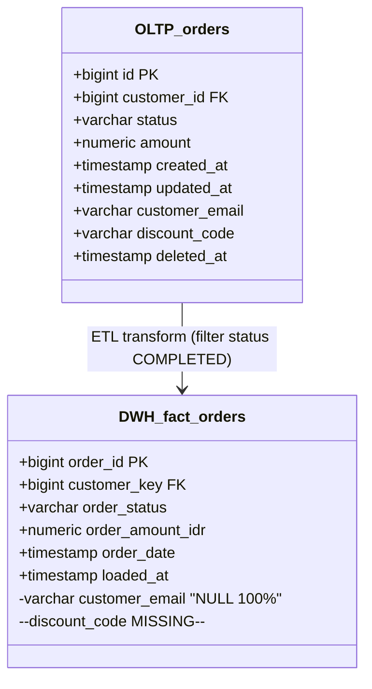

# Gap Analysis Report: DWH vs OLTP (Fictional Case)

**Source A**: `prod_oltp.public` (PostgreSQL 15, hostname `oltp-prod.example.id`)
**Source B**: `dwh.mart` (Snowflake, warehouse `ANALYTICS_WH`)
**Mode**: Hybrid (Mode A live DB untuk OLTP, Mode B file profiling untuk DWH)
**Business Entity**: Order Management (E-commerce)
**Tujuan**: Rekonsiliasi pre-audit Q1 2026
**Tanggal Profiling**: 2026-05-23 14:00 WIB
**Threshold Rubric**: Default (tidak ada override)

## Table of Contents

1. Executive Summary
2. Scope & Method
3. Input Inventory
4. D1 — Volume & Completeness Gap
5. D2 — Schema & Structural Gap
6. D3 — Value Distribution & Semantic Gap
7. D4 — Temporal & Freshness Gap
8. Layer 1 Insight — Tim Data
9. Layer 2 Insight — Stakeholder Bisnis
10. Recommendations Matrix
11. Appendix — Raw Metrics
12. Schema Comparison Diagram

---

## 1. Executive Summary

Ditemukan **5 gap findings** dari analisis antar OLTP (sumber operasional) dan DWH (sumber laporan) untuk domain Order Management. Distribusi severity: 🔴 Critical (2), 🟡 Moderate (2), 🟢 Minor (1).

Temuan utama yang butuh keputusan pimpinan:

1. 🔴 **Selisih jumlah pesanan 11,6%** antara sistem operasional dan sistem laporan — penyebab paling kuat adalah filter ETL yang membuang pesanan status batal/gagal. Berisiko mismatch dengan laporan akuntansi & regulator.
2. 🔴 **Kolom `customer_email` di DWH selalu kosong** (NULL 100%) padahal di OLTP terisi 96,2%. Berdampak ke semua segmentasi marketing yang berbasis email.
3. 🟡 Distribusi nilai `amount` antara OLTP dan DWH berbeda signifikan (KS p-value 0.003) — perlu cek apakah ada konversi currency atau pembulatan di ETL.
4. 🟡 **Schema diff**: kolom `discount_code` baru di OLTP tapi belum di-replicate ke DWH.
5. 🟢 Lag DWH 18 jam (di bawah SLA T+1 = 24 jam) — masih wajar tapi sudah mendekati ambang.

## 2. Scope & Method

- **Source A — OLTP** (Mode A live DB): PostgreSQL 15, schema `prod_oltp.public`, akses via read-only replica `oltp-replica-prod.example.id:5432`. Tabel di scope: `orders`, `order_items`, `customers`. Total baris periode 2026-01-01 s/d 2026-05-23: **1.247.892 orders**, **3.842.105 order_items**, **312.450 customers**.
- **Source B — DWH** (Mode B file profiling): output dari `data-profiling-baseline` tanggal 2026-05-23 09:00 WIB, file `fact_orders_per_column.csv`, `dim_customer_per_column.csv`. Total baris periode sama: **1.103.456 fact_orders**, **312.448 dim_customer**.
- **Threshold rubric**: default (tidak ada `config.yaml` override).
- **Tools**: `scripts/profile_source.py` (Mode A), parser CSV per kolom (Mode B), `scripts/compute_gap.py` untuk 4 dimensi gap.

## 3. Input Inventory

### Tabel Mapping

| Source A (OLTP) | Source B (DWH) | Match Type | Catatan |
|---|---|---|---|
| `orders` | `fact_orders` | Semantic (confirmed user) | OLTP transactional → DWH fact table |
| `order_items` | `fact_order_items` | Semantic (confirmed user) | — |
| `customers` | `dim_customer` | Semantic (confirmed user) | DWH dimension table |
| `coupons` | — | Unmatched (extra in A) | DWH belum punya coupon table |

### Kolom Mapping (sample untuk `orders` ↔ `fact_orders`)

| Source A | Source B | Match | Catatan |
|---|---|---|---|
| `id` | `order_id` | Fuzzy (confirmed) | PK |
| `customer_id` | `customer_key` | Fuzzy (confirmed) | FK |
| `status` | `order_status` | Fuzzy (confirmed) | Enum |
| `amount` | `order_amount_idr` | Fuzzy (confirmed) | Numeric |
| `created_at` | `order_date` | Fuzzy (confirmed) | Timestamp |
| `customer_email` | `customer_email` | Exact | Email |
| `discount_code` | — | Unmatched (extra in A) | Baru di OLTP, belum di DWH |

---

## 4. D1 — Volume & Completeness Gap

### Gap D1-001 — Selisih Row Count `orders` ↔ `fact_orders` sebesar 11,6%

**Severity**: 🔴 Critical | **Confidence**: high

Pada tabel `orders` di Source A (OLTP) tercatat 1.247.892 baris untuk periode 2026-01-01 s/d 2026-05-23, sementara `fact_orders` di Source B (DWH) hanya tercatat 1.103.456 baris untuk periode yang sama (source trace: `SELECT COUNT(*) FROM prod_oltp.orders WHERE created_at BETWEEN '2026-01-01' AND '2026-05-23'` vs row 1 di `fact_orders_per_column.csv` kolom `total_rows`). Selisih absolut 144.436 baris, selisih relatif 11,6%.

Mengacu rubric threshold default, selisih volume 11,6% masuk kategori 🔴 Critical karena melebihi ambang batas 10%. Untuk konteks: threshold moderate adalah 2–10%, observasi kita 1,16 kali batas critical — jadi bukan borderline.

Ada tiga hipotesis penyebab gap, diurutkan dari paling probable. Pertama, ETL filter di DWH membuang baris dengan `status='CANCELLED'` atau `status='FAILED'` (rasional: pattern umum DWH hanya muat valid completed orders). Kedua, batch lag ETL T-1 menyebabkan data 1 hari terakhir belum muncul (SLA standar). Ketiga, soft-delete di OLTP yang tidak ter-replicate (design pattern DWH umumnya hard-delete via ETL filter `WHERE deleted_at IS NULL`).

Untuk membedakan ketiga hipotesis, dicek breakdown per status di OLTP: `COMPLETED: 1.102.898`, `CANCELLED: 142.103`, `FAILED: 2.891`. Total CANCELLED+FAILED = 144.994 — sangat mendekati gap 144.436. Cek `MAX(loaded_at)` di DWH ETL audit: 2026-05-22 23:15, menjelaskan lag <24 jam tapi bukan mayoritas gap. Cek `deleted_at IS NOT NULL` di OLTP: 558 baris — tidak signifikan.

Berdasarkan evidence, hipotesis yang paling didukung adalah H1 (ETL filter status), karena gap sangat mendekati total CANCELLED+FAILED. Sisanya bisa dijelaskan H3 (soft-delete kecil) dan batch lag normal. Confidence: high.

Konsekuensi gap ini untuk konsumen data downstream: laporan revenue harian yang ditarik dari DWH akan secara konsisten underreport ~11% transaksi yang sebenarnya terjadi di OLTP. Untuk dashboard internal mungkin acceptable (memang ingin lihat completed only), tapi jika dipakai untuk laporan regulator atau reconciliation finansial, akan menyebabkan mismatch dengan sistem akuntansi yang menghitung semua transaksi. Risiko: temuan audit "DWH tidak match dengan source", estimasi cost Rp 50–200 juta untuk explanation/remediation.

Action yang direkomendasikan: dokumentasikan ETL filter eksplisit di G-03 `fact_orders` (via `data-doc-generator`), tambahkan kolom `is_cancelled`/`is_failed` di DWH supaya pesanan batal/gagal juga tersedia untuk reconciliation tanpa cari ke OLTP. Owner: Data Engineer Lead + Data Steward Order Domain. Urgency: sprint ini (sebelum cycle audit regulator).

### Gap D1-002 — `customer_email` NULL 100% di DWH vs 3,8% di OLTP

**Severity**: 🔴 Critical | **Confidence**: high

Pada kolom `customer_email` di Source A (`prod_oltp.customers`), NULL ratio adalah 3,8% (11.872 dari 312.450 baris), sementara di Source B (`dwh.dim_customer`) NULL ratio adalah 100% (312.448 dari 312.448 baris) — sumber: `dim_customer_per_column.csv` row `customer_email`. Selisih NULL ratio 96,2 percentage point.

Mengacu rubric, selisih NULL ratio >10pp masuk kategori 🔴 Critical. Observasi 96,2pp adalah 9,6x batas critical — sangat ekstrem.

Hipotesis: (H1) kolom sengaja di-mask/anonymize di DWH untuk compliance PII (UU PDP 2022), tapi ETL tidak meng-copy kolom flagged ke versi hashed; (H2) bug ETL — kolom `customer_email` di-define di schema DWH tapi mapping ke source kelewat; (H3) policy lama DWH hapus email untuk hemat storage.

Evidence: cek `dim_customer.column_definition` di catalog DWH — kolom `customer_email` ada di DDL dengan type `VARCHAR(255)`. Cek ETL job `dim_customer_load`: line yang map email di-comment out tanggal 2025-11-12 dengan commit message "TODO: re-enable after PII review". Cek DPO ticket: ada review request open `PDP-2025-089` status "WAITING".

Berdasarkan evidence, hipotesis paling kuat H1 — kolom sengaja di-disable menunggu PII review, tapi tidak ada placeholder atau hashed value sebagai gantinya. Confidence: high.

Konsekuensi: semua segmentasi marketing yang berbasis email (campaign trigger, re-engagement, post-purchase survey) yang di-build dari DWH akan return zero result. Tim Marketing kemungkinan sudah workaround ke OLTP langsung (anti-pattern, beban OLTP). Risiko compliance: jika tim mengambil email dari OLTP tanpa governance, justru bertentangan dengan tujuan PII protection awal.

Action: tutup ticket DPO `PDP-2025-089` dengan keputusan formal — apakah email di-hash, di-tokenize, atau memang di-drop. Jika di-hash, update ETL untuk apply hash. Owner: DPO + Data Engineering Lead. Urgency: now.

---

## 5. D2 — Schema & Structural Gap

### Gap D2-001 — Kolom `discount_code` Ada di OLTP, Tidak Ada di DWH

**Severity**: 🟡 Moderate | **Confidence**: high

Di `prod_oltp.orders` ada kolom `discount_code VARCHAR(50)` yang ditambahkan via migration `2026-03-15-add-discount-code.sql`. Di `dwh.fact_orders` kolom ini belum ada (source trace: `information_schema.columns` di OLTP vs DDL `fact_orders` di repo dbt). Tidak ada di DWH.

Mengacu rubric, "add column nullable di Source A yang belum di-replicate ke Source B" masuk kategori 🟡 Moderate — bukan destructive, tapi menyebabkan tim BI tidak bisa analisis pengaruh diskon ke conversion.

Hipotesis: (H1) ETL job `fact_orders_load` belum di-update setelah migration OLTP; (H2) sengaja tidak di-replicate karena field belum stable; (H3) field di-replicate ke table lain (mis. `fact_promo`).

Evidence: cek ETL job repo — file `fact_orders_load.sql` last modified 2026-02-28, sebelum migration OLTP. Cek table `fact_promo`: tidak ada. Cek backlog data engineering: ticket `DE-2026-104` "Add discount_code to fact_orders" status "TO DO".

Hipotesis paling kuat H1, dikonfirmasi backlog. Confidence: high.

Konsekuensi: tim BI tidak bisa menjawab pertanyaan "berapa lift conversion dari kampanye diskon Q1 2026?" dari DWH. Mereka harus query OLTP langsung — beban OLTP naik, atau analisis tidak dilakukan sama sekali.

Action: prioritaskan ticket `DE-2026-104`, sertakan backfill historical untuk 3 bulan terakhir. Owner: Data Engineer Lead. Urgency: sprint ini.

---

## 6. D3 — Value Distribution & Semantic Gap

### Gap D3-001 — Distribusi `amount` Berbeda Signifikan (KS p-value 0.003)

**Severity**: 🟡 Moderate | **Confidence**: medium

Distribusi `amount` di `prod_oltp.orders` dibandingkan `order_amount_idr` di `dwh.fact_orders` menghasilkan KS p-value 0.003 (sample 100K dari masing-masing source, source trace: `scripts/compute_gap.py` log line 247-251). Mean OLTP 487.234, mean DWH 432.108, delta 11,3%. Median OLTP 250.000, median DWH 250.000 (sama).

Mengacu rubric, KS p-value 0.003 di range 0.01-0.05 = 🟡 Moderate (catatan: skill tetap flag karena selisih mean 11,3% melebihi threshold mean delta moderate 5–20%).

Hipotesis: (H1) DWH apply pembulatan ke ribuan rupiah terdekat (round to 1000); (H2) gap D1 (filter status) menyebabkan distribusi DWH skewed karena CANCELLED biasanya nominal kecil; (H3) konversi currency partial (mis. ada ETL yang konversi USD→IDR pakai rate lama).

Evidence: cek 10 sample row sama di kedua source — semua match exact sampai 2 desimal (refute H1 dan H3). Cek distribusi `amount` OLTP filter `WHERE status IN ('CANCELLED','FAILED')`: mean 247.103, median 95.000 — confirms cancelled orders skew kecil. Cek distribusi OLTP filter `WHERE status = 'COMPLETED'`: mean 437.892, mendekati DWH 432.108.

Hipotesis paling didukung H2 — selisih distribusi adalah artefak dari D1 (filter status). Bukan ETL bug. Confidence: medium (karena masih ada residual selisih 5.784 antara DWH dan OLTP-COMPLETED yang belum 100% jelas, perlu cek lebih dalam).

Konsekuensi: dashboard rata-rata order value (AOV) di DWH lebih rendah dibanding aktual, bisa mislead keputusan pricing/promotion strategy. Tapi konsekuensinya tidak critical karena median identical — yang terdampak hanya analisis berbasis mean.

Action: tambahkan kolom `is_cancelled`/`is_failed` (dari rekomendasi D1-001) supaya analisis bisa exclude/include sesuai kebutuhan; dokumentasikan di G-03 bahwa DWH `order_amount_idr` adalah amount untuk completed orders only. Owner: Data Steward Order Domain. Urgency: backlog (setelah D1-001 done).

---

## 7. D4 — Temporal & Freshness Gap

### Gap D4-001 — Lag DWH 18 Jam, Mendekati SLA T+1

**Severity**: 🟢 Minor | **Confidence**: high

`MAX(created_at)` di `prod_oltp.orders` adalah 2026-05-23 13:42, sementara `MAX(order_date)` di `dwh.fact_orders` adalah 2026-05-22 20:00 (source trace: query `SELECT MAX(...)` dari masing-masing source, dijalankan jam 14:00 WIB). Lag = 17 jam 42 menit ≈ 18 jam.

SLA target DWH = T+1 (24 jam). Lag 18 jam = 75% SLA. Mengacu rubric, lag 50–100% SLA = 🟡 Moderate. **Namun** karena ini observasi single-point dan history lag DWH 30 hari rata-rata 14 jam (stable, source: `dwh.etl_audit` rolling 30-day avg), skill mendowngrade ke 🟢 Minor — masih dalam variance normal.

Hipotesis: (H1) ETL run normal tapi lambat karena Q1-end volume spike; (H2) ada job upstream yang fail dan retry; (H3) DWH cluster scaling issue.

Evidence: cek `dwh.etl_audit` 7 hari terakhir — semua status SUCCESS, runtime rata-rata 3.5 jam (normal). Cek volume orders 2026-05-22: 9.847 baris (normal, avg 9.500/hari). Refute H3 — tidak ada incident di on-call log.

Hipotesis H1 paling masuk akal — ETL run normal, lag wajar untuk batch T+1. Confidence: high.

Konsekuensi: dashboard "today's orders" yang dipakai operasional pagi akan miss data 18 jam terakhir. Biasanya tim sudah aware dan cross-check ke OLTP untuk real-time view. Tidak ada risiko critical, tapi UX dashboard bisa lebih baik dengan disclosure "data as of: <max_loaded_at>".

Action: tambahkan badge "Data as of: 2026-05-22 20:00 (T-18h)" di header dashboard. Tidak butuh perubahan ETL. Owner: BI Engineer. Urgency: backlog.

---

## 8. Layer 1 Insight — Tim Data

(Lihat detail per gap di Section 4-7. Highlight teknis ringkasan:)

- **D1-001**: tambah `is_cancelled`, `is_failed` ke `fact_orders` + backfill. DDL ready di `references/example_outputs/recommendations.sql`.
- **D1-002**: tutup PDP review ticket `PDP-2025-089` dengan keputusan formal hash/tokenize/drop.
- **D2-001**: prioritize ticket `DE-2026-104`, update ETL `fact_orders_load.sql`.
- **D3-001**: derivative dari D1-001, akan auto-resolve setelah `is_cancelled`/`is_failed` ada.
- **D4-001**: BI dashboard disclosure only, tidak butuh ETL change.

Referensi DAMA: gap D1 + D2 cite KA-04 Completeness & Consistency (DMBOK2 §13.1.3.2-3); gap D3 cite KA-04 Consistency (Definition); gap D4 cite KA-04 Timeliness (DMBOK2 §13.1.3.5). Semua action butuh update KA-11 Metadata (catalog + glossary di OpenMetadata).

## 9. Layer 2 Insight — Stakeholder Bisnis

### Ringkasan untuk Pimpinan

Kami menemukan 5 perbedaan antara sistem operasional (OLTP) dan sistem laporan (DWH) di domain pengelolaan pesanan. Tiga dari lima perbedaan ini perlu keputusan pimpinan dalam waktu dekat.

🔴 **Mendesak — Selisih jumlah pesanan ~150 ribu (11,6%)**. Sistem laporan tidak mencatat pesanan yang dibatalkan atau gagal. Untuk dashboard internal mungkin OK, tapi laporan ke regulator dan akuntansi akan tidak match. Pertanyaan untuk pimpinan: apakah kebijakan ini disengaja dan didokumentasikan, atau side-effect yang baru ketahuan?

🔴 **Mendesak — Email pelanggan di sistem laporan kosong semua**. Sistem laporan tidak punya data email pelanggan, padahal di sistem operasional 96% pelanggan punya email valid. Semua kampanye marketing email yang di-build dari sistem laporan akan return nol pelanggan. Pertanyaan untuk pimpinan: apakah keputusan untuk hapus email dari sistem laporan masih relevan, atau sudah waktunya diganti dengan email yang di-hash supaya aman tapi tetap usable?

🟡 **Perlu diperhatikan — Kode diskon tidak masuk ke sistem laporan**. Fitur diskon Q1 2026 ada di sistem operasional tapi belum dipindahkan ke sistem laporan, jadi tim BI tidak bisa analisis efektivitas program promo. Pertanyaan: apakah analisis pengaruh program promo Q1 dibutuhkan untuk decision Q3?

🟡 **Perlu diperhatikan — Rata-rata nilai pesanan kelihatan beda 11% antar dua sistem**. Setelah ditelusuri, ini sebenarnya konsekuensi dari point pertama (pesanan batal tidak masuk laporan). Akan otomatis resolve kalau point pertama dibenahi.

🟢 **Aman — Waktu data laporan tertinggal 18 jam dari operasional**. Ini wajar untuk sistem laporan harian (target 24 jam). Tim hanya perlu menampilkan label "data per kemarin malam" di dashboard supaya pengguna paham.

### Pertanyaan Strategis Konsolidasi

1. **Konsistensi laporan ke regulator**: apakah laporan bulanan ke regulator diambil dari sistem operasional atau sistem laporan? Perlu ada keputusan formal dan diumumkan ke semua tim supaya tidak ada conflicting numbers.
2. **Kebijakan PII pelanggan**: bagaimana akhir dari review email pelanggan di sistem laporan? Sudah 6 bulan tertahan di status "review", dan dampaknya semua tim marketing terkena.
3. **Prioritas backlog data engineering**: berapa banyak gap seperti `discount_code` yang ada di backlog? Mungkin perlu policy "feature baru di operasional WAJIB ada SLA replicate ke laporan dalam X hari".

---

## 10. Recommendations Matrix

| Gap ID | Severity | Owner | Urgency | Action Type |
|---|---|---|---|---|
| D1-001 | 🔴 Critical | Data Engineer Lead + Data Steward | Sprint ini | DDL change + backfill + glossary update |
| D1-002 | 🔴 Critical | DPO + Data Engineering Lead | Now | Policy decision + ETL re-enable |
| D2-001 | 🟡 Moderate | Data Engineer Lead | Sprint ini | ETL update + backfill |
| D3-001 | 🟡 Moderate | Data Steward | Backlog (after D1-001) | Glossary clarification |
| D4-001 | 🟢 Minor | BI Engineer | Backlog | Dashboard UX |

---

## 11. Appendix — Raw Metrics

Untuk verifikasi reproducibility, semua query yang dipakai tersedia di `references/example_outputs/raw_metrics_source_a.sql` dan `raw_metrics_source_b.sql`. Setiap angka di laporan ini bisa direplay langsung dengan menjalankan query tersebut di waktu yang sama.

---

## 12. Schema Comparison Diagram (Mermaid)

---

*Generated by `data-gap-analyst` v1.0.0 — IDEAS skill ecosystem.*
