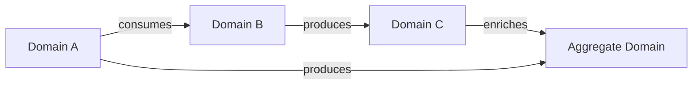

# Framework Reference: Data Mesh + DAMA + Privacy

## Sections in This File

| Seksi | Konten | Mulai Baris |
|---|---|---|
| Context Intake | Checklist pertanyaan untuk memahami brief | ~30 |
| Data Mesh 4 Prinsip | Fondasi arsitektur | ~80 |
| Domain Mapping Methodology | Cara memetakan bisnis → domain | ~160 |
| Data Product Archetypes | Source-aligned, Aggregate, Consumer-aligned | ~230 |
| DAMA-DMBOK2 Mapping | 14 KA dalam konteks Data Mesh | ~270 |
| Data Product Canvas Guide | Cara mengisi canvas 8 komponen | ~340 |
| Federated Governance Model | Struktur governance terfederasi | ~400 |

---

## Context Intake: Checklist untuk Business Brief Apapun

Sebelum memulai domain mapping, pastikan jawaban atas pertanyaan berikut tersedia dari brief. Jika tidak ada, ajukan ke user — **satu pertanyaan per giliran**.

### Bisnis & Proses
- [ ] **Tujuan utama program/sistem** — apa yang ingin dicapai?
- [ ] **Aktor utama** — siapa saja yang terlibat (pengguna akhir, operator, regulator, mitra)?
- [ ] **Proses bisnis inti** — apa alur utama dari trigger pertama sampai outcome akhir?
- [ ] **Event-event kritis** — apa saja kejadian penting yang harus dicatat? (pendaftaran, transaksi, pelaporan, dst.)
- [ ] **KPI keberhasilan** — bagaimana kesuksesan diukur secara bisnis?

### Data & Teknis
- [ ] **Sistem sumber yang ada** — apakah ada sistem operasional existing yang jadi sumber data?
- [ ] **Volume dan kecepatan** — berapa record/transaksi per hari? Apakah batch atau real-time?
- [ ] **Skala** — berapa pengguna, lokasi, atau unit operasional?
- [ ] **Integrasi eksternal** — data dari mana saja yang perlu masuk atau keluar?

### Organisasi & Governance
- [ ] **Struktur organisasi** — siapa yang punya otoritas atas masing-masing domain?
- [ ] **Regulasi yang berlaku** — industri apa? Regulasi apa? (OJK, Kominfo, BPOM, dsb.)
- [ ] **Apakah ada data pribadi?** — jika ya, kategori apa?
- [ ] **Kebutuhan reporting** — ke mana hasil data harus dilaporkan? Format apa?

### Infrastruktur & Anggaran
- [ ] **Cloud atau on-premise?** — atau hybrid?
- [ ] **Preferensi teknologi** — ada stack yang sudah digunakan atau dilarang?
- [ ] **Budget ballpark** — ada constraint anggaran yang signifikan?

---

## Data Mesh: 4 Prinsip Fondasi

### Prinsip 1 — Domain-Oriented Decentralized Data Ownership

**Konsep:** Kepemilikan data analitik bergeser dari tim data sentral ke tim domain. Setiap domain memiliki data dari sumber operasionalnya secara end-to-end — mulai dari ingestion, transformasi, hingga publikasi sebagai data product.

**Implikasi desain:**
- Satu domain = satu tim yang bertanggung jawab (bukan shared ownership)
- Domain boundary mengikuti bounded context bisnis (DDD)
- Tim domain memiliki kompetensi data engineering sendiri
- Data pipeline adalah bagian dari domain, bukan domain IT sentral

**Anti-pattern yang harus dihindari:**
- Data lake terpusat yang dikelola satu tim → bottleneck
- Domain tanpa Product Owner yang jelas → orphaned data
- Boundary domain mengikuti struktur organisasi IT, bukan bisnis

---

### Prinsip 2 — Data as a Product

**Enam karakteristik data product yang harus dipenuhi:**

| Karakteristik | Deskripsi | Implementasi |
|---|---|---|
| **Discoverable** | Bisa ditemukan oleh consumer | Entry di data catalog dengan metadata lengkap |
| **Addressable** | Memiliki alamat/identifier unik dan permanen | URN format: `urn:dataproduct:{domain}:{name}:{version}` |
| **Trustworthy** | Consumer bisa mengandalkan kualitas | SLO terdefinisi, quality metrics dipublikasikan |
| **Self-describing** | Mendeskripsikan dirinya sendiri | Data contract dengan schema, semantics, lineage |
| **Interoperable** | Bisa digunakan bersama data product lain | Standar output port, format terbuka |
| **Secure** | Hanya consumer berwenang yang bisa akses | Policy-based access, audit trail |

**Tiga komponen arsitektur data product:**
```
Data Product
├── Code        → pipeline, transformation logic, API, policies
├── Data        → datasets, metadata, quality metrics, lineage
└── Infra       → storage, compute, monitoring, access control
```

---

### Prinsip 3 — Self-Serve Data Platform

**Tiga plane platform:**

```
┌─────────────────────────────────────────┐
│  Mesh Experience Plane                  │
│  (Discovery, Governance, Observability) │
├─────────────────────────────────────────┤
│  Data Product Developer Experience      │
│  (SDK, Templates, CI/CD, Testing tools) │
├─────────────────────────────────────────┤
│  Data Infrastructure Provisioning       │
│  (Storage, Compute, Networking, IAM)    │
└─────────────────────────────────────────┘
```

**Apa yang HARUS disediakan platform (bukan per-domain):**
- Data catalog terpusat (discovery)
- Template data product (scaffolding)
- CI/CD pipeline standar
- Monitoring dan alerting
- Access control terpusat
- Data quality framework
- Schema registry

---

### Prinsip 4 — Federated Computational Governance

**Dua level governance:**

1. **Global policies** (ditetapkan governance council, dieksekusi secara komputasional):
   - Data classification standards
   - Privacy dan security requirements (PII handling, encryption at-rest)
   - Interoperability standards (format, naming convention)
   - Quality minimums (completeness, freshness SLO)
   - Compliance requirements (UU PDP, regulasi industri)

2. **Local policies** (diimplementasikan per domain):
   - Domain-specific business rules
   - Access control dalam domain
   - Retention policy sesuai kebutuhan bisnis domain
   - Custom quality rules beyond global minimum

**Governance council membership:**
- Data Product Owners (perwakilan per domain)
- Platform Product Owner
- Chief Data Officer / Data Governance Lead
- Legal / Compliance representative
- Security representative

---

## Domain Mapping Methodology

### Langkah 1 — Event Storming dari Business Brief

Baca brief, identifikasi semua **domain event** (kejadian bisnis yang signifikan). Format: kata kerja past tense dalam Bahasa Indonesia.

Contoh generic dari industri apapun:
- `PenggunaDidaftarkan`, `TransaksiDiproses`, `ProdukDikirim`
- `LaporanDibuat`, `AuditDilakukan`, `IncidentDitangani`

### Langkah 2 — Cluster Event ke Bounded Context

Kelompokkan event yang memiliki:
- **Cohesion tinggi**: event saling terkait dalam satu proses
- **Coupling rendah**: minimal dependency ke event di cluster lain
- **Ubiquitous language** yang sama (domain-specific terminology)

Tiap cluster = satu calon domain.

### Langkah 3 — Validasi dengan Test Pertanyaan

Untuk setiap calon domain, tanyakan:
- Apakah ada tim bisnis yang punya expertise dan otoritas atas domain ini?
- Apakah bisa di-deploy dan di-evolve secara independen dari domain lain?
- Apakah domain ini memiliki "single source of truth" yang jelas?
- Apakah ukurannya tepat? (bukan terlalu besar = monolith, bukan terlalu kecil = nano-domain)

### Langkah 4 — Identifikasi Data Products per Domain

Untuk setiap domain, tanyakan:
- Siapa yang akan mengkonsumsi data dari domain ini?
- Data apa yang perlu dipublikasikan (vs. disimpan internal)?
- Dalam format/interface apa data akan dikonsumsi?

Setiap kombinasi "data yang dipublikasikan + interface + consumer" = satu calon data product.

### Langkah 5 — Gambar Domain Relationship



Identifikasi:
- **Upstream domains**: menghasilkan data
- **Downstream domains**: mengkonsumsi data
- **Aggregate domains**: menggabungkan dari multiple upstream

---

## Data Product Archetypes

### Source-Aligned (Native/Operational)

**Definisi:** Data product yang memetakan langsung ke event dan entitas dari sistem operasional domain.

**Karakteristik:**
- Data dengan granularitas tinggi, mendekati raw
- Update near-real-time atau batch harian
- Minimal transformasi bisnis
- Sering menjadi upstream untuk aggregate products

**Contoh cross-industry:**
- E-commerce: `order-events`, `inventory-snapshot`
- Kesehatan: `patient-encounters`, `medication-records`
- Keuangan: `transaction-ledger`, `account-positions`
- Pemerintah: `citizen-registry`, `facility-operations`

---

### Aggregate (Consolidated)

**Definisi:** Data product yang menggabungkan dan mengintegrasikan data dari beberapa source-aligned products atau domain berbeda.

**Karakteristik:**
- Cross-domain integration
- Business-level aggregation dan enrichment
- Digunakan untuk analisis lintas-domain
- Biasanya batch (harian/mingguan)

**Contoh cross-industry:**
- E-commerce: `customer-360`, `product-performance`
- Kesehatan: `patient-journey`, `care-outcomes`
- Keuangan: `portfolio-risk`, `customer-profitability`
- Pemerintah: `program-impact-summary`, `regional-dashboard`

---

### Consumer-Aligned (Fit-for-Purpose)

**Definisi:** Data product yang dioptimasi untuk kebutuhan spesifik consumer atau use case tertentu.

**Karakteristik:**
- Highly denormalized, optimized for specific query pattern
- Semantic model sesuai domain konsumen
- Sering menggunakan materialized views atau pre-aggregated tables
- Dibuat ketika consumer membutuhkan bentuk data yang sangat spesifik

**Contoh cross-industry:**
- E-commerce: `recommendation-features` (untuk ML model)
- Kesehatan: `clinical-dashboard-dataset` (untuk dashboard dokter)
- Keuangan: `regulatory-report-dataset` (untuk laporan OJK)
- Pemerintah: `audit-report-dataset` (untuk BPK)

---

## DAMA-DMBOK2 Mapping dalam Data Mesh

| KA | Knowledge Area | Peran dalam Data Mesh |
|---|---|---|
| KA-01 | Data Governance | Federated computational governance; governance council; policy-as-code |
| KA-02 | Data Architecture | Domain boundary design; output port standards; platform architecture |
| KA-03 | Data Modeling | Schema definition dalam data contracts; ubiquitous language per domain |
| KA-04 | Data Storage & Operations | Polyglot persistence per domain; platform-provisioned storage |
| KA-05 | Data Security | Privacy-by-design; column-level security; policy enforcement |
| KA-06 | Data Integration | Output ports standardization; data contract interoperability |
| KA-07 | Document & Content Mgmt | Docusaurus docs-as-code; versioned documentation |
| KA-08 | DW & BI | Consumer-aligned data products untuk analytics; semantic layer |
| KA-09 | Metadata Management | Data catalog terpusat; DCAT-AP metadata standards |
| KA-10 | Reference & Master Data | Dedicated data products untuk reference data; global domain |
| KA-11 | Data Quality | Quality attributes dalam data contracts; automated DQ testing |
| KA-12 | Data Handling & Ethics | DPIA; RoPA; privacy-by-design; data classification |
| KA-13 | Big Data & Data Science | Feature store data products; ML dataset products |
| KA-14 | Data Management Maturity | Data Mesh maturity assessment (5 levels) |

---

## Data Product Canvas Guide (8 Komponen)

Canvas dari datamesh-architecture.com (CC BY 4.0, Larysa Visengeriyeva):

### Cara mengisi canvas secara berurutan:

**1. Domain** — Nama bounded context/domain bisnis

**2. Data Product Name** — Nama unik dalam domain. Konvensi: `{domain}-{entitas}-{versi}` (contoh: `finance-transaction-v1`)

**3. Consumer(s) & Use Case(s)** — Siapa yang akan menggunakan? Untuk apa?
```
Format Use Case:
"Kami percaya bahwa [consumer] akan [aksi/benefit]
menggunakan [data product ini] untuk [use case spesifik]
yang akan diukur melalui [metric]."
```

**4. Source Systems** — Sistem operasional asal data (bisa source sistem atau domain/data product lain)

**5. Data Product Architecture (6 komponen internal):**
- Processing: batch/streaming/real-time
- Framework: dbt, Spark, Flink, dsb.
- Costs: estimasi biaya infrastruktur
- Transformation Steps: ingest → clean → transform → aggregate → publish
- Query Engine: SQL, Python, API
- Storage: tabel, file, topic, bucket

**6. Data Contract (6 elemen):**
- Output Port: format output (tabel, REST API, event stream, file)
- Terms: ketentuan penggunaan, lisensi
- Data Model: schema, field definitions
- Definitions: semantic definitions, business keys, PII flags
- Quality: SLO untuk completeness, freshness, accuracy
- SLAs: availability, support, retention
- Security: siapa yang boleh akses? approval process?

**7. Classification** — Source-aligned / Aggregate / Consumer-aligned

**8. Ubiquitous Language** — Glossary istilah domain-specific yang relevan untuk data product ini

**Follow-up:** Setelah canvas selesai → buat `data-contract.yaml` formal

---

## Federated Governance Model

### Governance Artifacts yang Wajib Ada

Untuk setiap Data Mesh implementation, buat dokumen berikut:

**Level Global (satu untuk seluruh mesh):**
1. Data Classification Policy
2. PII Handling Standards
3. Data Contract Standards
4. Naming Convention Standards
5. Interoperability Standards
6. Minimum Quality SLOs
7. Security Baseline

**Level Domain (satu per domain):**
1. Domain Charter
2. Data Product Catalog (list semua data products domain)
3. Data Stewardship Assignments
4. Domain-Specific Quality Rules

**Level Data Product (satu per produk):**
1. Data Product Canvas
2. Data Contract (YAML)
3. RoPA (jika memproses data pribadi)
4. DPIA (jika diperlukan)
5. Data Quality Rules
