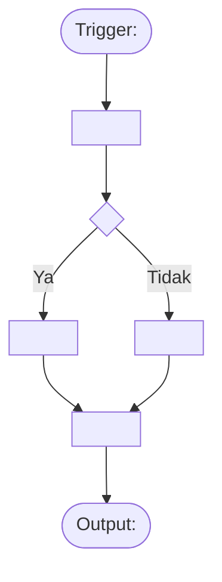
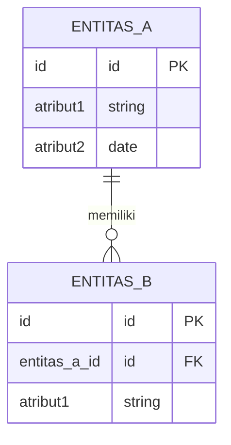

# Business Process Research & Data Context

> **Tujuan dokumen ini:** Mendokumentasikan pemahaman mendalam tentang proses bisnis, aktor, alur data, dan konteks organisasi yang menjadi fondasi desain data product. Dokumen ini dibuat **sebelum** canvas dan proposal, untuk memastikan desain data product benar-benar menjawab kebutuhan bisnis yang nyata.

:::info Cara Menggunakan Template Ini
Isi semua bagian yang ditandai `[Mandatory]`. Bagian `[Opsional]` diisi jika relevan. Hapus catatan panduan sebelum finalisasi.
:::

---

## Riwayat Versi

| Tanggal | Versi | Deskripsi Perubahan | Penulis |
|---|---|---|---|
| `<YYYY-MM-DD>` | 0.1 | Versi awal | `<Nama>` |
| | | | |

---

## Definisi Umum

| Atribut | Nilai |
|---|---|
| **Nama Data Product** | `<Nama Data Product>` |
| **Domain** | `<Nama Domain>` |
| **Pemilik Domain** | `<Nama Tim / Organisasi>` |
| **Tanggal Riset** | `<YYYY-MM-DD>` |
| **Narasumber Utama** | `<Nama, Jabatan, Organisasi>` |
| **Metode Riset** | `<Interview / Workshop / Dokumen Review / Kombinasi>` |

---

## 1. Konteks Organisasi & Program

`[Mandatory]` — *Role: Data Product Owner + Business Analyst*

### 1.1 Gambaran Program / Sistem

Deskripsikan program, sistem, atau inisiatif bisnis yang menjadi konteks data product ini. Jawab pertanyaan:
- Apa tujuan utama program/sistem ini?
- Siapa yang menginisiasi dan siapa yang bertanggung jawab?
- Apa regulasi atau kebijakan yang mengatur program ini?

> **[Isi di sini]**

### 1.2 Struktur Organisasi yang Relevan

Gambarkan hierarki organisasi yang terlibat dalam konteks data product ini:

```
<Nama Organisasi Induk>
├── <Unit/Divisi A>
│   ├── <Sub-unit A1> — [Peran dalam proses]
│   └── <Sub-unit A2> — [Peran dalam proses]
└── <Unit/Divisi B>
    └── <Sub-unit B1> — [Peran dalam proses]
```

### 1.3 Regulasi & Kebijakan yang Berlaku

`[Mandatory jika ada]`

| Regulasi / Kebijakan | Nomor / Versi | Dampak pada Data |
|---|---|---|
| `<Contoh: UU PDP>` | `<No. 27/2022>` | `<Wajib menerapkan privacy-by-design>` |
| `<Contoh: Perpres SPBE>` | `<No. 95/2018>` | `<Standar arsitektur digital pemerintah>` |
| | | |

---

## 2. Pemetaan Proses Bisnis

`[Mandatory]` — *Role: Business Analyst + Data Architect*

### 2.1 Proses Bisnis Inti

Deskripsikan alur proses bisnis utama yang menghasilkan atau mengonsumsi data. Gunakan format narasi dan diagram.

**Narasi alur proses:**

> **[Isi di sini — jelaskan step-by-step dari trigger awal sampai outcome akhir]**

**Diagram alur (Swimlane):**



### 2.2 Domain Events (Kejadian Bisnis Penting)

Daftar semua kejadian bisnis signifikan yang harus dicatat sebagai data:

| # | Domain Event | Deskripsi | Frekuensi | Siapa yang Memicu |
|---|---|---|---|---|
| 1 | `<NamaEvent>Terjadi` | `<Deskripsi kejadian>` | `<Harian/Per transaksi/Real-time>` | `<Aktor>` |
| 2 | | | | |
| 3 | | | | |

### 2.3 Proses Bisnis Pendukung

`[Opsional]` — Proses-proses bisnis lain yang berinteraksi dengan proses inti:

| Proses Pendukung | Hubungan dengan Proses Inti | Domain |
|---|---|---|
| `<Nama proses>` | `<Menyediakan input / Menerima output / Paralel>` | `<Nama domain>` |
| | | |

---

## 3. Aktor & Stakeholder

`[Mandatory]` — *Role: Business Analyst + Data Product Owner*

### 3.1 Peta Aktor

| Aktor | Peran dalam Proses | Interaksi dengan Data | Kebutuhan Data Utama |
|---|---|---|---|
| `<Nama aktor>` | `<Apa yang dilakukan>` | `<Membuat/Membaca/Mengubah/Menghapus>` | `<Data apa yang dibutuhkan>` |
| | | | |

### 3.2 Stakeholder Map

| Stakeholder | Organisasi | Level Kepentingan | Level Pengaruh | Kebutuhan |
|---|---|---|---|---|
| `<Nama>` | `<Org>` | `<Tinggi/Sedang/Rendah>` | `<Tinggi/Sedang/Rendah>` | `<Apa yang mereka butuhkan dari data product>` |
| | | | | |

### 3.3 Consumer Personas

Untuk setiap persona pengguna data product, deskripsikan:

**Persona 1: `<Nama Persona>`**

| Atribut | Detail |
|---|---|
| **Jabatan/Peran** | `<Contoh: Analis Data Senior>` |
| **Konteks Kerja** | `<Bagaimana mereka bekerja sehari-hari>` |
| **Pertanyaan Bisnis Utama** | `<Apa yang ingin mereka jawab dengan data?>` |
| **Cara Konsumsi Data** | `<Dashboard / API / Query langsung / File export>` |
| **Frekuensi Akses** | `<Harian / Mingguan / Ad-hoc>` |
| **Tingkat Teknis** | `<Expert SQL / Business user / Eksekutif>` |

*(Tambahkan persona sesuai kebutuhan)*

---

## 4. Pemetaan Entitas Data

`[Mandatory]` — *Role: Data Architect + Data Analyst*

### 4.1 Entitas Bisnis Utama

Identifikasi entitas data inti yang terlibat dalam proses bisnis:

| Entitas | Deskripsi Bisnis | Atribut Kunci | Sistem Sumber | Apakah Ada PII? |
|---|---|---|---|---|
| `<NamaEntitas>` | `<Apa entitas ini dalam bahasa bisnis>` | `<ID utama, nama, dll.>` | `<Nama sistem>` | `<Ya/Tidak>` |
| | | | | |

### 4.2 Entity Relationship (Bisnis Level)



### 4.3 Data Classification Awal

| Entitas / Atribut | Klasifikasi | Alasan | Regulasi Terkait |
|---|---|---|---|
| `<Nama>` | `<Public/Internal/Restricted/Confidential>` | `<Mengapa diklasifikasikan demikian>` | `<UU PDP Pasal X / dsb.>` |
| | | | |

---

## 5. Sistem & Infrastruktur Sumber

`[Mandatory]` — *Role: Data Engineer + Data Architect*

### 5.1 Sistem Sumber yang Diidentifikasi

| Sistem | Tipe | Teknologi | Pemilik | Cara Akses | Kualitas Data Awal |
|---|---|---|---|---|---|
| `<Nama sistem>` | `<Operasional/API/File/Stream>` | `<PostgreSQL/REST API/CSV/Kafka>` | `<Tim/Organisasi>` | `<Direct DB/API key/SFTP>` | `<Baik/Sedang/Buruk/Belum diketahui>` |
| | | | | | |

### 5.2 Dependency & Integrasi Eksternal

| Sistem Eksternal | Tipe Integrasi | Frekuensi | SLA yang Ada | Risiko Ketergantungan |
|---|---|---|---|---|
| `<Nama>` | `<API/File Transfer/DB Link>` | `<Real-time/Batch harian>` | `<Ada/Tidak ada>` | `<Tinggi/Sedang/Rendah>` |
| | | | | |

---

## 6. Gap Analysis & Peluang

`[Mandatory]` — *Role: Data Architect + Business Analyst*

### 6.1 Pain Points Saat Ini

| # | Masalah | Dampak Bisnis | Root Cause | Prioritas |
|---|---|---|---|---|
| 1 | `<Deskripsi masalah>` | `<Apa dampaknya>` | `<Penyebab utama>` | `<Tinggi/Sedang/Rendah>` |
| 2 | | | | |

### 6.2 Peluang yang Teridentifikasi

| # | Peluang | Nilai Bisnis yang Diharapkan | Feasibilitas Teknis |
|---|---|---|---|
| 1 | `<Deskripsi peluang>` | `<Nilai/manfaat>` | `<Tinggi/Sedang/Rendah>` |
| 2 | | | |

### 6.3 Kebutuhan Data yang Belum Terpenuhi

| Kebutuhan | Siapa yang Butuh | Mengapa Belum Ada | Pendekatan Solusi |
|---|---|---|---|
| `<Deskripsi kebutuhan>` | `<Aktor/Stakeholder>` | `<Alasan gap>` | `<Bagaimana data product akan mengisi gap ini>` |
| | | | |

---

## 7. Kesimpulan & Rekomendasi

`[Mandatory]` — *Role: Data Architect + Data Product Owner*

### 7.1 Rangkuman Temuan Kunci

> **[Tuliskan 3-5 temuan paling penting dari riset ini yang harus menjadi input desain data product]**

1. ...
2. ...
3. ...

### 7.2 Rekomendasi Data Domain

Berdasarkan riset di atas, domain-domain berikut direkomendasikan:

| Domain Kandidat | Justifikasi | Data Product Utama | Prioritas |
|---|---|---|---|
| `<Nama Domain>` | `<Mengapa ini satu bounded context>` | `<List data product>` | `<1/2/3>` |
| | | | |

### 7.3 Risiko & Asumsi

| Tipe | Deskripsi | Dampak | Mitigasi Awal |
|---|---|---|---|
| **Asumsi** | `<Hal yang diasumsikan benar>` | `<Jika salah, apa yang terjadi>` | `<Langkah validasi>` |
| **Risiko** | `<Risiko yang teridentifikasi>` | `<Dampak bisnis/teknis>` | `<Mitigasi awal>` |
| | | | |

---

## 8. Lampiran

`[Opsional]`

- Link ke recording workshop / interview: `<URL>`
- Link ke dokumen referensi: `<URL>`
- Gambar / diagram tambahan: `<Embed atau link>`
