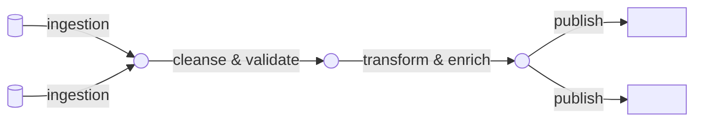

# Data Product Canvas

> **Tujuan dokumen ini:** Visualisasi satu-halaman yang mengintegrasikan seluruh aspek data product — dari sumber data hingga kontrak dan konsumen. Canvas ini adalah artefak komunikasi utama antara tim domain, konsumen, dan platform.

:::tip Cara Mengisi Canvas
Ikuti urutan pengisian: (1) Domain & Nama → (2) Consumer & Use Cases → (3) Data Contract → (4) Sources → (5) Architecture → (6) Classification → (7) Ubiquitous Language. Diskusikan bersama seluruh tim dalam sesi 2 jam.
:::

---

## Riwayat Versi

| Tanggal | Versi | Deskripsi | Penulis |
|---|---|---|---|
| `<YYYY-MM-DD>` | 0.1 | Versi awal | `<Nama>` |

---

## Header

| Atribut | Nilai |
|---|---|
| **Domain** | `<Nama Domain — bounded context bisnis>` |
| **Data Product Name** | `<Nama unik dalam domain>` |
| **Versi** | `<v1.0.0>` |
| **Tanggal** | `<YYYY-MM-DD>` |
| **Product Owner** | `<Nama, Email>` |

---

## Bagian 1 — Consumer(s) & Use Case(s)

`[Mandatory]` — *Role: DPO + Data Analyst*

### Siapa konsumen data product ini?

| Consumer | Tipe | Kebutuhan Utama |
|---|---|---|
| `<Nama tim/sistem>` | `<Human / System>` | `<Apa yang ingin dilakukan>` |
| | | |

### Use Cases

Gunakan format pernyataan use case:

> *"Kami percaya bahwa **[consumer]** akan **[aksi/benefit]** menggunakan data product ini untuk **[use case spesifik]**, yang akan kami ukur melalui **[metric]**."*

**Use Case 1:**
> `[Isi pernyataan use case 1]`

**Use Case 2:**
> `[Isi pernyataan use case 2]`

**Use Case 3:**
> `[Opsional — tambahkan jika ada]`

---

## Bagian 2 — Sources

`[Mandatory]` — *Role: Data Engineer + Data Architect*

### Source Systems (Sistem Operasional)

Sistem asal data yang menghasilkan data ini pertama kali:

| Source | Tipe | Entitas/Data | Koneksi | Frekuensi |
|---|---|---|---|---|
| `<Nama sistem>` | `<Operational DB / API / File / IoT>` | `<Tabel/endpoint/topik>` | `<Direct / CDC / API pull>` | `<Real-time / 15min / Harian>` |
| | | | | |

### Domain/Data Product Sources (Upstream Data Products)

Data products dari domain lain yang dikonsumsi:

| Domain | Data Product | Output Port | Tipe Relasi |
|---|---|---|---|
| `<Nama domain>` | `<Nama data product>` | `<Tabel/API/Stream>` | `<Enrichment / Join / Aggregation>` |
| | | | |

---

## Bagian 3 — Data Product Architecture

`[Mandatory]` — *Role: Data Architect + Data Engineer*

### Processing & Infrastructure

| Komponen | Detail |
|---|---|
| **Processing Mode** | `<Batch / Streaming / Lambda (Keduanya)>` |
| **Framework** | `<dbt / Apache Spark / Flink / Kafka Streams / lainnya>` |
| **Estimasi Biaya** | `<Rp X / USD X per bulan>` |

### Transformation Steps

Alur transformasi dari sumber ke output port:

```
[Sumber] 
  ↓ Ingestion      → <Cara data diambil dari sumber>
  ↓ Cleansing      → <Rules pembersihan data>
  ↓ Transformation → <Enrichment, join, kalkulasi>
  ↓ Aggregation    → <Kalkulasi summary jika diperlukan>
  ↓ Projection     → <Format akhir untuk output port>
[Output Port]
```

**Diagram Lineage (Mermaid):**



### Query Engine & Storage

| Komponen | Teknologi | Detail |
|---|---|---|
| **Query Engine** | `<Trino / PostgreSQL / PostgreSQL / Spark SQL>` | `<Cara consumer mengakses>` |
| **Storage Layer** | `<S3+Iceberg / PostgreSQL / ClickHouse>` | `<Lokasi penyimpanan>` |
| **Scheduling & Monitoring** | `<Airflow / Prefect / Dagster>` | `<Cara pipeline dijadwalkan>` |

---

## Bagian 4 — Data Contract

`[Mandatory]` — *Role: Data Architect + DPO*

:::note
Data contract lengkap dalam format YAML ada di file terpisah: `../design/data-contract.yaml`
:::

### Output Port

| Port ID | Tipe | Format | Alamat/Endpoint |
|---|---|---|---|
| `<urn:dp:domain:product:port:v1>` | `<Tabel / REST API / Event Stream / File>` | `<SQL / JSON / Avro / Parquet>` | `<schema.table / /api/v1/resource / topic-name>` |

### Terms & Conditions

- **Tujuan Penggunaan:** `<Untuk apa data ini boleh digunakan>`
- **Batasan:** `<Apa yang tidak boleh dilakukan dengan data ini>`
- **Harga/Biaya:** `<Gratis internal / Berbayar / Perlu approval>`
- **Masa Berlaku:** `<Versi ini valid hingga kapan>`

### Data Model

Schema utama output port (ringkasan — detail di data contract YAML):

| Field | Tipe | Key | Deskripsi | PII? |
|---|---|---|---|---|
| `<field_name>` | `<VARCHAR/INT/DATE/BOOL>` | `<PK/FK/->` | `<Definisi bisnis>` | `<Ya/Tidak>` |
| | | | | |

### Definitions (Ubiquitous Language untuk Data Model)

| Term | Definisi Bisnis | Business Key? | PII? |
|---|---|---|---|
| `<Nama field/konsep>` | `<Definisi dalam bahasa bisnis>` | `<Ya/Tidak>` | `<Ya/Tidak>` |
| | | | |

### Quality SLOs

| Dimensi | SLI (Cara Ukur) | SLO (Target) |
|---|---|---|
| **Freshness** | `<Latensi dari sumber ke tersedia>` | `<99% dalam X jam>` |
| **Availability** | `<Uptime endpoint/tabel>` | `<99.9% per bulan>` |
| **Completeness** | `<% kolom mandatory tidak null>` | `<>99.5%>` |
| **Uniqueness** | `<% record tidak duplikat>` | `<100%>` |
| **Validity** | `<% record lolos format/range check>` | `<>99%>` |

### SLAs (Operasional)

| Aspek | Komitmen |
|---|---|
| **Retention** | `<Data disimpan X tahun>` |
| **Support** | `<Response insiden P1 dalam X jam>` |
| **Deprecation Notice** | `<Minimum X bulan sebelum breaking change>` |
| **Backup** | `<Backup setiap X jam, RTO X jam, RPO X jam>` |

### Security & Access

| Aspek | Detail |
|---|---|
| **Siapa yang boleh akses?** | `<Role/grup/tim yang diizinkan>` |
| **Cara request akses** | `<Form / Approval DPO / Self-service>` |
| **PII Handling** | `<Dynamic masking / Pseudonymization / None>` |
| **Authentication** | `<OAuth 2.0 / API Key / DB credentials via vault>` |

---

## Bagian 5 — Classification

`[Mandatory]`

| Dimensi | Nilai |
|---|---|
| **Archetype** | `<Source-Aligned / Aggregate / Consumer-Aligned>` |
| **Data Classification** | `<Public / Internal / Restricted / Confidential>` |
| **Tier** | `<Gold (mission-critical) / Silver / Bronze>` |

---

## Bagian 6 — Ubiquitous Language

`[Mandatory]` — *Role: DPO + Domain Expert*

Istilah domain-spesifik yang relevan untuk data product ini (agar tidak ada ambiguitas antara tim bisnis dan teknis):

| Term | Definisi | Digunakan di |
|---|---|---|
| `<Istilah bisnis>` | `<Definisi tepat dalam konteks domain ini>` | `<Field/tabel/API>` |
| | | |

---

## Follow-up Actions

`[Mandatory setelah canvas selesai]`

| Aksi | Owner | Due Date | Status |
|---|---|---|---|
| Buat Data Contract YAML formal | DA + DE | `<Tanggal>` | `☐ TODO` |
| Validasi schema dengan consumer | DPO | `<Tanggal>` | `☐ TODO` |
| Lakukan DPIA (jika ada PII high-risk) | Legal | `<Tanggal>` | `☐ TODO` |
| Setup data catalog entry | DS | `<Tanggal>` | `☐ TODO` |

---

## Referensi

- Business Process Research: `../bootstrap/business-process-research.md`
- Data Product Proposal: `../bootstrap/proposal.md`
- Data Contract YAML: `../design/data-contract.yaml`
- Canvas original format: [datamesh-architecture.com](https://www.datamesh-architecture.com/data-product-canvas)
