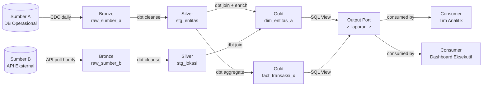

# Data Catalog & Metadata

> **Tujuan dokumen ini:** Mendokumentasikan semua aset data yang diproduksi oleh data product ini — mulai dari inventori tabel, kamus data lengkap, hingga mapping sumber-ke-target. Dokumen ini menjadi entri resmi di Data Catalog organisasi dan harus disinkronkan ke platform katalog (OpenMetadata / DataHub).

:::info Sinkronisasi Katalog
Setelah dokumen ini disetujui, Data Steward wajib membuat/memperbarui entri di platform data catalog:
- **OpenMetadata:** `<https://catalog.domain.org/table/schema.table_name>`
- **DataHub:** `<https://datahub.domain.org/dataset/urn:li:dataset:...>`
:::

---

## Riwayat Versi

| Tanggal | Versi | Deskripsi | Penulis |
|---|---|---|---|
| `<YYYY-MM-DD>` | 0.1 | Versi awal | `<Nama>` |

---

## Metadata Umum Data Product

| Atribut | Nilai |
|---|---|
| **Nama Data Product** | `<Nama Data Product>` |
| **Domain** | `<Nama Domain>` |
| **Data Product Owner** | `<Nama, Email>` |
| **Data Steward** | `<Nama, Email>` |
| **Tier / Kritikalitas** | `<Gold / Silver / Bronze>` |
| **Archetype** | `<Source-Aligned / Aggregate / Consumer-Aligned>` |
| **Status** | `<Active / Deprecated / Draft>` |
| **Tanggal Rilis** | `<YYYY-MM-DD>` |
| **Versi Data Product** | `<1.0.0>` |
| **Data Contract** | `../design/data-contract.yaml` |
| **Source Systems** | `<Sistem sumber — pisahkan dengan koma>` |
| **Tags** | `<domain, pii, program-x, batch-daily>` |

**Deskripsi:**
> `[Paragraf 2-4 kalimat yang mendeskripsikan data product ini untuk pengguna non-teknis. Apa isi datanya, dari mana asalnya, dan untuk apa biasanya digunakan?]`

**Use Cases Utama:**
1. `<Use case 1>`
2. `<Use case 2>`
3. `<Use case 3>`

---

## Bagian 1 — Table Index (Inventori Aset Data)

`[Mandatory]` — *Role: Data Steward + Data Architect*

> Semua tabel, view, dan dataset yang diproduksi atau dikelola oleh data product ini.

| Layer | Tipe | Nama Tabel/Dataset | Definisi Bisnis | Primary Key | Data Owner/Domain | Frekuensi Update | Ukuran Est. |
|---|---|---|---|---|---|---|---|
| `<Gold>` | `<Dimension>` | `<dim_entitas_a>` | `<Penjelasan bisnis tabel ini>` | `<entitas_a_id>` | `<Nama Domain>` | `<Daily>` | `<~X GB>` |
| `<Gold>` | `<Fact>` | `<fact_transaksi_x>` | `<Penjelasan bisnis tabel ini>` | `<transaksi_id>` | `<Nama Domain>` | `<Real-time>` | `<~X GB>` |
| `<Silver>` | `<Staging>` | `<stg_sumber_y>` | `<Data bersih dari sumber Y>` | `<source_id>` | `<Nama Domain>` | `<Hourly>` | `<~X GB>` |
| `<View>` | `<View>` | `<v_laporan_z>` | `<View untuk laporan eksekutif>` | `<->` | `<Nama Domain>` | `<Real-time (materialized)>` | `<~X MB>` |

**Keterangan Layer:**
- **Bronze:** Raw data dari sumber, minimal transformasi
- **Silver:** Data bersih dan tervalidasi, siap transformasi
- **Gold:** Data siap konsumsi, sudah di-enrich dan di-aggregate

---

## Bagian 2 — Data Dictionary & Constraints

`[Mandatory]` — *Role: Data Steward + Domain Expert*

> Definisi bisnis lengkap setiap kolom. Ini adalah sumber kebenaran untuk semua konsumen.

### 2.1 Tabel: `<dim_entitas_a>`

**Deskripsi tabel:** `<Penjelasan lengkap tabel ini dalam 1-2 kalimat>`

| Nama Kolom | Tipe Data | Key | Nullable | Definisi Bisnis | Klasifikasi | Aturan DQ & Security |
|---|---|---|---|---|---|---|
| `<entitas_a_id>` | `<UUID>` | `<PK>` | `<No>` | `<Surrogate key unik untuk entitas ini>` | `<Public>` | `<NOT NULL, UNIQUE>` |
| `<kode_referensi>` | `<VARCHAR(20)>` | `<AK>` | `<No>` | `<Kode bisnis unik yang digunakan dalam operasional>` | `<Public>` | `<NOT NULL, UNIQUE, format: [A-Z]{2}[0-9]{6}>` |
| `<nama>` | `<VARCHAR(255)>` | | `<No>` | `<Nama resmi entitas>` | `<Internal>` | `<NOT NULL, TRIM, max 255 karakter>` |
| `<nik>` | `<VARCHAR(16)>` | `<AK>` | `<Yes>` | `<Nomor Induk Kependudukan 16 digit>` | `<Restricted (PII)>` | `<Tepat 16 digit angka; Dynamic Data Masking wajib>` |
| `<tanggal_lahir>` | `<DATE>` | | `<Yes>` | `<Tanggal lahir format ISO 8601>` | `<Restricted (PII)>` | `<Harus < CURRENT_DATE; format YYYY-MM-DD>` |
| `<status>` | `<VARCHAR(20)>` | | `<No>` | `<Status keaktifan — lihat enum>` | `<Public>` | `<IN ('aktif', 'nonaktif', 'pending')>` |
| `<koordinat_lat>` | `<DOUBLE>` | | `<Yes>` | `<Koordinat lintang WGS84>` | `<Restricted>` | `<BETWEEN -11.0 AND 6.0>` |
| `<koordinat_lon>` | `<DOUBLE>` | | `<Yes>` | `<Koordinat bujur WGS84>` | `<Restricted>` | `<BETWEEN 95.0 AND 141.0>` |
| `<created_at>` | `<TIMESTAMP>` | | `<No>` | `<Waktu record dibuat di sistem ini>` | `<Internal>` | `<NOT NULL, default CURRENT_TIMESTAMP>` |
| `<updated_at>` | `<TIMESTAMP>` | | `<No>` | `<Waktu record terakhir diperbarui>` | `<Internal>` | `<NOT NULL, diperbarui otomatis>` |

**Klasifikasi Sensitivitas:**
- `Public` — Boleh diakses dan ditampilkan tanpa batasan
- `Internal` — Hanya untuk internal organisasi
- `Restricted (PII)` — Data pribadi; wajib masking untuk konsumen non-privileged
- `Confidential (PHI)` — Data kesehatan; akses sangat terbatas

*(Duplikasi tabel di atas untuk setiap tabel dalam data product)*

### 2.2 Tabel: `<fact_transaksi_x>`

| Nama Kolom | Tipe Data | Key | Nullable | Definisi Bisnis | Klasifikasi | Aturan DQ & Security |
|---|---|---|---|---|---|---|
| `<transaksi_id>` | `<UUID>` | `<PK>` | `<No>` | `<Surrogate key unik>` | `<Public>` | `<NOT NULL, UNIQUE>` |
| `<entitas_a_id>` | `<UUID>` | `<FK→dim_entitas_a>` | `<No>` | `<Referensi ke dimensi entitas>` | `<Public>` | `<NOT NULL, FK constraint>` |
| `<jumlah>` | `<INTEGER>` | | `<No>` | `<Kuantitas/jumlah>` | `<Internal>` | `<NOT NULL, >= 0>` |
| `<nilai>` | `<DECIMAL(15,2)>` | | `<Yes>` | `<Nilai nominal dalam IDR>` | `<Restricted>` | `<>= 0 jika tidak null>` |
| `<tanggal_transaksi>` | `<DATE>` | | `<No>` | `<Tanggal kejadian transaksi>` | `<Internal>` | `<NOT NULL, <= CURRENT_DATE>` |

---

## Bagian 3 — Source-to-Target Mapping

`[Mandatory]` — *Role: Data Engineer + Data Architect*

> Dokumentasi transformasi dari sumber ke target. "The truth is in the code — dokumen ini mendeskripsikan logic dalam 1-2 kalimat dan link ke implementasi aktual."

### 3.1 Mapping untuk `<dim_entitas_a>`

| Target Table | Target Column | Sistem Sumber | Source Table | Source Column | Transformasi (Silver Layer) | Business Logic (Gold Layer) |
|---|---|---|---|---|---|---|
| `<dim_entitas_a>` | `<entitas_a_id>` | `<Derived>` | `<->` | `<->` | `<UUID baru di-generate: gen_random_uuid()>` | `<N/A>` |
| `<dim_entitas_a>` | `<kode_referensi>` | `<Sistem A>` | `<tabel_sumber>` | `<kode>` | `<TRIM(UPPER(kode))>` | `<Deduplicate: ambil record terbaru per kode>` |
| `<dim_entitas_a>` | `<nama>` | `<Sistem A>` | `<tabel_sumber>` | `<nama>` | `<TRIM(nama), drop if null>` | `<Merge dari 2 sumber, prioritas Sumber A>` |
| `<dim_entitas_a>` | `<nik>` | `<Sistem A>` | `<tabel_sumber>` | `<nik>` | `<TRIM, validasi 16 digit angka>` | `<N/A>` |
| `<dim_entitas_a>` | `<status>` | `<Sistem A>` | `<tabel_sumber>` | `<status_kode>` | `<CASE: '1'→'aktif', '2'→'nonaktif', NULL→'pending'>` | `<N/A>` |
| `<dim_entitas_a>` | `<koordinat_lat>` | `<Sistem B>` | `<tabel_lokasi>` | `<lat>` | `<Cast to DOUBLE, filter 0.0>` | `<Round to 3 decimal places for privacy>` |

**Link ke implementasi:**
- dbt model: `<https://github.com/org/repo/models/gold/dim_entitas_a.sql>`
- Test suite: `<https://github.com/org/repo/tests/test_dim_entitas_a.yml>`

### 3.2 Kolom Target Tanpa Mapping Langsung

| Target Column | Status | Pendekatan |
|---|---|---|
| `<created_at>` | `<Derived — tidak ada di sumber>` | `<CURRENT_TIMESTAMP saat record pertama kali di-load>` |
| `<updated_at>` | `<Derived>` | `<CURRENT_TIMESTAMP di-update setiap kali record berubah>` |
| `<field_x>` | `<Sumber tidak lengkap>` | `<Default value NULL sampai sumber diperbaiki — lihat Jira: XYZ-123>` |

---

## Bagian 4 — Data Lineage

`[Mandatory]` — *Role: Data Architect*



**Link ke automated lineage:** `<https://catalog.domain.org/products/product-name/lineage>`

---

## Bagian 5 — Metadata Governance

`[Mandatory]` — *Role: Data Steward*

### 5.1 Data Ownership & Stewardship

| Role | Nama | Tanggung Jawab |
|---|---|---|
| **Data Owner** | `<Nama, Jabatan>` | Keputusan strategis atas data, approval penggunaan |
| **Data Steward** | `<Nama, Jabatan>` | Kualitas data, katalog, governance harian |
| **Data Engineer** | `<Nama, Jabatan>` | Pipeline, skema, kualitas teknis |
| **Privacy Officer** | `<Nama, Jabatan>` | Compliance UU PDP, DPIA, RoPA |

### 5.2 Data Lifecycle & Retention

| Layer | Retention Policy | Archival | Deletion |
|---|---|---|---|
| `<Bronze (raw)>` | `<90 hari>` | `<Cold storage setelah 90 hari>` | `<Hapus setelah 1 tahun>` |
| `<Silver (clean)>` | `<1 tahun>` | `<Cold storage setelah 1 tahun>` | `<Hapus setelah 3 tahun>` |
| `<Gold (business)>` | `<5 tahun>` | `<Cold storage setelah 5 tahun>` | `<Anonimisasi PII, simpan aggregate>` |

### 5.3 DCAT-AP Metadata (untuk Portal Data Publik)

> Isi bagian ini jika data product dipublikasikan ke portal data publik (data.go.id atau portal internal).

```yaml
# DCAT-AP v2.1 compliant metadata
dct:title: "<Nama Dataset>"
dct:description: "<Deskripsi untuk publik>"
dct:publisher:
  foaf:name: "<Nama Organisasi>"
  foaf:homepage: "<https://organisasi.go.id>"
dct:issued: "<YYYY-MM-DD>"
dct:modified: "<YYYY-MM-DD>"
dct:language: "id"
dct:license: "<https://creativecommons.org/licenses/by/4.0/ atau lisensi lain>"
dcat:theme:
  - "<http://publications.europa.eu/resource/authority/data-theme/GOVE>"
dcat:keyword: ["<kata kunci 1>", "<kata kunci 2>"]
dcat:contactPoint:
  vcard:fn: "<Nama Kontak>"
  vcard:hasEmail: "<email@organisasi.go.id>"
dcat:distribution:
  - dct:format: "application/json"
    dcat:accessURL: "<https://api.domain.org/v1/resource>"
  - dct:format: "text/csv"
    dcat:downloadURL: "<https://api.domain.org/v1/resource/export>"
```

### 5.4 Jadwal Review Katalog

| Frekuensi | Aktivitas | Owner |
|---|---|---|
| Setiap rilis | Update schema jika ada perubahan | Data Engineer |
| Bulanan | Validasi metadata masih akurat | Data Steward |
| Kuartalan | Review data owner, retention policy | DPO + Legal |
