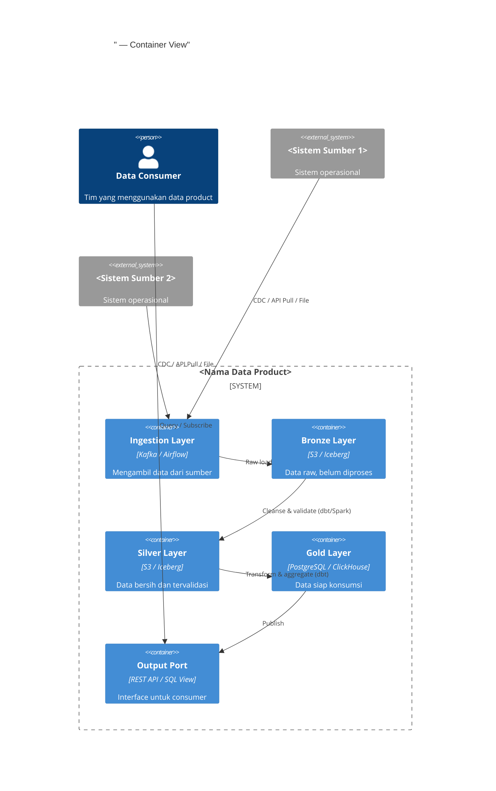

# Data Product Design Document

> **Tujuan dokumen ini:** Mendefinisikan semua keputusan arsitektur teknis dan logika pemrosesan data secara detail. Dokumen ini menjadi *source of truth* bagi Data Engineer dan menjadi lampiran teknis dari Data Contract.

:::info Referensi Silang
Dokumen ini merupakan ekspansi teknis dari:
- Canvas: `../bootstrap/canvas.md`
- Data Contract: `../design/data-contract-spec.md` & `../design/data-contract.yaml`
:::

---

## Riwayat Versi

| Tanggal | Versi | Deskripsi Perubahan | Penulis |
|---|---|---|---|
| `<YYYY-MM-DD>` | 0.1 | Versi awal | `<Nama>` |

---

## Istilah & Singkatan

| Term | Definisi |
|---|---|
| `<Term>` | `<Definisi>` |

## Referensi Dokumen

| Dokumen | Lokasi | Versi |
|---|---|---|
| Data Product Canvas | `../bootstrap/canvas.md` | `<versi>` |
| Business Process Research | `../bootstrap/business-process-research.md` | `<versi>` |
| Data Contract YAML | `../design/data-contract.yaml` | `<versi>` |

---

## Ringkasan Eksekutif

`[Mandatory]`

**Objektif Data Product:**
> `[Satu paragraf mendeskripsikan apa yang akan data product ini hasilkan, untuk siapa, dan nilai bisnis yang diberikan]`

**Keputusan Teknis Utama (rangkuman ADR):**
1. `<Keputusan 1: misal "Menggunakan Apache Iceberg untuk table format">`
2. `<Keputusan 2>`
3. `<Keputusan 3>`

---

## 1. Definisi & Visi Data Product

### 1.1 Sumber Data

`[Mandatory]` — *Role: Data Architect + Data Engineer*

#### Sumber Data 1: `<Nama Sistem/Tabel>`

| Atribut | Detail |
|---|---|
| **Objektif** | `<Mengapa data dari sumber ini dibutuhkan>` |
| **Alasan Kebutuhan** | `<Apa yang tidak bisa dipenuhi tanpa sumber ini>` |
| **Sistem** | `<Nama sistem>` |
| **Lokasi** | `<host:port/schema.table atau https://api.../endpoint>` |
| **Tipe Koneksi** | `<Direct DB / REST API / Event Stream / File>` |
| **Kepemilikan** | `<Tim / Organisasi>` |
| **SLA Sumber** | `<Tersedia X% uptime, data fresh setiap X jam>` |

*(Duplikasi bagian ini untuk setiap sumber data)*

### 1.2 Penilaian Sumber Data (Assessment)

`[Mandatory]`

| Dimensi | Sumber 1 | Sumber 2 | Catatan |
|---|---|---|---|
| **Completeness** | `<Baik/Sedang/Kritis>` | | |
| **Accuracy** | `<Baik/Sedang/Kritis>` | | |
| **Timeliness** | `<Baik/Sedang/Kritis>` | | |
| **Accessibility** | `<Baik/Sedang/Kritis>` | | |
| **Consistency** | `<Baik/Sedang/Kritis>` | | |

**Lihat laporan lengkap:** `../bootstrap/data-profiling-prelim.md`

---

## 2. Spesifikasi Arsitektur Data

### 2.1 Architecture Decision Records (ADRs)

`[Mandatory untuk setiap keputusan arsitektur signifikan]`

#### ADR-001: `<Judul Keputusan — contoh: Format Penyimpanan Data>`

| Atribut | Detail |
|---|---|
| **Tanggal** | `<YYYY-MM-DD>` |
| **Status** | `<Proposed / Accepted / Deprecated / Superseded>` |
| **Decision Makers** | `<Nama>` |

**Context:**
> `[Masalah atau kebutuhan yang memicu keputusan ini. Apa yang membuat keputusan ini penting?]`

**Decision:**
> `[Keputusan yang diambil dan alasan pemilihan opsi ini]`

**Opsi yang Dipertimbangkan:**
- **Opsi A: `<Nama>`** — `<Pro: ..., Kontra: ...>`
- **Opsi B: `<Nama>`** — `<Pro: ..., Kontra: ...>`
- **Opsi yang Dipilih: `<Nama>`** — `<Alasan pemilihan>`

**Consequences:**
- [x] `<Dampak positif>`
- [!] `<Tradeoff yang diterima>`
- -> `<Dependensi yang muncul>`

---

#### ADR-002: `<Judul Keputusan — contoh: Strategi Ingestion Data>`

*(Format sama dengan ADR-001)*

---

#### ADR-003: `<Judul Keputusan — contoh: Penanganan PII>`

*(Format sama dengan ADR-001)*

---

### 2.2 Arsitektur Logis

`[Mandatory]` — *Role: Data Architect*

**Diagram Arsitektur (C4 - Container Level):**



### 2.3 Logika Pemrosesan Data

`[Mandatory]` — *Role: Data Engineer + Data Architect*

#### 2.3.1 Ingestion (Ekstraksi & Pengumpulan)

| Aspek | Detail |
|---|---|
| **Strategi** | `<Full Load / Incremental / CDC / Event Streaming>` |
| **Trigger** | `<Cron schedule / Event-driven / Manual>` |
| **Schedule (jika batch)** | `<"0 1 * * *" = setiap hari jam 01:00 WIB>` |
| **Watermark / Checkpoint** | `<Kolom timestamp atau cursor untuk incremental>` |
| **Penanganan Rerun** | `<Idempotent: ya/tidak. Cara menangani duplikasi jika rerun>` |
| **Error Handling** | `<Dead letter queue / Retry policy / Alert>` |

**Logika:**
> `[Deskripsikan logika ingestion dalam 3-5 kalimat. Jangan duplikasi kode — link ke repo.]`

**Tools:** `<Apache Kafka / Debezium / Airbyte / Custom Python>`

**Link ke Code:** `<https://github.com/org/repo/path/to/ingestion>`

#### 2.3.2 Cleansing (Pembersihan Data)

**Logika:**
> `[Deskripsikan aturan pembersihan utama]`

| Aturan | Kolom | Tindakan | Alasan |
|---|---|---|---|
| `<Drop null PK>` | `<id>` | `<Filter out baris null>` | `<PK tidak boleh null>` |
| `<Standardize format>` | `<tanggal>` | `<Cast ke DATE ISO 8601>` | `<Konsistensi format>` |
| `<Trim whitespace>` | `<nama>` | `<TRIM(nama)>` | `<Kualitas string>` |
| | | | |

**Tools:** `<dbt / PySpark / pandas>`

**Link ke Code:** `<https://github.com/org/repo/path/to/cleansing>`

#### 2.3.3 Transformation (Transformasi & Enrichment)

**Logika:**
> `[Deskripsikan transformasi bisnis utama — join, derivasi kolom, lookup, dsb.]`

| Transformasi | Kolom Output | Logika | Source |
|---|---|---|---|
| `<Nama transformasi>` | `<output_column>` | `<Rumus/join/CASE WHEN>` | `<source_table.column>` |
| | | | |

**Business Rules yang Diterapkan:**
- Rule 1: `<Deskripsi rule bisnis>`
- Rule 2: `<Deskripsi rule bisnis>`

**Tools:** `<dbt models / PySpark transformations>`

**Link ke Code:** `<https://github.com/org/repo/path/to/transformations>`

#### 2.3.4 Projection / Penyajian (Output Layer)

**Logika:**
> `[Bagaimana data diformat untuk output port — materialized view, final schema, partisi, dsb.]`

| Output Port | Tipe | Format | Partisi | Refresh Strategy |
|---|---|---|---|---|
| `<Nama port>` | `<Tabel/API/Stream>` | `<SQL/JSON/Parquet>` | `<BY tanggal/wilayah>` | `<Full replace / Upsert / Append>` |
| | | | | |

---

## 3. Federated Governance & Compliance

### 3.1 Access Control & Security

`[Mandatory]`

**RBAC Design:**

| Role | Akses | Masking | Kondisi |
|---|---|---|---|
| `<data_engineer_role>` | `<Full access>` | `<None>` | `<Tim internal domain>` |
| `<analyst_role>` | `<Read-only gold layer>` | `<PII di-mask>` | `<Perlu approval DPO>` |
| `<consumer_system_role>` | `<Output port only>` | `<As per data contract>` | `<OAuth 2.0 client credentials>` |
| `<audit_role>` | `<Read-only all layers>` | `<None>` | `<Internal audit team>` |

**Column-Level Security:**

| Kolom | Klasifikasi | Masking Rule | Visible to |
|---|---|---|---|
| `<nik>` | `<PII - Restricted>` | `<Show first 6, mask rest>` | `<data_engineer_role only>` |
| `<nama>` | `<PII - Internal>` | `<First name only>` | `<analyst_role+>` |
| | | | |

**Secrets Management:**
> Semua credential WAJIB disimpan di `<Vault path: secret/domain/product/env>`. Tidak diperbolehkan hardcode credentials di kode maupun konfigurasi.

### 3.2 Interoperability Standards

`[Mandatory]`

| Standard | Penerapan |
|---|---|
| **Data Format** | `<Parquet (storage) / JSON (API response) / Avro (streaming)>` |
| **Date/Time** | `<ISO 8601 (YYYY-MM-DDTHH:MM:SSZ), timezone UTC+7>` |
| **Identifier** | `<UUID v4 untuk surrogate keys>` |
| **Naming Convention** | `<snake_case untuk kolom, PascalCase untuk entitas>` |
| **Encoding** | `<UTF-8 untuk semua string>` |
| **Geographic Coordinates** | `<WGS84, desimal degrees>` |

---

## 4. Project Management

### 4.1 Rencana Kerja

`[Mandatory]` — *Role: Project Manager*

| Sprint | Aktivitas | Output | Owner | Estimasi |
|---|---|---|---|---|
| Sprint 1 | Source connectivity, Bronze pipeline | Bronze layer berjalan | DE | 2 minggu |
| Sprint 2 | Silver layer, quality rules | Silver layer + DQ tests | DE + DS | 2 minggu |
| Sprint 3 | Gold layer, output ports | Gold layer + API/View | DE + DA | 2 minggu |
| Sprint 4 | Security, monitoring, UAT prep | Production-ready staging | DE + SRE | 2 minggu |

### 4.2 Dependensi Teknis

| Dependensi | Tipe | Status | Risiko |
|---|---|---|---|
| `<Akses koneksi ke DB sumber>` | `<Teknis>` | `<[x] Tersedia / [Pending] Dalam proses>` | `<Tinggi/Sedang/Rendah>` |
| `<Data sharing agreement>` | `<Governance>` | | |
| `<Infrastruktur provisioning>` | `<Teknis>` | | |

### 4.3 Definition of Ready (sebelum Development dimulai)

```
[ ] Data Contract v1.0 sudah disetujui DPO
[ ] Akses ke semua sumber data sudah diberikan
[ ] Infrastructure sudah di-provisioning (dev environment)
[ ] DPIA selesai jika ada PII high-risk
[ ] CI/CD pipeline template sudah tersedia
[ ] Data Catalog entry sudah dibuat (draft)
[ ] Tim Development sudah onboard
```

---

## 5. Lampiran

- Data Contract YAML: `../design/data-contract.yaml`
- Quality Design: `../design/quality-design.md`
- Infrastructure Brief: `../design/infra-brief.md`
- RoPA: `../design/ropa.md` *(jika applicable)*
- ADR lengkap: `../../decisions/`
