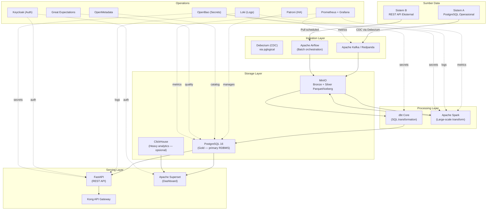

# Infrastructure Brief

> **Tujuan dokumen ini:** Mendefinisikan kebutuhan infrastruktur teknis dan finansial data product ini. Semua komponen memprioritaskan perangkat lunak open-source untuk menghindari vendor lock-in, mengurangi biaya lisensi, dan mempertahankan kontrol penuh atas data sesuai ketentuan residensi data Indonesia.

:::note Prinsip Pemilihan Stack
Open-source first: evaluasi solusi open-source sebelum mempertimbangkan opsi proprietary. PostgreSQL adalah RDBMS utama untuk Gold layer. Self-hosted diprioritaskan untuk memenuhi PP 71/2019 tentang residensi data sistem elektronik publik.
:::

---

## Riwayat Versi

| Tanggal | Versi | Deskripsi | Penulis |
|---|---|---|---|
| `<YYYY-MM-DD>` | 0.1 | Versi awal | `<Nama>` |

---

## Referensi Open-Source Stack yang Disetujui

Semua komponen dipilih berdasarkan kematangan proyek, lisensi open-source yang memungkinkan self-hosting, dan ketersediaan dukungan komunitas aktif.

| Kategori | Solusi Disetujui | Lisensi | Alternatif |
|---|---|---|---|
| **RDBMS (Gold Layer)** | **PostgreSQL 16+** | PostgreSQL License | TimescaleDB untuk time-series |
| OLAP / Analytics | ClickHouse | Apache 2.0 | DuckDB (embedded, no server) |
| Object Storage | MinIO | AGPL-3.0 | Ceph, SeaweedFS |
| Table Format | Apache Iceberg | Apache 2.0 | Apache Hudi |
| Batch Processing | Apache Spark | Apache 2.0 | DuckDB untuk dataset kecil |
| SQL Transform | dbt Core | Apache 2.0 | SQLMesh |
| Streaming | Apache Kafka | Apache 2.0 | Redpanda (drop-in) |
| CDC Connector | Debezium | Apache 2.0 | pglogical (PostgreSQL-native) |
| Data Integration | Airbyte Community | ELv2 | Singer |
| Orchestration | Apache Airflow | Apache 2.0 | Prefect Community |
| Query Engine | Trino | Apache 2.0 | Apache Drill |
| Data Catalog | OpenMetadata | Apache 2.0 | DataHub |
| Data Quality | Great Expectations | Apache 2.0 | Soda Core Community |
| Monitoring | Prometheus + Grafana | Apache 2.0 | VictoriaMetrics |
| Log Aggregation | Loki + Grafana | AGPL-3.0 | OpenSearch |
| Auth / SSO | Keycloak | Apache 2.0 | Authentik |
| Secrets Management | OpenBao | Apache 2.0 | OpenBao OSS (BSL) |
| API Gateway | Kong Community | Apache 2.0 | Traefik, Nginx |
| Container | Kubernetes + containerd | Apache 2.0 | K3s untuk edge |
| CI/CD | GitLab CE | MIT | Jenkins, Tekton |
| Dashboard / BI | Apache Superset | Apache 2.0 | Metabase Community |
| Partition Management | pg_partman | PostgreSQL License | Partisi manual |
| HA / Failover | Patroni | MIT | Repmgr |

---

## 1. Estimasi Volume Data

### 1.1 Volume Sumber (Baseline)

| Sumber / Tabel | Jumlah Record | Ukuran per Record | Total | Pertumbuhan |
|---|---|---|---|---|
| `<Sumber A: tabel_x>` | `<~5 juta>` | `<~500 byte>` | `<~2.5 GB>` | `<+50K record/hari>` |
| `<Sumber B: tabel_y>` | `<~100 ribu>` | `<~2 KB>` | `<~200 MB>` | `<+500 record/hari>` |
| **Total Input** | | | `<~X GB>` | `<+X MB/hari>` |

### 1.2 Volume per Layer

| Layer | Format | Ukuran Raw | Kompresi | Ukuran Final |
|---|---|---|---|---|
| Bronze (raw) | Parquet (Zstandard) | `<~X GB>` | ~55% | `<~X GB>` |
| Silver (cleaned) | Parquet + Iceberg | `<~X GB>` | ~55% | `<~X GB>` |
| Gold (business) | PostgreSQL | `<~X GB>` | TOAST + pg_compress | `<~X GB>` |
| Audit Log | PostgreSQL (partitioned) | `<~X GB>` | — | `<~X GB>` |
| **Total Storage** | | | | `<~X GB>` |

### 1.3 Proyeksi Pertumbuhan 12 Bulan

| Bulan | Kumulatif Records | Total Storage | Catatan |
|---|---|---|---|
| 1 | `<X juta>` | `<X GB>` | |
| 3 | `<X juta>` | `<X GB>` | |
| 6 | `<X juta>` | `<X GB>` | Review kapasitas |
| 12 | `<X juta>` | `<X GB>` | |

**Asumsi:** `<+X% per bulan / linear X record/hari / seasonal peak pada [bulan]>`

### 1.4 Throughput Target

| Metrik | Nilai | Keterangan |
|---|---|---|
| Peak ingestion rate | `<X record/detik>` | Jam sibuk: `<HH:MM–HH:MM WIB>` |
| Rata-rata ingestion | `<X record/menit>` | |
| Max query latency P95 | `<200ms>` | Query standar Gold layer via PostgreSQL |
| Batch window | `<4 jam>` | Pipeline selesai dalam window ini |
| Query concurrency | `<X>` | Consumer aktif bersamaan |

---

## 2. Topologi Deployment

### 2.1 Environment dan Data Residency

| Atribut | Nilai |
|---|---|
| **Deployment Model** | `<Self-hosted on-premise / Private cloud>` |
| **Platform** | `<Bare metal / VMware / Proxmox>` |
| **Lokasi** | `<Jakarta — IDC Cyberbuilding / PDN / GovCloud Indonesia>` |
| **Data Residency** | Indonesia — memenuhi PP 71/2019 pasal 17 |
| **Environment Tiers** | Development — Staging — Production |
| **High Availability** | `<Active-Standby PostgreSQL via Patroni>` |

### 2.2 Architecture Topology



### 2.3 Compute Specification

| Komponen | CPU | RAM | Storage | Replikasi |
|---|---|---|---|---|
| PostgreSQL 16 Primary | 4 vCPU | 16 GB | 500 GB NVMe SSD | Streaming ke standby |
| PostgreSQL Standby (Patroni) | 4 vCPU | 16 GB | 500 GB NVMe SSD | Hot standby |
| Apache Kafka (3 node) | 2 vCPU/node | 8 GB/node | 200 GB/node | Replication factor 3 |
| MinIO (4 node erasure) | 2 vCPU/node | 8 GB/node | 2 TB HDD/node | Erasure code 2+2 |
| Spark Driver | 4 vCPU | 8 GB | 50 GB | — |
| Spark Worker (2–4 node) | 4 vCPU/node | 16 GB/node | 200 GB/node | — |
| Apache Airflow | 2 vCPU | 4 GB | 50 GB | — |
| ClickHouse (opsional) | 4 vCPU | 16 GB | 500 GB SSD | — |
| OpenMetadata + Keycloak | 2 vCPU | 4 GB | 50 GB | — |
| Grafana + Prometheus + Loki | 2 vCPU | 4 GB | 200 GB | — |
| OpenBao | 2 vCPU | 2 GB | 20 GB | 3-node raft |

---

## 3. Proyeksi Biaya

:::note
Tidak ada biaya lisensi software. Seluruh stack open-source. Biaya hanya mencakup infrastruktur komputasi.
:::

### 3.1 Estimasi Biaya Bulanan (Production)

| Komponen | Tipe | Est./Bulan (IDR) | Est./Bulan (USD) | Keterangan |
|---|---|---|---|---|
| PostgreSQL Primary + Standby | Compute | `<Rp X>` | `<$X>` | 2 VM @ 4C/16GB |
| Kafka cluster (3 node) | Compute | `<Rp X>` | `<$X>` | 3 VM @ 2C/8GB |
| MinIO (4 node) | Compute + Storage | `<Rp X>` | `<$X>` | Storage X TB |
| Spark cluster | Compute | `<Rp X>` | `<$X>` | Driver + worker |
| Layanan pendukung | Compute | `<Rp X>` | `<$X>` | Airflow, monitoring, auth |
| Networking + bandwidth | Network | `<Rp X>` | `<$X>` | Estimasi X GB egress/bulan |
| Backup storage | Storage | `<Rp X>` | `<$X>` | Cold storage di MinIO secondary |
| **Total per Bulan** | | **`<Rp X>`** | **`<$X>`** | Tidak ada biaya lisensi |

**Biaya per record diproses:** `<Rp X / record>`

### 3.2 Estimasi Biaya Build (One-Time)

| Aktivitas | Person-Days | Estimasi |
|---|---|---|
| Engineering (Development + QA) | `<X PD>` | `<Rp X>` |
| Infrastructure setup | `<X PD>` | `<Rp X>` |
| Security review dan hardening | `<X PD>` | `<Rp X>` |
| UAT dan go-live | `<X PD>` | `<Rp X>` |
| **Total Build** | | **`<Rp X>`** |

### 3.3 Optimasi Biaya

| Peluang | Est. Penghematan | Tradeoff |
|---|---|---|
| Bronze ke cold storage (HDD) setelah 90 hari | ~40% storage cost | Query Bronze lebih lambat |
| Kompresi Parquet Zstandard (vs Snappy) | ~55% storage vs raw | CPU overhead ringan |
| Partisi PostgreSQL by date di Gold layer | ~60% query cost untuk time-range | Sedikit kompleksitas DDL |
| pg_partman untuk audit log retention otomatis | Eliminasi purge manual | Setup awal diperlukan |
| DuckDB untuk ad-hoc queries dan EDA | Tidak perlu Spark untuk dataset kecil | Tidak cocok untuk concurrent workload |

---

## 4. Konfigurasi PostgreSQL

### 4.1 Parameter Produksi

```ini
# postgresql.conf — dioptimalkan untuk data product workload
# Asumsi: server RAM 16 GB

# Memory
shared_buffers           = 4GB          # 25% total RAM
effective_cache_size     = 12GB         # 75% total RAM
work_mem                 = 64MB         # per sort/hash op — hati-hati paralel query
maintenance_work_mem     = 1GB          # VACUUM, CREATE INDEX
wal_buffers              = 64MB

# Query Planner
random_page_cost         = 1.1          # untuk SSD — default 4.0
effective_io_concurrency = 200          # untuk SSD NVMe
default_statistics_target = 200         # lebih akurat dari default 100

# Parallelism (untuk analytical queries)
max_parallel_workers_per_gather = 4
max_parallel_workers            = 8
max_worker_processes            = 16

# WAL dan Replication
wal_level                = replica
max_wal_senders          = 5
wal_keep_size            = 2GB
synchronous_commit       = on

# Autovacuum — kritis untuk SCD Type 2 yang banyak UPDATE/INSERT
autovacuum_vacuum_scale_factor    = 0.01   # lebih agresif dari default 0.2
autovacuum_analyze_scale_factor   = 0.005  # lebih sering dari default 0.1
autovacuum_vacuum_cost_delay      = 2ms    # lebih cepat dari default 20ms
autovacuum_max_workers            = 5

# Logging
log_min_duration_statement = 1000       # log query > 1 detik
log_checkpoints            = on
log_connections            = on
log_disconnections         = on
log_lock_waits             = on
log_temp_files             = 0          # log semua temp file usage

# Extensions yang harus di-preload
shared_preload_libraries = 'pg_stat_statements,pg_partman_bgw'
# Tambahkan 'pgaudit' jika compliance ketat memerlukan statement-level logging
```

### 4.2 Extensions

```sql
-- Eksekusi sebagai superuser setelah koneksi ke database

-- Monitoring query performance
CREATE EXTENSION IF NOT EXISTS pg_stat_statements;

-- Pencegahan periode overlap untuk SCD Type 2
CREATE EXTENSION IF NOT EXISTS btree_gist;

-- UUID generation
CREATE EXTENSION IF NOT EXISTS pgcrypto;

-- Partition management otomatis
CREATE EXTENSION IF NOT EXISTS pg_partman;

-- Statement-level audit logging (opsional, untuk compliance ketat)
-- CREATE EXTENSION IF NOT EXISTS pgaudit;
-- SET pgaudit.log = 'ddl,write';
```

### 4.3 Provisioning Script Lengkap

```sql
-- ============================================================
-- PROVISIONING: <Nama Data Product> — Gold Layer
-- PostgreSQL 16+
-- Dijalankan sebagai: superuser
-- ============================================================

-- Database
CREATE DATABASE <product_db>
    ENCODING    = 'UTF8'
    LC_COLLATE  = 'id_ID.UTF-8'
    LC_CTYPE    = 'id_ID.UTF-8'
    CONNECTION LIMIT = 100;

\connect <product_db>

-- Extensions
CREATE EXTENSION IF NOT EXISTS pg_stat_statements;
CREATE EXTENSION IF NOT EXISTS btree_gist;
CREATE EXTENSION IF NOT EXISTS pgcrypto;
CREATE EXTENSION IF NOT EXISTS pg_partman;

-- Schema
CREATE SCHEMA IF NOT EXISTS <domain_schema>;
CREATE SCHEMA IF NOT EXISTS audit;
COMMENT ON SCHEMA <domain_schema>
    IS '<Nama domain — tim: <Nama Tim>, sejak: <YYYY-MM-DD>';

-- Roles (least privilege)
CREATE ROLE <domain>_engineer    NOLOGIN;
CREATE ROLE <domain>_analyst     NOLOGIN;
CREATE ROLE <domain>_consumer    NOLOGIN;
CREATE ROLE <domain>_audit_role  NOLOGIN;
CREATE ROLE <domain>_dq          NOLOGIN;

GRANT USAGE ON SCHEMA <domain_schema>
    TO <domain>_engineer, <domain>_analyst, <domain>_consumer,
       <domain>_audit_role, <domain>_dq;
GRANT USAGE ON SCHEMA audit
    TO <domain>_engineer, <domain>_audit_role;

-- Audit log table (partitioned by month)
CREATE TABLE audit.audit_log (
    audit_id        BIGSERIAL           NOT NULL,
    schema_name     TEXT                NOT NULL,
    table_name      TEXT                NOT NULL,
    record_id       TEXT                NOT NULL,
    operation       TEXT                NOT NULL
                    CHECK (operation IN ('INSERT','UPDATE','DELETE','TRUNCATE')),
    old_values      JSONB,
    new_values      JSONB,
    changed_columns TEXT[],
    changed_by      TEXT                NOT NULL DEFAULT current_user,
    changed_at      TIMESTAMPTZ         NOT NULL DEFAULT now(),
    application     TEXT DEFAULT current_setting('application_name', true),
    client_addr     INET DEFAULT inet_client_addr(),
    transaction_id  BIGINT DEFAULT txid_current(),
    CONSTRAINT pk_audit_log PRIMARY KEY (audit_id, changed_at)
) PARTITION BY RANGE (changed_at);

SELECT partman.create_parent(
    p_parent_table         => 'audit.audit_log',
    p_control              => 'changed_at',
    p_type                 => 'range',
    p_interval             => 'monthly',
    p_premake              => 3,
    p_retention            => '24 months',
    p_retention_keep_table => false
);

CREATE INDEX idx_audit_log_table_record
    ON audit.audit_log (table_name, record_id, changed_at DESC);
CREATE INDEX idx_audit_log_user
    ON audit.audit_log (changed_by, changed_at DESC);

-- Generic audit trigger function
CREATE OR REPLACE FUNCTION audit.fn_generic_audit_trigger()
RETURNS TRIGGER AS $$
DECLARE
    v_record_id  TEXT;
    v_changed    TEXT[];
BEGIN
    v_record_id := CASE WHEN TG_OP = 'DELETE'
                        THEN (to_jsonb(OLD) ->> 'id')
                        ELSE (to_jsonb(NEW) ->> 'id') END;

    IF TG_OP = 'UPDATE' THEN
        SELECT ARRAY_AGG(key ORDER BY key) INTO v_changed
        FROM jsonb_each(to_jsonb(NEW)) n
        JOIN jsonb_each(to_jsonb(OLD)) o USING (key)
        WHERE n.value IS DISTINCT FROM o.value;
    END IF;

    INSERT INTO audit.audit_log (
        schema_name, table_name, record_id, operation,
        old_values, new_values, changed_columns
    ) VALUES (
        TG_TABLE_SCHEMA, TG_TABLE_NAME, v_record_id, TG_OP,
        CASE WHEN TG_OP IN ('UPDATE','DELETE') THEN to_jsonb(OLD) ELSE NULL END,
        CASE WHEN TG_OP IN ('INSERT','UPDATE') THEN to_jsonb(NEW) ELSE NULL END,
        v_changed
    );
    RETURN COALESCE(NEW, OLD);
END;
$$ LANGUAGE plpgsql SECURITY DEFINER;

-- Contoh tabel dimensi (SCD Type 2)
CREATE TABLE <domain_schema>.dim_entitas_a (
    entitas_a_id    UUID            NOT NULL DEFAULT gen_random_uuid(),
    kode_entitas    VARCHAR(36)     NOT NULL,
    nama            VARCHAR(255)    NOT NULL,
    status          VARCHAR(20)     NOT NULL DEFAULT 'aktif',
    kategori        VARCHAR(50)     NOT NULL,
    -- SCD Type 2 columns
    valid_from      TIMESTAMPTZ     NOT NULL DEFAULT now(),
    valid_to        TIMESTAMPTZ     NOT NULL DEFAULT 'infinity'::timestamptz,
    is_current      BOOLEAN         NOT NULL DEFAULT true,
    version         INTEGER         NOT NULL DEFAULT 1,
    -- Audit metadata
    created_at      TIMESTAMPTZ     NOT NULL DEFAULT now(),
    created_by      TEXT            NOT NULL DEFAULT current_user,
    source_system   VARCHAR(100),
    load_id         UUID,

    CONSTRAINT pk_dim_entitas_a         PRIMARY KEY (entitas_a_id),
    CONSTRAINT chk_status               CHECK (status IN ('aktif','nonaktif','pending')),
    CONSTRAINT chk_valid_period         CHECK (valid_from < valid_to),
    CONSTRAINT chk_version_positive     CHECK (version >= 1),
    CONSTRAINT uq_entitas_current
        UNIQUE (kode_entitas, is_current) WHERE (is_current = true)
);

-- Prevent overlapping SCD Type 2 periods
ALTER TABLE <domain_schema>.dim_entitas_a
    ADD CONSTRAINT no_overlapping_versions
    EXCLUDE USING gist (
        kode_entitas WITH =,
        tstzrange(valid_from, valid_to, '[)') WITH &&
    );

CREATE INDEX idx_dim_entitas_a_bk
    ON <domain_schema>.dim_entitas_a (kode_entitas);
CREATE INDEX idx_dim_entitas_a_current
    ON <domain_schema>.dim_entitas_a (kode_entitas)
    WHERE is_current = true;
CREATE INDEX idx_dim_entitas_a_temporal
    ON <domain_schema>.dim_entitas_a USING btree (kode_entitas, valid_from, valid_to);

-- Pasang audit trigger
CREATE TRIGGER trg_audit_dim_entitas_a
    AFTER INSERT OR UPDATE OR DELETE ON <domain_schema>.dim_entitas_a
    FOR EACH ROW EXECUTE FUNCTION audit.fn_generic_audit_trigger();

-- View: current state dengan PII masking
CREATE VIEW <domain_schema>.v_dim_entitas_a AS
SELECT
    entitas_a_id,
    kode_entitas,
    nama,
    status,
    kategori,
    valid_from,
    is_current,
    version
FROM <domain_schema>.dim_entitas_a
WHERE is_current = true;

-- Permissions
GRANT SELECT ON ALL TABLES IN SCHEMA <domain_schema>
    TO <domain>_analyst, <domain>_consumer, <domain>_audit_role, <domain>_dq;
GRANT INSERT, UPDATE, DELETE ON ALL TABLES IN SCHEMA <domain_schema>
    TO <domain>_engineer;
GRANT USAGE, SELECT ON ALL SEQUENCES IN SCHEMA <domain_schema>
    TO <domain>_engineer;
GRANT SELECT ON ALL TABLES IN SCHEMA audit
    TO <domain>_audit_role, <domain>_engineer;

ALTER DEFAULT PRIVILEGES IN SCHEMA <domain_schema>
    GRANT SELECT ON TABLES TO <domain>_analyst, <domain>_consumer;
ALTER DEFAULT PRIVILEGES IN SCHEMA <domain_schema>
    GRANT INSERT, UPDATE, DELETE ON TABLES TO <domain>_engineer;
```

### 4.4 High Availability dengan Patroni

```yaml
# patroni.yml — konfigurasi dasar HA PostgreSQL
scope: <product>_cluster
namespace: /service/

restapi:
  listen: 0.0.0.0:8008
  connect_address: <this_node_ip>:8008

etcd3:
  host: <etcd_host>:2379

bootstrap:
  dcs:
    ttl: 30
    loop_wait: 10
    retry_timeout: 10
    maximum_lag_on_failover: 1048576    # 1 MB lag max
  postgresql:
    use_pg_rewind: true
    parameters:
      shared_buffers: 4GB
      max_connections: 200
      wal_level: replica

postgresql:
  listen: 0.0.0.0:5432
  connect_address: <this_node_ip>:5432
  data_dir: /var/lib/postgresql/16/data
  authentication:
    replication:
      username: replicator
      password: <dari_openbao_vault>
    superuser:
      username: postgres
      password: <dari_openbao_vault>
```

---

## 5. Keamanan Infrastruktur

### 5.1 Enkripsi

| Layer | At-Rest | In-Transit | Key Management |
|---|---|---|---|
| PostgreSQL | LUKS full-disk encryption di OS | SSL/TLS wajib (`ssl = on`) | OpenBao |
| MinIO | Server-side AES-256 via KES integration | TLS 1.2+ | OpenBao KES |
| Kafka | Opsional per-topic encryption | mTLS antar broker dan client | Keystore via Vault |
| API | N/A | TLS 1.3, HSTS | Let's Encrypt atau internal CA |

### 5.2 Network Isolation

```
[Internet]
  |
[Kong API Gateway + WAF]
  |
[DMZ — 10.0.1.0/24]
  |-- API Server         10.0.1.10
  |-- Superset           10.0.1.11
  |
[Internal — 10.0.2.0/24]   (tidak ada public IP)
  |-- PostgreSQL Primary  10.0.2.10
  |-- PostgreSQL Standby  10.0.2.11
  |-- Spark cluster       10.0.2.20–23
  |-- Kafka cluster       10.0.2.30–32
  |-- MinIO cluster       10.0.2.40–43
  |
[Management — 10.0.3.0/24]
  |-- Airflow             10.0.3.10
  |-- OpenMetadata        10.0.3.11
  |-- Keycloak            10.0.3.12
  |-- Grafana+Prometheus  10.0.3.13
  |-- OpenBao             10.0.3.14
```

### 5.3 Secrets Management (OpenBao)

```bash
# OpenBao — fork Apache 2.0 dari OpenBao
# https://github.com/openbao/openbao

# Simpan credentials PostgreSQL
bao kv put secret/<env>/<domain>/<product>/pg \
    host="10.0.2.10" port="5432" \
    database="<product_db>" \
    username="<service_account>" \
    password="<generated_password>"

# Policy akses
bao policy write <domain>-<product>-policy - << EOF
path "secret/data/<env>/<domain>/<product>/*" {
    capabilities = ["read"]
}
EOF

# Semua komponen (dbt, Airflow, FastAPI) mengambil credentials saat runtime
# melalui OpenBao agent atau SDK. JANGAN hardcode di kode atau konfigurasi.
```

---

## 6. Backup dan Disaster Recovery

**Tool: pgBackRest** (open source, full/differential/incremental backup ke MinIO)

| Komponen | Metode | Frekuensi | Retensi | RTO | RPO |
|---|---|---|---|---|---|
| PostgreSQL | pgBackRest + WAL archiving ke MinIO | Full: harian, WAL: continuous | 30 hari | 4 jam | 5 menit |
| MinIO | Native bucket replication ke secondary | Real-time sync | 90 hari | 1 jam | Near-zero |
| Kafka | Log retention + MirrorMaker 2 | On-disk 7 hari | 7 hari | 1 jam | 1 jam |
| Konfigurasi infra | GitOps di GitLab CE | Per commit | Permanen | 30 menit | 0 |

```ini
# /etc/pgbackrest/pgbackrest.conf
[global]
repo1-path            = /mnt/backup/pgbackrest
repo1-type            = s3
repo1-s3-bucket       = <bucket>
repo1-s3-endpoint     = <minio-endpoint>
repo1-s3-key          = <access-key-from-openbao>
repo1-s3-key-secret   = <secret-key-from-openbao>
repo1-cipher-type     = aes-256-cbc
repo1-retention-full  = 7
repo1-retention-diff  = 30

[<product_db>]
pg1-path = /var/lib/postgresql/16/data
```
