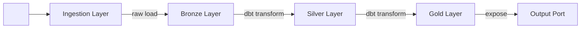

# Data Pipeline

> **Tujuan dokumen ini:** Mendokumentasikan implementasi aktual pipeline data — bukan spesifikasi desain. Dokumen ini adalah "as-built record" yang mencerminkan kode yang sudah berjalan di production, bukan kode yang direncanakan.

:::note V-05 vs V-01
**V-01 Pipeline Brief** = Spesifikasi desain *sebelum* build (apa yang akan dibangun).
**V-05 Data Pipeline** = Dokumentasi implementasi *setelah* build (apa yang sudah dibangun dan berjalan). Perbarui dokumen ini setiap kali ada perubahan signifikan pada pipeline.
:::

---

## Riwayat Versi

| Tanggal | Versi | Deskripsi | Penulis |
|---|---|---|---|
| `<YYYY-MM-DD>` | 0.1 | Dokumentasi awal post-deployment | `<Nama, Role>` |

---

## Header Identifikasi

| Atribut | Nilai |
|---|---|
| **Doc ID** | `V-05` |
| **Domain** | `<Nama Domain>` |
| **Data Product** | `<Nama Data Product>` |
| **Nama Pipeline** | `<Nama pipeline yang deskriptif>` |
| **Pipeline URN** | `urn:dp:<domain>:<product>:pipeline:<nama>:v<N>` |
| **Status** | `<Active \| Deprecated \| In-Maintenance>` |
| **Engineer Utama** | `<Nama, Email>` |
| **Repository** | `<https://github.com/org/repo/tree/main/pipelines/<nama>>` |
| **Dokumen terkait** | [V-01 Pipeline Brief](./pipeline-brief.md) · [D-02 Data Contract](../design/data-contract-spec.md) · [D-05 Quality Design](../design/quality-design.md) · [M-07 Runbook](../monitoring/operations-runbook.md) |

---

## 1. Overview Pipeline

### 1.1 Tujuan dan Konteks Bisnis

`[Mandatory]`

> `[Deskripsikan dalam 2–3 kalimat: apa yang dikerjakan pipeline ini, data apa yang dipindahkan/ditransformasi, dan nilai bisnis yang dihasilkan.]`

### 1.2 Arsitektur Aktual

`[Mandatory]` — *Gambar sebagai Mermaid diagram*



### 1.3 Inventori Komponen

`[Mandatory]`

| Komponen | Tool / Teknologi | Versi | Lokasi di Repo | Status |
|---|---|---|---|---|
| Ingestion | `<Airbyte / Fivetran / custom script>` | `<versi>` | `pipelines/ingestion/` | `<Active>` |
| Orchestration | `<Airflow / Dagster / Prefect>` | `<versi>` | `pipelines/dags/` | `<Active>` |
| Transformation | `<dbt / SQLMesh / Spark>` | `<versi>` | `models/` | `<Active>` |
| Quality Tests | `<dbt tests / Great Expectations / Soda>` | `<versi>` | `tests/` | `<Active>` |
| Monitoring | `<Elementary / Monte Carlo / custom>` | `<versi>` | `monitors/` | `<Active>` |

---

## 2. Sumber Data (Input)

### 2.1 Sistem Sumber

`[Mandatory]`

| ID | Sistem Sumber | Tipe | Koneksi | Objek yang Diingest |
|---|---|---|---|---|
| SRC-01 | `<nama sistem>` | `<PostgreSQL / REST API / S3 / Kafka>` | `<nama koneksi di Airbyte / env var>` | `<schema.table atau endpoint>` |
| SRC-02 | `<nama sistem>` | `<tipe>` | `<koneksi>` | `<objek>` |

### 2.2 Jadwal dan Trigger

| Sumber | Mode | Jadwal / Trigger | Timezone | Retry Policy |
|---|---|---|---|---|
| SRC-01 | `<Batch>` | `<0 2 * * * (setiap hari jam 02:00)>` | `<Asia/Jakarta>` | `<3× dengan interval 10 menit>` |
| SRC-02 | `<Streaming>` | `<Event-driven (Kafka topic)>` | `N/A` | `<Dead-letter queue setelah 3 gagal>` |

### 2.3 Volume dan Karakteristik Data

| Sumber | Volume Tipikal | Volume Peak | Growth Rate |
|---|---|---|---|
| SRC-01 | `<~500K rows/run>` | `<~2M rows (akhir bulan)>` | `<+10% per kuartal>` |

---

## 3. Logika Transformasi

### 3.1 Peta Transformasi End-to-End

`[Mandatory]`

| Layer | Model / Objek | Tool | Logika Utama | Output |
|---|---|---|---|---|
| Bronze | `bronze.<nama_model>` | `<dbt / SQL>` | Raw copy tanpa transformasi; tambah metadata kolom (`_loaded_at`, `_source`) | Tabel historis append-only |
| Silver | `silver.<nama_model>` | `<dbt>` | Dedup, null handling, tipe casting, normalisasi enum | Tabel clean, 1 record per entitas per waktu |
| Gold | `gold.<nama_model>` | `<dbt>` | Join, agregasi, business logic, SCD handling | Tabel final siap konsumsi |

### 3.2 Business Rules yang Diimplementasikan

`[Mandatory]` — *Setiap rule harus bisa dilacak ke requirement di D-01 atau D-02*

| Rule ID | Deskripsi | Implementasi | Referensi |
|---|---|---|---|
| BR-01 | `<Deduplikasi berdasarkan composite key (id, date)>` | `dbt: models/silver/<model>.sql baris 12–18` | [D-01 §3.2](../design/design-document.md) |
| BR-02 | `<Status NULL di-default ke "pending">` | `dbt: models/silver/<model>.sql baris 30` | [D-01 §3.4](../design/design-document.md) |
| BR-03 | `<Nilai negatif pada <field> di-flag sebagai anomali>` | `dbt test: tests/assert_<field>_positive.sql` | [D-05 §2.1](../design/quality-design.md) |

### 3.3 Penanganan Slowly Changing Dimensions

`[Opsional — isi jika ada SCD]` — *Referensi: [D-12 SCD Design](../design/scd-audit-design.md)*

| Tabel | SCD Type | Kolom Histori | Strategi |
|---|---|---|---|
| `<silver.dim_entity>` | `Type 2` | `valid_from`, `valid_to`, `is_current` | `dbt snapshot` |

---

## 4. Konfigurasi Deployment

### 4.1 Environment Variables

`[Mandatory]` — *Jangan simpan nilai aktual di dokumen ini; referensikan ke Vault*

| Variable | Deskripsi | Vault Path | Wajib? |
|---|---|---|---|
| `DB_SOURCE_CONN` | Connection string sistem sumber | `secret/<env>/<domain>/source-db` | ✅ |
| `DB_DW_CONN` | Connection string data warehouse | `secret/<env>/<domain>/dw-db` | ✅ |
| `DBT_TARGET` | dbt target environment (`dev`/`staging`/`prod`) | `N/A` — set via CI/CD | ✅ |
| `SLACK_ALERT_WEBHOOK` | Webhook untuk notifikasi pipeline failure | `secret/<env>/monitoring/slack` | ✅ |
| `SENTRY_DSN` | Error tracking DSN | `secret/<env>/monitoring/sentry` | Opsional |

### 4.2 Resource Requirements

| Komponen | CPU | Memory | Storage | Catatan |
|---|---|---|---|---|
| Airflow Worker | `<2 vCPU>` | `<4 GB>` | `<20 GB ephemeral>` | Per concurrent task |
| dbt run | `<1 vCPU>` | `<2 GB>` | `<N/A>` | Compute di-delegate ke DWH |
| PostgreSQL DWH | `<4 vCPU>` | `<16 GB>` | `<500 GB>` | Shared dengan data product lain |

### 4.3 DAG / Workflow Definition

`[Mandatory]` — *Link ke file, jangan paste kode lengkap di sini*

| DAG ID | File | Schedule | Timeout | SLA Alert |
|---|---|---|---|---|
| `dp_<domain>_<product>_daily` | `pipelines/dags/dp_<product>_daily.py` | `0 2 * * *` | `4 jam` | `3 jam` |
| `dp_<domain>_<product>_quality` | `pipelines/dags/dp_<product>_quality.py` | `30 2 * * *` | `1 jam` | `45 menit` |

---

## 5. Data Quality dan Testing

### 5.1 Test Suite yang Berjalan di CI/CD

`[Mandatory]`

| Layer | Test Tipe | Tool | Jumlah Test | Pass Rate Target | Lokasi |
|---|---|---|---|---|---|
| Bronze | Schema validation | `dbt test` | `<8>` | `100%` | `tests/bronze/` |
| Silver | Data contract validation | `data-contract-cli` | `<15>` | `100%` | `tests/contracts/` |
| Gold | Business rule assertions | `Great Expectations` | `<22>` | `≥ 99%` | `tests/gold/` |
| End-to-end | Row count reconciliation | Custom SQL | `<5>` | `100%` | `tests/e2e/` |

### 5.2 Menjalankan Test Lokal

```bash
# Jalankan semua dbt tests
cd models/ && dbt test --target dev

# Validasi data contract
data-contract-cli test --contract ../design/data-contract.yaml

# Jalankan Great Expectations suite
great_expectations checkpoint run <checkpoint_name>
```

### 5.3 Quality SLO Aktual vs Target

*Diperbarui setiap bulan. Data terakhir: `<YYYY-MM>`*

| Dimensi | Target SLO | Aktual Bulan Ini | Status |
|---|---|---|---|
| Completeness | `≥ 99%` | `<___>%` | `<✅ / ⚠️ / ❌>` |
| Freshness | `≤ 1 jam setelah cut-off` | `<___ menit>` | `<✅ / ⚠️ / ❌>` |
| Accuracy | `0 BR violations` | `<___>` | `<✅ / ⚠️ / ❌>` |
| Validity | `≥ 99.5% rows valid` | `<___>%` | `<✅ / ⚠️ / ❌>` |

---

## 6. Data Lineage

### 6.1 Lineage Aktual (Terverifikasi)

```
<Sistem Sumber A>
  └── schema_raw.table_a
        └── bronze.stg_table_a         (dbt source)
              └── silver.clean_table_a (dbt model: models/silver/clean_table_a.sql)
                    └── gold.dim_entity (dbt model: models/gold/dim_entity.sql)
                          └── gold.fct_transactions (dbt model: models/gold/fct_transactions.sql)
                                └── OUTPUT: schema.v_<product>_daily (SQL View)
                                └── OUTPUT: /api/v1/<resource> (REST API)
```

### 6.2 Upstream Dependencies

| Upstream | Tipe | SLA yang Diperlukan | Dampak jika Terlambat |
|---|---|---|---|
| `<Sistem Sumber A>` | Operational DB | Data tersedia sebelum `01:30 WIB` | Pipeline delay, freshness SLO breach |
| `<Data Product lain>` | Data Mesh upstream | `<Delivery SLO: ≤ 1 jam setelah cut-off>` | Gold layer tidak bisa diproses |

### 6.3 Downstream Dependents

| Downstream | Tipe | Data yang Dikonsumsi | Dampak jika Pipeline Gagal |
|---|---|---|---|
| `<Nama Dashboard>` | BI Dashboard | `gold.fct_transactions` | Dashboard stale, alert ke consumer |
| `<Nama ML Model>` | Data Science | `gold.dim_entity` | Model retraining tertunda |
| `<Domain lain>` | Data Mesh downstream | `SQL View` | Downstream pipeline gagal |

---

## 7. Operasional

### 7.1 Monitoring dan Alerting

| Monitor | Tool | Threshold Alert | Channel |
|---|---|---|---|
| Pipeline failure | Airflow + Slack | Setiap kali task gagal | `#dp-<product>-alerts` |
| Freshness SLO breach | Elementary | Data > `<2 jam>` setelah cut-off | `#dp-<product>-alerts` |
| Row count anomaly | Monte Carlo / Elementary | Delta > `±20%` dari baseline | `#dp-<product>-alerts` |
| DQ test failure | dbt + Slack | Setiap test merah | `#dp-<product>-alerts` |

### 7.2 Prosedur Re-Run dan Backfill

```bash
# Re-run pipeline hari ini (Airflow CLI)
airflow dags trigger dp_<domain>_<product>_daily

# Backfill rentang tanggal tertentu
airflow dags backfill dp_<domain>_<product>_daily \
  --start-date 2025-01-01 \
  --end-date 2025-01-07

# Re-run dbt model tertentu beserta dependensi
dbt run --select +gold.fct_transactions --target prod

# Re-run hanya layer Bronze (full reload dari source)
dbt run --select bronze.stg_<source> --full-refresh --target prod
```

:::warning Full Refresh
Flag `--full-refresh` menghapus dan merekonstruksi tabel dari awal. Gunakan hanya untuk Bronze layer atau saat ada perubahan skema. **Jangan gunakan di Gold layer tanpa koordinasi** — downstream consumer akan terdampak selama proses.
:::

### 7.3 Known Issues dan Workarounds

| Issue ID | Deskripsi | Kondisi Trigger | Workaround | Status |
|---|---|---|---|---|
| KI-01 | `<Pipeline lambat saat source >3M rows>` | `<Akhir bulan>` | `<Naikkan Airflow worker pool ke 4 sebelum tanggal 28>` | `<Open>` |
| KI-02 | `<Field <X> kadang NULL dari source>` | `<Setelah maintenance source system>` | `<Jalankan dbt run --select silver.clean_<X> --full-refresh>` | `<Open>` |

---

## Annex A — Quick Reference

| Aksi | Perintah / Link |
|---|---|
| Airflow UI | `<https://airflow.domain.org>` |
| dbt docs | `<https://dbt-docs.domain.org/<product>>` |
| Data Catalog entry | `<https://catalog.domain.org/<domain>/<product>>` |
| Grafana Dashboard | `<https://grafana.domain.org/d/<id>>` |
| On-call | `#dp-oncall` · `<nomor HP DE on-call>` |
| Runbook lengkap | [M-07 Operations Runbook](../monitoring/operations-runbook.md) |
