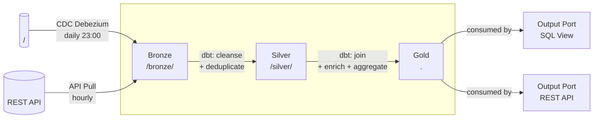

# Data Pipeline Brief

> **Tujuan dokumen ini:** Memberikan spesifikasi teknis yang cukup bagi Data Engineer untuk membangun, menguji, dan memelihara pipeline data ini. Prinsip utama: **"The truth is in the code"** — dokumen ini mendeskripsikan logika dalam 2-3 kalimat dan merujuk ke codebase, bukan menduplikasi kode.

:::tip Metadata as Code
Dokumen ini harus disimpan sebagai file `.md` langsung di Git repository bersama kode pipeline. Perbarui dokumen ini sebagai bagian dari standar Pull Request review.
:::

---

## Riwayat Versi

| Tanggal | Versi | Deskripsi | Penulis |
|---|---|---|---|
| `<YYYY-MM-DD>` | 0.1 | Versi awal | `<Nama>` |

---

## Header Identifikasi

| Atribut | Nilai |
|---|---|
| **Domain** | `<Nama Domain>` |
| **Data Product** | `<Nama Data Product>` |
| **Nama Pipeline** | `<Nama Pipeline yang deskriptif>` |
| **Pipeline ID** | `<urn:dmb:cmp:<domain>:<product>:v1:<pipeline-name>>` |
| **Tipe Workload** | `<Ingestion ETL / Streaming / Transformation / Export>` |
| **Engineer Utama** | `<Nama, Email>` |

---

## 1. Konteks & Ruang Lingkup

### 1.1 Permasalahan Bisnis

`[Mandatory]` — *Role: Data Product Owner*

Deskripsikan **mengapa** pipeline ini dibangun. Apa masalah bisnis yang diselesaikan?

> `[Isi di sini — contoh: "Pipeline ini menyerap data transaksi harian dari sistem operasional ke Gold layer sehingga Tim Keuangan dapat melakukan rekonsiliasi T+1 alih-alih T+3."]`

### 1.2 Target Konsumen Data

`[Mandatory]` — *Role: Data Analyst*

Siapa yang akan menggunakan data hasil pipeline ini dan bagaimana cara konsumsinya?

| Persona | Cara Konsumsi | Kebutuhan Kunci |
|---|---|---|
| `<Nama Persona 1>` | `<SQL View / API / Dashboard>` | `<Data segar sebelum jam 06:00 WIB>` |
| `<Nama Persona 2>` | `<Streaming subscription>` | `<Latensi < 1 menit>` |

### 1.3 Sistem Sumber Data (Input)

`[Mandatory]` — *Role: Data Analyst*

| ID | Sistem | Tipe | Lokasi / Endpoint | Data yang Diambil | Pemilik |
|---|---|---|---|---|---|
| SRC-01 | `<Nama Sistem A>` | `<PostgreSQL DB>` | `<host:5432/dbname.schema.table>` | `<Semua kolom, incremental by updated_at>` | `<Tim X>` |
| SRC-02 | `<Nama Sistem B>` | `<REST API>` | `<https://api.sistem-b.org/v2/resource>` | `<Field a, b, c>` | `<Tim Y>` |

### 1.4 Target Tujuan Data (Output)

`[Mandatory]` — *Role: Data Architect*

| Layer | Lokasi | Format | Tipe Penyimpanan |
|---|---|---|---|
| `<Bronze>` | `<s3://<bucket>/bronze/<domain>/<product>/>` | `<Parquet>` | `<Object Storage (MinIO/S3)>` |
| `<Silver>` | `<s3://<bucket>/silver/<domain>/<product>/>` | `<Parquet + Iceberg>` | `<Object Storage>` |
| `<Gold>` | `<<schema>.<table_name> di PostgreSQL/ClickHouse>` | `<Tabel relasional>` | `<Database>` |

### 1.5 Out of Scope

`[Opsional]` — *Role: Project Manager*

Yang **TIDAK** termasuk dalam pipeline ini:
- `<Backfill data historis sebelum YYYY-MM-DD — dikerjakan terpisah>`
- `<Transformasi downstream untuk use case ML — ada pipeline terpisah>`
- `<Tabel X dari sumber A — tidak diperlukan untuk versi ini>`

---

## 2. Arsitektur & Data Lineage

### 2.1 Tech Stack & Frameworks

`[Opsional]` — *Role: Data Architect*

| Komponen | Teknologi | Versi | Alasan Pemilihan |
|---|---|---|---|
| `<Orchestration>` | `<Apache Airflow>` | `<2.9>` | `<Standard platform>` |
| `<Batch Transform>` | `<dbt Core>` | `<1.8>` | `<SQL-based, versioned>` |
| `<Stream Ingestion>` | `<Apache Kafka + Debezium>` | `<3.x>` | `<CDC dari PostgreSQL>` |
| `<Storage Format>` | `<Apache Iceberg>` | `<1.5>` | `<Time travel, schema evolution>` |

### 2.2 Design Patterns

`[Mandatory]` — *Role: Data Architect*

Pipeline ini menggunakan pola:

- [ ] **Medallion Architecture** (Bronze → Silver → Gold)
- [ ] **CDC (Change Data Capture)** dari sumber operasional
- [ ] **Incremental Load** dengan watermark pada kolom `updated_at`
- [ ] **Full Load** (full replace setiap run — *hanya untuk tabel kecil*)
- [ ] **Event Streaming** (Kafka → consumer)
- [ ] **ELT** (Extract → Load raw → Transform in warehouse)
- [ ] **Lainnya:** `<Sebutkan>`

**Penjelasan singkat pola yang dipilih:**
> `[Isi di sini — contoh: "Menggunakan Medallion Architecture dengan incremental CDC dari Debezium. Bronze menyimpan raw events, Silver melakukan dedup dan cleaning, Gold menyajikan tabel dimensi final yang siap dikonsumsi."]`

### 2.3 Execution Trigger

`[Mandatory]` — *Role: Data Architect*

| Komponen Pipeline | Trigger | Schedule/Kondisi |
|---|---|---|
| `<Ingestion Bronze>` | `<Cron schedule>` | `<"0 23 * * *" (setiap hari 23:00 WIB)>` |
| `<Transform Silver>` | `<Trigger setelah Bronze selesai>` | `<DAG dependency>` |
| `<Transform Gold>` | `<Trigger setelah Silver selesai>` | `<DAG dependency>` |
| `<Streaming Consumer>` | `<Event-driven>` | `<Saat event masuk ke Kafka topic>` |

### 2.4 Data Lineage

`[Mandatory]` — *Role: Data Engineer*



**Link ke automated lineage:** `<https://catalog.domain.org/lineage/product-name>`

**Link ke DAG di Airflow:** `<https://airflow.domain.org/dags/dag_name>`

---

## 3. SLA Kualitas Data & Keamanan

### 3.1 Aturan Kualitas Data

`[Mandatory]` — *Role: Data Quality Engineer / Data Steward*

Lihat dokumen lengkap: `../design/quality-design.md`

**Ringkasan rules kritis untuk pipeline ini:**

#### Completeness

| Target Tabel | Kolom | Aturan | Threshold Minimum |
|---|---|---|---|
| `<gold_table>` | `<id>` | `<Harus terisi semua>` | `<100%>` |
| `<gold_table>` | `<nama>` | `<Harus terisi semua>` | `<97%>` |
| `<gold_table>` | `<tanggal>` | `<Harus terisi semua>` | `<99%>` |

#### Uniqueness

| Target Tabel | Kolom/Kombinasi | Aturan | Threshold |
|---|---|---|---|
| `<gold_table>` | `<id>` | `<Tidak boleh duplikat>` | `<100%>` |

#### Timeliness / Freshness

Data Gold layer harus tersedia sebelum `<pukul 06:00 WIB>`. Alert dikirim ke `<Slack #dq-alerts>` jika terlambat melebihi `<1 jam>`.

#### Validity & Accuracy

| Kolom | Aturan | Action Jika Gagal |
|---|---|---|
| `<status>` | `<IN ('aktif', 'nonaktif', 'pending')>` | `<Default ke 'pending', log anomali>` |
| `<jumlah>` | `<>= 0>` | `<Quarantine record, alert>` |
| `<nik>` | `<16 digit angka>` | `<Quarantine record, notify upstream>` |

#### Consistency

| Aturan | Cara Ukur | Action |
|---|---|---|
| `<Row count Gold = sum Silver (after dedup)>` | `<Reconciliation query setiap run>` | `<Alert + block jika selisih > 0.1%>` |

### 3.2 Klasifikasi Data

`[Mandatory]` — *Role: Data Architect*

| Klasifikasi | Berlaku untuk Kolom |
|---|---|
| `<Public>` | `<id, kode, status, tanggal, jumlah>` |
| `<Internal>` | `<nama, alamat_kabupaten, kategori>` |
| `<Restricted (PII)>` | `<nik, tanggal_lahir, alamat_lengkap>` |
| `<Confidential (PHI)>` | `<kondisi_kesehatan, diagnosis>` |

### 3.3 Keamanan & Masking

`[Mandatory]` — *Role: Data Architect*

| Kolom | Aturan Masking | Berlaku Untuk |
|---|---|---|
| `<nik>` | `<Dynamic masking: tampilkan 6 digit pertama + mask: "317104******0001">` | `<Semua role kecuali data_engineer_role>` |
| `<nama>` | `<Hanya tampilkan nama depan: SPLIT_PART(nama, ' ', 1)>` | `<analyst_role ke bawah>` |
| `<kondisi_kesehatan>` | `<Sembunyikan sepenuhnya — replace dengan NULL>` | `<Semua kecuali medical_role>` |

### 3.4 Manajemen Rahasia (Secrets Management)

`[Mandatory]` — *Role: Data Engineer*

:::danger Dilarang Hardcode
DILARANG menggunakan kata sandi dalam bentuk teks biasa (plaintext) di kode, config file, atau log pipeline.
:::

| Secret | Path di Vault / SSM | Cara Inject |
|---|---|---|
| `<DB connection SRC-01>` | `<secret/prod/domain/product/src-01-db-conn>` | `<Airflow Connection: CONN_ID=src01_db>` |
| `<API Key SRC-02>` | `<secret/prod/domain/product/src-02-api-key>` | `<Airflow Variable + Jinja template>` |
| `<Gold DB connection>` | `<secret/prod/domain/product/gold-db-conn>` | `<Airflow Connection: CONN_ID=gold_db>` |

---

## 4. Metadata Workload (DPDS)

`[Mandatory]` — *Role: Data Engineer + Data Product Owner*

> **Instruksi:** Isi YAML ini sebagai metadata resmi workload. Simpan sebagai file terpisah `dpds.yaml` di root direktori data product.

```yaml
# ---------------------------------------------------------------
# DATA PRODUCT DESCRIPTOR SPECIFICATION (DPDS) — Pipeline Workload
# ---------------------------------------------------------------

DataProduct_ID: "urn:dmb:dp:<domain>:<product-name>:v1"
Name: "<Nama Pipeline>"
Description: "<Deskripsi singkat fungsi pipeline>"
Version: "1.0.0"
Domain: "<Nama Domain>"
DataProductOwner: "<email@domain.org>"

# Output Ports (Consumption Interfaces)
Output_Ports:
  - Port_ID: "urn:dmb:cmp:<domain>:<product>:v1:<output-port-name>"
    OutputPortType: "<SQL | REST API | Files | Events>"
    DataContract:
      Schema: "<Link ke data-contract.yaml atau OpenAPI spec>"
      SLA:
        Timeliness: "<Data tersedia sebelum 06:00 WIB>"
        UpTime: "99.9%"
      DataSharingAgreement:
        Purpose: "<Tujuan penggunaan data ini>"
        Security: "<PII masking diterapkan sesuai role>"

# Workloads (Processing Logic)
Workloads:
  - Workload_ID: "urn:dmb:cmp:<domain>:<product>:v1:<pipeline-name>"
    WorkloadType: "<Ingestion ETL | Streaming | Transformation>"
    Technology: "<Apache Airflow + dbt + Spark>"
    ReadsFrom:
      - "<Sistem Sumber A: host/db/schema/table>"
      - "<Sistem Sumber B: API endpoint>"
    Code_Reference: "<https://github.com/org/repo/pipelines/<product>>"
    Documentation_Reference: "development/pipeline-brief.md"

# Storage Areas
Storage_Areas:
  - Storage_ID: "urn:dmb:cmp:<domain>:<product>:v1:bronze"
    StorageType: "<S3 / MinIO>"
    Location: "<s3://<bucket>/bronze/<domain>/<product>/>"
    Owners: "<domain_engineer LDAP group>"
    
  - Storage_ID: "urn:dmb:cmp:<domain>:<product>:v1:silver"
    StorageType: "<S3 / MinIO + Iceberg>"
    Location: "<s3://<bucket>/silver/<domain>/<product>/>"
    Owners: "<domain_engineer LDAP group>"
    
  - Storage_ID: "urn:dmb:cmp:<domain>:<product>:v1:gold"
    StorageType: "<PostgreSQL / ClickHouse>"
    Location: "<host:port/<db>/<schema>>"
    Owners: "<domain_engineer LDAP group>"

# Observability
Observability:
  Endpoint: "<https://monitoring.domain.org/api/v1/pipelines/<product>>"
  DataQuality: "<https://dq.domain.org/products/<product>/checks>"
  PipelineRuns: "<https://airflow.domain.org/dags/<dag-id>>"
  Lineage: "<https://catalog.domain.org/lineage/<product>>"
```

---

## 5. Runbook Operasional

`[Opsional — isi setelah pipeline live]`

### 5.1 Prosedur Rerun Pipeline

```bash
# Rerun untuk tanggal tertentu (Airflow CLI)
airflow dags backfill \
    --start-date YYYY-MM-DD \
    --end-date YYYY-MM-DD \
    <dag_id>

# Atau via Airflow UI:
# DAG > Clear > Set date range > Confirm
```

### 5.2 Troubleshooting Common Issues

| Masalah | Kemungkinan Penyebab | Langkah Diagnostik | Solusi |
|---|---|---|---|
| `<Pipeline stuck / tidak jalan>` | `<Worker down / DB connection timeout>` | `<Cek Airflow worker log>` | `<Restart worker / cek network>` |
| `<Data Quality alert: null tinggi>` | `<Sumber data berubah schema>` | `<Cek schema sumber vs data contract>` | `<Update mapping atau notify upstream>` |
| `<Volume drop >50% dari normal>` | `<Sumber sedang maintenance / partial load>` | `<Cek source system health>` | `<Koordinasi dengan tim sumber / trigger rerun>` |
