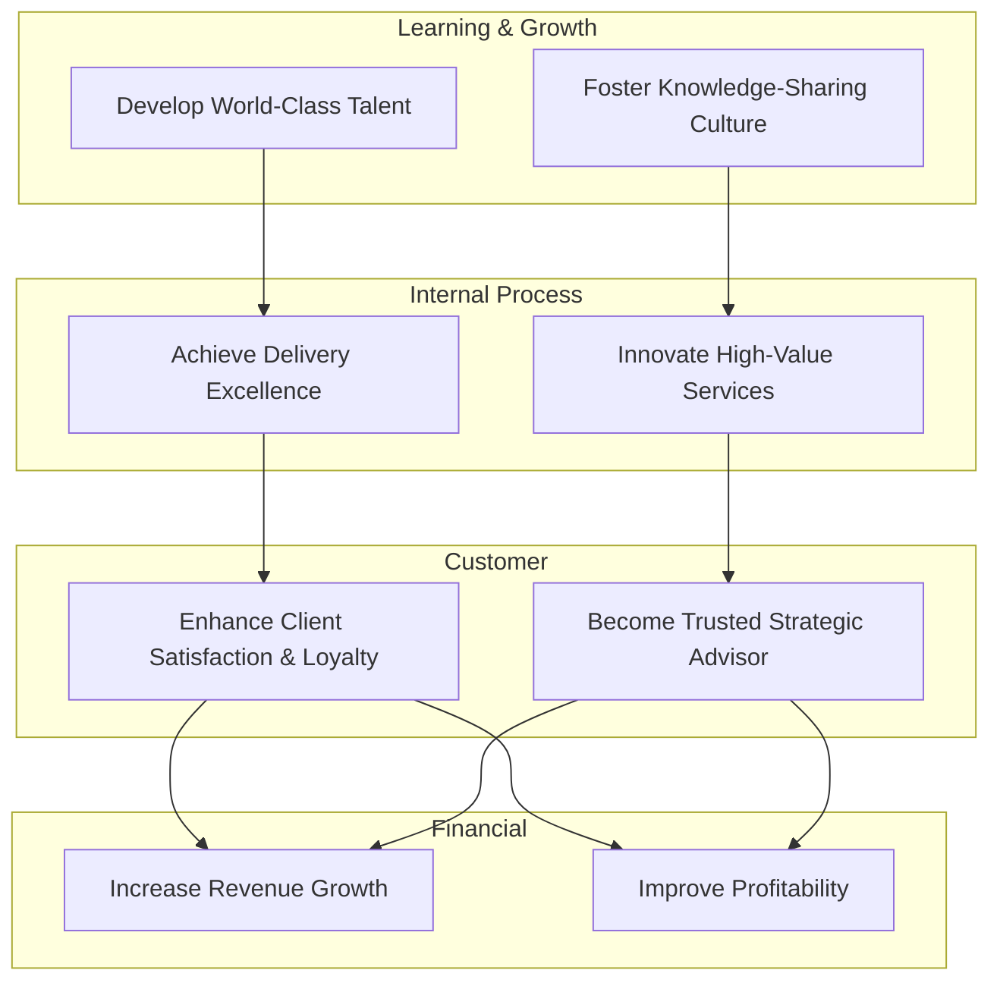
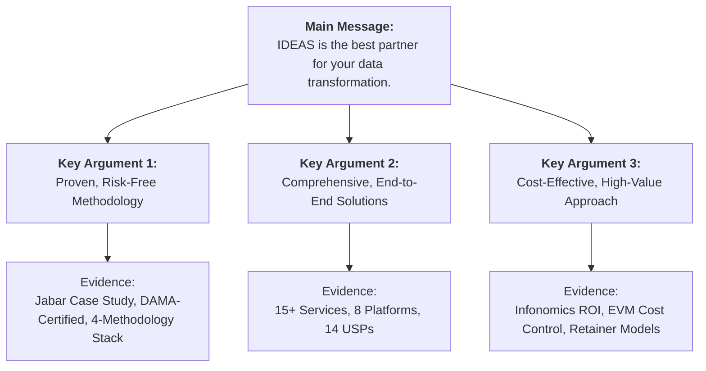

>   **Last Updated:** February 2026

# IDEAS End-to-End Business Frameworks Reference

> Comprehensive business strategy, operations, and development frameworks applied to IDEAS's context as Indonesia's premier B2B data consulting company. Based on wide-research from 75+ credible sources across 10 framework categories, this document serves as a central playbook for strategic decision-making.

---

## 1. IDEAS Business Model Canvas (BMC)

**Source Framework:** Osterwalder & Pigneur, *Business Model Generation* (2010) [1]

The Business Model Canvas (BMC) is a strategic management tool that describes how IDEAS creates, delivers, and captures value. It is composed of nine interconnected building blocks that form a blueprint for our business model.

### 1.1 Pre-Filled BMC for IDEAS

This canvas provides a snapshot of the IDEAS business model as of early 2026.

| Block | IDEAS Application |
|---|---|
| **Key Partners** | DAMA International (ATP Partner), BNSP (Certification Body), Cloud Providers (AWS/GCP/Azure), Government Agencies (Diskominfo, Bappeda, K/L), Academic Institutions (Universities, Research Centers), Technology Vendors (Talend, Informatica, dbt), Open Source Communities (Apache Foundation), System Integrators |
| **Key Activities** | Data Strategy & Governance Consulting (S1.x), Data Analytics & Engineering (S2.x), Knowledge Transfer & Capacity Building (S3.x), Product Platform Development (8 products), Data Asset Valuation (S1.5), DAMA-DMBOK Training & Certification, Research & Development in AI and Cloud Data Management |
| **Key Resources** | 46+ DAMA-certified data management professionals, 8 proprietary product platforms (Data Engine, Collect, Data Hub, DataSpace, Control Center, Executive, Civic Insight, MapEdge), DAMA-DMBOK + PMBOK + CRISP-DM + Agile methodology stack, 20+ years combined government sector experience, CDMP Master + BNSP credentials, Knowledge Base (internal skill repository) |
| **Value Propositions** | End-to-end data ecosystem solutions (15+ services across 3 pillars), Indonesia-first contextual expertise (regulatory + cultural), 4-methodology integration (DAMA + Agile + CRISP-DM + PMBOK), Data-as-Asset valuation capability (Infonomics & Deloitte 2025 Frameworks), Government-grade compliance (UU PDP, SPBE, Perpres 46/2025) |
| **Customer Relationships** | Long-term advisory partnerships, Retainer-based managed services, Project-based engagements, Knowledge transfer & capacity building, Community building (workshops, webinars), Executive briefings |
| **Channels** | Direct sales (government procurement/LKPP), **INAPROC e-Katalog v6** (24 produk SaaS digital — e-Purchasing tanpa tender), Enterprise sales team, Website ([data-ecosystem.id](https://data-ecosystem.id/)), LinkedIn & social media, Industry events & conferences, Partner referrals, Medium blog (thought leadership) |
| **Customer Segments** | Government (Kementerian/Lembaga, Pemda, BUMN), Enterprise (Banking, Telco, Manufacturing, Retail), International (ASEAN government agencies), Academia (Universities, Research Institutions) |
| **Cost Structure** | People costs (65-75% of COGS — consultants, engineers, analysts), Software licenses & cloud infrastructure (10-15%), Operational overhead (office, admin, travel — 10-15%), R&D for product platforms (5-10%), Training & certification maintenance. See `cogs-methodology.md` for details. |
| **Revenue Streams** | Project-based consulting fees (primary), Retainer/managed services (recurring), Product platform licensing (SaaS), **INAPROC SaaS distribution** (24 digital products — reseller margin), Training & certification programs, Data asset valuation advisory (success fee or value-based model). See Section 7 for details. |

### 1.2 BMC Generation Guide

When generating a BMC for IDEAS or a client, follow this iterative process:
1.  Start with **Value Propositions** — what unique value does the entity deliver to its customers?
2.  Map **Customer Segments** — who are the target beneficiaries of this value?
3.  Define **Channels** and **Customer Relationships** — how does the entity reach, acquire, and retain its customers?
4.  Identify **Key Activities**, **Key Resources**, and **Key Partners** — what internal capabilities, assets, and external collaborations are necessary to deliver the value proposition?
5.  Calculate **Cost Structure** and **Revenue Streams** — analyze the financial viability and logic of the business model.
6.  Iterate and refine the connections between the blocks. A change in one block often impacts others.
7.  Cross-reference with `references/services-catalog.md` for service details and `references/cogs-methodology.md` for cost structure calculations.

### 1.3 Lean Canvas Variant (for New Service Development)

For new service ideation, internal ventures, or startups, the Lean Canvas by Ash Maurya provides a more problem-focused alternative. It is particularly useful for validating new ideas under conditions of high uncertainty.

| Block | Purpose | Example: S1.5 Data Asset Valuation Service |
|---|---|---|
| **Problem** | Top 3 problems the service solves | 1. Organizations don't know the financial value of their data. 2. Data is managed as a cost center, not an asset. 3. Lack of quantitative justification for data investments. |
| **Solution** | Top 3 features addressing each problem | 1. 6-model valuation (Income, Cost, Market approaches). 2. Data Debt analysis. 3. ROI modeling for data projects. |
| **Key Metrics** | 3-5 measurable success indicators | 1. Number of valuation engagements. 2. Average data value identified per client. 3. Client adoption of data-as-asset reporting. |
| **Unique Value Proposition** | Single, clear, compelling message | "We quantify the financial value of your data assets to drive strategic investment and monetization." |
| **Unfair Advantage** | What cannot be easily copied | DAMA ATP partnership, CDMP Master expertise in Infonomics, proprietary valuation models aligned with Deloitte 2025 framework. |
| **Channels** | Path to customers | Executive briefings for CFOs/CDOs, add-on to S1.1 Data Strategy projects, thought leadership articles. |
| **Customer Segments** | Early adopters + target market | Early Adopters: Data-mature BUMNs. Target Market: All government agencies and large enterprises. |
| **Cost Structure** | Fixed + variable costs | Fixed: Salaries of valuation experts. Variable: Project-specific research and tool licensing. |
| **Revenue Streams** | Pricing model + lifetime value | Value-based pricing (percentage of identified value), fixed-fee advisory, retainer for continuous valuation. |

---
## 2. Business Operations Framework

### 2.1 Porter Value Chain — IDEAS Adaptation

**Source:** Michael Porter, *Competitive Advantage* (1985) [2]

The Value Chain analysis helps to identify the primary and support activities that create value for our clients. By optimizing these activities, IDEAS can achieve a competitive advantage.

| Category | Activity | IDEAS Implementation |
|---|---|---|
| **Primary** | Inbound Logistics | Knowledge acquisition: DAMA-DMBOK study, regulatory monitoring (Perpres 46/2025, UU PDP), client intelligence gathering (SPBE data), industry research (Gartner, Forrester), competitive analysis. |
| **Primary** | Operations | Service delivery: 15+ services across 3 pillars, 8 product platforms, Agile+PMBOK hybrid methodology, RASCI-based team coordination. See `references/service-delivery-patterns.md`. |
| **Primary** | Outbound Logistics | Deliverable packaging: proposals, reports, dashboards, data products, trained personnel, certified professionals, source code, documentation. |
| **Primary** | Marketing & Sales | Thought leadership (Medium, LinkedIn), government procurement (LKPP e-Katalog), enterprise solution selling, partner referrals, conference speaking. |
| **Primary** | Service | Post-delivery support: retainer services, managed analytics, knowledge transfer, capacity building, continuous improvement cycles, helpdesk support. |
| **Support** | Firm Infrastructure | 4-methodology governance (DAMA + Agile + CRISP-DM + PMBOK), EVM-based cost control, financial management, legal & compliance (UU PDP). |
| **Support** | HR Management | 46+ DAMA roles, CDMP certification pipeline, BNSP competency standards, salary benchmarking, continuous learning programs. See `references/human-resources-and-pricing.md`. |
| **Support** | Technology Development | 8 product platforms, R&D for AI/ML capabilities, Zero-Trust architecture, Privacy-by-Design, development of internal tools (`scripts/`). |
| **Support** | Procurement | Cloud infrastructure (AWS/GCP/Azure), software licenses (dbt, Talend), training materials, third-party tools, professional services. |

### 2.2 Operational Excellence (OpEx) Pillars for IDEAS

Operational Excellence is a mindset of continuous improvement across the organization. For IDEAS, it is built upon the following pillars:

| Pillar | Application |
|---|---|
| **Leadership Commitment** | CEO (Rizki Rusdiwijaya) champions a data-driven culture; the 5-director leadership team owns strategic objectives. |
| **Strategic Alignment** | The 4-methodology stack is directly aligned with Indonesia's digital transformation agenda (SPBE, Satu Data Indonesia). |
| **Performance Management** | EVM-based project tracking (CPI/SPI), Balanced Scorecard (Section 5.1), OKRs (Section 5.3), and client NPS scores. |
| **Process Excellence** | Standardized delivery patterns per service (see `references/service-delivery-patterns.md`), PMBOK Process Groups, and peer review quality gates. |
| **Continuous Improvement** | Agile retrospectives per sprint, lessons learned documented per project, and tracking of internal DAMA maturity progression. |
| **Employee Engagement** | A strong knowledge transfer culture, full support for CDMP certification, and adherence to 6 core values (INTEGRITAS, INOVASI, KOLABORASI, KEUNGGULAN, KEBERLANJUTAN, PEMBERDAYAAN). |
| **Customer Focus** | Client-centric delivery models, SPBE-aligned government solutions, outcome-based pricing options, and a dedicated client success function. |

### 2.3 BPM Lifecycle for Service Delivery

Business Process Management (BPM) provides a structured approach to designing, executing, and optimizing our service delivery processes.

| Phase | Activities | IDEAS Tools & Cross-References |
|---|---|---|
| **Design** | Service blueprinting, delivery pattern design, defining SLAs. | `references/service-delivery-patterns.md`, `references/proposal-patterns.md` |
| **Model** | WBS creation, effort estimation (using COCOMO II concepts), RASCI charting. | `references/task-decomposition.md`, `scripts/estimate_service_cost.py` |
| **Execute** | Sprint-based delivery within a PMBOK governance wrapper, daily stand-ups. | `references/agile-work-hierarchy.md`, Jira/Azure DevOps |
| **Monitor** | EVM tracking (CPI, SPI), quality gate reviews, SLA compliance monitoring, risk log maintenance. | `references/cogs-methodology.md` (Section 11), `references/thought-leadership-frameworks.md` (Risk Management section) |
| **Optimize** | Post-sprint retrospectives, project post-mortems, process improvement proposals, knowledge base updates. | Continuous improvement cycle, updates to `references/case-studies.md` |

---
## 3. Business Development Model

### 3.1 IDEAS Go-to-Market (GTM) Strategy

A Go-to-Market strategy is a comprehensive plan that details how an organization will engage with customers to convince them to buy their product or service.

| Dimension | Strategy |
|---|---|
| **Target Market** | Primary: Indonesian Government (Kementerian/Lembaga, Pemda, BUMN). Secondary: Enterprise (Banking, Telco, Manufacturing). Tertiary: International (ASEAN). |
| **Market Entry** | Government: LKPP e-Katalog procurement + direct engagement. Enterprise: Consultative solution selling + partner referrals. International: Partner-led expansion. |
| **Positioning** | "Indonesia's premier end-to-end data ecosystem partner" — a niche specialist in data management consulting with deep local context. |
| **Differentiation** | 4-methodology integration, 14 unique selling propositions (USPs), DAMA ATP partnership, government-grade compliance, and Infonomics-based data valuation. See `references/competitive-landscape.md`. |
| **Sales Motion** | A hybrid consultative selling approach (SPIN + Solution Selling) for complex engagements, combined with streamlined e-Katalog purchasing for standardized products. |

### 3.2 Sales Framework — SPIN Selling for Data Consulting

**Source:** Neil Rackham, *SPIN Selling* (1988) [3]

SPIN Selling is a consultative sales methodology designed for large, complex sales. It focuses on asking the right questions to uncover client needs.

| Stage | Question Type | Example for IDEAS (Targeting a Government CIO) |
|---|---|---|
| **Situation** | Understand the current state | "How does your organization currently manage its data assets to support the latest SPBE evaluation?" |
| **Problem** | Identify pain points and challenges | "What challenges do you face with data quality and integration across different OPDs that might impact your SPBE score?" |
| **Implication** | Explore the consequences of the problems | "How does poor data quality affect your agency's decision-making accuracy and ability to comply with Perpres 46/2025?" |
| **Need-Payoff** | Focus on the value of the solution | "If you could automate data quality checks and improve your SPBE index by 0.5 points, what would that enable for your public service programs?" |

### 3.3 Account-Based Marketing (ABM) for Government Clients

ABM is a strategic approach that concentrates sales and marketing resources on a clearly defined set of target accounts.

| Tier | Target | Approach | IDEAS Services |
|---|---|---|---|
| Tier 1 (1:1) | Top 10 K/L by SPBE opportunity score | Personalized proposals, executive briefings, custom pilot projects, C-level engagement. | Full S1.x + S2.x + S3.x suites. |
| Tier 2 (1:Few) | Provincial Pemda clusters (e.g., all provinces in Kalimantan) | Cluster-based workshops, shared platform offerings, regional best-practice sharing. | S1.1, S2.3, S2.4, S3.1. |
| Tier 3 (1:Many) | Kabupaten/Kota with specific needs (e.g., low data maturity) | Webinars, standardized packages via e-Katalog, self-service assessment tools. | S2.3, S3.1, S3.2. |

Use `scripts/query_spbe.py` to identify and prioritize target accounts based on the latest SPBE data. See `references/client-intelligence-spbe.md`.

### 3.4 Partnership Development Matrix

Partnerships are a key component of our growth strategy, extending our reach and capabilities.

| Partner Type | Examples | Value Exchange |
|---|---|---|
| **Technology** | AWS, GCP, Talend, dbt, Informatica | IDEAS provides deep domain and implementation expertise; partners provide the core technology platforms and co-marketing funds. |
| **Certification** | DAMA International, BNSP | IDEAS delivers authorized training and local expertise; partners provide globally recognized credentials and curriculum. |
| **Government** | Diskominfo, Bappeda, LKPP | IDEAS provides data solutions to meet national priorities; government provides access, policy guidance, and procurement channels. |
| **Academic** | Universities (e.g., ITB, UI) | IDEAS provides industry context and internship opportunities; academia provides cutting-edge research and a talent pipeline. |
| **Channel** | System Integrators, local IT firms | IDEAS provides specialized methodologies and expert resources; partners provide local market presence and broader project implementation capabilities. |

---
## 4. Business Analysis Toolkit

### 4.1 BABOK-Aligned Analysis Framework

**Source:** IIBA, *A Guide to the Business Analysis Body of Knowledge (BABOK Guide) v3* (2015) [4]

The BABOK Guide is the global standard for the practice of business analysis. IDEAS aligns its analysis activities with these knowledge areas.

| BABOK Knowledge Area | IDEAS Application & Example |
|---|---|
| **Business Analysis Planning & Monitoring** | Scoping client engagements, defining the analysis approach for each service, and selecting the right techniques for the project. | 
| **Elicitation & Collaboration** | Conducting stakeholder interviews, facilitating workshops, and performing data profiling for S1.x services to gather requirements. | 
| **Requirements Life Cycle Management** | Ensuring traceability from high-level business needs down to detailed data requirements and technical specifications, managing changes via a formal process. | 
| **Strategy Analysis** | Performing SWOT, PESTEL, and Five Forces analyses for a client's data strategy (Service S1.1) to understand the current state and define the future state. | 
| **Requirements Analysis & Design Definition** | Creating data models, process flows, and architecture blueprints (Services S1.2, S1.3) that specify the solution in detail. | 
| **Solution Evaluation** | Conducting post-implementation assessments, measuring business outcomes against objectives, and performing DAMA maturity scoring (Service S1.4). | 

### 4.2 Strategic Analysis Templates

These templates provide a structured way to conduct strategic analysis during client engagements.

**SWOT Analysis Template (for Client Engagements):**

| | Helpful | Harmful |
|---|---|---|
| **Internal** | **Strengths:** What does the client do well? (e.g., Strong technical team) | **Weaknesses:** Where can the client improve? (e.g., No formal data governance) |
| **External** | **Opportunities:** What external factors can the client leverage? (e.g., New government mandate for data sharing) | **Threats:** What external factors could harm the client? (e.g., New data privacy regulations) |

**PESTEL Analysis Template (for Market Assessment):**

| Factor | Key Considerations for Indonesian Data Market (2026) |
|---|---|
| **Political** | Government digital transformation agenda (SPBE), One Data Indonesia policy, upcoming elections. |
| **Economic** | Digital economy growth projections, government IT budget allocation (APBN/APBD), inflation impacting project costs. |
| **Social** | Increasing data literacy levels, the digital divide, cultural attitudes toward data sharing and privacy. |
| **Technological** | Rapid cloud adoption, AI/ML maturity (especially GenAI), open-source ecosystem growth, 5G and IoT proliferation. |
| **Environmental** | Green IT initiatives, sustainable data centers, regulations on electronic waste, climate data analysis opportunities. |
| **Legal** | Full enforcement of UU PDP (UU 27/2022), Perpres 46/2025 (Procurement), PP 49/2025 (Wages), BNSP standards. |

**Porter's Five Forces Template (for Competitive Analysis):**

| Force | Assessment for IDEAS in the Indonesian Data Consulting Market |
|---|---|
| **Threat of New Entrants** | **MEDIUM**. Low capital barriers, but high expertise barriers (DAMA ATP status, CDMP Master credentials, local context) are significant deterrents. |
| **Bargaining Power of Buyers** | **HIGH**. Government procurement is highly price-sensitive and regulated (Perpres 46/2025). Enterprise clients have more flexibility but also more choices. |
| **Bargaining Power of Suppliers** | **LOW-MEDIUM**. Talent is the key supply; IDEAS mitigates this by investing heavily in its internal training pipeline and certification programs. Tech vendors have some power, but multi-cloud strategy reduces lock-in. |
| **Threat of Substitutes** | **MEDIUM**. In-house data teams, global consulting firms (McKinsey, BCG), large system integrators, and offshore providers are all potential substitutes. |
| **Competitive Rivalry** | **MEDIUM-HIGH**. See `references/competitive-landscape.md` for a detailed breakdown of the 4 competitor categories. The market is fragmented but consolidating. |

### 4.3 Business Requirements Document (BRD) Structure

For major client engagements, a comprehensive BRD is created using this BABOK-aligned structure:

1.  **Executive Summary**
2.  **Business Objectives & Success Criteria** (SMART goals)
3.  **Stakeholder Analysis** (using the Salience Model from `references/proposal-patterns.md`)
4.  **Current State Assessment (As-Is)**
5.  **Future State Vision (To-Be)**
6.  **Gap Analysis** (People, Process, Technology)
7.  **Functional Requirements**
8.  **Non-Functional Requirements** (Performance, Security, Compliance with UU PDP, etc.)
9.  **Data Requirements** (aligned with DAMA Knowledge Areas)
10. **Constraints & Assumptions**
11. **Risk Assessment** (PMBOK-aligned, see `references/thought-leadership-frameworks.md` (Risk Management section))
12. **Implementation Roadmap** (phased approach)
13. **Acceptance Criteria**

---
## 5. Business Metrics & Performance Dashboard

### 5.1 Balanced Scorecard for IDEAS

**Source:** Kaplan & Norton, *The Balanced Scorecard* (1996) [5]

The Balanced Scorecard translates IDEAS's vision and strategy into a coherent set of performance measures across four perspectives.

| Perspective | Strategic Objective | KPI | Target (FY 2026) |
|---|---|---|---|
| **Financial** | Increase Revenue | Annual Revenue Growth | >25% YoY |
| **Financial** | Improve Profitability | Gross Margin per Project | >40% |
| **Financial** | Grow Recurring Revenue | Retainer/Subscription Revenue Share | >35% of Total |
| **Customer** | Enhance Client Satisfaction | Net Promoter Score (NPS) | >60 |
| **Customer** | Increase Client Lifetime Value | Client Retention Rate | >85% |
| **Customer** | Expand Market Leadership | New Strategic Accounts (Tier 1) | >5 |
| **Internal Process** | Improve Delivery Excellence | On-Time, On-Budget Delivery Rate | >90% |
| **Internal Process** | Deepen Methodological Rigor | Internal DAMA Maturity Score | Level 4+ (Managed) |
| **Internal Process** | Optimize Resource Allocation | Consultant Utilization Rate | 75-85% |
| **Learning & Growth** | Develop World-Class Talent | New CDMP Certifications | >8 |
| **Learning & Growth** | Foster a Knowledge-Sharing Culture | Knowledge Base Contributions | >20/year |
| **Learning & Growth** | Drive Innovation | New Product Features/Services Launched | >4/quarter |

### 5.2 Consulting-Specific Metrics

These metrics are crucial for managing the health and performance of a consulting business.

| Metric | Formula | Benchmark (IDEAS Target) |
|---|---|---|
| **Revenue per Consultant** | Total Revenue / FTE Consultants | IDR 800M - 1.5B/year |
| **Utilization Rate** | Billable Hours / Available Hours × 100 | 75-85% |
| **Realization Rate** | Collected Revenue / Billed Revenue × 100 | >95% |
| **Win Rate** | Won Proposals / Total Submitted Proposals × 100 | >35% |
| **Average Project Size** | Total Revenue / Number of Projects | IDR 750M - 3B |
| **Client Lifetime Value (CLV)** | Avg. Annual Revenue per Client × Avg. Relationship Duration | > IDR 5B for strategic clients |
| **Cost of Client Acquisition (CAC)** | Total Sales & Marketing Costs / New Clients | < IDR 100M |
| **CLV:CAC Ratio** | CLV / CAC | >10:1 for strategic clients |
| **Project Backlog** | Total Value of Signed Contracts Not Yet Delivered | > 6 months of revenue |
| **Employee Satisfaction (eNPS)** | Employee Net Promoter Score | >40 |

### 5.3 OKR Template for IDEAS

Objectives and Key Results (OKRs) provide a framework for setting ambitious goals and tracking progress in a transparent, aligned way.

| Level | Objective | Key Results |
|---|---|---|
| **Company** | **Become Indonesia's undisputed #1 data consulting firm in the public sector.** | KR1: Win 5 new government contracts > IDR 2B each.
KR2: Achieve a client NPS score of >60.
KR3: Grow total annual revenue by 25% YoY. |
| **Pillar 1 (Strategy)** | **Deliver world-class, high-impact data strategy services.** | KR1: 100% of S1.1 projects result in a measurable client DAMA maturity improvement.
KR2: Successfully deliver 3 Data Asset Valuation (S1.5) projects using the new Deloitte/Infonomics framework.
KR3: Maintain >95% on-time delivery for all S1 projects. |
| **Pillar 2 (Engineering)** | **Build best-in-class, scalable analytics platforms for our clients.** | KR1: Deploy the IDEAS Data Engine to 5 new enterprise or government clients.
KR2: Achieve and maintain 99.95% platform uptime across all managed services.
KR3: Release 2 new GenAI-powered features in the IDEAS Executive platform. |
| **Pillar 3 (Knowledge)** | **Create lasting data capability and self-sufficiency for our clients.** | KR1: Train 250+ professionals in DAMA/CDMP concepts.
KR2: Achieve an average training satisfaction score of >4.7/5.
KR3: Ensure >80% of participants in CDMP bootcamps pass their certification exam on the first attempt. |

---
## 6. Value Proposition Canvas (VPC)

**Source:** Osterwalder et al., *Value Proposition Design* (2014) [6]

The Value Proposition Canvas helps ensure that a product or service is positioned around what the customer values and needs. It is a drill-down into the relationship between the **Value Propositions** and **Customer Segments** blocks of the BMC.

### 6.1 IDEAS Value Proposition Canvas

**Customer Profile (Indonesian Government Segment):**

| Element | Details |
|---|---|
| **Jobs-to-be-Done** | Comply with SPBE & Satu Data Indonesia mandates, implement UU PDP, improve public service delivery, manage data as a strategic asset, achieve digital transformation goals, justify IT budgets. |
| **Pains** | Data silos across OPDs/K/L, low data quality and trust, lack of data governance and clear ownership, limited internal data literacy and skills, complex and slow procurement processes, heavy regulatory compliance burden. |
| **Gains** | Higher SPBE scores, evidence-based policy decisions, cost savings from data-driven operational efficiency, increased public trust, seamless regulatory compliance, international recognition for digital government. |

**Value Map (IDEAS Offering):**

| Element | Details |
|---|---|
| **Products & Services** | 15+ services (S1.1-S3.4), 8 product platforms, DAMA training & certification, data valuation advisory, e-Katalog product bundles. See `references/services-catalog.md`. |
| **Pain Relievers** | End-to-end data governance framework (eliminates silos), automated data quality solutions (reduces errors), compliance-ready frameworks (UU PDP, SPBE), knowledge transfer & certification (builds internal capability), streamlined e-Katalog procurement. |
| **Gain Creators** | Proven SPBE score improvement (Jabar case study), data-driven decision support systems, data asset monetization strategies (Infonomics), internationally recognized best-practice methodology (DAMA), pipeline of certified local talent. |

### 6.2 Jobs-to-be-Done (JTBD) Framework

**Source:** Clayton Christensen et al. [7]

The JTBD framework focuses on the customer's underlying motivation. Customers "hire" products to get a "job" done.

| Customer Segment | Functional Job | Emotional Job | Social Job |
|---|---|---|---|
| **Government CIO** | Implement an SPBE-compliant, secure, and integrated data infrastructure. | Feel confident and prepared for digital readiness audits and public scrutiny. | Be recognized as an innovative leader driving national digital transformation. |
| **Enterprise CDO** | Build a data-driven organization that leverages data for competitive advantage. | Reduce anxiety about data risks, compliance failures, and making bad decisions. | Demonstrate tangible ROI from data investments to the board of directors. |
| **BUMN Director** | Modernize legacy data systems to improve efficiency and customer service. | Trust the data being used for critical operational and strategic decisions. | Meet and exceed performance targets set by the government shareholder. |

---
## 7. Revenue & Pricing Strategy Matrix

### 7.1 IDEAS Pricing Model Portfolio

A portfolio of pricing models allows IDEAS to align the price of a service with the value delivered to the client and the nature of the engagement.

| Model | When to Use | IDEAS Services | Margin Target |
|---|---|---|---|
| **Cost-Plus** | Standardized, effort-based work with clear scope. | S3.1 Training, S3.2 Workshops, basic data migration. | 25-35% |
| **Value-Based** | High-impact strategic work where value can be quantified. | S1.1 Data Strategy, S1.5 Data Valuation, S2.6 Advanced Analytics. | 40-60% |
| **Retainer** | Ongoing managed services and advisory support. | S1.4 Lifecycle Management, S2.4 Analytics-as-a-Service. | 30-40% |
| **Subscription** | Access to proprietary product platforms (SaaS). | IDEAS Data Engine, Control Center, Executive. | 50-70% |
| **Outcome-Based** | Projects with directly measurable financial ROI (e.g., cost savings). | S2.6 Advanced Analytics, S1.5 Monetization advisory. | Variable (20-50% of outcome) |
| **Hybrid** | Complex, multi-phase projects combining different work types. | Full-stack engagements (S1+S2+S3). | Blended 35-45% |

See `references/cogs-methodology.md` and `references/rab-hps-methodology.md` for detailed calculation logic.

### 7.2 Pricing Decision Tree

This simple tree helps guide the initial selection of a pricing model for a new opportunity.

```mermaid
graph TD
    A[Is the scope well-defined and predictable?] -->|YES| B{Is the value to the client easily quantifiable?};
    A -->|NO| C{Is it an ongoing/recurring need?};
    B -->|YES| D[Value-Based Pricing];
    B -->|NO| E[Fixed-Price (Cost-Plus with margin)];
    C -->|YES| F[Retainer or Subscription];
    C -->|NO| G[Time & Materials with a cap];
```

### 7.3 Revenue Diversification Strategy (Ansoff Matrix Application)

**Source:** Igor Ansoff, *Corporate Strategy* (1965) [8]

The Ansoff Matrix is a tool for analyzing and planning growth strategies.

| | **Existing Services** | **New Services** |
|---|---|---|
| **Existing Markets** (Gov & Enterprise) | **Market Penetration:** Deepen government relationships, cross-sell services across pillars, increase retainer conversions, expand e-Katalog offerings. | **Product Development:** S1.5 Data Valuation, AI-powered analytics services, automated governance tools, DMBOK 3.0 readiness consulting. |
| **New Markets** (ASEAN, New Verticals) | **Market Development:** Expand to new provinces, enter new BUMN sectors (e.g., energy, logistics), form partnerships for ASEAN government agencies. | **Diversification:** SaaS product licensing for international markets, data marketplace concepts, certification-as-a-service platforms. |

---
## 8. Strategic Planning Toolkit

### 8.1 BCG Matrix — IDEAS Service Portfolio

**Source:** Boston Consulting Group [9]

The BCG Matrix helps classify services in a portfolio to inform investment decisions.

| Quadrant | Services | Strategy |
|---|---|---|
| **Stars** (High Growth, High Share) | S1.1 Data Strategy, S2.3 Data Portal, S1.5 Data Valuation | Invest heavily to grow market share and solidify leadership. Expand capacity and features. |
| **Cash Cows** (Low Growth, High Share) | S1.4 Lifecycle Management, S3.1 DAMA Training | Maintain market position, optimize margins, and use the generated cash to fund Stars and Question Marks. |
| **Question Marks** (High Growth, Low Share) | S2.6 Advanced Analytics (AI/ML), International Services | Invest selectively to prove market fit and grow share. If unsuccessful, divest. High risk, high potential reward. |
| **Pets** (Low Growth, Low Share) | Basic data entry/migration services, non-strategic workshops | Phase out, automate, or bundle with higher-value services. Minimize investment. |

### 8.2 VRIO Analysis — IDEAS Competitive Resources

**Source:** Jay Barney (1991) [10]

VRIO analysis is a framework for evaluating the competitive potential of a firm's resources and capabilities.

| Resource/Capability | Valuable? | Rare? | Inimitable? (Costly to Imitate) | Organized to Capture Value? | Competitive Implication |
|---|---|---|---|---|---|
| **DAMA ATP Partnership** | ✅ | ✅ | ✅ | ✅ | **Sustained Competitive Advantage** |
| **4-Methodology Stack** | ✅ | ✅ | ✅ | ✅ | **Sustained Competitive Advantage** |
| **CDMP Master Credentials** | ✅ | ✅ | ⚠️ (Trainable) | ✅ | **Temporary Competitive Advantage** |
| **8 Proprietary Product Platforms** | ✅ | ✅ | ⚠️ (Replicable) | ✅ | **Temporary Competitive Advantage** |
| **Deep Government Sector Experience** | ✅ | ⚠️ (Gained over time) | ❌ (Can be hired) | ✅ | **Competitive Parity** |
| **Infonomics / Data Valuation Expertise** | ✅ | ✅ | ✅ | ✅ | **Sustained Competitive Advantage** |

### 8.3 Strategy Map — IDEAS Cause-and-Effect

A Strategy Map is a visual representation of the cause-and-effect relationships among the strategic objectives of a Balanced Scorecard.



---
## 9. Proposal Excellence Framework

### 9.1 Shipley-Aligned Proposal Process

**Source:** Shipley Associates, *Proposal Guide for Business Development Professionals* [11]

The Shipley process provides a structured, best-practice approach to winning business through formal proposals.

| Phase | Color Team Review | Activities | IDEAS Application & Tools |
|---|---|---|---|
| 1. Opportunity Assessment | - | Qualify opportunity, assess win probability (P-Win), identify capture team. | Use `scripts/query_spbe.py` for initial government opportunity screening. |
| 2. Capture Planning | - | Develop win strategy, identify teaming partners, gather competitive intelligence. | Map services to client needs using `scripts/recommend_service.py`. Analyze `references/competitive-landscape.md`. |
| 3. Proposal Planning | **Pink Team** | Solution and storyboard review. Confirm proposal outline and win themes. | Use templates from `references/proposal-patterns.md`. Develop win themes (Section 9.3). |
| 4. First Draft | **Red Team** | Full draft review against client's evaluation criteria. Check for compliance and persuasiveness. | Cross-check technical solution with `references/services-catalog.md` and `references/service-delivery-patterns.md`. |
| 5. Final Draft | **Gold Team** | Executive review focusing on business case, pricing, and strategic alignment. Final pricing validation. | Validate with `scripts/pricing_engine.py` and `scripts/generate_rab.py`. |
| 6. Production & Submission | - | Final formatting, compliance check, and submission. | Generate final documents using `scripts/generate_proposal.py`. |

### 9.2 Minto Pyramid for Proposal Structure

**Source:** Barbara Minto, *The Pyramid Principle* [12]

The Minto Pyramid Principle ensures that proposal arguments are clear, logical, and easy for the client to understand by starting with the main message.



### 9.3 Win Theme Development

Win themes are the core, persuasive messages that differentiate our proposal from the competition.

| Theme | Statement | Proof Point |
|---|---|---|
| **Compliance & Low Risk** | "The only DAMA ATP-certified partner in Indonesia, ensuring guaranteed alignment with SPBE, Satu Data, and UU PDP compliance from day one." | DAMA ATP Certificate, `references/regulatory-standards.md`. |
| **Unmatched Experience** | "Leveraging 20+ years of combined government data management experience, including the successful Jabar Digital Province ecosystem." | `references/case-studies.md` (Jabar), Team CVs. |
| **Holistic Methodology** | "Our unique 4-methodology integration (DAMA + Agile + CRISP-DM + PMBOK) provides a comprehensive framework for guaranteed delivery success." | `references/dama-integration-map.md`. |
| **Sustainable Innovation** | "Beyond consulting, our 8 proprietary product platforms and knowledge transfer programs build your team's long-term self-sufficiency." | `references/products-catalog.md`, `references/services-catalog.md` (S3.x). |
| **Measurable Value** | "We transform data from a cost center into a measurable financial asset using the Infonomics framework, directly linking data projects to your bottom line." | `references/thought-leadership-frameworks.md` (Section 18). |

---
## 10. Change Management Playbook

### 10.1 IDEAS Change Management Framework for Client DX Projects

Successful data transformation is not just about technology; it's about managing change. We use a hybrid model combining Kotter's 8-Step Process and the Prosci ADKAR Model for data transformation engagements.

**Sources:** John Kotter, *Leading Change* (1996) [13]; Prosci, *ADKAR Model* [14]

| Phase | Kotter Step | ADKAR Element | IDEAS Activities |
|---|---|---|---|
| **Prepare** | 1. Create Urgency | **Awareness** | Data maturity assessment, Cost of Poor Quality (COPQ) analysis, regulatory gap analysis (UU PDP, SPBE). |
| **Prepare** | 2. Build a Guiding Coalition | **Awareness** + **Desire** | Identify and empower data champions, form a data governance council, secure executive sponsorship. |
| **Prepare** | 3. Form a Strategic Vision | **Desire** | Develop the data strategy roadmap (S1.1) and target state architecture (S1.2). |
| **Enable** | 4. Enlist a Volunteer Army | **Knowledge** | Deliver targeted training programs (S3.1), hands-on workshops (S3.2), and CDMP preparation courses. |
| **Enable** | 5. Enable Action by Removing Barriers | **Knowledge** + **Ability** | Implement new technology platforms (S2.x), redesign outdated processes, and co-develop new data policies. |
| **Deliver** | 6. Generate Short-Term Wins | **Ability** | Launch quick-win pilot projects, deploy high-visibility dashboards, and celebrate initial successes. |
| **Deliver** | 7. Sustain Acceleration | **Ability** + **Reinforcement** | Expand successful pilots to additional departments, iterate on feedback, and build on momentum. |
| **Sustain** | 8. Institute Change | **Reinforcement** | Embed new behaviors into the culture, implement data lifecycle management (S1.4), offer retainer services, and conduct periodic maturity re-assessments. |

### 10.2 Gleicher Formula for Change Application

> **D × V × F > R** (Dissatisfaction × Vision × First Steps > Resistance)

This formula provides a simple model for understanding the necessary conditions for change.

| Element | IDEAS Application: How We Overcome Resistance |
|---|---|
| **D (Dissatisfaction)** | We quantify and amplify dissatisfaction with the status quo by presenting objective data: COPQ analysis, low SPBE gap scores, and data quality issue logs. |
| **V (Vision)** | We create a clear and compelling vision of the future state through data strategy roadmaps, target architecture diagrams, and case studies of successful transformations. |
| **F (First Steps)** | We make the change feel achievable by defining concrete, manageable first steps, such as a 90-day pilot project, a training calendar, or a single quick-win dashboard. |
| **R (Resistance)** | We proactively identify and mitigate resistance by using stakeholder mapping (Salience Model), developing a communication plan, and building a network of internal champions. |

### 10.3 Technology Adoption Lifecycle for Data Solutions

**Source:** Everett Rogers, *Diffusion of Innovations* (1962) [15]

This model helps us tailor our messaging and approach to different adopter categories within a client organization.

| Adopter Category | % | Client Characteristics | IDEAS Approach |
|---|---|---|---|
| **Innovators** | 2.5% | Tech enthusiasts, eager to try new data technologies, risk-takers. | Offer cutting-edge AI/ML solutions (S2.6), co-development partnerships, access to R&D labs. |
| **Early Adopters** | 13.5% | Visionaries, opinion leaders, looking for strategic advantage. | Executive briefings on competitive advantage, pilot programs, compelling case studies. |
| **Early Majority** | 34% | Pragmatists, need proven solutions and clear ROI, risk-averse. | ROI calculators, reference clients, proven methodologies (DAMA), strong support. |
| **Late Majority** | 34% | Skeptics, adopt out of necessity or peer pressure, highly risk-averse. | Focus on compliance-driven messaging (SPBE, UU PDP), government mandates, peer success stories. |
| **Laggards** | 16% | Highly resistant to change, bound by tradition, suspicious of new methods. | Focus on regulatory compliance as a must-have, offer minimal viable solutions, emphasize stability and low risk. |

---
## 11. Risk Management Framework

### 11.1 Risk Matrix Template

A risk matrix is a standard tool for assessing and prioritizing project and operational risks based on their likelihood and impact. This template helps in categorizing risks to inform appropriate response strategies, aligned with the PMBOK guide.

| Likelihood | Impact (Low) | Impact (Medium) | Impact (High) |
|---|---|---|---|
| **High** | Medium Risk | High Risk | Critical Risk |
| **Medium** | Low Risk | Medium Risk | High Risk |
| **Low** | Low Risk | Low Risk | Medium Risk |

**Risk Response Strategies:**

-   **Critical Risk:** **Avoid** or **Mitigate** immediately. Requires a dedicated risk owner and immediate action plan.
-   **High Risk:** **Mitigate** or **Transfer** (e.g., through insurance or contractual clauses).
-   **Medium Risk:** **Accept** (with contingency) or **Monitor**. Often managed through project reserves.
-   **Low Risk:** **Accept** and document on a watchlist.

See `references/thought-leadership-frameworks.md` (Risk Management section) for a more detailed breakdown of risk categories and mitigation patterns.

---

## 12. Blue Ocean Strategy

**Source:** W. Chan Kim & Renée Mauborgne, *Blue Ocean Strategy* (2005) [16]

Blue Ocean Strategy is the simultaneous pursuit of differentiation and low cost to open up a new, uncontested market space. It is about making the competition irrelevant by creating a leap in value for buyers.

For IDEAS, this strategy is embodied by our focus on **Infonomics and Data Asset Valuation (S1.5)** within the Indonesian public and BUMN sectors. This is a niche where traditional IT consultants lack the financial acumen and global strategy firms lack the deep local regulatory and data context. By integrating this unique, high-value service with our core DAMA-based governance and technical execution capabilities, we create a "blue ocean" of opportunity. We are not just managing data; we are unlocking its balance sheet value, a proposition that few competitors can match.

### Four Actions Framework for IDEAS Data Valuation Service:

| Action | Question | IDEAS Strategy |
|---|---|---|
| **Eliminate** | Which factors that the industry takes for granted should be eliminated? | Eliminate complex, academic valuation reports that are not actionable. |
| **Reduce** | Which factors should be reduced well below the industry's standard? | Reduce the reliance on purely technical data quality metrics. |
| **Raise** | Which factors should be raised well above the industry's standard? | Raise the focus on financial ROI, risk reduction, and balance sheet impact. |
| **Create** | Which factors should be created that the industry has never offered? | Create a direct link between data governance efforts and quantifiable financial value (Data Debt concept). |

---
## 13. Ethical AI Framework

As IDEAS develops and deploys AI-powered solutions (Service S2.6), an ethical framework is crucial to ensure responsible innovation. This framework guides the development of AI systems that are fair, transparent, and accountable, aligning with global standards like the NIST AI Risk Management Framework.

| Principle | Description | IDEAS Application & Commitment |
|---|---|---|
| **Fairness & Equity** | AI systems should treat all individuals and groups equitably, avoiding the creation or reinforcement of unfair bias. | We conduct regular bias audits in algorithms using diverse, representative training data and perform impact assessments for vulnerable groups. |
| **Transparency & Explainability** | AI decisions should be understandable and explainable to users and stakeholders, not a "black box." | We implement explainable AI (XAI) techniques (e.g., SHAP, LIME) and provide clear documentation on model behavior and limitations. |
| **Accountability & Governance** | There must be clear lines of responsibility for the outcomes of AI systems. | We are establishing an internal AI ethics review board and defining clear roles and responsibilities for all AI projects, from data scientist to project manager. |
| **Privacy & Security** | AI systems must respect user privacy and be secure from external threats, in full compliance with UU PDP. | We adhere to Privacy-by-Design principles, use robust data encryption, and follow a secure software development lifecycle for all AI models. |
| **Reliability & Safety** | AI systems should operate reliably and safely, with mechanisms to prevent unintended harm. | We conduct rigorous testing and validation in sandboxed environments, implement fail-safes, and ensure meaningful human oversight in all critical AI-driven processes. |

---
## 14. Framework Selection Guide

This guide helps IDEAS consultants quickly select the appropriate framework based on the business need or client problem.

| Business Need | Recommended Framework(s) | Reference (Section in this file) |
|---|---|---|
| Define or refine a business model | Business Model Canvas, Lean Canvas | 1.1, 1.3 |
| Analyze internal operations and find efficiencies | Porter Value Chain, BPM Lifecycle | 2.1, 2.3 |
| Develop a sales or market entry strategy | GTM Strategy, SPIN Selling, ABM | 3.1, 3.2, 3.3 |
| Conduct strategic analysis of a client or market | SWOT, PESTEL, Porter's Five Forces | 4.2 |
| Set and track performance targets | Balanced Scorecard, OKRs | 5.1, 5.3 |
| Articulate and test a value proposition | Value Proposition Canvas, JTBD | 6.1, 6.2 |
| Design a pricing strategy for a service | Pricing Model Portfolio, Ansoff Matrix | 7.1, 7.3 |
| Plan long-term portfolio and resource strategy | BCG Matrix, VRIO Analysis, Strategy Map | 8.1, 8.2, 8.3 |
| Win a competitive proposal | Shipley Process, Minto Pyramid | 9.1, 9.2 |
| Manage change during a client transformation | Kotter + ADKAR Hybrid, Gleicher Formula | 10.1, 10.2 |
| Find an uncontested market niche | Blue Ocean Strategy | 12 |
| Ensure responsible AI development | Ethical AI Framework | 13 |

---

## 15. Cross-References

This document is a central node in the IDEAS knowledge base. It connects to many other critical reference files.

-   `references/services-catalog.md`: Provides detailed descriptions for all services (S1.1-S3.4) mentioned in the BMC and other sections.
-   `references/cogs-methodology.md`: Details the cost structure calculations for the BMC and pricing strategies.
-   `references/rab-hps-methodology.md`: Explains the methodology for creating government-compliant budget plans (RAB/HPS).
-   `references/competitive-landscape.md`: Contains the detailed competitive analysis referenced in Porter's Five Forces and Win Themes.
-   `references/proposal-patterns.md`: Includes templates and models (e.g., Salience Model) that support the Shipley proposal process.
-   `references/thought-leadership-frameworks.md`: Offers extended details on advanced frameworks like PMBOK, Infonomics, and DAMA.
-   `references/company-profile.md`: Provides the core company information used in the BMC and VPC.
-   `references/human-resources-and-pricing.md`: Contains the role definitions and salary benchmarks that feed into our cost and pricing models.
-   `references/role-definitions.md`: Provides DDaT-aligned role definitions for all 141 roles, including summaries, responsibilities, and skills with proficiency levels.
-   `references/service-delivery-patterns.md`: Describes the standardized delivery processes for the Operations Framework.
-   `references/agile-work-hierarchy.md`: Details the Agile methodology used within our BPM Lifecycle.
-   `references/client-intelligence-spbe.md`: Contains the government client data that informs the ABM strategy.
-   `references/case-studies.md`: Provides the evidence and proof points for Win Themes and proposal support.
-   `references/thought-leadership-frameworks.md` (Risk Management section): Offers a more detailed view of risk assessment and mitigation strategies.
-   `references/dama-integration-map.md`: Shows how our services and methodologies align with the DAMA-DMBOK framework.

---

## 16. References

[1] Osterwalder, A., & Pigneur, Y. (2010). *Business Model Generation*. John Wiley & Sons.
[2] Porter, M. E. (1985). *Competitive Advantage: Creating and Sustaining Superior Performance*. Free Press.
[3] Rackham, N. (1988). *SPIN Selling*. McGraw-Hill.
[4] International Institute of Business Analysis. (2015). *A Guide to the Business Analysis Body of Knowledge (BABOK Guide) v3*.
[5] Kaplan, R. S., & Norton, D. P. (1996). *The Balanced Scorecard: Translating Strategy into Action*. Harvard Business Press.
[6] Osterwalder, A., Pigneur, Y., Bernarda, G., & Smith, A. (2014). *Value Proposition Design*. John Wiley & Sons.
[7] Christensen, C. M., Hall, T., Dillon, K., & Duncan, D. S. (2016). *Competing Against Luck: The Story of Innovation and Customer Choice*. HarperBusiness.
[8] Ansoff, H. I. (1965). *Corporate Strategy: An Analytic Approach to Business Policy for Growth and Expansion*. McGraw-Hill.
[9] Henderson, B. D. (1970). The Product Portfolio. *BCG Perspectives*.
[10] Barney, J. B. (1991). Firm Resources and Sustained Competitive Advantage. *Journal of Management*, 17(1), 99-120.
[11] Shipley Associates. (2021). *Shipley Proposal Guide for Business Development Professionals*.
[12] Minto, B. (1987). *The Pyramid Principle: Logic in Writing and Thinking*. Financial Times/Prentice Hall.
[13] Kotter, J. P. (1996). *Leading Change*. Harvard Business School Press.
[14] Hiatt, J. M. (2006). *ADKAR: A Model for Change in Business, Government and our Community*. Prosci Learning Center Publications.
[15] Rogers, E. M. (2003). *Diffusion of Innovations, 5th Edition*. Free Press.
[16] Kim, W. C., & Mauborgne, R. (2005). *Blue Ocean Strategy: How to Create Uncontested Market Space and Make the Competition Irrelevant*. Harvard Business School Press.
