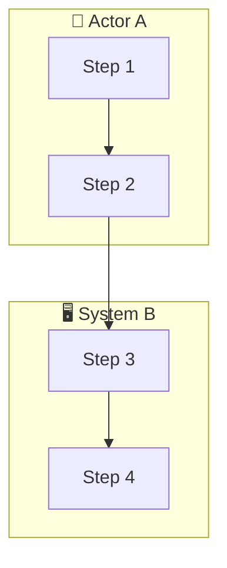
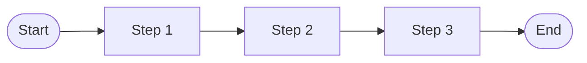
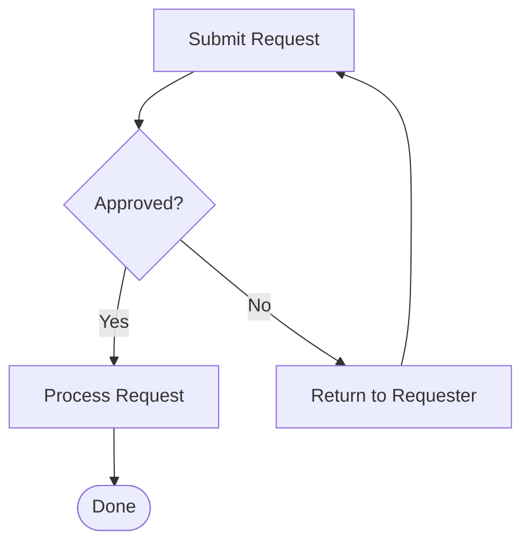
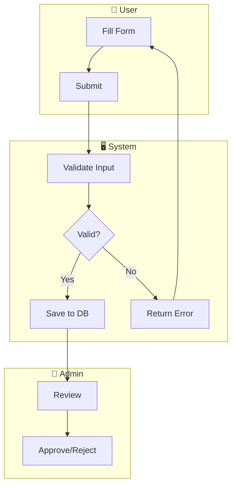
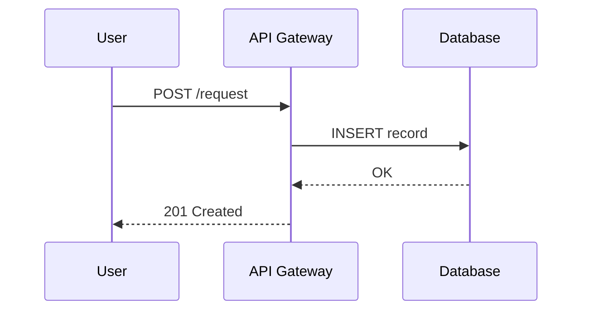

# Workflow Designer

Transform any input — image, document, or conversation — into a clear, accurate, and detailed Mermaid diagram.

---

## Step 0: Read the Input

Before doing anything else, identify what the user has provided:

| Input type | What to do |
|---|---|
| **Image** (screenshot, photo, whiteboard) | Use visual reasoning to extract all visible actors, steps, arrows, labels, decision points, and annotations. Describe what you see before modeling it. |
| **Document** (PDF, DOCX, spreadsheet, table) | Extract process steps, responsible parties, conditions, timings, and exceptions. Prioritize numbered lists, tables with roles/steps, and section headings that describe phases. |
| **Chat / conversation / verbal description** | Identify the implicit sequence, actors, and decisions. Ask ONE clarifying question if a critical actor or decision point is ambiguous. Otherwise proceed. |
| **Mixed** | Combine all sources. Cross-reference for consistency — flag contradictions before proceeding. |

If the input is completely ambiguous (no discernible sequence or process), ask: *"Can you tell me more about what process you'd like to visualize?"*

---

## Step 1: Extract Workflow Components

Before drawing anything, mentally extract these components from the input:

### 1.1 Actors / Swimlanes
Who or what performs actions? These become swimlane labels or node prefixes.
- People (roles, departments, users)
- Systems (APIs, databases, services)
- External entities (third parties, regulators)

### 1.2 Steps / Nodes
Each discrete action, task, or state. Use active verb phrases:
- ✅ "Submit Request", "Validate Data", "Send Notification"
- ❌ "Request", "Data", "Notification"

### 1.3 Decision Points
Any point where the flow branches based on a condition:
- Yes/No gates, approvals, validations, thresholds
- Each decision must have at least 2 labeled exits

### 1.4 Flow Connections
How steps connect: sequential, parallel, loop-back, conditional.

### 1.5 Start & End Points
Every workflow must have at least one Start and one End (terminal state).

### 1.6 Exceptions & Error Paths
Rejection flows, error handling, timeout paths, escalation routes.
Don't omit these — they're often the most important part of a real workflow.

---

## Step 2: Choose the Right Mermaid Diagram Type

Select based on what best represents the process:

| Process type | Diagram type | Mermaid keyword |
|---|---|---|
| General step-by-step process | Flowchart | `flowchart TD` or `flowchart LR` |
| Multi-actor / cross-department process | Flowchart with subgraphs (swimlanes) | `flowchart TD` + `subgraph ActorName` |
| System interactions / API calls | Sequence diagram | `sequenceDiagram` |
| Object/entity states and transitions | State diagram | `stateDiagram-v2` |
| Time-based phases / project stages | Gantt chart | `gantt` |
| User journey with satisfaction | User journey | `journey` |
| Hierarchical breakdown | Mind map | `mindmap` |

**Default: use `flowchart TD` with subgraphs for swimlanes** — it's the most readable and widely renderable format.

---

## Step 3: Apply Mermaid Diagram Best Practices

### Node Shape Conventions
```
[Rectangle]           → Regular process step
([Rounded rectangle]) → Start / End terminal
{Diamond}             → Decision / gateway
[(Cylinder)]          → Database / data store
((Circle))            → Event / trigger
>Asymmetric<          → Document / output artifact
```

### Layout Direction
- `TD` (top-down): best for approval flows, hierarchical processes, short-to-medium flows
- `LR` (left-to-right): best for pipelines, data flows, long sequential processes

### Swimlane Pattern (multi-actor)


### Labeling Rules
- Decision exits: always label edges (e.g., `-->|Yes|`, `-->|Rejected|`, `-->|Timeout|`)
- Keep node labels short (≤5 words) — put detail in a comment or prose summary
- Use consistent casing (Title Case for nodes)
- Avoid special characters in node IDs (use alphanumeric + underscores only)

### ⚠️ Syntax Safety Rules (critical for rendering)
- **No emoji in subgraph labels** — `subgraph HR[HR Department]` ✅ not `subgraph HR[👥 HR]` ❌
- **No special characters in edge labels** — use `plus` not `+`, use `and` not `&`, avoid colons in labels
- **Sequence diagram alt/else** — use plain text inside `alt`/`else` blocks, no special chars
- **No quotes in node IDs** — node IDs must be alphanumeric: `HR1`, `Step_2`, not `"step 1"`
- **Subgraph node connections** — cross-subgraph arrows must be written OUTSIDE all subgraph blocks
- Always render using `Mermaid Chart:validate_and_render_mermaid_diagram` tool — never output raw code blocks only

### Styling (optional but recommended for clarity)
```mermaid
  style NodeID fill:#color,stroke:#color,color:#fff
  classDef errorPath fill:#fee2e2,stroke:#dc2626,color:#7f1d1d
  classDef successPath fill:#dcfce7,stroke:#16a34a,color:#14532d
  classDef decision fill:#fef9c3,stroke:#ca8a04,color:#713f12
```

---

## Step 4: Draft and Validate the Diagram

Write the Mermaid code. Then self-check:

**Completeness checklist:**
- [ ] Every actor from the source is represented
- [ ] Every step/task is a node (nothing collapsed or skipped)
- [ ] All decision points have ≥2 labeled exits
- [ ] There is exactly one Start terminal; end terminals cover all terminal paths
- [ ] Exception/error/rejection paths are present if source mentions them
- [ ] Loops and retry paths are shown with back-arrows
- [ ] No "floating" nodes (every node connects to at least one other node)

**Accuracy checklist:**
- [ ] Step sequence matches the source exactly (don't reorder without noting it)
- [ ] Actor assignments match source (don't infer ownership without stating it)
- [ ] Condition labels match source language

**Readability checklist:**
- [ ] Node IDs are unique and descriptive
- [ ] Labels are concise (≤5 words per node)
- [ ] Swimlane groupings are logical
- [ ] Flow direction is consistent

---

## Step 5: Render and Explain

Always render using the `Mermaid Chart:validate_and_render_mermaid_diagram` tool.

After the diagram, provide a brief prose summary:

```
### Workflow Summary
**Process:** [Name]
**Actors:** [list]
**Steps:** [count] main steps, [count] decision points
**Key paths:**
- Happy path: [describe in 1 sentence]
- Exception paths: [describe briefly]
**Assumptions / gaps noted:** [anything inferred or missing from source]
```

If you had to make assumptions (because the source was ambiguous), list them explicitly. Offer to refine.

---

## Step 6: Offer Refinements

After presenting the diagram, offer:
1. **Add detail** — expand any step into a sub-flow
2. **Change format** — switch to sequence diagram, state diagram, etc.
3. **Add swimlanes** — if not already present
4. **Export** — offer to save as a `.md` file with embedded Mermaid for documentation use
5. **Adjust scope** — zoom in on a specific phase

---

## Reference: Common Workflow Patterns

### Linear Process


### Approval Gate


### Multi-Actor Swimlane


### System Sequence


---

## Notes on Input Quality

- **Low-quality images** (blurry, partial): extract what's visible, flag what's unclear, ask for confirmation before assuming
- **Unstructured chat**: look for verbs (submit, approve, validate, send) as implicit steps; nouns (user, manager, system) as actors
- **Contradictory documents**: flag the contradiction clearly before picking one interpretation
- **Very large processes** (>30 steps): split into phases; diagram each phase separately with a top-level overview diagram first
